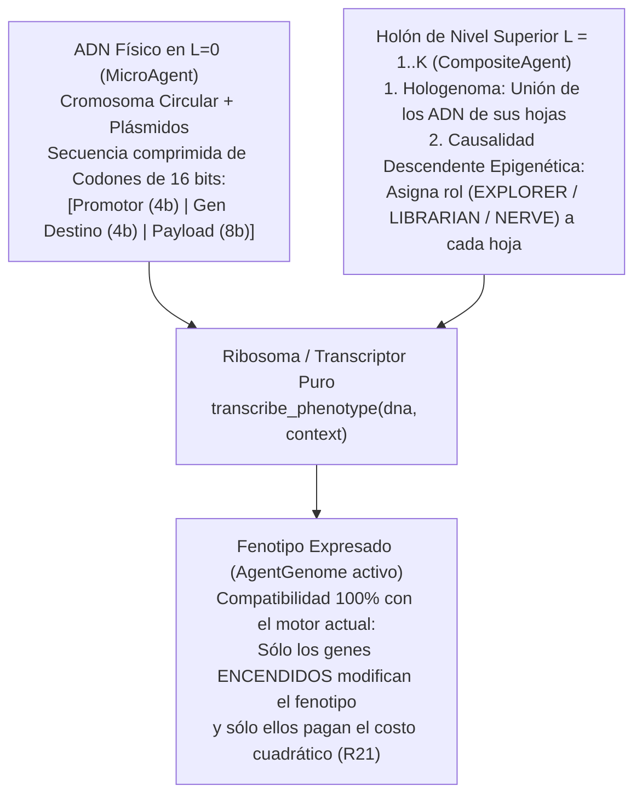

# Arquitectura de ADN Bacteriano Comprimido, Epigenética Multinivel y Plásmidos (`CompactDNA` — Fase II-B / v2.5)

> **Propósito de este documento:** Definir la arquitectura formal y técnica del sistema genético comprimido (`CompactDNA`) que se implementará **inmediatamente al finalizar la Fase II (`v2.0`)**, evolucionando el vector fenotípico plano actual (`AgentGenome` de 7 parámetros) hacia un código genético bacteriano real con **codones de 16 bits, operones condicionales, diferenciación epigenética en holones ($L = 0 \dots K$), transferencia horizontal de plásmidos (HGT) y senescencia telomérica**.

---

## 1. Motivación Científica y Empírica (Lecciones de la Fase II)

En la Fase II (`v2.0`), la herencia genética ($R_{13}$) se modela mediante `AgentGenome`: una tupla inmutable de 7 hiperparámetros escalares ($\alpha, \gamma, \epsilon, \omega_{\text{bond}}, C_{\max}, r_{\text{perc}}, r_{\text{com}}$). Si bien este modelo permite cerrar los protocolos pre-registrados `002` y `003`, presenta **cuatro límites biológicos estructurales** que `CompactDNA` resuelve de raíz al cierre de la Fase II:

1. **Ausencia de Compresión y Regulación Génica (Genotipo $=$ Fenotipo en `v2.0`):**
   - En `v2.0`, un agente con $C_{\max} = 6$ paga el costo metabólico cuadrático ($R_{21}$) todo el tiempo, esté suelto ($L=0$) o dentro de un holón ($L \ge 1$).
   - En las bacterias reales, el ADN almacena información altamente comprimida mediante **operones**: secuencias de genes con un *promotor* que permanecen **dormidos (costo metabólico $\approx 0$)** y sólo se transcriben cuando el entorno o el nivel holónico lo requiere.
2. **Diferenciación Celular Lenta en Holones ($L \ge 1$):**
   - En `v2.0`, cuando un holón se reproduce simbióticamente (`reproduce_holon`, $R_{17}$), sus hojas nacen con genomas casi idénticos y dependen de mutaciones aleatorias lentas para especializarse.
   - Con **Operones Epigenéticos**, todas las células de un organismo pluricelular ($L = 2 \dots 5$) pueden portar **exactamente el mismo ADN en $L=0$**, pero expresar instantáneamente castas distintas (*Explorador*, *Bibliotecario*, *Nervio*) según la señal descendente del holón ($R_{18}$ ampliada).
3. **Falta de Evolución Horizontal en Vida (Plásmidos / Conjugación Bacteriana):**
   - Las bacterias reales no esperan a reproducirse ($g \to g+1$) para compartir adaptaciones: intercambian **plásmidos** (anillos cortos de ADN funcional) de par a par en vida.
4. **El "Tapón de Matusalén" en Abundancia de Recursos (Ausencia de Telómeros / Senescencia):**
   - Como demostró la calibración empírica de la Fase II (`resources_per_pattern >= 40`), cuando abundan los recursos y no existe envejecimiento celular, las primeras 2–3 generaciones saturan el cupo `max_population = 160` y sobreviven indefinidamente ($E_i > 0$), deteniendo el recambio generacional. Incorporar **telómeros** en el ADN introduce senescencia programada y garantiza rotación evolutiva continua en cualquier régimen ecológico.

---

## 2. Principio de Escala: ¿Tienen ADN los Niveles Superiores ($L \ge 1$)?

Siguiendo el principio libre de escala de [`ESCALA_BIOLOGICA_HOLONICA.md`](ESCALA_BIOLOGICA_HOLONICA.md):

> **El ADN físico (`CompactDNA`) reside única y exclusivamente en las unidades mínimas ($L = 0$, `MicroAgent`). Los niveles superiores ($L = 1 \dots K$, `CompositeAgent`) NO poseen una estructura de ADN separada; su genética emerge del Hologenoma (la unión del ADN de sus hojas) y del Epigenoma (qué operones del ADN de $L=0$ enciende cada nivel superior).**



---

## 3. Especificación Formal del Codón de 16 bits (`2 bytes`)

Cada instrucción genética elemental es un **Codón** empaquetado en un entero inmutable de 16 bits sin signo (`uint16`, `0x0000` a `0xFFFF`):

$$\text{Codon} \in \{0, \dots, 65535\} \Longleftrightarrow \underbrace{\text{PROM}}_{4\text{ bits (15..12)}} \;\Big|\; \underbrace{\text{TARGET}}_{4\text{ bits (11..8)}} \;\Big|\; \underbrace{\text{PAYLOAD}}_{8\text{ bits con signo (7..0)}}$$

### 3.1. Campo `PROM` — Promotor Epigenético (`bits 15..12`, 16 condiciones)

Determina bajo qué condición ambiental o jerárquica se transcribe el codón:

| Código (`4 bits`) | Nombre Simbólico | Condición de Activación ($\mathbb{I}_{\text{prom}}(\text{context}) = 1$) |
| :---: | :--- | :--- |
| `0x0` | `ALWAYS_BASAL` | Activo siempre, en cualquier nivel $L \ge 0$ (metabolismo y aprendizaje basal). |
| `0x1` | `SOLITARY_L0` | Activo **sólo** cuando el agente vive libre ($L = 0$). Se silencia al unirse a un holón. |
| `0x2` | `IN_HOLON_L1_PLUS` | Se enciende cuando la hoja pertenece a cualquier holón ($L \ge 1$, Célula Eucariota o superior). |
| `0x3` | `IN_HOLON_L2_PLUS` | Se enciende sólo en tejidos, órganos u organismos ($L \ge 2$). |
| `0x4` | `IN_HOLON_L4_PLUS` | Se enciende sólo en sistemas y super-organismos complejos ($L \ge 4$). |
| `0x5` | `ROLE_EXPLORER` | Se enciende cuando el holón asigna a la hoja la casta epigenética **Exploradora** ($r_{\text{perc}} \uparrow$). |
| `0x6` | `ROLE_LIBRARIAN` | Se enciende cuando el holón asigna a la hoja la casta **Bibliotecaria** ($C_{\max} \uparrow$). |
| `0x7` | `ROLE_NERVE` | Se enciende cuando el holón asigna a la hoja la casta **Nervio / Enlace** ($r_{\text{com}} \uparrow$). |
| `0x8` | `STRESS_LOW_ENERGY` | Operón de supervivencia: se enciende en ayuno crítico ($E_i(t) < 0.35 \cdot E_{\text{reprod}}$). |
| `0x9` | `SURPLUS_HIGH_ENERGY` | Operón de abundancia: se enciende cuando $E_i(t) \ge 0.85 \cdot E_{\text{reprod}}$. |
| `0xA..0xF` | `RESERVED_ENV` | Reservados para señales estigmérgicas ($R_{19}$) y gradientes del eje $Z$ en 3D (Fase III). |

### 3.2. Campo `TARGET` — Rasgo Fenotípico u Operador Funcional (`bits 11..8`, 16 destinos)

Determina qué parámetro del fenotipo o qué operador procedimental modula el codón cuando su promotor está activo:

| Código (`4 bits`) | Destino | Efecto al Expresarse ($\delta = \text{payload} / 128.0 \in [-1.0, +0.992]$) |
| :---: | :--- | :--- |
| `0x0` | `ALPHA_LEARNING` | Modula la tasa de aprendizaje individual: $\alpha = \text{clip}(\alpha_0 + 0.40 \cdot \sum \delta, 0.01, 1.0)$. |
| `0x1` | `GAMMA_DISCOUNT` | Modula el descuento epistémico social: $\gamma = \text{clip}(\gamma_0 + 0.40 \cdot \sum \delta, 0.0, 1.0)$. |
| `0x2` | `EPSILON_EXPLORE` | Modula la curiosidad / exploración: $\epsilon = \text{clip}(\epsilon_0 + 0.35 \cdot \sum \delta, 0.0, 1.0)$. |
| `0x3` | `BOND_AFFINITY` | Modula la propensión simbiótica: $\omega_{\text{bond}} = \text{clip}(\omega_0 + 0.50 \cdot \sum \delta, 0.0, 1.0)$. |
| `0x4` | `MEMORY_CAPACITY` | Modula el tamaño cerebral activo: $C_{\max} = \text{clip}(C_{\max, 0} + \text{round}(3.0 \cdot \sum \delta), 1, C_{\max}^{\text{tope}})$. |
| `0x5` | `PERCEPTION_RADIUS` | Modula el radio sensorial: $r_{\text{perc}} = \text{clip}(r_{\text{perc}, 0} + \text{round}(2.0 \cdot \sum \delta), 1, 4)$. |
| `0x6` | `COMM_RADIUS` | Modula el radio comunicativo: $r_{\text{com}} = \text{clip}(r_{\text{com}, 0} + \text{round}(2.0 \cdot \sum \delta), 1, 4)$. |
| `0x7` | `TELOMERE_LONGEVITY` | Modula la vida máxima antes de senescencia: $T_{\max} = \text{clip}(T_0 + \text{round}(250 \cdot \sum \delta), 150, 1200)$. |
| `0x8..0xF` | `LOGIC_OPERATORS` | **Puente directo a Fase IV:** Codifican operadores formales (`ADD`, `SUB`, `MUL`, `EMA`, `GT`, `AND`, `XOR`, `MATCH`) para el AST del holón. |

---

## 4. Contratos de Dominio (`CompactDNA` y `EpigeneticContext`)

El diseño se integra como un **adaptador generativo puro** por encima de `AgentGenome`, preservando intactas todas las firmas de Fase I y Fase II:

```python
class EpigeneticRole(Enum):
    NONE = "NONE"
    EXPLORER = "EXPLORER"      # Casta sensorial / periférica
    LIBRARIAN = "LIBRARIAN"    # Casta de almacenamiento profundo (C_max alto)
    NERVE = "NERVE"            # Casta de ruteo comunicativo (r_com alto)


@dataclass(frozen=True)
class EpigeneticContext:
    """Contexto celular e intra-holón que gobierna qué promotores se encienden."""
    holon_level: int = 0
    role: EpigeneticRole = EpigeneticRole.NONE
    energy_ratio: float = 1.0       # E_i(t) / E_reprod
    is_endospore: bool = False      # Criptobiosis / dormancia ante escasez extrema


@dataclass(frozen=True)
class CompactDNA:
    """Genotipo bacteriano comprimido en L=0 (Fase II-B / v2.5)."""
    chromosome: tuple[int, ...]        # Tupla de codones uint16 (Herencia Vertical Madre -> Hija)
    plasmids: tuple[int, ...] = ()     # Anillos cortos (0..4 codones uint16) para HGT horizontal
    crispr_memory: tuple[int, ...] = () # Firmas de plásmidos tóxicos/parásitos rechazados (Inmunidad)
```

---

## 5. Dinámica Genética, Inmunológica y Epigenética en el Motor

### 5.1. Transcripción y Costo Metabólico Diferencial ($R_{21}$ Expresada)
- En lugar de pagar por genes dormidos, el agente paga un costo basal minúsculo por replicar/mantener la hebra física de ADN más el costo cuadrático **únicamente del fenotipo expresado en ese tick**:
  $$c_{\text{total}}(i, t) = c_{\text{dna}} \cdot \left(|\text{chromosome}_i| + |\text{plasmids}_i| + |\text{crispr}_i|\right) + c_{\text{base}}\!\left(\text{transcribe}(\text{DNA}_i, \text{context}_i)\right)$$
  donde $c_{\text{dna}} \ll c_{\text{mem}}$. Así, portar genes para niveles superiores ($L \ge 2$) es casi gratis en $L=0$, eliminando la presión selectiva contra la complejidad latente.

### 5.2. Diferenciación Epigenética Intra-Holón (`assign_epigenetic_roles`) y Herencia Mitótica
- **Asignación Descendente:** Cuando un `CompositeAgent` ($L \ge 1$) agrupa hojas, ejecuta una regla determinista de asignación de roles basada en la topología y el estado de memoria de sus hojas:
  1. La hoja con mayor número de patrones únicos de alta confianza recibe `EpigeneticRole.LIBRARIAN` (enciende sus codones `0x6`, expandiendo $C_{\max}$).
  2. La hoja con mayor conectividad espacial hacia el exterior recibe `EpigeneticRole.EXPLORER` (enciende sus codones `0x5`, expandiendo $r_{\text{perc}}$ y reduciendo su gasto en $C_{\max}$).
  3. Las hojas puente reciben `EpigeneticRole.NERVE` (encienden sus codones `0x7`, expandiendo $r_{\text{com}}$).
- **Memoria Epigenética Mitótica (Impronta Madre $\to$ Hija):** Cuando una hoja especializada se divide dentro de un holón, la hija nace heredando por defecto la marca epigenética (`role`) de su madre, evitando perder ticks de especialización hasta que el nivel superior ($R_{18}$) requiera reprogramarla.

### 5.3. Los 4 Operadores Evolutivos sobre `CompactDNA` (usando `evo_rng`)
1. **Mutación de Punto (SNP):** Con probabilidad $\mu_{\text{snp}}$, invierte o desplaza bits en un codón del cromosoma (puede cambiar la intensidad `PAYLOAD`, el rasgo `TARGET` o el interruptor `PROM`).
2. **Duplicación Génica (*Gene Duplication*):** Con probabilidad $\mu_{\text{dup}}$ (si $|\text{chromosome}| < L_{\max}$), duplica un codón existente. Una copia mantiene la función original mientras la otra queda libre para mutar su promotor o destino (**neofuncionalización**).
3. **Deleción (Compactación Genómica):** Con probabilidad $\mu_{\text{del}}$ (si $|\text{chromosome}| > L_{\min}$), elimina un codón, premiando genomas compactos y eficientes.
4. **Conjugación Bacteriana de Plásmidos (HGT Horizontal en Vida):**
   - Cuando dos agentes co-localizados (o miembros del mismo holón) interactúan y el donante supera un umbral de éxito energético, copia su plásmido más activo al receptor sin necesidad de esperar a la reproducción vertical.

### 5.4. Inmunidad Genética tipo CRISPR-Cas (Defensa contra Plásmidos Parásitos)
- Al recibir un plásmido nuevo por HGT, el agente registra su nivel de energía inicial $E_{\text{ingreso}}$ y abre una ventana de prueba de $K_{\text{eval}}$ ticks:
  - Si el codón ya figura en `crispr_memory`, el agente **bloquea su ingreso** de inmediato.
  - Si tras $K_{\text{eval}}$ ticks el balance energético $\Delta E = E_i(t) - E_{\text{ingreso}} < -\theta_{\text{tox}}$, la enzima Cas digital **escinde y destruye el plásmido** de `plasmids` e inserta su codón en `crispr_memory` (hasta un tope FIFO de 4 espaciadores), transmitiendo además esa inmunidad a su descendencia vertical.

### 5.5. Esporulación Bacteriana / Criptobiosis (`ENDOSPORE` ante Escasez Extrema)
- Solución biológica al cuello de botella de extinción en desiertos ecológicos (`resources_per_pattern <= 10`):
  - Cuando $E_i(t) \le E_{\text{espora}}$ y el agente no percibe ningún recurso benéfico ni rastro estigmérgico positivo en su vecindad, el operón `STRESS_LOW_ENERGY` (`0x8`) activa el estado **Endospora** (`is_endospore = True`).
  - **Física de la Endospora:** El agente permanece inmóvil (`IDLE`), silencia la expresión de sus radios y memoria activa, y reduce su gasto metabólico total al mínimo de supervivencia ($c_{\text{espora}} = 0.05 \cdot c_{\text{fijo}}$).
  - **Germinación:** Apenas reaparece un recurso en su celda o se deposita un rastro estigmérgico positivo ($R_{19}$), la endospora germina (`is_endospore = False`) y restaura su transcripción normal.

### 5.6. Respuesta SOS: Tasa de Mutación Adaptativa regulada por Estrés
- En lugar de una tasa de mutación ciega y constante, la fidelidad de copia de `CompactDNA` depende del estado metabólico del progenitor:
  $$\mu_{\text{efectiva}}(i) = \begin{cases} 0.25 \cdot \mu_{\text{base}} & \text{si } E_i(t) \ge E_{\text{reprod}} \text{ y superávit reciente (Reparación de Alta Fidelidad)} \\ 4.00 \cdot \mu_{\text{base}} & \text{si estrés energético o shock ambiental (Hipermutación SOS)} \\ \mu_{\text{base}} & \text{en régimen normal} \end{cases}$$
- Preserva los genomas campeones en estabilidad y acelera $16\times$ la exploración evolutiva frente a crisis o inversiones de reglas del mundo (`Exp 005`).

### 5.7. Telómeros y Senescencia Celular (Solución al "Tapón de Matusalén")
- Cada `MicroAgent` lleva un contador `age_ticks: int`.
- Al superar la longevidad expresada por sus codones teloméricos ($T_{\max}$), el agente entra en **senescencia**: su costo metabólico basal se incrementa progresivamente ($\Delta c_{\text{senescencia}} \propto (\text{age\_ticks} - T_{\max})^2$) hasta agotar su energía y morir.
- **Efecto ecológico:** Incluso en entornos de altísima abundancia (`resources_per_pattern = 40` u `80`), ninguna generación puede monopolizar eternamente el cupo `max_population`, garantizando evolución continua ($g \to \infty$).

### 5.8. Trinquete Simbiótico Evolutivo (*Symbiotic Ratchet*): De Alianza Reversible a Organismo Indisoluble
- En la naturaleza existen dos regímenes de asociación jerárquica (Maynard Smith & Szathmáry):
  1. **Alianza Facultativa (Holón Joven / Reversible):** Un `CompositeAgent` recién formado por `BOND` (`formed_by_bond = True`, generación simbiótica $0$) es una alianza de prueba: si no genera superávit en `holon_split_patience` ticks, se disuelve un escalón ($L \to L-1$) mediante `SPLIT` ($R_{16}$).
  2. **Organismo Consolidado (Trinquete Simbiótico / Irreversible, `is_locked = True`):** Cuando un holón supera un umbral de consolidación evolutiva —por haberse reproducido como unidad simbiótica (`reproduce_holon`, $R_{17}$) o haber completado $K_{\text{lock}}$ tareas compuestas con diferenciación epigenética activa ($R_{25}$)— sus enlaces internos quedan **soldados (`is_locked = True`)**.
- **Efecto arquitectónico:** Un nodo con `is_locked = True` ya **no se desarma por `SPLIT`** (sus hojas cedieron autonomía para especializarse como órganos del conjunto) y recibe un descuento de madurez en su costo de coordinación ($\eta_{\text{lock}} \cdot c_{\text{coord}}$), convirtiéndose en un ladrillo estable e indivisible sobre el cual el motor puede ensamblar el nivel jerárquico siguiente ($L+1$).

---

## 6. Inventario de Reglas de Diseño (`R24`–`R30`) y Ablaciones (Cumplimiento de `CLAUDE.md`)

Siguiendo la regla metodológica central del proyecto (*toda capacidad diseñada debe declararse en el inventario con su propósito y su ablación explícita*):

| Regla | `name` | `purpose` (capacidad que se diseñó para producir) | `ablation` |
| :--- | :--- | :--- | :--- |
| `R24` | Codificación genética en codones y operones (`CompactDNA`) | Comprimir rasgos en secuencias con promotores condicionales y pagar costo $R_{21}$ sólo por los genes expresados. | `(("enable_compact_dna", False),)`: revierte al `AgentGenome` plano de Fase II. |
| `R25` | Diferenciación epigenética intra-holón e impronta mitótica | Especializar hojas con el mismo ADN en castas (`EXPLORER`, `LIBRARIAN`, `NERVE`) según su rol en el holón. | `(("enable_epigenetic_roles", False),)`: todas las hojas mantienen `EpigeneticRole.NONE`. |
| `R26` | Transferencia horizontal de plásmidos (HGT) | Compartir codones ventajosos en vida entre pares sin esperar a la reproducción vertical. | `(("enable_plasmid_hgt", False),)` |
| `R27` | Inmunidad genética CRISPR-Cas | Purgar plásmidos con balance energético negativo y bloquear su reinfección. | `(("enable_crispr_immunity", False),)` |
| `R28` | Esporulación bacteriana (`ENDOSPORE`) | Reducir el gasto metabólico en hambruna extrema hasta que reaparezcan estímulos locales. | `(("enable_sporulation", False),)` |
| `R29` | Senescencia telomérica y mutación SOS adaptativa | Garantizar recambio generacional bajo abundancia (`Telómeros`) y modular la tasa de mutación según el estrés (`SOS`). | `(("enable_telomere_senescence", False), ("enable_sos_mutation", False))` |
| `R30` | Trinquete simbiótico evolutivo (*Symbiotic Ratchet*) | Soldar (`is_locked = True`) los holones consolidados por reproducción simbiótica o especialización para que actúen como individuos indivisibles del nivel siguiente. | `(("enable_symbiotic_ratchet", False),)` |

---

## 7. Plan de Ejecución al Cerrar la Fase II (`v2.0` $\to$ `v2.5`)

Sí: **podemos implementarlo exactamente al terminar el Bloque 7 de la Fase II**, antes de pasar al cubo 3D de la Fase III, como un cambio OpenSpec autocontenido (`ide-v25-compact-dna-and-epigenetics`):

1. **Paso 1 (Hoy):** Claude cierra el Bloque 7 de la Fase II (`v2.0`) con `resources_per_pattern = 20` (Opción A) y archiva los resultados pre-registrados de `002` y `003`.
2. **Paso 2 (Fase II-B / `v2.5`):** Abrimos el cambio OpenSpec de `CompactDNA`:
   - Nuevo módulo `src/ide/agent/dna.py` (`CompactDNA`, `EpigeneticRole`, `EpigeneticContext`, `transcribe_phenotype`, mutación por SNP/duplicación/deleción + SOS, conjugación de plásmidos con inmunidad CRISPR, esporulación y senescencia telomérica).
   - Retrocompatibilidad total: si `enable_compact_dna=False` (por defecto), el motor usa el `AgentGenome` directo de Fase II sin alterar un solo test ni hash previo.
   - Nuevos experimentos **Exp 002-C / 003-C**: miden cómo un holón de clones con **idéntico ADN** se diferencia en castas epigenéticas (*Explorador / Bibliotecario / Nervio*), cómo la esporulación sobrevive en `resources_per_pattern = 10` y cómo la senescencia telomérica destraba las generaciones en `resources_per_pattern = 40 / 80`.

