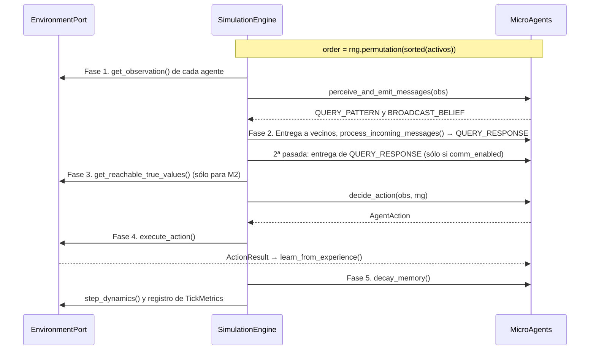

# Especificación de Definiciones Técnicas — Proyecto IDE (v0.3)

Este documento traduce las [Definiciones Formales](DEFINICIONES_FORMALES.md) en una **arquitectura de software concreta**: stack, estructura, contratos de datos, ciclo de ejecución y parámetros.

> **Fuente normativa.** Las firmas exactas, fórmulas y reglas de desempate viven en [`openspec/changes/ide-emergent-distributed-intelligence/design.md`](openspec/changes/ide-emergent-distributed-intelligence/design.md) y los criterios verificables en sus `specs/`. Este documento es un resumen orientativo; ante una discrepancia rigen aquellos.

---

## 1. Stack Tecnológico y Principios de Ingeniería

- **Lenguaje:** Python $\ge 3.11$.
- **Tipado:** Estricto (`typing`, `dataclasses`, `Protocol`, `Enum`).
- **Dependencias del núcleo:** biblioteca estándar + `numpy` (generador reproducible `np.random.Generator(np.random.PCG64(seed))` y agregaciones).
- **Testing y análisis:** `pytest` con `pytest-cov` (cobertura) e `hypothesis` (pruebas por propiedades con generación reproducible); exportación JSON y CSV desacoplada del motor.
- **Calidad estática:** `ruff` (lint y formato) y `pyright` en modo estricto sobre `src/`. Un bloque de trabajo sólo se cierra con las cuatro verificaciones en verde.
- **Rendimiento:** paralelismo entre corridas independientes (`--jobs N`, con salida idéntica para cualquier `N`), una línea base medida (`ide.experiments.benchmark`) y perfiladores instalados (`py-spy`, `line_profiler`). No se vectoriza el bucle de agentes sin una medición que lo justifique: cambiaría la arquitectura que permite ablacionar reglas.
- **Arquitectura hexagonal:** el paquete `agent` **tiene prohibido** importar `environments`, `simulation` o `experiments`. Toda interacción pasa por estructuras agnósticas (`Observation`, `AgentAction`, `Message`).
- **Determinismo entre procesos:** Python aleatoriza el hash de `str` por proceso, así que está prohibido iterar un `set` sin `sorted(...)` y toda selección aleatoria opera sobre listas ordenadas.
- **Atribución verificable:** cada regla de diseño del agente se puede desactivar desde `SimulationConfig`, y la plataforma clasifica cada afirmación como programada o emergente (ver §7, protocolo 001-D, y [Definiciones Formales](DEFINICIONES_FORMALES.md) §3.1).
- **Protocolo reemplazable:** toda la semántica de los mensajes vive en `agent/protocol.py`; ningún otro módulo del agente construye ni interpreta mensajes.

---

## 2. Estructura de Directorios del Proyecto

```text
IDE/
├── DOCUMENTO_FUNDACIONAL.md
├── DEFINICIONES_FORMALES.md
├── DEFINICIONES_TECNICAS.md
├── openspec/                        # Propuesta, diseño, specs y tareas (OpenSpec)
├── pyproject.toml
├── src/
│   └── ide/
│       ├── __init__.py
│       ├── config.py                # SimulationConfig (hiperparámetros validados)
│       ├── domain/                  # Contratos puros
│       │   ├── __init__.py
│       │   ├── types.py             # Pattern, KnowledgeUnit, Resource, VisibleResource, Observation, Message, AgentAction, ActionResult
│       │   ├── ports.py             # EnvironmentPort
│       │   └── extensions.py        # Contratos para Exp 002–006
│       ├── agent/                   # Cognición local (agnóstica del espacio)
│       │   ├── __init__.py
│       │   ├── memory.py            # BoundedMemory
│       │   ├── epistemology.py      # Aprendizaje directo y revalidación social (A, B, C)
│       │   ├── protocol.py          # BeliefExchangeProtocol: única semántica de mensajes
│       │   └── micro_agent.py       # MicroAgent
│       ├── environments/
│       │   ├── __init__.py
│       │   └── grid2d.py            # ToroidalGrid2D
│       ├── simulation/
│       │   ├── __init__.py
│       │   └── engine.py            # SimulationEngine (pipeline de 5 fases)
│       └── experiments/
│           ├── __init__.py
│           ├── metrics.py           # TickMetrics, MetricsCollector, M1–M7
│           ├── benchmark.py         # Línea base de rendimiento (ticks por segundo)
│           ├── attribution.py       # Reglas de diseño, afirmaciones, ablación, control nulo y 001-D
│           └── exp001_runner.py     # Protocolos 001-A, 001-B, 001-C y CLI
└── tests/
    ├── test_domain_contracts.py
    ├── test_roadmap_extensions.py
    ├── test_memory.py
    ├── test_epistemology.py
    ├── test_micro_agent.py
    ├── test_grid2d.py
    ├── test_simulation_engine.py
    ├── test_metrics.py
    ├── test_exp001_suite.py
    ├── test_attribution.py
    ├── test_empirical.py            # @pytest.mark.empirical (excluido por defecto)
    └── conftest.py                  # Perfil `ci` de Hypothesis (derandomize=True)
```

---

## 3. Estructuras de Datos (`domain/types.py`)

Todas son `@dataclass(frozen=True)` para evitar mutaciones accidentales de estado compartido.

### 3.1. `Pattern`
Firma observable $\rho$ de un recurso. Tiene orden total (`order=True`) para iterar de forma determinista.
```python
@dataclass(frozen=True, order=True)
class Pattern:
    attributes: tuple[tuple[str, str], ...]  # Ej: (("id", "p_0"),)
```

### 3.2. `KnowledgeUnit` (creencia $k$)
```python
@dataclass(frozen=True)
class KnowledgeUnit:
    pattern: Pattern
    predicted_value: float       # \hat{v} en [-1.0, +1.0]
    confidence: float            # c en [0.0, 1.0]
    evidence_count: int          # n >= 1
    last_updated_tick: int       # \tau
    from_direct_experience: bool # d: True si este agente lo experimentó
```

### 3.3. `Resource` (interno del entorno)
```python
@dataclass(frozen=True)
class Resource:
    resource_id: int
    pattern: Pattern
    true_value: float            # v(r): oculto al agente
```

### 3.4. `VisibleResource` y `Observation` (lo que percibe el agente)
El entorno nunca entrega `Resource`. En su lugar proyecta `VisibleResource`, que no tiene `true_value` y trae una guía de movimiento agnóstica de la geometría:
```python
@dataclass(frozen=True)
class VisibleResource:
    resource_id: int
    pattern: Pattern
    recommended_move: Any        # Primer paso (∈ available_moves) hacia el recurso; None si distance == 0
    distance: int                # Distancia en pasos (Chebyshev en la grilla)
    is_reachable_now: bool       # True sii distance == 0

@dataclass(frozen=True)
class Observation:
    agent_id: int
    tick: int
    visible_resources: tuple[VisibleResource, ...]   # Ordenados por (distance, resource_id)
    available_moves: tuple[Any, ...]
    neighbor_ids: tuple[int, ...]                     # Ascendentes, sin el propio agente
```

### 3.5. `Message`
Este es el protocolo de nivel N0: su semántica viene **predefinida de fábrica**, y es un presupuesto de diseño que se irá retirando ([Documento Fundacional](DOCUMENTO_FUNDACIONAL.md) §8).
```python
class MessageType(Enum):
    QUERY_PATTERN = "QUERY_PATTERN"       # "¿Alguien conoce ρ?"
    QUERY_RESPONSE = "QUERY_RESPONSE"     # "Yo creo esto sobre ρ"
    BROADCAST_BELIEF = "BROADCAST_BELIEF" # Difusión espontánea

@dataclass(frozen=True)
class Message:
    msg_type: MessageType
    sender_id: int
    recipient_id: int | None              # None = todos los vecinos de comunicación
    pattern: Pattern
    belief: KnowledgeUnit | None = None   # Obligatorio en QUERY_RESPONSE y BROADCAST_BELIEF
```

### 3.6. `AgentAction` y `ActionResult`
```python
class ActionType(Enum):
    MOVE = "MOVE"
    INTERACT = "INTERACT"
    IDLE = "IDLE"

@dataclass(frozen=True)
class AgentAction:
    action_type: ActionType
    target: Any = None                    # Movimiento si MOVE, resource_id si INTERACT

@dataclass(frozen=True)
class ActionResult:
    action_type: ActionType
    interacted_pattern: Pattern | None = None
    experienced_value: float | None = None # Sólo si INTERACT tuvo éxito
```

---

## 4. Contrato del Entorno (`domain/ports.py`)

```python
@runtime_checkable
class EnvironmentPort(Protocol):
    def get_active_agent_ids(self) -> list[int]: ...
    def get_observation(self, agent_id: int, tick: int) -> Observation: ...
    def get_communication_neighbors(self, agent_id: int) -> list[int]: ...
    def execute_action(self, agent_id: int, action: AgentAction, tick: int) -> ActionResult: ...
    def remove_agents(self, agent_ids: list[int]) -> None: ...
    def retire_pattern_resources(self, pattern: Pattern) -> None: ...          # Prueba de persistencia (M4)
    def invert_world_rules(self, fraction: float, rng: np.random.Generator) -> list[Pattern]: ...  # Exp 004
    def step_dynamics(self, tick: int) -> None: ...
    def get_world_patterns(self) -> dict[Pattern, float]: ...
    def get_reachable_true_values(self, agent_id: int) -> dict[int, float]: ...  # Sólo telemetría (M2)
```

`get_reachable_true_values` es un oráculo exclusivo del motor para juzgar decisiones; nunca se entrega a un agente.

### Índice espacial en `ToroidalGrid2D`
- `cell_agents: dict[tuple[int, int], set[int]]`
- `cell_resources: dict[tuple[int, int], dict[int, Resource]]`

Consultar vecinos en un radio $R$ inspecciona sólo las $(2R+1)^2$ celdas del radio, con aritmética modular. El costo no depende del tamaño del mapa.

---

## 5. Ciclo de Ejecución por Tick (`simulation/engine.py`)

Cada tick $t$ se ejecuta en **5 fases**. La percepción, la comunicación y la decisión son **simultáneas**: todos ven la misma instantánea y nadie ve lo que otro hace en el mismo tick. El orden de los agentes se baraja una vez por tick con `rng.permutation`; su único efecto sustantivo es resolver por sorteo los conflictos físicos (dos agentes que intentan consumir el mismo recurso). Un esquema alternativo asíncrono (`update_scheme="asynchronous"`) servirá para verificar que ninguna propiedad dependa del reloj de la simulación (criterio E5):



### Recepción de mensajes (Fase 2)
Cada agente responde primero todas las consultas de su bandeja con la memoria que tenía al empezar la fase, y recién después asimila los testimonios recibidos, en el orden de llegada. Como ese orden sigue la permutación del tick, responder antes de asimilar evita que el sorteo altere el contenido de una respuesta.

### Toma de decisión del agente (Fase 3)
Una creencia es **conocida** si su confianza es $\ge c_{\text{umbral}}$. Se consulta primero la memoria y luego las creencias recibidas en el tick.
1. **Recursos en la celda actual:**
   - Si hay alguno conocido como benéfico ($\hat{v} > 0$): `INTERACT` sobre el de mayor $\hat{v} \cdot c$.
   - Si no, y hay alguno no conocido: con probabilidad $\epsilon$, `INTERACT` sobre él (exploración).
   - Nunca interactúa con un recurso conocido como dañino.
2. **Recursos a distancia:** si ve uno conocido como benéfico, `MOVE` hacia su `recommended_move` (el de menor `distance`).
3. **Por defecto:** caminata aleatoria uniforme sobre `available_moves` (`IDLE` si no hay movimientos).

---

## 6. Parámetros de Configuración (`config.py`)

Centralizados en `SimulationConfig` (inmutable, validado en `__post_init__`, serializable con `to_dict()`):

| Parámetro | Nombre en código | Valor base (Exp 001) | Descripción |
| :--- | :--- | :---: | :--- |
| Semilla | `seed` | `42` | Reproducibilidad exacta. |
| Dimensiones | `grid_width`, `grid_height` | `40, 40` | 1.600 celdas toroidales. |
| Población ($M$) | `num_agents` | `80` | Densidad de 5 %. |
| Patrones ($N$) | `num_world_patterns` | `12` | 6 benéficos ($+1.0$) y 6 dañinos ($-1.0$). |
| Recursos por patrón | `resources_per_pattern` | `8` | 96 recursos en el tablero. |
| Capacidad ($C_{\max}$) | `memory_capacity` | `3` | **Restricción crítica:** 3/12 = 25 % del mundo. |
| Radio de percepción | `perception_radius` | `2` | Vecindad de Moore de 5×5. |
| Radio de comunicación | `comm_radius` | `2` | Vecindad de Moore de 5×5. |
| Comunicación activa | `comm_enabled` | `True` | `False` en el modo aislado. |
| Confianza directa inicial | `initial_direct_confidence` | `0.85` | Tras la primera experiencia directa. |
| Aprendizaje de valor ($\alpha$) | `alpha_learning` | `0.40` | Peso de la nueva experiencia en $\hat{v}$. |
| Refuerzo empírico ($\beta_{\text{ref}}$) | `beta_reinforce` | `0.30` | Aumento al confirmar. |
| Castigo por refutación ($\beta_{\text{cast}}$) | `beta_punish` | `0.60` | Caída al ser contradicho por la realidad. |
| Descuento por rumor ($\gamma$) | `gamma_social_discount` | `0.75` | Por cada salto social. |
| Consenso ($\eta_{\text{consenso}}$) | `eta_consensus` | `0.15` | Refuerzo por coincidencia. |
| Duda ($\eta_{\text{duda}}$) | `eta_doubt` | `0.20` | Atenuación por contradicción. |
| Decaimiento de utilidad ($\lambda$) | `lambda_decay` | `0.005` | En $U(k,t)$. |
| Decaimiento pasivo ($\delta$) | `passive_conf_decay` | `0.002` | Pérdida de confianza por tick sin validación. |
| Confianza mínima ($c_{\min}$) | `min_confidence` | `0.05` | Por debajo se purga la creencia. |
| Umbral de decisión ($c_{\text{umbral}}$) | `decision_conf_threshold` | `0.35` | Confianza mínima para actuar. |
| Exploración ($\epsilon$) | `epsilon_explore` | `0.15` | Probabilidad de probar lo desconocido. |
| Broadcasts por tick | `max_broadcast_per_tick` | `1` | Difusión espontánea. |
| Consultas por tick | `max_queries_per_tick` | `2` | Patrones desconocidos consultados. |
| Especialización | `enable_specialization` | `False` | Exp 003 (no implementado). |
| Re-verificación escéptica | `epsilon_recheck` | `0.0` | Exp 004 (no implementado): probar lo que se cree dañino con probabilidad $\epsilon_{\text{recheck}}(1-c)$. |
| Política de τ | `tau_policy` | `"validation"` | Exp 004 (no implementado): `"evidence_age"` hace que τ sea la edad de la evidencia empírica más reciente. |
| Forzar $C_{\max} < N$ | `enforce_memory_constraint` | `True` | Validación de la restricción crítica. |
| Anti-cámara de eco | `anti_echo_enabled` | `True` | `False` ablaciona la regla R6. |
| Navegación | `enable_navigation` | `True` | `False` ablaciona la regla R11. |
| Esquema de actualización | `update_scheme` | `"synchronous"` | `"asynchronous"` (aún no implementado): secuencial aleatorio, para el criterio E5. |
| Control nulo de contenido | `comm_content_null` | `False` | `True` entrega cada creencia con $\hat{v} = \pm 1$ al azar, desde un generador propio (criterio E4). |

Las demás reglas se ablacionan con valores existentes: R3 `passive_conf_decay=0`, R4 `gamma_social_discount=1`, R5 `eta_consensus=0`, R7 `eta_doubt=0`, R8 `max_queries_per_tick=0`, R9 `max_broadcast_per_tick=0`, R10 `epsilon_explore=0`.

---

## 7. Sub-Experimentos del Experimento 001

`exp001_runner.py` ejecuta los protocolos 001-A a 001-C, y desde su CLI invoca 001-D, que vive en `attribution.py`. Cada uno tiene dos perfiles: **quick**, para tests y valores por defecto de las funciones, y **full**, el valor por defecto de la CLI.

| Protocolo | quick | full |
| :--- | :---: | :---: |
| 001-A: ticks totales | 300 | 1000 |
| 001-B: ticks totales / tick de inyección | 300 / 80 | 1000 / 200 |
| 001-C: warmup / ticks post-ablación | 150 / 100 | 500 / 200 |

1. **001-A (Superávit: colectivo vs. aislado):** misma semilla con `comm_enabled=True` y `False`. Compara precisión de decisión (M2) y cobertura accesible a un salto (M1). La cobertura colectiva también se reporta, pero no sirve como criterio: la población aislada también cubre casi todos los patrones. El superávit verifica que los mecanismos de comunicación cumplen su propósito; no es, por sí solo, evidencia de emergencia.
2. **001-B (Falsificación):** inyecta en el 25 % de la población un rumor plantado ($c = 0.95$, `from_direct_experience=False`) que afirma que el patrón benéfico `p_0` es dañino, y mide su prevalencia inicial, pico y final y el tiempo hasta su extinción.
3. **001-C (Daño y persistencia):** ablación del 10, 30, 50 y 70 % en corridas independientes (retención y tiempo de recuperación $T_{\text{rec}}$), y una corrida que elimina al 100 % de los descubridores de `p_0` y retira el estímulo físico, para medir la persistencia puramente social.

4. **001-D (Atribución de emergencia):** para cada afirmación pre-registrada (C1 acceso a conocimiento ajeno, C2 superávit de decisión, C3 inmunidad a la falsedad, C4 persistencia extra-individual) mide la métrica en cuatro variantes (completa, aislada, sin las reglas diseñadas para producirla y control nulo) y la clasifica como `PROGRAMMED`, `EMERGENT`, `ACTIVITY_ARTIFACT`, `NOT_OBSERVED` o `INSUFFICIENT_EVIDENCE`. También mide el aporte de cada regla apagándolas de a una. Se ejecuta con `--attribution`, siempre con el perfil pre-registrado `quick`, y requiere al menos 5 semillas. C1, C2 y C4 son programadas **por construcción** (sus reglas de propósito incluyen toda la comunicación); C3 es la única con prueba empírica genuina.

La CLI acepta varias semillas y reporta media y desvío de cada métrica. Las expectativas funcionales (`python -m pytest -m empirical`) usan las semillas 42 a 46 y una prueba de signo unilateral: con 5 de 5 a favor, p = 1/32.

---

## 8. Criterios de Calidad (Definition of Done)

1. **Memoria:** `BoundedMemory` jamás supera $C_{\max}$ y reemplaza siempre la creencia de menor utilidad, con desempate determinista.
2. **Epistemología:** la refutación directa derrumba una creencia falsa, un rumor sufre el descuento $\gamma$ y, con factor de confianza en el emisor $\le 1$, dos rumores no se inflan mutuamente (ver el riesgo declarado en [DEFINICIONES_FORMALES.md](DEFINICIONES_FORMALES.md) §2.3).
3. **Aislamiento:** `src/ide/agent/` no importa `environments`, `simulation` ni `experiments` (verificado sobre el AST).
4. **Reproducibilidad:** dos ejecuciones con `seed=42` producen métricas idénticas, también en procesos con distinto `PYTHONHASHSEED`.
5. **Hipótesis:** `python -m pytest -m empirical` se ejecuta y su resultado se reporta tal cual, sin ajustar parámetros para que pase.
6. **Protocolo aislado:** dentro de `src/ide/agent/`, sólo `protocol.py` construye `Message` o usa `MessageType` (verificado sobre el AST).
7. **Atribución:** las reglas y afirmaciones se versionan antes de la primera corrida de 001-D, y su tabla de estados se registra tal cual.
8. **Calidad estática y propiedades:** `ruff check`, `ruff format --check` y `pyright` sin errores; los invariantes de memoria, epistemología, grilla y determinismo verificados con Hypothesis.
9. **Paralelismo inocuo:** la CLI produce archivos idénticos con `--jobs 1` y `--jobs N`.
