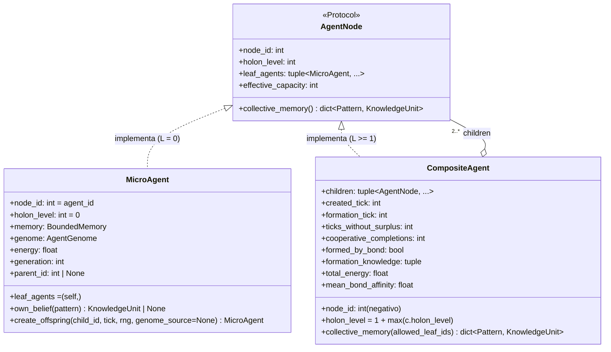
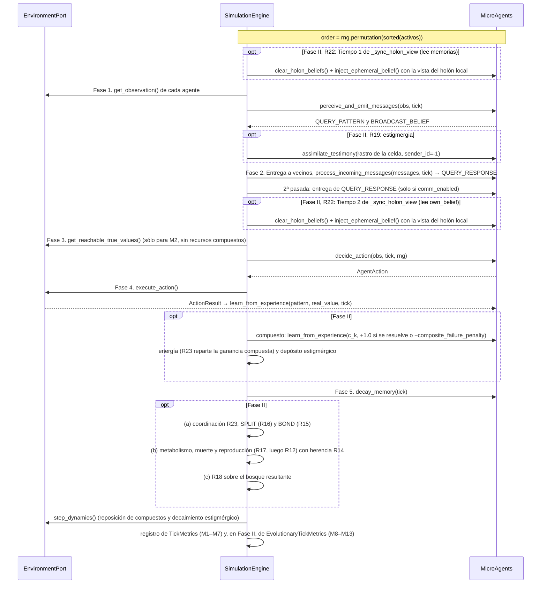

# Especificación de Definiciones Técnicas — Proyecto IDE (v2.0)

Este documento traduce las [Definiciones Formales](DEFINICIONES_FORMALES.md) en una **arquitectura de software concreta**: stack, estructura, contratos de datos, ciclo de ejecución y parámetros.

> **Fuente normativa.** Este documento es un **resumen orientativo**; ante una discrepancia rigen los specs y el design:
> - **Fase I (Experimento 001, implementada y verificada):** criterios verificables en [`openspec/specs/*/spec.md`](openspec/specs/) y firmas, fórmulas y desempates en el design archivado [`openspec/changes/archive/2026-10-17-ide-emergent-distributed-intelligence/design.md`](openspec/changes/archive/2026-10-17-ide-emergent-distributed-intelligence/design.md) (Decisiones D1–D18).
> - **Fase II (Experimentos 002 y 003, especificada, sin implementar):** [`openspec/changes/ide-v2-evolutionary-holonic-intelligence/design.md`](openspec/changes/ide-v2-evolutionary-holonic-intelligence/design.md) (Decisiones D19–D29) es la **fuente única** de firmas, nombres, parámetros, valores por defecto y desempates; los criterios verificables están en los `specs/` de ese cambio.

> **Novedades en la Versión 2.0.** Conserva la especificación implementada de la **Fase I** y resume la arquitectura técnica prevista para la **Fase II**:
> 1. **Patrón *Composite* recursivo (`AgentNode`, en `agent/holon.py`):** `MicroAgent` ($L=0$) y `CompositeAgent` ($L \ge 1$) implementan el protocolo común `AgentNode`, de modo que un `CompositeAgent` agrupa nodos de cualquier nivel sin un tope de profundidad codificado.
> 2. **Metabolismo, linaje y herencia dual (`agent/evolution.py`):** genoma inmutable `AgentGenome`, mutación acotada (`mutate_genome`) y herencia cultural vertical que el motor entrega por `assimilate_testimony`.
> 3. **Recursos compuestos graduados (`CompositeRule`, que ya existe en `domain/extensions.py`):** recursos de orden $m \ge 2$ que exigen conocer $m$ patrones a la vez. Ponen a prueba si la población forma niveles jerárquicos superiores para resolverlos.
> 4. **Compatibilidad regresiva estricta:** todas las banderas de activación de la Fase II valen `False` por defecto y `num_composite_patterns = 0`, de modo que las corridas y los hashes SHA-256 del Experimento 001 permanecen idénticos bit a bit.
>
> **Decisiones tomadas** (2026-10-18, ver "Decisiones tomadas" en `proposal.md` del cambio): **P1 → (a)**, la vista compartida del holón es un canal efímero declarado, con regla y ablación propias ($R_{22}$, §6); **P2 → (b)**, el agente aprende los recursos compuestos por experiencia y el motor no le inyecta nada (§6); **P3**, el pre-registro de la Fase II (reglas $R_{12}$–$R_{23}$, afirmaciones C5–C8, variantes y perfil `phase2`) está versionado en design D29 (§8.4).

---

## 1. Stack Tecnológico y Principios de Ingeniería

- **Lenguaje:** Python $\ge 3.11$.
- **Tipado:** Estricto (`typing`, `dataclasses`, `Protocol`, `Enum`).
- **Dependencias del núcleo:** biblioteca estándar + `numpy` (generador reproducible `np.random.Generator(np.random.PCG64(seed))` y agregaciones).
- **Testing y análisis:** `pytest` con `pytest-cov` (cobertura) e `hypothesis` (pruebas por propiedades con generación reproducible); exportación JSON y CSV desacoplada del motor.
- **Calidad estática:** `ruff` (lint y formato) y `pyright` en modo estricto sobre `src/`. Un bloque de trabajo sólo se cierra con las cuatro verificaciones en verde.
- **Rendimiento:** paralelismo entre corridas independientes (`--jobs N`, con salida idéntica para cualquier `N`), una línea base medida (`ide.experiments.benchmark`) y perfiladores instalados (`py-spy`, `line_profiler`). No se vectoriza el bucle de agentes sin una medición que lo justifique: cambiaría la arquitectura que permite ablacionar reglas. Sin cambiar la semántica, la grilla precalcula una tabla de desplazamientos por vecindad, de percepción y de comunicación (cada una válida desde cualquier celda del toro, así que no crece con el tablero) y el motor reutiliza los vecinos de la observación para rutear los mensajes; una prueba exige historiales idénticos a los de la implementación previa.
- **Arquitectura hexagonal:** el paquete `agent` **tiene prohibido** importar `environments`, `simulation` o `experiments`. Toda interacción pasa por estructuras agnósticas (`Observation`, `AgentAction`, `Message`). En la Fase II, `agent/evolution.py` y `agent/holon.py` quedan sujetos a las mismas auditorías AST (design D20).
- **Determinismo entre procesos:** Python aleatoriza el hash de `str` por proceso, así que está prohibido iterar un `set` sin `sorted(...)` y toda selección aleatoria opera sobre listas ordenadas.
- **Generadores derivados (excepción declarada, design D19):** además del generador principal `engine.rng`, toda operación estocástica nueva usa un generador derivado con `np.random.SeedSequence(seed, spawn_key=(k,))`: `(1,)` `null_rng` del control nulo (ya existe en Fase I), `(2,)` `evo_rng` del motor (mutación y ubicación de descendientes), `(3,)` `_comp_rng` de `ToroidalGrid2D` (ubicación y reposición de recursos compuestos) y `(4,)` `donor_rng` del motor (sólo el sorteo del donante de genoma en la reproducción neutral, aparte para no desplazar `evo_rng`). Cada uno se consume sólo si su mecanismo está activo.
- **Atribución verificable:** cada regla de diseño ($R_1 \dots R_{11}$ en Fase I; $R_{12} \dots R_{23}$ en Fase II) se puede desactivar desde `SimulationConfig`, salvo las nucleares (`R1`, `R2` y `R20`, con ablación vacía), y la plataforma clasifica cada afirmación como programada o emergente (ver §8, protocolo 001-D, y [Definiciones Formales](DEFINICIONES_FORMALES.md) §3.1).
- **Protocolo reemplazable:** toda la semántica de los mensajes vive en `agent/protocol.py`; ningún otro módulo del agente construye ni interpreta mensajes.
- **Jerarquía sin clases por nivel (Fase II):** la jerarquía holónica se representa con el protocolo `AgentNode`; no existen clases por nivel. El ciclo del tick sigue ejecutándose sobre los `MicroAgent` (las hojas), y el motor mantiene aparte el bosque de nodos raíz `root_nodes` que usan la vista compartida del holón, la resolución compuesta y los operadores `BOND`/`SPLIT`.

---

## 2. Estructura de Directorios del Proyecto

Los archivos marcados `[Fase II]` están especificados en el design y todavía no existen.

```text
IDE/
├── DOCUMENTO_FUNDACIONAL.md         # Visión v2.0 (Horizontal + Vertical + Holónica)
├── DEFINICIONES_FORMALES.md         # Modelo matemático v2.0 (Fase I + Fase II)
├── DEFINICIONES_TECNICAS.md         # Arquitectura técnica v2.0 (este documento)
├── RESULTADOS.md                    # Reporte empírico verificable (Exp 001)
├── openspec/                        # Specs vigentes, cambios y archivo (OpenSpec)
├── pyproject.toml
├── src/
│   └── ide/
│       ├── __init__.py
│       ├── config.py                # SimulationConfig (Fase I; [Fase II] campos de D20)
│       ├── domain/                  # Contratos puros
│       │   ├── __init__.py
│       │   ├── types.py             # Pattern, KnowledgeUnit, Resource, VisibleResource, Observation, Message, AgentAction, ActionResult; [Fase II] AgentGenome, StigmergicTrace, HolonSnapshot
│       │   ├── ports.py             # EnvironmentPort (10 métodos); [Fase II] EvolutionaryEnvironmentPort
│       │   └── extensions.py        # TrustStrategyPort, AgentCapabilities, CompositeRule, AgentHyperParams, EvolutionaryPort; [Fase II] mutate_genome, compute_epistemic_synergy
│       ├── agent/                   # Cognición local (agnóstica del espacio)
│       │   ├── __init__.py
│       │   ├── memory.py            # BoundedMemory ([Fase II] set_redundant_patterns, R18)
│       │   ├── epistemology.py      # Aprendizaje directo y revalidación social (A, B, C)
│       │   ├── protocol.py          # BeliefExchangeProtocol: única semántica de mensajes
│       │   ├── micro_agent.py       # MicroAgent (hoja L = 0 de AgentNode en Fase II)
│       │   ├── evolution.py         # [Fase II] genome_from_config, compute_metabolic_cost, transfer_cultural_heritage
│       │   └── holon.py             # [Fase II] AgentNode, CompositeAgent, BOND, SPLIT, R17, R18, poda
│       ├── environments/
│       │   ├── __init__.py
│       │   └── grid2d.py            # ToroidalGrid2D ([Fase II] spawn_agent_near, recursos compuestos, estigmergia)
│       ├── simulation/
│       │   ├── __init__.py
│       │   ├── engine.py            # SimulationEngine (5 fases; [Fase II] trabajo dentro de las fases 1, 2, 4 y 5)
│       │   └── controls.py          # nullify_belief (control nulo de contenido, E4)
│       └── experiments/
│           ├── __init__.py
│           ├── metrics.py           # TickMetrics, MetricsCollector, M1–M7; [Fase II] EvolutionaryTickMetrics, EvolutionaryMetricsCollector, M8–M13
│           ├── benchmark.py         # Línea base de rendimiento (ticks por segundo)
│           ├── attribution.py       # R1–R11, C1–C4, ablación, clasificación y 001-D; [Fase II] R12–R23, C5–C8, perfil phase2
│           ├── exp001_runner.py     # Protocolos 001-A, 001-B, 001-C y CLI
│           ├── exp002_runner.py     # [Fase II] Protocolos 002-A y 002-B y CLI
│           └── exp003_runner.py     # [Fase II] Protocolos 003-A (transición holónica) y 003-B (cobertura colectiva) y CLI
└── tests/
    ├── test_domain_contracts.py
    ├── test_roadmap_extensions.py
    ├── test_memory.py
    ├── test_epistemology.py
    ├── test_micro_agent.py
    ├── test_grid2d.py
    ├── test_simulation_engine.py
    ├── test_metrics.py
    ├── test_exp001_suite.py
    ├── test_attribution.py
    ├── test_controls.py
    ├── test_benchmark.py
    ├── test_performance_equivalence.py  # Huellas SHA-256 del oráculo (Decisión 18; intactas en v2.0)
    ├── test_suite_markers.py            # La corrida por defecto excluye `empirical` y `slow`
    ├── test_empirical.py                # @pytest.mark.empirical (excluido por defecto)
    ├── test_evolutionary_dynamics.py    # [Fase II]
    ├── test_holonic_hierarchy.py        # [Fase II]
    ├── test_exp002_exp003.py            # [Fase II]
    └── conftest.py                      # Perfil `ci` de Hypothesis (derandomize=True)
```

---

## 3. Estructuras de Datos (`domain/types.py` y `domain/extensions.py`)

Todas son `@dataclass(frozen=True)` para evitar mutaciones accidentales de estado compartido. Los tipos de Fase I **no cambian** en la Fase II: un test verifica los campos exactos de `VisibleResource`, y los hashes dorados dependen de los demás.

### 3.1. `Pattern`
Firma observable $\rho$ de un recurso. Tiene orden total (`order=True`) para iterar de forma determinista.
```python
@dataclass(frozen=True, order=True)
class Pattern:
    attributes: tuple[tuple[str, str], ...]  # Ej: (("id", "p_0"),)
```

### 3.2. `KnowledgeUnit` (creencia $k$)
```python
@dataclass(frozen=True)
class KnowledgeUnit:
    pattern: Pattern
    predicted_value: float       # \hat{v} en [-1.0, +1.0]
    confidence: float            # c en [0.0, 1.0]
    evidence_count: int          # n >= 1
    last_updated_tick: int       # \tau
    from_direct_experience: bool # d: True si este agente lo experimentó (False en testimonios, herencia cultural y estigmergia)
```

### 3.3. `Resource` (interno del entorno)
```python
@dataclass(frozen=True)
class Resource:
    resource_id: int
    pattern: Pattern
    true_value: float            # v(r): oculto al agente
```
En la Fase II, un recurso compuesto es un `Resource` ordinario cuyo `pattern` es un patrón compuesto (`c_k`) registrado en las reglas compuestas del entorno (§3.7); no hay un tipo de recurso aparte.

### 3.4. `VisibleResource` y `Observation` (lo que percibe el agente)
El entorno nunca entrega `Resource`. En su lugar proyecta `VisibleResource`, que no tiene `true_value` y trae una guía de movimiento agnóstica de la geometría:
```python
@dataclass(frozen=True)
class VisibleResource:
    resource_id: int
    pattern: Pattern
    recommended_move: Any        # Primer paso (∈ available_moves) hacia el recurso; None si distance == 0
    distance: int                # Distancia en pasos (Chebyshev en la grilla)
    is_reachable_now: bool       # True sii distance == 0

@dataclass(frozen=True)
class Observation:
    agent_id: int
    tick: int
    visible_resources: tuple[VisibleResource, ...]   # Ordenados por (distance, resource_id)
    available_moves: tuple[Any, ...]
    neighbor_ids: tuple[int, ...]                     # Ascendentes, sin el propio agente
```

### 3.5. `Message`
Este es el protocolo de nivel N0: su semántica viene **predefinida de fábrica**, y es un presupuesto de diseño que se irá retirando (Experimento 006; [Documento Fundacional](DOCUMENTO_FUNDACIONAL.md) §7, eje transversal). La Fase II no agrega tipos de mensaje.
```python
class MessageType(Enum):
    QUERY_PATTERN = "QUERY_PATTERN"       # "¿Alguien conoce ρ?"
    QUERY_RESPONSE = "QUERY_RESPONSE"     # "Yo creo esto sobre ρ"
    BROADCAST_BELIEF = "BROADCAST_BELIEF" # Difusión espontánea

@dataclass(frozen=True)
class Message:
    msg_type: MessageType
    sender_id: int
    recipient_id: int | None              # None = todos los vecinos de comunicación
    pattern: Pattern
    belief: KnowledgeUnit | None = None   # Obligatorio en QUERY_RESPONSE y BROADCAST_BELIEF
```

### 3.6. `AgentAction` y `ActionResult`
```python
class ActionType(Enum):
    MOVE = "MOVE"
    INTERACT = "INTERACT"
    IDLE = "IDLE"

@dataclass(frozen=True)
class AgentAction:
    action_type: ActionType
    target: Any = None                    # Movimiento si MOVE, resource_id si INTERACT

@dataclass(frozen=True)
class ActionResult:
    action_type: ActionType
    interacted_pattern: Pattern | None = None
    experienced_value: float | None = None # Sólo si INTERACT tuvo éxito
```
Al interactuar con un recurso compuesto, `execute_action` devuelve `ActionResult(ActionType.INTERACT, comp_pat, rule.composite_value)`, y el motor intercepta el resultado (§6).

### 3.7. Tipos de la Fase II (design D20)
En `domain/types.py` se agregan tres tipos inmutables, sin tocar `VisibleResource`. Los valores por defecto de `AgentGenome` coinciden con los de `SimulationConfig`; el genoma fundador real se construye siempre con `genome_from_config`.
```python
@dataclass(frozen=True)
class AgentGenome:
    alpha_learning: float = 0.40
    gamma_social_discount: float = 0.75
    epsilon_explore: float = 0.15
    bond_affinity: float = 0.60          # \omega_{bond}
    memory_capacity: int = 3             # C_{max, i} (costo metabólico cuadrático)
    perception_radius: int = 2           # r_{perc, i}
    comm_radius: int = 2                 # r_{com, i}

@dataclass(frozen=True)
class StigmergicTrace:
    pattern: Pattern
    sign_value: float                    # sign(v) del valor experimentado
    intensity: float                     # decae con stigmergy_decay
    last_updated_tick: int

@dataclass(frozen=True)
class HolonSnapshot:
    node_id: int
    holon_level: int
    child_node_ids: tuple[int, ...]
    leaf_agent_ids: tuple[int, ...]
    effective_capacity: int
    collective_known_patterns: int
```

`CompositeRule` **ya existe** en `domain/extensions.py` y se reutiliza sin cambios:
```python
@dataclass(frozen=True)
class CompositeRule:
    required_patterns: tuple[Pattern, ...]   # >= 2 patrones, sin repetir
    composite_value: float

    def evaluate(self, known_patterns: set[Pattern] | dict[Pattern, KnowledgeUnit]) -> float | None: ...
```

En `domain/extensions.py` se agregan además dos funciones (que pasan a importar `ide.config`, sin ciclo):
```python
def mutate_genome(genome: AgentGenome, config: SimulationConfig, rng: np.random.Generator) -> AgentGenome: ...
def compute_epistemic_synergy(
    patterns_a: frozenset[Pattern], patterns_b: frozenset[Pattern], mean_bond_affinity: float
) -> float: ...  # |K_a △ K_b| / |K_a ∪ K_b| · mean_bond_affinity; 0.0 si ambos vacíos
```
`mutate_genome` no consume `rng` si `mutation_rate == 0.0` y `discrete_mutation_prob == 0.0`. Con `mutation_rate > 0` extrae 4 normales para $(\alpha, \gamma, \epsilon, \omega_{\text{bond}})$ y recorta $\alpha \in [0.01, 1]$ y el resto a $[0, 1]$. Con `discrete_mutation_prob > 0`, para $C_{\max}$, $r_{\text{perc}}$ y $r_{\text{com}}$, en ese orden, extrae siempre un `random()` y, si salta, un `integers(0, 2)` para el signo, y recorta a las cotas del rasgo ($C_{\max} \in [1, \texttt{max\_genome\_memory\_capacity}]$, y $< N$ si `enforce_memory_constraint`; radios en $[1, (\min(\text{ancho}, \text{alto}) - 1) // 2]$, o el valor parental si ese intervalo es vacío). Los detalles están en design D22.

No hay tipos `LineageRecord` ni `MetabolicState`: la energía, la generación, el progenitor y el genoma son estado del `MicroAgent` (§4.1).

---

## 4. Agentes y Arquitectura Holónica

### 4.1. `MicroAgent` (Fase I; hoja $L = 0$ en la Fase II)
Firmas públicas canónicas de la Fase I, verificadas por `test_firmas_publicas_canonicas` y que la Fase II no modifica (8 métodos y 4 propiedades de sólo lectura):
```python
class MicroAgent:
    def __init__(self, agent_id: int, config: SimulationConfig,
                 trust_strategy: TrustStrategyPort | None = None,
                 protocol: BeliefExchangeProtocol | None = None) -> None: ...
    # Propiedades: agent_id, config, memory, capabilities
    def get_effective_belief(self, pattern: Pattern) -> KnowledgeUnit | None: ...
    def assimilate_testimony(self, belief: KnowledgeUnit, sender_id: int, tick: int) -> KnowledgeUnit: ...
    def perceive_and_emit_messages(self, obs: Observation, tick: int) -> list[Message]: ...
    def process_incoming_messages(self, messages: list[Message], tick: int) -> list[Message]: ...
    def decide_action(self, obs: Observation, tick: int, rng: np.random.Generator) -> AgentAction: ...
    def learn_from_experience(self, pattern: Pattern, real_value: float, tick: int) -> None: ...
    def decay_memory(self, tick: int) -> None: ...
```
`assimilate_testimony` es la **única puerta** del conocimiento social persistente. En la Fase II hay una sola excepción declarada: la vista compartida del holón ($R_{22}$, §4.3), que es efímera y no se fusiona con la memoria. `perceive_and_emit_messages` vacía al empezar el caché efímero del tick (no la vista del holón, que tiene su propio diccionario).

**Agregados de la Fase II** (design D22, D23 y D25; spec delta `micro-agent`): `energy`, `generation`, `parent_id`, `genome`, `node_id` (`== agent_id`), `holon_level` (`0`), `leaf_agents` (`(self,)`), `effective_capacity`, `collective_memory()`, `own_belief(pattern)`, `apply_energy_delta(delta)`, `clear_holon_beliefs()`, `inject_ephemeral_belief(unit)`, `MicroAgent.from_lineage(agent_id, config, genome, energy, generation, parent_id, trust_strategy=None, protocol=None)` y `create_offspring(child_id, tick, rng, genome_source=None)`.
- `__init__` toma `genome_from_config(config)`, `energy = config.initial_energy`, `generation = 0` y `parent_id = None`, sin reemplazar `config` (así `agent.config == config` en Fase I). `from_lineage` deriva la configuración del agente desde el genoma con `dataclasses.replace`.
- `create_offspring` parte la energía (`offspring_energy_share`), muta con `mutate_genome` el genoma de `genome_source` o, si es `None`, el propio (`genome_source` sólo lo pasa la reproducción neutral, Caso 3 de §6) y construye el hijo con `from_lineage`. **No** transfiere creencias: la herencia cultural la entrega el motor (§6).
- **Creencia propia frente a vista del holón:** `own_belief(p)` es la `get_effective_belief` de Fase I (memoria → caché efímero propio). `get_effective_belief(p)` agrega al final la vista del holón del tick (`_holon_tick_beliefs`), y sólo la usan `decide_action` y la decisión de consultar del protocolo. `learn_from_experience` y `assimilate_testimony` parten de `own_belief`, para que la experiencia directa y los testimonios nunca se fusionen con la creencia de un compañero. Las respuestas a consultas y los broadcasts salen sólo de la memoria propia: nadie retransmite la vista del holón. Con la vista vacía, ambas coinciden bit a bit con Fase I (requisito `MODIFIED` del spec delta `micro-agent`).

### 4.2. Protocolo `AgentNode` y `CompositeAgent` (`agent/holon.py`, design D23)
Para que los agentes formen holones ($L=1$) y éstos vuelvan a unirse en niveles $L = 2, 3, \dots, K$ **sin límite codificado de niveles**, se aplica el patrón estructural *Composite*:



```python
@runtime_checkable
class AgentNode(Protocol):
    @property
    def node_id(self) -> int: ...
    @property
    def holon_level(self) -> int: ...
    @property
    def leaf_agents(self) -> tuple[MicroAgent, ...]: ...
    @property
    def effective_capacity(self) -> int: ...
    def collective_memory(self) -> dict[Pattern, KnowledgeUnit]: ...
```

`CompositeAgent`:
- `node_id` sale de un contador decreciente del motor (`next_holon_id`, empieza en `-2`; `-1` es el emisor sintético de la estigmergia): los holones tienen IDs negativos y nunca colisionan con los `agent_id >= 0`.
- `children` tiene al menos 2 nodos de cualquier nivel; `__init__` lanza `ValueError` con menos de 2 hijos o con hojas repetidas entre subárboles.
- `created_tick: int` y `formation_tick: int`: al crearlo, `formation_tick == created_tick`; el motor lo reinicia al tick actual cuando el holón pierde un miembro y sigue siendo holón (M13, §8.5).
- `formed_by_bond: bool` y `formation_knowledge: tuple[tuple[int, frozenset[Pattern]], ...]`: si lo creó `BOND` (no $R_{17}$) y lo que sabía cada hoja al formarse, en pares `(agent_id, K)` ordenados; los fija el motor al crearlo, y `formation_knowledge` se reinicia junto con `formation_tick` (M13, §8.5).
- **Constructor:** `CompositeAgent(node_id, children, created_tick, formed_by_bond)`, con `formation_tick = created_tick` y `formation_knowledge = ()`. `holon.py` nunca calcula $K$ (exige la verdad del mundo): el motor completa `formation_knowledge` al crear el holón (por `BOND` o $R_{17}$) y lo reinicia cuando el holón pierde un miembro. Como `prune_dead_leaves` modifica los árboles en el lugar, `_remove` guarda antes las hojas de cada nodo compuesto y después reinicia los que quedaron con menos; el `tick` es el del paso en curso, o `next_tick` si la poda la piden las perturbaciones entre pasos.
- Propiedades derivadas: `holon_level` $= 1 + \max_c c.\text{holon\_level}$; `leaf_agents` ordenadas por `agent_id`; `effective_capacity` $= \sum_\ell \ell.\text{memory.capacity}$; `total_energy`; `mean_bond_affinity` (media de `leaf.genome.bond_affinity`).
- `collective_memory(allowed_leaf_ids=None)` recorre las hojas (filtradas si se da `allowed_leaf_ids`) y conserva, para cada patrón, la `KnowledgeUnit` que maximiza `(confidence, last_updated_tick, -agent_id)`.

**Cómo escala a cualquier nivel:**
1. **Sin clases por nivel:** dos `MicroAgent` forman un nivel 1; dos holones de nivel 1 forman un nivel 2; un nivel 2 con un nivel 1 o 2 forma un nivel 3, y así inductivamente.
2. **Capacidad colectiva sin violar $C_{\max}$:** cada hoja conserva su `BoundedMemory` con su $C_{\max, \ell}$. La memoria colectiva se calcula en tiempo de ejecución, así que un holón reúne hasta `effective_capacity` creencias y puede cubrir recursos compuestos de orden $m > C_{\max}$. Para resolverlos sólo cuentan las hojas en alcance local (§4.3).
3. **Causalidad descendente ($R_{18}$, `apply_downward_causation`):** con `enable_downward_causation=True`, cada hoja marca como redundantes, con `memory.set_redundant_patterns(redundant, redundancy_penalty)`, los patrones que otra hoja en su alcance local retiene con más confianza (empate: conserva el patrón la hoja de menor `agent_id`). La penalización multiplica $U(k, t)$ y afecta el desalojo, el orden de difusión y el de la herencia cultural. Esta regla **está diseñada para ortogonalizar** las memorias: la ortogonalización que produzca es programada, no espontánea.
4. **Reproducción de holón completo ($R_{17}$, `reproduce_holon`):** cada hoja engendra una hija con `create_offspring`, y el árbol se replica en un nuevo `CompositeAgent` raíz (§6, Fase 5).
5. **Fisión (`SPLIT`, $R_{16}$):** el holón disuelto se reemplaza por sus `children` inmediatos, preservando los sub-holones intermedios.
6. **Poda (`prune_dead_leaves`):** tras una muerte o ablación, un sub-holón con una sola hoja sobreviviente colapsa a ella y uno sin hojas desaparece.

**Firmas públicas** (ninguna recibe el entorno: las distancias llegan calculadas por el motor):
```python
# agent/evolution.py (no importa micro_agent.py)
def genome_from_config(config: SimulationConfig) -> AgentGenome: ...
def compute_metabolic_cost(genome: AgentGenome, config: SimulationConfig) -> float: ...  # c_base
def transfer_cultural_heritage(
    parent_memory: BoundedMemory, child_capacity: int, tick: int, config: SimulationConfig
) -> tuple[KnowledgeUnit, ...]: ...

# agent/holon.py
def prune_dead_leaves(node: AgentNode, alive_ids: set[int]) -> AgentNode | None: ...
def evaluate_bond_candidates(
    roots: Sequence[AgentNode], adjacent_pairs: Sequence[tuple[int, int]], config: SimulationConfig
) -> list[tuple[int, int]]: ...
def should_split_holon(holon: CompositeAgent, config: SimulationConfig) -> bool: ...
def apply_downward_causation(
    holon: CompositeAgent, local_reach: Mapping[int, Sequence[int]], config: SimulationConfig
) -> None: ...
def reproduce_holon(
    holon: CompositeAgent, offspring: Mapping[int, MicroAgent], node_id_source: Callable[[], int], tick: int
) -> CompositeAgent: ...
```

### 4.3. Localidad, `BOND` y `SPLIT` (design D24)
El motor mantiene `root_nodes: dict[int, AgentNode]` (al inicio, cada `MicroAgent` es su propio nodo raíz) y el índice inverso `agent_to_root: dict[int, int]`.
- **Alcance local intra-holón:** dos hojas de un mismo holón están en alcance local si `env.get_agent_distance(a, b) <= max(comm_radius_a, comm_radius_b) + 1`. Sólo esas hojas participan en la vista compartida, la resolución compuesta y la causalidad descendente. Así se evita la "telepatía holónica" a través del toro.
- **Costo de coordinación ($R_{23}$, junto con el reparto de la ganancia compuesta de §6):** por holón raíz, en orden ascendente de `node_id`, $c_{\text{coord}}(U) = \texttt{holon\_coord\_cost} \cdot |U| \cdot L(U)$, repartido en partes iguales entre sus hojas si `enable_evolution=True`. Los sub-holones no pagan aparte, porque $L(U)$ ya pondera la profundidad.
- **Superávit del tick:** hubo una resolución compuesta exitosa en la Fase 4, o la unión de los patrones conocidos (`confidence >= decision_conf_threshold`) de la mayor componente conexa del grafo de alcance local supera la mejor memoria individual. Sin superávit, `ticks_without_surplus += 1`.
- **`SPLIT` ($R_{16}$):** con `enable_holon_splitting=True`, el holón se disuelve si `ticks_without_surplus >= holon_split_patience` o `total_energy < |U| · holon_min_energy_per_leaf`.
- **`BOND` ($R_{15}$):** dos nodos raíz son candidatos si su masa combinada no supera `max_holon_leaves` y alguna hoja de cada uno está a distancia $\le 1$. Su puntaje es $\mathcal{S}_{\text{comp}}(\mathcal{K}_a, \mathcal{K}_b) \cdot (\bar{\omega}_a + \bar{\omega}_b)/2$, con $\mathcal{S}_{\text{comp}}$ la distancia de Jaccard entre los patrones conocidos de sus memorias colectivas. Los pares con puntaje `>= holon_bond_threshold` se ordenan por `(-score, a, b)` y se fusionan en un emparejamiento codicioso sin solapamiento.

- **Vista compartida del holón ($R_{22}$, decisión P1 resuelta por la variante (a), design D25):** es un canal de conocimiento social **efímero y declarado**: cada hoja ve en el tick lo que saben las hojas de su holón raíz en alcance local, sin copiarlo a su memoria. Es la única excepción a la regla de que el conocimiento social entra sólo por `assimilate_testimony`, y se justifica porque no persiste, no pasa por la fusión epistémica y se puede apagar. Se controla con `enable_holon_view` (por defecto `True`; sólo actúa con `enable_holonic_hierarchy=True`). Con `enable_holon_view=False`, los holones siguen existiendo (`BOND`, `SPLIT`, energía y resolución compuesta), pero sus miembros no ven el conocimiento ajeno. El motor la sincroniza en dos tiempos con `_sync_holon_view` (§6).

---

## 5. Contrato del Entorno (`domain/ports.py`)

`EnvironmentPort` conserva **exactamente** sus 10 métodos de Fase I (lo verifica un test):
```python
@runtime_checkable
class EnvironmentPort(Protocol):
    def get_active_agent_ids(self) -> list[int]: ...
    def get_observation(self, agent_id: int, tick: int) -> Observation: ...
    def get_communication_neighbors(self, agent_id: int) -> list[int]: ...
    def execute_action(self, agent_id: int, action: AgentAction, tick: int) -> ActionResult: ...
    def remove_agents(self, agent_ids: list[int]) -> None: ...
    def retire_pattern_resources(self, pattern: Pattern) -> None: ...          # Prueba de persistencia (M4)
    def invert_world_rules(self, fraction: float, rng: np.random.Generator) -> list[Pattern]: ...  # Exp 005
    def step_dynamics(self, tick: int) -> None: ...
    def get_world_patterns(self) -> dict[Pattern, float]: ...
    def get_reachable_true_values(self, agent_id: int) -> dict[int, float]: ...  # Sólo telemetría (M2)
```

`get_reachable_true_values` es un oráculo exclusivo del motor para juzgar decisiones; nunca se entrega a un agente. Sólo `simulation/engine.py` lo referencia (auditoría AST).

**Fase II (design D20).** Los métodos nuevos van en un sub-protocolo, que `ToroidalGrid2D` implementará además de `EnvironmentPort`:
```python
@runtime_checkable
class EvolutionaryEnvironmentPort(EnvironmentPort, Protocol):
    def spawn_agent_near(
        self, agent_id: int, anchor_agent_id: int, rng: np.random.Generator,
        perception_radius: int | None = None, comm_radius: int | None = None,
    ) -> tuple[int, int]: ...
    def set_agent_radii(self, agent_id: int, perception_radius: int, comm_radius: int) -> None: ...
    def get_agent_distance(self, agent_a: int, agent_b: int) -> int: ...      # Chebyshev toroidal
    def get_composite_rules(self) -> dict[Pattern, CompositeRule]: ...
    def deposit_stigmergy(
        self, agent_id: int, pattern: Pattern, value: float, confidence: float, tick: int
    ) -> None: ...
    def get_cell_stigmergy(self, agent_id: int) -> tuple[StigmergicTrace, ...]: ...
    def get_active_stigmergy_cells(self) -> int: ...
```

### Índice espacial en `ToroidalGrid2D`
- `cell_agents: dict[tuple[int, int], set[int]]`
- `cell_resources: dict[tuple[int, int], dict[int, Resource]]`

Consultar vecinos en un radio $R$ inspecciona sólo las $(2R+1)^2$ celdas del radio, con aritmética modular y tabla de desplazamientos precalculada. El costo no depende del tamaño del mapa.

**Agregados de la Fase II en `ToroidalGrid2D` (design D22 y D27):**
- **Radios individuales:** `_agent_radii: dict[int, tuple[int, int]]` y un caché de desplazamientos por radio. Un agente ausente de `_agent_radii` (todos en Fase I) usa las tablas globales sin sobrecosto.
- **`spawn_agent_near`:** toma las 9 celdas `((0, 0), *MOORE_MOVES)` alrededor del ancla, se queda con las de menor ocupación y elige una con una única extracción `best[int(rng.integers(len(best)))]`.
- **Recursos compuestos** (si `num_composite_patterns > 0`, con `_comp_rng`): para $k = 0, \dots$, el patrón `c_k` de orden $m$ = `composite_order` exige `m` patrones benéficos elegidos cíclicamente (`p_k, p_{k+1}, …`) y vale $m^{\texttt{composite\_reward\_exponent}}$. Se generan `composite_resources_per_pattern` instancias, que se reponen en `step_dynamics`.
- **Estigmergia ($R_{19}$):** `cell_stigmergy: dict[Cell, dict[Pattern, StigmergicTrace]]`. Un depósito crea `StigmergicTrace(pattern, sign(value), min(1, stigmergy_deposit_rate · confidence), tick)` y, si ya hay un rastro de ese patrón de un tick anterior, lo reemplaza; si es del mismo tick, conserva el de mayor `(intensity, sign_value)`, de modo que el resultado no depende del orden de la Fase 4. Un depósito con intensidad menor que `min_confidence` reemplaza y se purga en el acto: borra el rastro de ese patrón de un tick anterior y no deja ninguno. Frente a un rastro del mismo tick no cambia nada: la comparación del mismo tick se hace antes que el umbral, y así el resultado no depende del orden. En `step_dynamics(tick)`, cada rastro con `last_updated_tick < tick` pierde `stigmergy_decay` de intensidad y se purga bajo `min_confidence`.

---

## 6. Ciclo de Ejecución por Tick (`simulation/engine.py`)

Cada tick $t$ se ejecuta en **5 fases**; la quinta incluye el olvido. La percepción, la comunicación y la decisión son **simultáneas**: todos ven la misma instantánea y nadie ve lo que otro hace en el mismo tick. El orden de los agentes se baraja una vez por tick con `rng.permutation`; su único efecto sustantivo es resolver por sorteo los conflictos físicos (dos agentes que intentan consumir el mismo recurso). Un esquema alternativo asíncrono (`update_scheme="asynchronous"`, **no implementado**) servirá para verificar que ninguna propiedad dependa del reloj de la simulación (criterio E5).

La Fase II **no agrega fases**: agrega trabajo dentro de las fases 1, 2, 4 y 5, sólo cuando sus banderas están activas (design D21 y D24–D27).



### Recepción de mensajes (Fase 2)
Cada agente responde primero todas las consultas de su bandeja con la memoria que tenía al empezar la fase, y recién después asimila los testimonios recibidos, en el orden de llegada. Como ese orden sigue la permutación del tick, responder antes de asimilar evita que el sorteo altere el contenido de una respuesta.

### Toma de decisión del agente (Fase 3)
Una creencia es **conocida** si su confianza es $\ge c_{\text{umbral}}$. Se consulta `get_effective_belief`: primero la memoria y luego las creencias recibidas en el tick (y, en la Fase II, la vista del holón).
1. **Recursos en la celda actual:**
   - Si hay alguno conocido como benéfico ($\hat{v} > 0$): `INTERACT` sobre el de mayor $\hat{v} \cdot c$.
   - Si no, y hay alguno no conocido: con probabilidad $\epsilon$, `INTERACT` sobre él (exploración).
   - Nunca interactúa con un recurso conocido como dañino. (La re-verificación escéptica `epsilon_recheck`, prevista para el Exp 005, no está implementada.)
2. **Recursos a distancia:** si ve uno conocido como benéfico, `MOVE` hacia su `recommended_move` (el de menor `distance`).
3. **Por defecto:** caminata aleatoria uniforme sobre `available_moves` (`IDLE` si no hay movimientos).

`decide_action` no trata de forma especial a los recursos compuestos (decisión P2 resuelta por la variante (b), design D25 punto 3). Para el agente, un recurso compuesto es un recurso más, con su propio patrón `c_k`: lo ve como `VisibleResource`, lo explora con $\epsilon$ como a cualquier desconocido, lo consulta y lo difunde con el protocolo, y aprende su valor con `learn_from_experience`. El motor **no** le inyecta patrones compuestos ni le informa la estructura de las reglas: sólo él conoce `CompositeRule`, y sólo para resolver la interacción en la Fase 4, igual que conoce `true_value`.

### Trabajo de la Fase II dentro del tick (design D21–D27)
- **Vista del holón en dos tiempos (`_sync_holon_view`, $R_{22}$)**, sólo con `enable_holonic_hierarchy=True` y `enable_holon_view=True`. En cada tiempo, el motor primero calcula la vista de **todos** los agentes y recién después llama, en orden de `agent_id`, a `clear_holon_beliefs()` y a `inject_ephemeral_belief` de cada uno: ningún cálculo lee una inyección del mismo tiempo, así que no hay efectos de orden. La vista de `aid` contiene, para cada patrón, la creencia de mayor `(confidence, last_updated_tick, -agent_id)` entre las hojas de su holón raíz en alcance local, sin contar a `aid`.
  - **Tiempo 1** (Fase 1, antes de `perceive_and_emit_messages`): lee las **memorias** de las hojas, no su caché efímero, que todavía es del tick anterior. Así el protocolo no gasta `QUERY_PATTERN` en lo que el holón ya sabe.
  - **Tiempo 2** (al final de la Fase 2, antes de decidir): lee `own_belief` de las hojas (memoria más caché del tick en curso), para que la decisión de la Fase 3 aproveche lo que cada hoja obtuvo de sus vecinos.
  - Sólo sincroniza la vista del holón: no inyecta patrones compuestos.
- **Estigmergia en la Fase 1** ($R_{19}$, con `enable_stigmergy=True`): cada rastro de la celda del agente se convierte en `KnowledgeUnit(trace.pattern, trace.sign_value, trace.intensity, 1, trace.last_updated_tick, False)` y entra por `assimilate_testimony(unit, sender_id=-1, tick=tick)`. Ocurre **después** de que todos los agentes ejecutaron `perceive_and_emit_messages`, que vacía el caché efímero, y en orden de `agent_id` (design D27).
- **Control nulo aplicado por el motor:** `nullify_belief` vive en `ide.simulation.controls`, que el agente no puede importar. Con `comm_content_null=True`, el motor lo aplica con `null_rng` a todos los canales de la Fase II (vista del holón, estigmergia y herencia cultural) antes de entregar la creencia.
- **M2 sólo sobre recursos elementales:** para que M2 siga siendo objetiva, los recursos compuestos no entran en el `truth` de `judge_decision`. El motor quita de `get_reachable_true_values(aid)` los `resource_id` de las entradas de `observations[aid].visible_resources` cuyo `pattern` está en `env.get_composite_rules()`. Si el resultado queda vacío, o si la acción de `aid` es `INTERACT` sobre un compuesto, el agente no suma oportunidad de decisión en ese tick. El desempeño sobre compuestos se mide con M12.
- **Fase 4, recurso compuesto:** `execute_action` consume el recurso (que se repone en `step_dynamics`) y el motor intercepta el resultado. Arma $\mathcal{K}_{\text{eff}}$ con los patrones que alguna hoja en alcance local de `aid` dentro de su nodo raíz (o sólo `aid`, si no está en un holón) conoce según `own_belief` con `predicted_value > 0` y `confidence >= decision_conf_threshold`, y evalúa `rule.evaluate(K_eff)`. La resolución usa el conocimiento de las hojas aunque $R_{22}$ esté apagada: es física declarada del entorno ("el recurso se libera si el grupo local conoce los fragmentos"), no un canal de conocimiento hacia el agente.
  - **Éxito:** el agente aprende `learn_from_experience(comp_pat, +1.0, tick)`, se incrementa `composite_completions` y, si el nodo raíz es un `CompositeAgent`, también su `cooperative_completions`, y se reinicia su `ticks_without_surplus`. Con `enable_evolution=True`, la ganancia `energy_gain_scale · composite_value` se reparte en partes iguales entre las hojas en alcance local del holón ($R_{23}$); con `holon_energy_sharing=False`, o fuera de un holón, va entera a `aid`. No se agrega a `direct_discoverers` (que rastrea sólo patrones elementales) ni se deposita rastro estigmérgico.
  - **Fracaso:** el agente aprende `learn_from_experience(comp_pat, -composite_failure_penalty, tick)`; con `enable_evolution=True`, eso le cuesta `energy_gain_scale · composite_failure_penalty` de energía. No hay éxito compuesto.
  - El valor que aprende el agente **no es estacionario**: el mismo recurso paga o castiga según lo que sepa su grupo local en ese tick. Es una propiedad declarada del entorno: un individuo solo tenderá a aprender que `c_k` es dañino, y si los holones superan esa trampa es parte de lo que se mide.
- **Fase 4, recurso elemental:** las ganancias de energía ($\eta_E \cdot v$) se acreditan en esta fase. Con `enable_stigmergy=True` y `stigmergy_deposit_rate > 0`, el motor deposita un rastro con la confianza resultante de `learn_from_experience`.
- **Fase 5, en este orden** (design D21 y spec delta `simulation-engine`): (i) `decay_memory` de todos los agentes, igual que en Fase I; (ii) el trabajo de Fase II: (a) costo de coordinación ($R_{23}$), `SPLIT` ($R_{16}$) y `BOND` ($R_{15}$); (b) cobro metabólico, muerte por $E_i \le 0$ (con poda `prune_dead_leaves`) y reproducción ($R_{17}$, luego $R_{12}$) con su herencia cultural ($R_{14}$); (c) causalidad descendente ($R_{18}$) sobre el bosque holónico resultante, de modo que las hojas liberadas por `SPLIT` o por poda pierden la penalización de redundancia antes del tick siguiente; (iii) `env.step_dynamics(tick)`, con la reposición de compuestos y el decaimiento estigmérgico; (iv) registro de `TickMetrics` y de `EvolutionaryTickMetrics` en `engine.evolutionary_history`, **después** de `step_dynamics`, para que `stigmergy_active_cells` refleje el decaimiento del tick y los nacimientos y bajas del tick figuren en sus métricas. Con el paso (ii) inactivo, la secuencia de Fase I no cambia.
- **Metabolismo ($R_{20}$, física metabólica nuclear, con el costo cuadrático $R_{21}$; design D21):** $E_i(t+1) = E_i(t) + \eta_E r_i(t) - c_{\text{base}}(i) - c_{\text{move}} \mathbb{I}(\text{mov}) - c_{\text{msg}} m_i(t) - c_{\text{coord\_share}}(i, t)$, con $c_{\text{base}}(i) = c_{\text{fijo}} + c_{\text{mem}} C_{\max, i}^2 + c_{\text{sens}}(r_{\text{perc}, i}^2 + r_{\text{com}, i}^2)$. $r_i(t)$ es el valor real experimentado: `true_value` de un recurso elemental, `-composite_failure_penalty` en un intento compuesto fallido, o la fracción recibida de un compuesto resuelto. Las ganancias y penalizaciones por recursos se acreditan en la Fase 4; el costo de coordinación, en el paso (a) de la Fase 5; el basal, el de movimiento y el de mensajes, en el paso (b). No hay tope superior de energía. `_remove` (por muerte o por `ablate_population` / `ablate_discoverers`) poda `root_nodes` y reconstruye `agent_to_root`.
- **Reproducción (design D26):** a lo sumo un evento reproductivo por agente y por tick (`reproduced_this_tick`). `next_agent_id` empieza en `max(ids activos) + 1`.
  - **Caso 1, holón completo ($R_{17}$, con `enable_holon_reproduction=True`):** cada holón raíz en orden de `node_id`, sin hojas ya reproducidas, con `total_energy >= |U| · reproduction_threshold` y cupo para `|U|` hijos, se reproduce entero: cada hoja, en orden de `agent_id`, engendra una hija con `create_offspring` y recibe su herencia cultural antes de pasar a la siguiente; después `reproduce_holon` replica el árbol en un nuevo `CompositeAgent` raíz.
  - **Caso 2, individual ($R_{12}$, `reproduction_mode="energy"`):** cada agente en orden de `agent_id`, no reproducido, con `energy >= reproduction_threshold` y `len(agents) < max_population`, engendra un hijo con `create_offspring(next_agent_id, tick, evo_rng)`, ubicado con `spawn_agent_near` y registrado como nodo raíz de nivel 0.
  - **Caso 3, neutral (`reproduction_mode="neutral"`, ablación de $R_{12}$ y control de deriva de C6):** quita el vínculo entre éxito y herencia sin cambiar **la regla** demográfica. Se reproducen los mismos agentes que en el Caso 2 (no reproducidos, con `energy >= reproduction_threshold`, en orden de `agent_id`, respetando el cupo) y exactamente igual: misma partición de energía, misma ubicación junto al progenitor, mismo `parent_id`, misma `generation` y misma herencia cultural. Sólo cambia el **genoma** del hijo: antes de cada nacimiento se sortea un donante con `donors[int(donor_rng.integers(len(donors)))]`, donde `donors` es la lista ordenada por `agent_id` de los agentes vivos al empezar la fase de reproducción del tick, y el hijo nace con `create_offspring(next_agent_id, tick, evo_rng, genome_source=donante.genome)`, es decir, con `mutate_genome(donante.genome, ...)`. En un tick dado, con el mismo estado de partida, quién se reproduce, la partición de energía y las posiciones son las mismas que en el modo `"energy"`; sólo se rompe la herencia de los rasgos de los exitosos. A partir de ahí las dos corridas divergen, porque los hijos tienen genomas distintos, y ésa es la diferencia que mide `selection_gain`: no es un control de demografía idéntica a lo largo de la corrida. La reproducción holónica ($R_{17}$) no cambia.
- **Herencia cultural ($R_{14}$, design D22):** `transfer_cultural_heritage` es pura y no escribe en el hijo. El motor entrega cada testimonio, en el orden devuelto, con `child.assimilate_testimony(belief, sender_id=parent.agent_id, tick=tick)`, en el mismo tick y antes de procesar al siguiente progenitor. Como el hijo nace vacío, la creencia heredada queda con confianza $\gamma \cdot \gamma_{\text{gen}} \cdot c$, `evidence_count = 1` y `from_direct_experience = False`.

---

## 7. Parámetros de Configuración (`config.py`)

Centralizados en `SimulationConfig` (inmutable, validado en `__post_init__`, serializable con `to_dict()`).

### 7.1. Parámetros de la Fase I (Experimento 001)

| Parámetro | Nombre en código | Valor base (Exp 001) | Descripción |
| :--- | :--- | :---: | :--- |
| Semilla | `seed` | `42` | Reproducibilidad exacta. Entero `>= 0`. |
| Dimensiones | `grid_width`, `grid_height` | `40, 40` | 1.600 celdas toroidales. |
| Población ($M$) | `num_agents` | `80` | Densidad de 5 %. |
| Patrones ($N$) | `num_world_patterns` | `12` | 6 benéficos ($+1.0$) y 6 dañinos ($-1.0$). |
| Recursos por patrón | `resources_per_pattern` | `8` | 96 recursos en el tablero. |
| Capacidad ($C_{\max}$) | `memory_capacity` | `3` | **Restricción crítica:** 3/12 = 25 % del mundo. |
| Radio de percepción | `perception_radius` | `2` | Vecindad de Moore de 5×5. |
| Radio de comunicación | `comm_radius` | `2` | Vecindad de Moore de 5×5. |
| Comunicación activa | `comm_enabled` | `True` | `False` en el modo aislado. |
| Confianza directa inicial | `initial_direct_confidence` | `0.85` | Tras la primera experiencia directa. |
| Aprendizaje de valor ($\alpha$) | `alpha_learning` | `0.40` | Peso de la nueva experiencia en $\hat{v}$. |
| Refuerzo empírico ($\beta_{\text{ref}}$) | `beta_reinforce` | `0.30` | Aumento al confirmar. |
| Castigo por refutación ($\beta_{\text{cast}}$) | `beta_punish` | `0.60` | Caída al ser contradicho por la realidad. |
| Descuento por rumor ($\gamma$) | `gamma_social_discount` | `0.75` | Por cada salto social. |
| Consenso ($\eta_{\text{consenso}}$) | `eta_consensus` | `0.15` | Refuerzo por coincidencia. |
| Duda ($\eta_{\text{duda}}$) | `eta_doubt` | `0.20` | Atenuación por contradicción. |
| Decaimiento de utilidad ($\lambda$) | `lambda_decay` | `0.005` | En $U(k,t)$. |
| Decaimiento pasivo ($\delta$) | `passive_conf_decay` | `0.002` | Pérdida de confianza por tick sin validación. |
| Confianza mínima ($c_{\min}$) | `min_confidence` | `0.05` | Por debajo se purga la creencia. |
| Umbral de decisión ($c_{\text{umbral}}$) | `decision_conf_threshold` | `0.35` | Confianza mínima para actuar. |
| Exploración ($\epsilon$) | `epsilon_explore` | `0.15` | Probabilidad de probar lo desconocido. |
| Broadcasts por tick | `max_broadcast_per_tick` | `1` | Difusión espontánea. |
| Consultas por tick | `max_queries_per_tick` | `2` | Patrones desconocidos consultados. |
| Especialización | `enable_specialization` | `False` | Exp 004 (no implementado). |
| Re-verificación escéptica | `epsilon_recheck` | `0.0` | Exp 005 (no implementado): probar lo que se cree dañino con probabilidad $\epsilon_{\text{recheck}}(1-c)$. |
| Política de τ | `tau_policy` | `"validation"` | Exp 005 (no implementado): `"evidence_age"` hace que τ sea la edad de la evidencia empírica más reciente. |
| Forzar $C_{\max} < N$ | `enforce_memory_constraint` | `True` | Validación de la restricción crítica. |
| Anti-cámara de eco | `anti_echo_enabled` | `True` | `False` ablaciona la regla R6. |
| Navegación | `enable_navigation` | `True` | `False` ablaciona la regla R11. |
| Esquema de actualización | `update_scheme` | `"synchronous"` | `"asynchronous"` (no implementado): secuencial aleatorio, para el criterio E5. |
| Control nulo de contenido | `comm_content_null` | `False` | `True` entrega cada creencia con $\hat{v} = \pm 1$ al azar, desde un generador propio (criterio E4). |

Los mecanismos marcados "(no implementado)" tienen contrato en `SimulationConfig`, pero `SimulationEngine.__init__` lanza `NotImplementedError` si se activan (`enable_specialization=True`, `epsilon_recheck > 0`, `tau_policy != "validation"` o `update_scheme != "synchronous"`). La Fase II conserva esas cuatro comprobaciones.

Las demás reglas se ablacionan con valores existentes: R3 `passive_conf_decay=0`, R4 `gamma_social_discount=1`, R5 `eta_consensus=0`, R7 `eta_doubt=0`, R8 `max_queries_per_tick=0`, R9 `max_broadcast_per_tick=0`, R10 `epsilon_explore=0`.

### 7.2. Parámetros de la Fase II (design D20)

Se agregan al final de `SimulationConfig`, con los nombres y valores por defecto exactos del design. Con `SimulationConfig()`, todas las banderas de activación valen `False` y `num_composite_patterns = 0`. Las únicas banderas en `True` son `enable_holon_splitting`, `enable_holon_view` y `holon_energy_sharing`, que sólo modulan a `enable_holonic_hierarchy` y no tienen efecto mientras ésta valga `False`. Las configuraciones de los experimentos 002 y 003 no cambian estos valores por defecto: se construyen sobre ellos en `PHASE2_PROTOCOL_CONFIGS`, congeladas en el pre-registro (§8.4).

| Grupo | Nombre en código | Por defecto | Descripción |
| :--- | :--- | :---: | :--- |
| Evolución ($R_{12}$, $R_{20}$, $R_{21}$) | `enable_evolution` | `False` | Activa metabolismo, muerte y reproducción. |
| | `initial_energy` | `1.50` | Energía inicial $E_0$. |
| | `reproduction_threshold` | `2.20` | $E_{\text{reprod}}$. |
| | `reproduction_mode` | `"energy"` | `"energy"`: reproducción diferencial por energía ($R_{12}$). `"neutral"`: mismos nacimientos que `"energy"`, pero el genoma del hijo sale de un donante sorteado entre los vivos (ablación de $R_{12}$ y control de deriva de C6, §6). |
| | `offspring_energy_share` | `0.50` | Fracción $\kappa_{\text{part}}$ de energía que recibe el hijo. |
| | `max_population` | `160` | Capacidad de carga $N_{\max}$. |
| | `metabolic_base_cost` | `0.01` | $c_{\text{fijo}}$. |
| | `memory_capacity_cost` | `0.002` | $c_{\text{mem}}$ (multiplica $C_{\max, i}^2$; $R_{21}$). |
| | `sensory_radius_cost` | `0.0005` | $c_{\text{sens}}$ (multiplica $r_{\text{perc}}^2 + r_{\text{com}}^2$; $R_{21}$). |
| | `move_cost` | `0.005` | $c_{\text{move}}$ por `MOVE` válido. |
| | `message_cost` | `0.001` | $c_{\text{msg}}$ por mensaje emitido. |
| | `energy_gain_scale` | `0.45` | $\eta_E$, escala del valor experimentado sobre la energía. |
| Mutación ($R_{13}$) | `mutation_rate` | `0.05` | Desvío de la mutación gaussiana de rasgos continuos. |
| | `discrete_mutation_prob` | `0.10` | Probabilidad de salto $\pm 1$ en $C_{\max}$, $r_{\text{perc}}$, $r_{\text{com}}$. |
| | `max_genome_memory_capacity` | `6` | Cota superior de $C_{\max}$ en el genoma. |
| | `initial_bond_affinity` | `0.60` | $\omega_{\text{bond}}$ del genoma fundador. |
| Herencia cultural ($R_{14}$) | `enable_cultural_inheritance` | `False` | Testimonios parentales al nacer. |
| | `inheritance_discount` | `0.65` | $\gamma_{\text{gen}}$. |
| Holones ($R_{15}$–$R_{18}$, $R_{22}$, $R_{23}$) | `enable_holonic_hierarchy` | `False` | Activa `CompositeAgent` y `BOND`. |
| | `holon_bond_threshold` | `0.35` | Puntaje mínimo de sinergia para `BOND`. |
| | `max_holon_leaves` | `8` | Masa máxima de un holón. |
| | `holon_coord_cost` | `0.002` | Costo de coordinación por hoja y nivel ($R_{23}$). |
| | `enable_holon_splitting` | `True` | Activa `SPLIT` (sólo con la jerarquía activa). |
| | `enable_holon_view` | `True` | Vista compartida del holón ($R_{22}$; sólo con la jerarquía activa). |
| | `holon_energy_sharing` | `True` | Reparto de la ganancia compuesta entre las hojas en alcance local (parte de $R_{23}$; sólo con la jerarquía activa). |
| | `holon_split_patience` | `25` | Ticks sin superávit antes de `SPLIT`. |
| | `holon_min_energy_per_leaf` | `0.30` | Energía mínima por hoja para no disolverse. |
| | `enable_holon_reproduction` | `False` | Reproducción del holón completo ($R_{17}$). |
| | `enable_downward_causation` | `False` | Causalidad descendente ($R_{18}$). |
| | `redundancy_penalty` | `0.25` | $\psi_{\text{red}}$ sobre $U(k,t)$ de patrones redundantes. |
| Compuestos y estigmergia ($R_{19}$) | `num_composite_patterns` | `0` | Cantidad de patrones compuestos. |
| | `composite_order` | `2` | Orden $m$ de cada patrón compuesto. |
| | `composite_resources_per_pattern` | `4` | Instancias por patrón compuesto. |
| | `composite_reward_exponent` | `1.50` | $\kappa_{\text{comp}}$: el compuesto vale $m^{\kappa_{\text{comp}}}$. |
| | `composite_failure_penalty` | `0.20` | Valor experimentado ($-$) de un intento compuesto fallido; lo aprende el agente y, con evolución, le cuesta energía. |
| | `enable_stigmergy` | `False` | Depósito y lectura de rastros. |
| | `stigmergy_deposit_rate` | `0.50` | Intensidad depositada por unidad de confianza. |
| | `stigmergy_decay` | `0.02` | $\delta_{\text{suelo}}$ por tick. |

**Validación en `__post_init__`:**
- En `[0, 1]`: `discrete_mutation_prob`, `initial_bond_affinity`, `holon_bond_threshold`, `inheritance_discount`, `stigmergy_deposit_rate`, `stigmergy_decay`.
- `offspring_energy_share` en `(0, 1)`; `redundancy_penalty` en `(0, 1]`.
- Estrictamente positivos: `initial_energy`, `reproduction_threshold`, `energy_gain_scale`, `composite_reward_exponent`.
- No negativos: `metabolic_base_cost`, `memory_capacity_cost`, `sensory_radius_cost`, `move_cost`, `message_cost`, `mutation_rate`, `holon_coord_cost`, `holon_min_energy_per_leaf`, `composite_failure_penalty` (además `<= 1`) y `num_composite_patterns`.
- Enteros: `max_population >= 1`, `max_genome_memory_capacity >= memory_capacity`, `max_holon_leaves >= 2`, `holon_split_patience >= 1`, `composite_order >= 2`, `composite_resources_per_pattern >= 1`.
- `reproduction_mode` en `{"energy", "neutral"}`; si no, `ValueError` que nombra `reproduction_mode`.
- Si `num_composite_patterns > 0`, `composite_order <= num_world_patterns // 2` (con los valores base, $m \le 6$); si no, `ValueError` que nombra `composite_order`.

**Generadores derivados (design D19):** la Fase II agrega `evo_rng` (`spawn_key=(2,)`: mutación y ubicación de descendientes), que se consume únicamente con `enable_evolution=True`; `_comp_rng` (`(3,)`: recursos compuestos), únicamente con `num_composite_patterns > 0`; y `donor_rng` (`(4,)`: donante de genoma), únicamente con `reproduction_mode="neutral"`; junto con `null_rng` (`(1,)`, Fase I) son los únicos generadores derivados. Las métricas (M8–M13) no consumen ningún generador.

**Ablaciones de $R_{12}$–$R_{23}$:** forman parte del pre-registro de design D29 y se listan en el inventario de §8.4.

---

## 8. Protocolos Experimentales

Numeración v2: **001** memoria (completado), **002** evolución y herencia, **003** holones y composición, **004** especialización, **005** shock ambiental (`invert_world_rules`), **006** protocolo emergente. Los docstrings del código que todavía usan la numeración v1 se actualizan en la tarea 1.2 de `tasks.md`.

### 8.1. Experimento 001 (Fase I — Completado)
`exp001_runner.py` ejecuta los protocolos 001-A a 001-C, y desde su CLI invoca 001-D, que vive en `attribution.py`. Cada uno tiene dos perfiles: **quick**, para tests y valores por defecto de las funciones, y **full**, el valor por defecto de la CLI.

| Protocolo | quick | full |
| :--- | :---: | :---: |
| 001-A: ticks totales | 300 | 1000 |
| 001-B: ticks totales / tick de inyección | 300 / 80 | 1000 / 200 |
| 001-C: warmup / ticks post-ablación | 150 / 100 | 500 / 200 |

1. **001-A (Superávit: colectivo vs. aislado):** misma semilla con `comm_enabled=True` y `False`. Compara precisión de decisión (M2) y cobertura accesible a un salto (M1). La cobertura colectiva también se reporta, pero no sirve como criterio: la población aislada también cubre casi todos los patrones. El superávit verifica que los mecanismos de comunicación cumplen su propósito; **no es, por sí solo, evidencia de emergencia**.
2. **001-B (Falsificación):** inyecta en el 25 % de la población un rumor plantado ($c = 0.95$, `from_direct_experience=False`) que afirma que el patrón benéfico `p_0` es dañino, y mide su prevalencia inicial, pico y final y el tiempo hasta su extinción.
3. **001-C (Daño y persistencia):** ablación del 10, 30, 50 y 70 % en corridas independientes (retención y tiempo de recuperación $T_{\text{rec}}$), y una corrida que elimina al 100 % de los descubridores de `p_0` y retira el estímulo físico, para medir la persistencia puramente social.
4. **001-D (Atribución de emergencia):** para cada afirmación pre-registrada (C1 acceso a conocimiento ajeno, C2 superávit de decisión, C3 inmunidad a la falsedad, C4 persistencia extra-individual) mide la métrica en cuatro variantes (completa, aislada, sin las reglas diseñadas para producirla y control nulo) y la clasifica como `PROGRAMMED`, `ACTIVITY_ARTIFACT`, `NOT_OBSERVED`, `INSUFFICIENT_EVIDENCE` o, si cumple E1–E4, `EMERGENT_PENDING_ROBUSTNESS` (sin la prueba de robustez E5 al esquema asíncrono), `SCHEDULING_ARTIFACT` (falla E5) o `EMERGENT` (la cumple). **E5 no es evaluable todavía**, porque el esquema asíncrono no está implementado (`e5_evaluated = False`). También mide el aporte de cada regla apagándolas de a una. Se ejecuta con `--attribution`, que corre **sólo** 001-D (no los protocolos 001-A/B/C), siempre con el perfil pre-registrado `quick`. Con menos de 5 semillas avisa en consola y todos los estados son `INSUFFICIENT_EVIDENCE`. C1, C2 y C4 son programadas **por construcción** (sus reglas de propósito incluyen toda la comunicación), así que E3 no se prueba; si además falla E2 su estado es `NOT_OBSERVED` (le ocurrió a C4). C3 es la única con prueba empírica genuina. El criterio está en [Documento Fundacional](DOCUMENTO_FUNDACIONAL.md) §9 y [Definiciones Formales](DEFINICIONES_FORMALES.md) §3.1; los resultados, en [RESULTADOS.md](RESULTADOS.md).

La CLI acepta varias semillas y reporta media y desvío de cada métrica. Las expectativas funcionales (`python -m pytest -m empirical`) usan las semillas 42 a 46 y una prueba de signo unilateral: con 5 de 5 a favor, p = 1/32.

### 8.2. Experimento 002 (Fase II — Evolución y Herencia; design D28)
`exp002_runner.py` define dos protocolos con reportes inmutables, serializables a JSON y CLI reproducible. Cada función corre sus condiciones con la misma semilla y devuelve su reporte. Las precisiones (`*_accuracy`) son la `cumulative_decision_accuracy` del último tick (M2, sólo recursos elementales). La duración, las semillas y la configuración de cada protocolo salen del perfil pre-registrado `phase2` (§8.4).
1. **002-A (Adaptación), `run_protocol_002a_adaptation(config, total_ticks) -> AdaptationReport`:** tres condiciones: `evolved` = `config`; `frozen_genome` = `ablate(config, ["R13"])` (sin mutación); `drift` = `ablate(config, ["R12"])` (reproducción neutral con mutación: el control de deriva). Campos: `seed`, `total_ticks`, `evolved_accuracy`, `frozen_genome_accuracy`, `drift_accuracy`, `adaptation_gain` (`evolved - frozen_genome`), `selection_gain` (`evolved - drift`), `final_mean_memory_capacity` y `final_mean_bond_affinity` (rasgos finales, **exploratorios**: qué rasgos evolucionan), `evolved_max_generation`, `evolved_mean_energy`, `total_births` y `total_deaths`.
2. **002-B (Herencia cultural), `run_protocol_002b_cultural_inheritance(config, total_ticks) -> CulturalInheritanceReport`:** `cultural` = `config` frente a `tabula_rasa` = `ablate(config, ["R14"])`. Campos: `seed`, `total_ticks`, `cultural_accuracy`, `tabula_rasa_accuracy`, `cultural_accuracy_surplus` (`cultural - tabula_rasa`), `final_offspring_social_ratio`, `final_offspring_social_ratio_tabula_rasa`, `social_ratio_gain` (diferencia de las dos anteriores: la contribución de la herencia a M9), `cultural_convergence_tick` y `tabula_rasa_convergence_tick`. Un tick de convergencia es el menor `m.tick` de `engine.history` con `decision_opportunities > 0` y `cumulative_decision_accuracy >= 0.70`, o `None`.

### 8.3. Experimento 003 (Fase II — Holones y Composición; design D28)
`exp003_runner.py` define dos protocolos sobre recursos compuestos de orden $m > C_{\max}$ (la validación exige $m \le N // 2$), con las mismas convenciones de 002.
1. **003-A (Transición holónica), `run_protocol_003a_holonic_transition(config, total_ticks) -> HolonicTransitionReport`:** `holonic` = `config` frente a `individual` = `ablate(config, ["R15"])` (sin holones, con comunicación). Campos: `seed`, `total_ticks`, `holonic_composite_completions`, `individual_composite_completions`, `composite_completion_surplus` (`float(holonic - individual)`), `holonic_accuracy`, `individual_accuracy`, `holonic_surplus` (diferencia de precisiones), `max_holon_level` (profundidad máxima alcanzada) y `peak_holonic_coverage_gain`.
2. **003-B (Cobertura colectiva), `run_protocol_003b_orthogonalization(config, total_ticks) -> OrthogonalizationReport`:** dos condiciones, ambas con $R_{18}$ **apagada** (`enable_downward_causation=False`): `with_view` = `config` y `without_view` = `ablate(config, ["R22"])` (holones formados por la misma regla `BOND`, sin la vista compartida; no son los mismos holones, porque la vista cambia la energía). Mide si los holones ganan cobertura colectiva después de formarse sin la regla diseñada para repartir memoria; C8 se declara programada por construcción por R22 (§8.4), y la cobertura, la reducción de redundancia y la exposición de ambas condiciones son observaciones exploratorias. Campos: `seed`, `total_ticks`, `mean_acquired_coverage` (media de M13 por par tick-holón elegible en `with_view`, o `None`), `mean_acquired_coverage_without_view` (lo mismo en `without_view`), las reducciones de redundancia medias de ambas condiciones (descriptivas), `coverage_advantage` (con vista − sin vista, o `None`), `holon_ticks` y `holon_ticks_without_view` (exposición de cada condición), `max_holon_level` y `level_counts_peak` (pares `(L, conteo)` ordenados por $L$).

### 8.4. Atribución de la Fase II (pre-registro, design D29)
El pre-registro de la Fase II (decisión P3) está versionado en design D29 antes de implementar los runners y de mirar resultados; cambiarlo después exige un commit que lo justifique.

**Inventario de reglas.** `DESIGN_RULES` conserva exactamente R1–R11. Se agrega `PHASE2_DESIGN_RULES` con R12–R23, cada una con `rule_id`, `name`, `purpose` no vacío y `ablation` (`()` marca una regla nuclear, como R1 y R2 en Fase I). `ALL_DESIGN_RULES = DESIGN_RULES + PHASE2_DESIGN_RULES`, y `ablate()` busca en `_ALL_RULES_BY_ID`.

| Regla | Nombre | Propósito | Ablación |
| :--- | :--- | :--- | :--- |
| R12 | Reproducción diferencial por energía | Que los agentes con más energía dejen más descendencia (selección). | `reproduction_mode="neutral"` (misma demografía, genoma del hijo tomado de un donante al azar; es también el control de deriva de C6). |
| R13 | Mutación genética acotada | Variación heredable sobre la que actúa la selección. | `mutation_rate=0.0`, `discrete_mutation_prob=0.0` |
| R14 | Herencia cultural vertical | Transmitir conocimiento de padres a hijos. | `enable_cultural_inheritance=False`, `inheritance_discount=0.0` |
| R15 | Fusión holónica (`BOND`) | Asociar nodos complementarios en unidades de nivel superior. | `enable_holonic_hierarchy=False` (deja inertes R16, R17, R18, R22 y R23). |
| R16 | Fisión holónica (`SPLIT`) | Disolver holones sin superávit. | `enable_holon_splitting=False` |
| R17 | Reproducción de holón completo | Transmitir la estructura simbiótica a la descendencia. | `enable_holon_reproduction=False` |
| R18 | Causalidad descendente intra-holón | Reducir la redundancia de memoria entre hojas de un holón (ortogonalización). | `enable_downward_causation=False`, `redundancy_penalty=1.0` |
| R19 | Estigmergia | Externalizar conocimiento en el entorno. | `enable_stigmergy=False`, `stigmergy_deposit_rate=0.0` |
| R20 | Física metabólica | Vida y muerte por energía: costo basal fijo, de movimiento y de emisión, muerte con $E \le 0$ y capacidad de carga. Sin ella no hay selección. | `()` (nuclear) |
| R21 | Costo cuadrático de cerebro y sentidos | Encarecer la hipertrofia individual ($C_{\max}^2$, radios²). Sesga a favor de cooperar; se declara como sesgo. | `memory_capacity_cost=0.0`, `sensory_radius_cost=0.0` |
| R22 | Vista compartida del holón | Dar a cada hoja acceso efímero al conocimiento de las hojas cercanas de su holón. | `enable_holon_view=False` |
| R23 | Coordinación y reparto energético del holón | Que pertenecer a un holón tenga un costo y un beneficio energético compartido. | `holon_coord_cost=0.0`, `holon_energy_sharing=False` |

Cómo paga un recurso compuesto (éxito si el grupo local conoce los fragmentos, fracaso si no) es **física del entorno sin regla**, como `true_value`: el agente no la recibe, la aprende.

**Afirmaciones C5–C8.** `EmergenceClaim` no cambia. Se definen `EXP002_CLAIMS` (C5, C6) y `EXP003_CLAIMS` (C7, C8). Cada afirmación declara además su **canal**, las reglas sin las cuales el mecanismo que se pone a prueba no existe, en `PHASE2_CLAIM_CHANNELS: dict[str, tuple[str, ...]]`:

| Afirmación | Protocolo y métrica | $R_C$ | Canal | Variante `isolated` | Clasificación esperable |
| :--- | :--- | :--- | :--- | :--- | :--- |
| **C5** Aceleración cultural intergeneracional | `002b`, `cultural_accuracy` (mayor es mejor) | R14 | R14 | `ablate(config, ["R14"])`: sin herencia, con comunicación horizontal | Programada por construcción. |
| **C6** Adaptación evolutiva por selección | `002a`, `evolved_accuracy` (mayor es mejor) | R12, R13 | R12 | `ablate(config, ["R12"])`: el control de deriva | Programada por construcción. Qué rasgos evolucionan (`final_mean_memory_capacity`, `final_mean_bond_affinity`) es una **observación exploratoria**, no una afirmación. |
| **C7** Superávit cooperativo sobre recursos compuestos | `003a`, `holonic_composite_completions` (mayor es mejor) | R15, R17 | R15 | `ablate(config, ["R15"])`: sin holones, con comunicación | Programada por construcción: el entorno impide por diseño que un individuo con $C_{\max} < m$ y sin ayuda resuelva el recurso. |
| **C8** Cobertura colectiva adquirida sin causalidad descendente | `003b`, `mean_acquired_coverage` (mayor es mejor) | R22 | R22 | `ablate(config, ["R22"])`: holones formados por la misma regla `BOND`, sin la vista compartida | Programada por construcción. Saber más patrones correctos es una afirmación sobre **disponibilidad** de conocimiento, y por el principio conservador (Documento Fundacional §9, punto 5) se atribuye a la regla que da acceso a ese conocimiento, R22. R18 está apagada en la condición base y el sesgo de `BOND` se cancela porque M13 mide el cambio desde la formación, pero eso no basta para llamarla emergente. Semillas sin medición en alguna variante: empate descartado y listado; con menos de `MIN_SEEDS` medidas en E2, `INSUFFICIENT_EVIDENCE`; efectos de regla sin medición, `None`. |

- **Criterio "por construcción" ampliado.** Para C1–C4, `is_by_construction` no cambia (quitar $R_C$ deja a la población sin comunicación). Para las de Fase II, una afirmación es por construcción si su canal no es vacío y está contenido en $R_C$: quitar $R_C$ elimina el mecanismo que se pone a prueba, y E3 sería una tautología. Con este criterio, C5, C6, C7 y C8 salen por construcción: **la Fase II no tiene ninguna prueba genuina pre-registrada**, y se declara así, como resultado del diseño (sus cuatro afirmaciones verifican que mecanismos diseñados funcionan).
- **Observaciones exploratorias de 003-B** (no son afirmaciones y no se clasifican). En las dos condiciones de 003-B se registran la cobertura colectiva adquirida (M13), la reducción de redundancia y la exposición a holones. **Mecanismo hipotético, declarado de antemano:** con la vista, una hoja deja de consultar lo que ya saben sus compañeros (§6), no lo duplica y conserva capacidad para patrones propios. No se pre-registra ningún veredicto esperado. E4 compara contra el control nulo, que anula el contenido de **todos** los canales (horizontal, herencia, estigmergia y vista), así que pone a prueba si importa el contenido de toda la comunicación, no sólo el de la vista.
- **Variantes de Fase II** (`_variants`; para C1–C4 no cambian):
  - `isolated`: la de la tabla.
  - `purpose_ablated`: `ablate(config, R_C)`, sólo si $R_C$ no es vacío y la afirmación no es por construcción.
  - `null_content`: `replace(config, comm_content_null=True)`; el motor aplica `nullify_belief` al ruteo horizontal, a la herencia cultural ($R_{14}$), a la estigmergia ($R_{19}$) y a la vista del holón ($R_{22}$).
  - `rule_effects`: una variante sin cada regla ablacionable de `ALL_DESIGN_RULES`, **salvo las inactivas** en el protocolo de la afirmación (quitarlas no cambia nada, y un efecto 0 se leería como "no influye"). Se declaran en `PHASE2_INACTIVE_RULES: dict[str, tuple[str, ...]]` y no reciben variante ni efecto: `"002a"`: R14–R19, R22, R23 (sin herencia cultural, sin holones, sin estigmergia); `"002b"`: R15–R19, R22, R23; `"003a"` y `"003b"`: R14, R18, R19.
- **Compatibilidad con Fase I:** `run_protocol_001d_attribution(config, seeds, claims=EXP001_CLAIMS, jobs=1)` no cambia: usa `DESIGN_RULES`, el perfil `ATTRIBUTION_PROFILE` y sólo afirmaciones de Fase I, así que siguen valiendo `report.rules == DESIGN_RULES` y los efectos de regla R3–R11 de sus tests.
- **Ejecución de la Fase II:** `run_phase2_attribution(seeds=PHASE2_SEEDS, claims=EXP002_CLAIMS + EXP003_CLAIMS, jobs=1)` usa `PHASE2_PROTOCOL_CONFIGS[claim.protocol]` como `full`, el perfil `phase2` y `ALL_DESIGN_RULES`. Cada variante corre **sólo** la condición base del protocolo (las comparaciones ya son las variantes).
- **Perfil pre-registrado `phase2`:**
  - `PHASE2_ATTRIBUTION_PROFILE = "phase2"`, con `PROFILES["phase2"] = Profile(total_ticks=2000, injection_tick=80, warmup_ticks=150, post_ablation_ticks=100)`; los protocolos 002 y 003 sólo usan `total_ticks`.
  - `PHASE2_SEEDS = tuple(range(42, 52))`: 10 semillas (42–51). La prueba de signo unilateral puede llegar a $p = 1/1024$.
  - `PHASE2_PROTOCOL_CONFIGS: dict[str, SimulationConfig]`, sobre los valores por defecto de `SimulationConfig`: `"002a"` con `enable_evolution=True`; `"002b"` con `enable_evolution=True` y `enable_cultural_inheritance=True`; `"003a"` y `"003b"` con `enable_evolution=True`, `enable_holonic_hierarchy=True`, `enable_holon_reproduction=True`, `num_composite_patterns=3` y `composite_order=4` (> `memory_capacity = 3`). En `"003b"`, `enable_downward_causation=False` es parte de la condición base de C8.
  - Ningún parámetro del perfil se cambia a la vista de los resultados. Si la población se extingue o no llega a varias generaciones, eso se reporta como resultado.
  - **Prueba de humo:** antes de implementar los runners se corre una prueba que sólo comprueba que la corrida termina y registra la generación máxima, **sin calcular ni mirar las métricas de las afirmaciones** (tarea 6.2 de `tasks.md`).

### 8.5. Métricas M8–M13 (`EvolutionaryTickMetrics`, design D28)
`TickMetrics` conserva sus 14 campos de Fase I. La telemetría de Fase II va en `EvolutionaryTickMetrics` (registrada por `EvolutionaryMetricsCollector` en `engine.evolutionary_history`), con estos campos y fórmulas de casos borde. En M9 y M11, una creencia **válida** es una de la memoria con `confidence >= decision_conf_threshold`, sin importar si su signo es correcto (describen qué se retiene, no si es verdad); M13 es la excepción y sólo cuenta creencias de signo correcto:

| Métrica | Campos | Definición y casos borde |
| :--- | :--- | :--- |
| — | `tick`, `active_agents`, `stigmergy_active_cells` | Tick, agentes activos y celdas con rastros. |
| **M8** Generaciones y energía | `mean_generation`, `max_generation`, `births_this_tick`, `deaths_this_tick`, `mean_energy` | Sin agentes activos: `0.0`, `0` y `0.0`. |
| **M9** Proporción social de los descendientes | `offspring_social_ratio` | Sobre agentes con `generation >= 1`: creencias válidas con `from_direct_experience == False` sobre creencias válidas; `0.0` si no hay ninguna. Es **descriptiva**: cuenta también los testimonios horizontales, así que no mide sola la herencia; su contribución se mide contra la ablación de R14 en 002-B (`social_ratio_gain`). |
| **M10** Estructura holónica | `holon_count_by_level`, `max_holon_level`, `mean_holon_size` | Pares `(L, conteo)` para $L \ge 1$ ordenados por $L$; nivel máximo (`0` sin holones); tamaño medio en hojas de los holones raíz (`0.0` sin holones). |
| **M11** Ganancia holónica | `holonic_coverage_gain` | Media, sobre holones raíz, de patrones válidos en `collective_memory()` dividido por el promedio de patrones válidos de sus hojas (`1.0` si ese promedio es 0); `1.0` sin holones. |
| **M12** Resolución compuesta | `composite_completions` | Acumulado de recursos compuestos resueltos. |
| **M13** Cobertura colectiva adquirida (métrica de C8) y reducción de redundancia (descriptiva) | `acquired_coverage`, `redundancy_reduction`, `eligible_holons` | Para una hoja $\ell$, $K(\ell)$ son los patrones **elementales** de su memoria con `confidence >= decision_conf_threshold` **y signo correcto** (el colector conoce la verdad del mundo, como para M1 y M2; el agente no). $\text{cov}(U) = |\bigcup_\ell K(\ell)|$ y $\text{red}(U) = (\sum_\ell |K(\ell)| - \text{cov}(U)) / \sum_\ell |K(\ell)|$ (0 si la suma es 0). $\text{cov}_0$ y $\text{red}_0$ se calculan con `formation_knowledge` (lo que sabía cada hoja al formarse). Cuando el holón pierde un miembro (muerte o poda) y sigue siendo holón, el motor **reinicia** su estado de formación: `formation_knowledge` = $K$ actual de las hojas que quedan y `formation_tick = tick`, así que una muerte nunca cuenta como ganancia ni como pérdida (p. ej., con $A = \{\rho_0\}$, $B = \{\rho_1\}$, $C = \{\rho_2\}$, si $A$ aprende $\rho_1$ y muere $B$ en $t$, el holón se reinicia al estado de $A$ y $C$, no es elegible en $t$ y en $t+1$, sin cambios, aporta 0); un sub-holón que pasa a raíz por `SPLIT` conserva su propio estado de formación. Holones elegibles: raíz, `formed_by_bond` y `tick - formation_tick >= 1` (los de $R_{17}$ y sus sub-holones replicados no entran). `acquired_coverage` es la media de $(\text{cov} - \text{cov}_0)/|U|$ sobre los elegibles y `redundancy_reduction` la de $\text{red}_0 - \text{red}$; las dos valen `None` sin elegibles. La media de una corrida es por par (tick, holón elegible). La cobertura no premia olvidar: olvidar un duplicado no suma y olvidar algo único resta. |

### 8.6. Experimentos 004 a 006 y extensiones
- **004 Especialización:** contrato `enable_specialization` y `AgentCapabilities` (no implementados).
- **005 Shock ambiental:** `invert_world_rules` invierte una fracción de las reglas del mundo; `epsilon_recheck` y `tau_policy="evidence_age"` (no implementados) son los mecanismos previstos contra la trampa de evitación.
- **006 Protocolo emergente:** retiro progresivo de la semántica predefinida de `Message` (niveles N1 a N4; [Documento Fundacional](DOCUMENTO_FUNDACIONAL.md) §7, eje transversal).
- **Confianza por emisor (`TrustStrategyPort`):** extensión ya disponible (por defecto `UniformTrustStrategy`), sin experimento asignado en la numeración v2.

---

## 9. Criterios de Calidad (Definition of Done)

1. **Memoria:** `BoundedMemory` jamás supera $C_{\max}$ y reemplaza siempre la creencia de menor utilidad, con desempate determinista. Sin patrones redundantes marcados ($\psi_{\text{red}} = 1$, que es el estado de toda hoja fuera de un holón o con $R_{18}$ apagada) la utilidad es la de Fase I.
2. **Epistemología:** la refutación directa derrumba una creencia falsa, un rumor sufre el descuento $\gamma$ y, con factor de confianza en el emisor $\le 1$, dos rumores no se inflan mutuamente (ver el riesgo declarado en [DEFINICIONES_FORMALES.md](DEFINICIONES_FORMALES.md) §2.3).
3. **Aislamiento:** `src/ide/agent/` (incluidos `evolution.py` y `holon.py`) no importa `environments`, `simulation`, `experiments` ni `grid2d`; `merge_social_belief` sólo se referencia en `epistemology.py` y en `MicroAgent.assimilate_testimony`; no hay alias `import ... as ...` sobre nombres vigilados, y `evolution.py` no importa `micro_agent.py` (verificado sobre el AST).
4. **Protocolo aislado:** dentro de `src/ide/agent/`, sólo `protocol.py` construye `Message` o usa `MessageType` (verificado sobre el AST).
5. **Reproducibilidad y no regresión de Fase I:** dos ejecuciones con `seed=42` producen métricas idénticas, también en procesos con distinto `PYTHONHASHSEED` (en la Fase II, también con todas sus banderas activas). Con los valores por defecto de la Fase II, los hashes SHA-256 de `test_performance_equivalence.py` no cambian y ningún test de Fase I se modifica.
6. **Hipótesis:** `python -m pytest -m empirical` se ejecuta y su resultado se reporta tal cual, sin ajustar parámetros para que pase.
7. **Recursividad holónica (Fase II):** `CompositeAgent` acepta como `children` instancias de `MicroAgent` o de `CompositeAgent` indistintamente, verificado con tests para $L = 1, 2, 3, 4$ sin lógica condicional por número de nivel.
8. **Atribución:** las reglas ($R_1 \dots R_{23}$) y las afirmaciones se versionan antes de la corrida de atribución correspondiente (en la Fase II, antes del primer commit de los runners 002 y 003), y su tabla de estados se registra tal cual.
9. **Propiedades:** los invariantes de memoria, epistemología, grilla, evolución, jerarquía holónica y determinismo se verifican con Hypothesis (perfil `ci`, `derandomize=True`).
10. **Paralelismo inocuo:** la CLI produce archivos idénticos con `--jobs 1` y `--jobs N`.
11. **Verificaciones de cierre** (las de [CLAUDE.md](CLAUDE.md) y la CI):
    ```bash
    ruff check
    ruff format --check
    pyright
    python -m pytest --cov=ide
    PYTHONHASHSEED=12345 python -m pytest -q          # otro PYTHONHASHSEED, como en CI
    OPENSPEC_TELEMETRY=0 npx -y @fission-ai/openspec@latest validate --all --strict
    ```
    Después, `/code-review` sobre el cambio, según el ciclo de revisión de CLAUDE.md.
