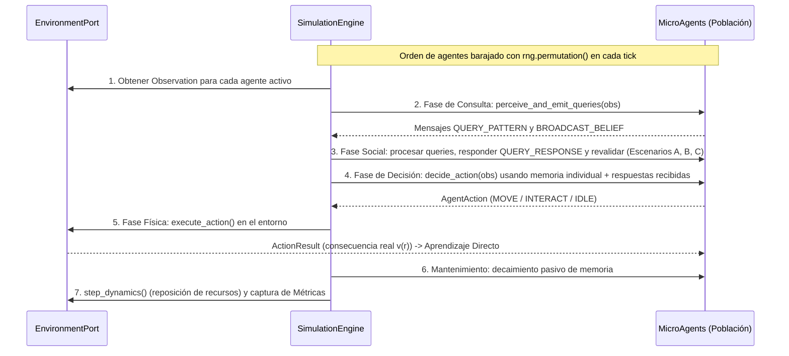

# Especificación de Definiciones Técnicas — Proyecto IDE (v0.1)

Este documento traduce las definiciones formales ([DEFINICIONES_FORMALES.md](file:///c:/Desarrollo/IDE/DEFINICIONES_FORMALES.md)) en una **arquitectura de software concreta, contratos de código, estructuras de datos, ciclo de ejecución y parámetros técnicos** en Python.

---

## 1. Stack Tecnológico y Principios de Ingeniería

- **Lenguaje:** Python $\ge 3.11$
- **Tipado:** Estricto (`typing`, `dataclasses`, `Protocol`, `Enum`). Todo módulo debe ser verificable estáticamente.
- **Dependencias del Núcleo (`core`):**
  - Librería estándar de Python (`dataclasses`, `typing`, `enum`, `math`, `collections`).
  - `numpy`: Exclusivamente para el generador de números pseudoaleatorios reproducible (`np.random.Generator`) y cálculo rápido de métricas agregadas.
- **Dependencias de Testing y Análisis:**
  - `pytest` para pruebas unitarias y validación de hipótesis.
  - `matplotlib` / exportación `JSON` y `CSV` para telemetría de experimentos (desacoplado del motor).
- **Principio de Desacoplamiento (Arquitectura Hexagonal):**
  - El paquete `agent` **tiene prohibido** importar cualquier módulo del paquete `environments`. Toda interacción ocurre a través de estructuras de datos agnósticas (`Observation`, `AgentAction`, `Message`).

---

## 2. Estructura de Directorios del Proyecto

```text
c:\Desarrollo\IDE\
├── DOCUMENTO_FUNDACIONAL.md
├── DEFINICIONES_FORMALES.md
├── DEFINICIONES_TECNICAS.md
├── pyproject.toml
├── src/
│   └── ide/
│       ├── __init__.py
│       ├── config.py                # Dataclasses de configuración e hiperparámetros
│       ├── domain/                  # Contratos puros y estructuras de datos base
│       │   ├── __init__.py
│       │   ├── types.py             # Pattern, KnowledgeUnit, Resource, Message, Action, Observation
│       │   └── ports.py             # Protocolo abstracto EnvironmentPort
│       ├── agent/                   # Cognición local (100% agnóstica del espacio)
│       │   ├── __init__.py
│       │   ├── memory.py            # BoundedMemory (capacidad C_max, utilidad U, olvido)
│       │   ├── epistemology.py      # Reglas de aprendizaje directo y revalidación social (A, B, C)
│       │   └── micro_agent.py       # MicroAgent (percepción, consulta, decisión, comunicación)
│       ├── environments/            # Implementaciones intercambiables del mundo
│       │   ├── __init__.py
│       │   └── grid2d.py            # ToroidalGrid2D (indexación espacial O(1) por celda)
│       ├── simulation/              # Motor de ejecución por ticks
│       │   ├── __init__.py
│       │   └── engine.py            # SimulationEngine (pipeline determinista de 5 fases)
│       └── experiments/             # Protocolos científicos y telemetría
│           ├── __init__.py
│           ├── metrics.py           # Cálculo de métricas M1 a M7
│           └── exp001_runner.py     # Ejecutor de Experimento 001 (Base, Falsificación, Daño)
└── tests/
    ├── test_memory.py               # Tests de límite C_max, reemplazo y decaimiento
    ├── test_epistemology.py         # Tests de aprendizaje directo y conflicto social
    ├── test_grid2d.py               # Tests de topología toroidal y vecindades
    └── test_exp001_integration.py   # Tests de humo y determinismo por semilla
```

---

## 3. Especificación de Estructuras de Datos (`domain/types.py`)

Todas las entidades de transferencia entre el entorno y los agentes son inmutables (`frozen=True`) para evitar efectos secundarios ocultos (mutación accidental de estado compartido).

### 3.1. `Pattern` (Rasgo Observable del Recurso)
Representa la firma observable $\rho$ de un recurso.
```python
@dataclass(frozen=True)
class Pattern:
    attributes: tuple[tuple[str, str], ...]  # Ej: (("color", "azul"), ("forma", "esfera"))
```

### 3.2. `KnowledgeUnit` (Unidad de Conocimiento / Creencia $k$)
```python
@dataclass(frozen=True)
class KnowledgeUnit:
    pattern: Pattern
    predicted_value: float       # \hat{v} \in [-1.0, +1.0]
    confidence: float            # c \in [0.0, 1.0]
    evidence_count: int          # n >= 1
    last_updated_tick: int       # \tau (tick de última validación/uso)
    from_direct_experience: bool # True si fue experimentado directamente por este agente
```

### 3.3. `Resource` (Recurso en el Entorno)
```python
@dataclass(frozen=True)
class Resource:
    resource_id: int
    pattern: Pattern
    true_value: float            # v(r) real: oculto al agente hasta que interactúa
```

### 3.4. `VisibleResource` y `Observation` (Lo que percibe el Agente)
El entorno jamás entrega el objeto `Resource` completo al agente (para impedir que el agente lea `true_value` haciendo trampa). Entrega `VisibleResource`:
```python
@dataclass(frozen=True)
class VisibleResource:
    resource_id: int
    pattern: Pattern
    relative_target: Any         # Dirección o nodo para moverse hacia él (0 distancia si está en la misma ubicación)
    is_reachable_now: bool       # True si el agente puede consumirlo en este tick sin moverse

@dataclass(frozen=True)
class Observation:
    agent_id: int
    tick: int
    visible_resources: tuple[VisibleResource, ...]
    available_moves: tuple[Any, ...]       # Opciones de movimiento válidas en el espacio actual
    neighbor_ids: tuple[int, ...]          # IDs de agentes dentro del radio de comunicación
```

### 3.5. `Message` (Protocolo de Comunicación Local)
```python
class MessageType(Enum):
    QUERY_PATTERN = "QUERY_PATTERN"       # "¿Alguien conoce este patrón \rho?"
    QUERY_RESPONSE = "QUERY_RESPONSE"     # "Yo tengo esta creencia sobre \rho"
    BROADCAST_BELIEF = "BROADCAST_BELIEF" # Difusión espontánea de conocimiento

@dataclass(frozen=True)
class Message:
    msg_type: MessageType
    sender_id: int
    recipient_id: int | None              # None = broadcast a todos los vecinos en rango
    pattern: Pattern
    belief: KnowledgeUnit | None = None   # Presente en QUERY_RESPONSE y BROADCAST_BELIEF
```

### 3.6. `AgentAction` y `ActionResult`
```python
class ActionType(Enum):
    MOVE = "MOVE"
    INTERACT = "INTERACT"
    IDLE = "IDLE"

@dataclass(frozen=True)
class AgentAction:
    action_type: ActionType
    target: Any = None                    # Dirección/nodo si es MOVE, resource_id si es INTERACT

@dataclass(frozen=True)
class ActionResult:
    action_type: ActionType
    interacted_pattern: Pattern | None = None
    experienced_value: float | None = None # Solo contiene valor si action_type == INTERACT y tuvo éxito
```

---

## 4. Contrato del Entorno (`domain/ports.py`)

Cualquier espacio (Grilla 2D hoy, Grafo o Espacio Continuo mañana) debe implementar la interfaz `EnvironmentPort`:

```python
class EnvironmentPort(Protocol):
    def get_active_agent_ids(self) -> list[int]: ...
    def get_observation(self, agent_id: int, tick: int) -> Observation: ...
    def get_communication_neighbors(self, agent_id: int) -> list[int]: ...
    def execute_action(self, agent_id: int, action: AgentAction, tick: int) -> ActionResult: ...
    def remove_agents(self, agent_ids: list[int]) -> None: ...
    def step_dynamics(self, tick: int) -> None: ...
    def get_world_patterns(self) -> dict[Pattern, float]: ...
```

### Optimización Técnica en `ToroidalGrid2D` (`environments/grid2d.py`)
Para evitar calcular distancias todos-contra-todos en $O(M^2)$ (lo cual sería lento al escalar a miles de agentes), `ToroidalGrid2D` mantendrá un **índice espacial por celdas**:
- `cell_agents: dict[tuple[int, int], set[int]]`
- `cell_resources: dict[tuple[int, int], dict[int, Resource]]`
Consultar vecinos en un radio $R$ sólo inspecciona las $(2R+1)^2$ celdas adyacentes con aritmética modular `(x % width, y % height)`, logrando complejidad **$O(1)$ respecto al tamaño del mapa**.

---

## 5. Ciclo de Ejecución por Tick (`simulation/engine.py`)

El motor de simulación ejecuta cada paso de tiempo $t$ en **5 fases síncronas lógicas** para que ningún agente tenga ventaja injusta y el experimento sea $100\%$ determinista dada una semilla (`seed`):



### Detalle de la Toma de Decisión del Agente (Fase 4)
Cuando un agente evalúa su `Observation`:
1. **Evaluación de Recursos en la Celda Actual (`is_reachable_now == True`):**
   - Busca el `pattern` del recurso en su `BoundedMemory` (o en el buffer temporal de respuestas `QUERY_RESPONSE` recibidas en ese mismo tick).
   - Si tiene una creencia con confianza $c \ge c_{\text{umbral}}$:
     - Si $\hat{v} > 0$: Ejecuta `INTERACT(resource_id)` (consume recurso benéfico).
     - Si $\hat{v} < 0$: **Evita** el recurso (no interactúa y se mueve a otra ubicación).
   - Si **no conoce** el patrón (o $c < c_{\text{umbral}}$):
     - Con probabilidad $\epsilon$ (exploración): Ejecuta `INTERACT(resource_id)` para descubrir qué hace.
     - Con probabilidad $1 - \epsilon$: Ignora por precaución.
2. **Evaluación de Recursos a Distancia (`is_reachable_now == False`):**
   - Si ve en su radio perceptual un recurso que sabe que es benéfico ($\hat{v} > 0, c \ge c_{\text{umbral}}$), se mueve en dirección a ese recurso.
3. **Movimiento por Defecto:**
   - Si no hay recursos atractivos visibles, realiza una caminata aleatoria con persistencia direccional suave dentro de `available_moves`.

---

## 6. Parámetros Técnicos de Configuración (`config.py`)

Todos los hiperparámetros quedan centralizados en un objeto `SimulationConfig` serializable a JSON para trazabilidad científica:

| Parámetro | Nombre en Código | Valor Base (Exp 001) | Descripción Técnica |
| :--- | :--- | :---: | :--- |
| Semilla Aleatoria | `seed` | `42` | Garantiza reproducibilidad exacta bit a bit. |
| Dimensiones Grilla | `grid_width`, `grid_height` | `40, 40` | $1,600$ celdas toroidales. |
| Población de Agentes | `num_agents` ($M$) | `80` | Densidad moderada ($5\%$ de ocupación). |
| Patrones del Mundo | `num_world_patterns` ($N$) | `12` | $6$ benéficos ($+1.0$) y $6$ dañinos ($-1.0$). |
| Capacidad de Memoria | `memory_capacity` ($C_{\max}$) | `3` | **Restricción crítica:** cada agente sólo retiene $3/12$ ($25\%$) del mundo. |
| Radio de Percepción | `perception_radius` ($R_{\text{perc}}$) | `2` | Vecindad de Moore de $5 \times 5$ celdas. |
| Radio de Comunicación | `comm_radius` ($R_{\text{com}}$) | `2` | Vecindad de Moore de $5 \times 5$ celdas. |
| Confianza Directa Inicial | `initial_direct_confidence` | `0.85` | Confianza asignada tras primera experiencia directa. |
| Tasa Aprendizaje Valor | `alpha_learning` ($\alpha$) | `0.40` | Peso de nueva experiencia en $\hat{v}$. |
| Refuerzo Empírico | `beta_reinforce` ($\beta_{\text{ref}}$) | `0.30` | Incremento de confianza al confirmar empíricamente. |
| Castigo por Refutación | `beta_punish` ($\beta_{\text{cast}}$) | `0.60` | Caída rápida de confianza cuando la realidad contradice la creencia. |
| Descuento por Rumor | `gamma_social_discount` ($\gamma$) | `0.75` | Factor multiplicador al recibir conocimiento de otro agente. |
| Peso Consenso Social | `eta_consensus` | `0.15` | Refuerzo cuando un vecino confirma tu creencia. |
| Peso Duda Social | `eta_doubt` | `0.20` | Atenuación cuando un vecino contradice tu creencia. |
| Decaimiento Temporal | `lambda_decay` ($\lambda$) | `0.005` | Tasa de decaimiento en utilidad $U(k,t)$ por falta de uso. |
| Decaimiento Pasivo $c$ | `passive_conf_decay` ($\delta$) | `0.002` | Pérdida de confianza por tick sin validación. |
| Umbral de Decisión | `decision_conf_threshold` | `0.35` | Confianza mínima para dar por válida una creencia al decidir. |
| Tasa de Exploración | `epsilon_explore` ($\epsilon$) | `0.15` | Probabilidad de probar un recurso desconocido. |
| Mensajes Broadcast/Tick | `max_broadcast_per_tick` | `1` | Cantidad de creencias espontáneas compartidas por tick. |

---

## 7. Especificación Técnica de los 3 Sub-Experimentos (Exp 001)

El módulo `exp001_runner.py` ejecutará de forma automatizada tres protocolos comparativos:

1. **Protocolo 001-A (Emergencia Base: Colectivo vs. Aislado):**
   - Corre la simulación durante $T = 1,000$ ticks en dos modos con la misma semilla:
     - *Modo Aislado (`comm_enabled = False`):* Comunicación desactivada.
     - *Modo Colectivo (`comm_enabled = True`):* Comunicación local y consultas activas.
   - Verifica que $Acc_{\text{col}}(T) > Acc_{\text{iso}}(T)$ y $Cov_{\text{col}}(T) \gg Cov_{\text{ind}}(T)$.

2. **Protocolo 001-B (Falsificación / Epistemología Distribuida):**
   - En $t = 200$, inyecta en el $25\%$ de la población una creencia falsa con confianza máxima ($c = 0.95$) que afirma que un patrón benéfico $\rho_0$ es dañino ($\hat{v} = -1.0$), o viceversa.
   - Mide cuántos ticks tarda la población en extinguir la creencia falsa por contraste empírico y revalidación social.

3. **Protocolo 001-C (Daño Poblacional y Persistencia):**
   - Una vez alcanzado el equilibrio cognitivo en $t = 500$, ejecuta pruebas de ablación eliminando el $10\%, 30\%, 50\%$ y $70\%$ de los agentes, además de una prueba donde se elimina específicamente al $100\%$ de los descubridores originales de un patrón $\rho^*$.
   - Mide la supervivencia de la información en la red y el tiempo de recuperación $T_{\text{rec}}$.

---

## 8. Criterios de Calidad y Validación de Código (Definition of Done)

Antes de dar por válida la implementación técnica:
1. **Tests Unitarios de Memoria (`test_memory.py`):** Verificar que `BoundedMemory` jamás supere `C_max` elementos y siempre reemplace el de menor utilidad $U(k,t)$.
2. **Tests Unitarios de Epistemología (`test_epistemology.py`):** Verificar que una experiencia directa refutatoria derrumbe una creencia falsa y que un rumor sufra descuento $\gamma$.
3. **Tests de Aislamiento Arquitectónico:** Verificar que `src/ide/agent/` no contenga ninguna referencia a coordenadas $(x, y)$ ni a `ToroidalGrid2D`.
4. **Tests de Reproducibilidad:** Dos ejecuciones con `seed=42` deben arrojar exactamente las mismas métricas hasta el último decimal.
