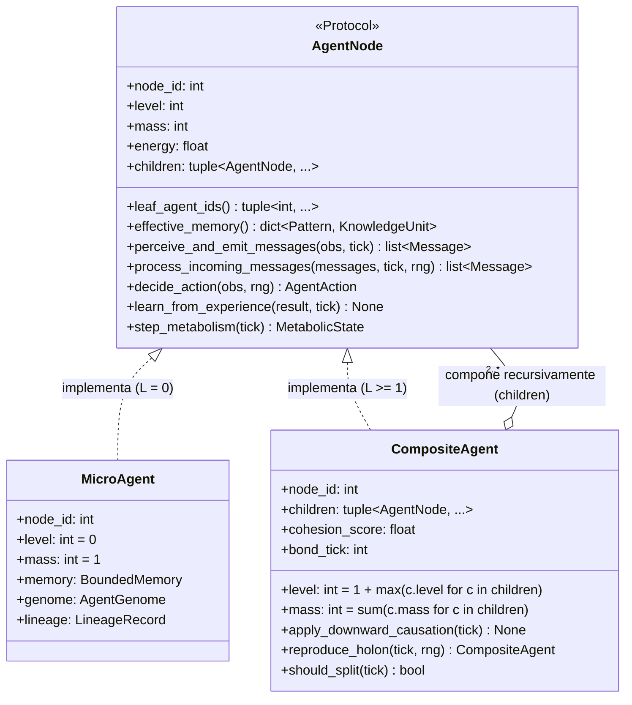
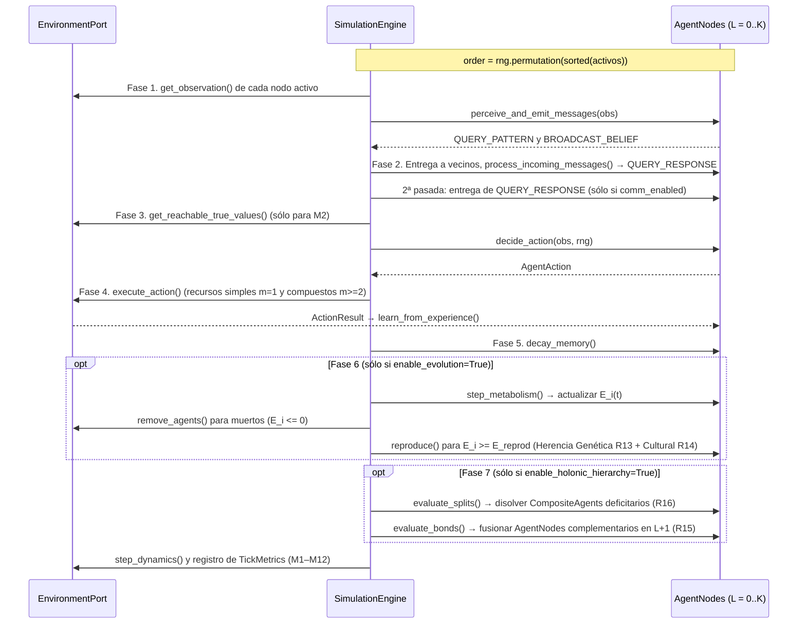

# Especificación de Definiciones Técnicas — Proyecto IDE (v2.0)

Este documento traduce las [Definiciones Formales](DEFINICIONES_FORMALES.md) en una **arquitectura de software concreta**: stack, estructura, contratos de datos, ciclo de ejecución y parámetros.

> **Novedades en la Versión 2.0:** Esta versión conserva intacta toda la especificación implementada y verificada de la **Fase I (Experimento 001)** y define la arquitectura técnica para la **Fase II (Experimentos 002–003)**:
> 1. **Patrón *Composite* Recursivo (`AgentNode`) para Jerarquía Ilimitada ($L = 0, 1, \dots, K$):** tanto `MicroAgent` ($L=0$) como `CompositeAgent` ($L \ge 1$) implementan el protocolo común `AgentNode`, permitiendo que un `CompositeAgent` agrupe sub-nodos de cualquier nivel sin límite de profundidad codificado.
> 2. **Motor de Metabolismo, Linaje y Herencia Dual (`agent/evolution.py`):** contratos inmutables para reserva energética, reproducción, mutación de `AgentGenome` y transferencia cultural vertical de `KnowledgeUnit`.
> 3. **Recursos Compuestos Graduados (`CompositeResource`):** recursos de orden $m \ge 2$ que requieren cubrir $m$ patrones simultáneamente, forzando la emergencia de niveles jerárquicos superiores.
> 4. **Compatibilidad Regresiva Estricta:** todos los mecanismos de la Fase II están gobernados por banderas explícitas en `SimulationConfig` (`enable_evolution=False`, `enable_holonic_hierarchy=False` por defecto), garantizando que las corridas y hashes SHA-256 del Experimento 001 permanezcan idénticos bit a bit.

> **Fuente normativa de la Fase I.** Las firmas exactas, fórmulas y reglas de desempate del Experimento 001 viven en [`openspec/changes/ide-emergent-distributed-intelligence/design.md`](openspec/changes/ide-emergent-distributed-intelligence/design.md) y los criterios verificables en sus `specs/`.

---

## 1. Stack Tecnológico y Principios de Ingeniería

- **Lenguaje:** Python $\ge 3.11$.
- **Tipado:** Estricto (`typing`, `dataclasses`, `Protocol`, `Enum`).
- **Dependencias del núcleo:** biblioteca estándar + `numpy` (generador reproducible `np.random.Generator(np.random.PCG64(seed))` y agregaciones).
- **Testing y análisis:** `pytest` con `pytest-cov` (cobertura) e `hypothesis` (pruebas por propiedades con generación reproducible); exportación JSON y CSV desacoplada del motor.
- **Calidad estática:** `ruff` (lint y formato) y `pyright` en modo estricto sobre `src/`. Un bloque de trabajo sólo se cierra con las cuatro verificaciones en verde.
- **Rendimiento:** paralelismo entre corridas independientes (`--jobs N`, con salida idéntica para cualquier `N`), una línea base medida (`ide.experiments.benchmark`) y perfiladores instalados (`py-spy`, `line_profiler`). No se vectoriza el bucle de agentes sin una medición que lo justifique: cambiaría la arquitectura que permite ablacionar reglas. Sin cambiar la semántica, la grilla precalcula una tabla de desplazamientos por vecindad, de percepción y de comunicación (cada una válida desde cualquier celda del toro, así que no crece con el tablero) y el motor reutiliza los vecinos de la observación para rutear los mensajes; una prueba exige historiales idénticos a los de la implementación previa.
- **Arquitectura hexagonal:** el paquete `agent` **tiene prohibido** importar `environments`, `simulation` o `experiments`. Toda interacción pasa por estructuras agnósticas (`Observation`, `AgentAction`, `Message`).
- **Determinismo entre procesos:** Python aleatoriza el hash de `str` por proceso, así que está prohibido iterar un `set` sin `sorted(...)` y toda selección aleatoria opera sobre listas ordenadas.
- **Atribución verificable:** cada regla de diseño del agente ($R_1 \dots R_{11}$ en Fase I; $R_{12} \dots R_{16}$ en Fase II) se puede desactivar desde `SimulationConfig`, y la plataforma clasifica cada afirmación como programada o emergente (ver §7, protocolo 001-D, y [Definiciones Formales](DEFINICIONES_FORMALES.md) §3.1).
- **Protocolo reemplazable:** toda la semántica de los mensajes vive en `agent/protocol.py`; ningún otro módulo del agente construye ni interpreta mensajes.
- **Simetría Fractal / Patrón *Composite* (Fase II):** el motor de simulación (`SimulationEngine`) opera sobre la abstracción `AgentNode` sin distinguir si el nodo es un individuo hoja (`MicroAgent`, $L=0$) o una coalición anidada de nivel arbitrario (`CompositeAgent`, $L = 1, 2, \dots, K$).

---

## 2. Estructura de Directorios del Proyecto

```text
IDE/
├── DOCUMENTO_FUNDACIONAL.md         # Visión v2.0 (Horizontal + Vertical + Holónica)
├── DEFINICIONES_FORMALES.md         # Modelo matemático v2.0 (Fase I + Fase II)
├── DEFINICIONES_TECNICAS.md         # Arquitectura técnica v2.0 (este documento)
├── RESULTADOS.md                    # Reporte empírico verificable (Exp 001)
├── openspec/                        # Propuestas, diseños, specs y tareas (OpenSpec)
├── pyproject.toml
├── src/
│   └── ide/
│       ├── __init__.py
│       ├── config.py                # SimulationConfig (hiperparámetros Fase I y Fase II)
│       ├── domain/                  # Contratos puros
│       │   ├── __init__.py
│       │   ├── types.py             # Pattern, KnowledgeUnit, Resource, VisibleResource, Observation, Message, AgentAction, ActionResult
│       │   ├── ports.py             # EnvironmentPort, AgentNode (Protocol)
│       │   └── extensions.py        # Contratos evolutivos y holónicos (AgentGenome, LineageRecord, CompositeResource, etc.)
│       ├── agent/                   # Cognición local y jerarquía holónica (agnóstica del espacio)
│       │   ├── __init__.py
│       │   ├── memory.py            # BoundedMemory
│       │   ├── epistemology.py      # Aprendizaje directo y revalidación social (A, B, C)
│       │   ├── protocol.py          # BeliefExchangeProtocol: única semántica de mensajes
│       │   ├── micro_agent.py       # MicroAgent (Holón hoja L = 0)
│       │   ├── evolution.py         # [Fase II] Metabolismo, reproducción, mutación y herencia cultural
│       │   └── composite_agent.py   # [Fase II] CompositeAgent (Holón recursivo L = 1..K, BOND/SPLIT)
│       ├── environments/
│       │   ├── __init__.py
│       │   └── grid2d.py            # ToroidalGrid2D (recursos simples m=1 y compuestos m>=2)
│       ├── simulation/
│       │   ├── __init__.py
│       │   ├── engine.py            # SimulationEngine (5 fases en Fase I; +2 fases opcionales en Fase II)
│       │   └── controls.py          # nullify_belief y controles nulos evolutivos/jerárquicos
│       └── experiments/
│           ├── __init__.py
│           ├── metrics.py           # TickMetrics, MetricsCollector, M1–M7 (Fase I) y M8–M12 (Fase II)
│           ├── benchmark.py         # Línea base de rendimiento (ticks por segundo)
│           ├── attribution.py       # Reglas R1..R16, afirmaciones, ablación, clasificación
│           ├── exp001_runner.py     # Protocolos 001-A, 001-B, 001-C, 001-D y CLI
│           ├── exp002_runner.py     # [Fase II] Evolución intergeneracional y herencia dual
│           └── exp003_runner.py     # [Fase II] Emergencia de Meta-Agentes recursivos (L = 1..K)
└── tests/
    ├── test_domain_contracts.py
    ├── test_roadmap_extensions.py
    ├── test_memory.py
    ├── test_epistemology.py
    ├── test_micro_agent.py
    ├── test_grid2d.py
    ├── test_simulation_engine.py
    ├── test_metrics.py
    ├── test_exp001_suite.py
    ├── test_attribution.py
    ├── test_controls.py
    ├── test_benchmark.py
    ├── test_performance_equivalence.py  # Huellas SHA-256 del oráculo (intactas en v2.0)
    ├── test_suite_markers.py            # La corrida por defecto excluye `empirical` y `slow`
    ├── test_empirical.py                # @pytest.mark.empirical (excluido por defecto)
    └── conftest.py                      # Perfil `ci` de Hypothesis (derandomize=True)
```

---

## 3. Estructuras de Datos (`domain/types.py` y `domain/extensions.py`)

Todas son `@dataclass(frozen=True)` para evitar mutaciones accidentales de estado compartido.

### 3.1. `Pattern`
Firma observable $\rho$ de un recurso. Tiene orden total (`order=True`) para iterar de forma determinista.
```python
@dataclass(frozen=True, order=True)
class Pattern:
    attributes: tuple[tuple[str, str], ...]  # Ej: (("id", "p_0"),)
```

### 3.2. `KnowledgeUnit` (creencia $k$)
```python
@dataclass(frozen=True)
class KnowledgeUnit:
    pattern: Pattern
    predicted_value: float       # \hat{v} en [-1.0, +1.0]
    confidence: float            # c en [0.0, 1.0]
    evidence_count: int          # n >= 1
    last_updated_tick: int       # \tau
    from_direct_experience: bool # d: True si este agente lo experimentó (False en rumores y herencia cultural)
```

### 3.3. `Resource` y `CompositeResource` (internos del entorno)
```python
@dataclass(frozen=True)
class Resource:
    resource_id: int
    pattern: Pattern
    true_value: float            # v(r): oculto al agente (recurso elemental de orden m = 1)

@dataclass(frozen=True)
class CompositeResource:
    """Recurso compuesto de orden m >= 2 (Fase II)."""
    resource_id: int
    required_patterns: tuple[Pattern, ...]  # m patrones requeridos simultáneamente
    success_value: float                    # Retorno superlineal si el holón conoce todos los patrones
    failure_penalty: float                  # Penalización (< 0) si interactúa sin cubrir los m patrones

    @property
    def complexity_order(self) -> int:
        return len(self.required_patterns)
```

### 3.4. `VisibleResource` y `Observation` (lo que percibe el agente o holón)
El entorno nunca entrega `Resource` ni `CompositeResource`. En su lugar proyecta `VisibleResource`, que no tiene `true_value` y trae una guía de movimiento agnóstica de la geometría:
```python
@dataclass(frozen=True)
class VisibleResource:
    resource_id: int
    pattern: Pattern
    recommended_move: Any        # Primer paso (∈ available_moves) hacia el recurso; None si distance == 0
    distance: int                # Distancia en pasos (Chebyshev en la grilla)
    is_reachable_now: bool       # True sii distance == 0
    required_patterns: tuple[Pattern, ...] = ()  # Vacío en orden m=1; tupla de m patrones en recursos compuestos

@dataclass(frozen=True)
class Observation:
    agent_id: int
    tick: int
    visible_resources: tuple[VisibleResource, ...]   # Ordenados por (distance, resource_id)
    available_moves: tuple[Any, ...]
    neighbor_ids: tuple[int, ...]                     # Ascendentes, sin el propio agente/holón
```

### 3.5. `Message`
Este es el protocolo de nivel N0: su semántica viene **predefinida de fábrica**, y es un presupuesto de diseño que se irá retirando ([Documento Fundacional](DOCUMENTO_FUNDACIONAL.md) §8).
```python
class MessageType(Enum):
    QUERY_PATTERN = "QUERY_PATTERN"       # "¿Alguien conoce ρ?"
    QUERY_RESPONSE = "QUERY_RESPONSE"     # "Yo creo esto sobre ρ"
    BROADCAST_BELIEF = "BROADCAST_BELIEF" # Difusión espontánea
    PROPOSE_BOND = "PROPOSE_BOND"         # [Fase II] Propuesta de fusión holónica (L -> L+1)

@dataclass(frozen=True)
class Message:
    msg_type: MessageType
    sender_id: int
    recipient_id: int | None              # None = todos los vecinos de comunicación
    pattern: Pattern
    belief: KnowledgeUnit | None = None   # Obligatorio en QUERY_RESPONSE y BROADCAST_BELIEF
```

### 3.6. `AgentAction` y `ActionResult`
```python
class ActionType(Enum):
    MOVE = "MOVE"
    INTERACT = "INTERACT"
    IDLE = "IDLE"

@dataclass(frozen=True)
class AgentAction:
    action_type: ActionType
    target: Any = None                    # Movimiento si MOVE, resource_id si INTERACT

@dataclass(frozen=True)
class ActionResult:
    action_type: ActionType
    interacted_pattern: Pattern | None = None
    experienced_value: float | None = None # Sólo si INTERACT tuvo éxito
    interacted_patterns: tuple[Pattern, ...] = ()  # [Fase II] Patrones de un CompositeResource
```

### 3.7. Genoma, Linaje y Estado Metabólico (Fase II — `domain/extensions.py`)
```python
@dataclass(frozen=True)
class AgentGenome:
    """Genoma heredable y mutable (Θ_i y G_i)."""
    alpha_learning: float
    gamma_social_discount: float
    epsilon_explore: float
    bond_propensity: float       # \omega_{bond} en [0.0, 1.0]
    memory_capacity: int         # C_{max, i} < N (sujeto a costo metabólico cuadrático)
    perception_radius: int       # r_{perc, i}
    comm_radius: int             # r_{com, i}

@dataclass(frozen=True)
class LineageRecord:
    """Trazabilidad genealógica para métricas evolutivas M8–M10."""
    agent_id: int
    parent_id: int | None        # None para la generación fundadora g = 0
    generation: int              # g >= 0
    birth_tick: int
    inherited_belief_count: int  # Cantidad de creencias recibidas por herencia cultural (R14)

@dataclass(frozen=True)
class MetabolicState:
    """Estado energético del agente o holón."""
    energy: float
    max_energy: float
    basal_cost_per_tick: float
    cumulative_energy_gained: float = 0.0

@dataclass(frozen=True)
class StigmergicTrace:
    """Rastro epistémico depositado en una celda del entorno (Construcción de Nicho, R19)."""
    pattern: Pattern
    signaled_value: float
    intensity: float             # I(l, t) en [0.0, 1.0], decae con \delta_{suelo}
    deposited_tick: int
```

---

## 4. Arquitectura Holónica Ilimitada (`AgentNode` y `CompositeAgent`)

Para permitir que los agentes formen Meta-Agentes ($L=1$), y que conjuntos de estos Meta-Agentes vuelvan a unirse en niveles $L = 2, 3, \dots, K$ **sin límite codificado de niveles**, se aplica el **Patrón Estructural *Composite*** a través del protocolo recursivo `AgentNode`.



### 4.1. Contrato Recursivo `AgentNode`
```python
@runtime_checkable
class AgentNode(Protocol):
    @property
    def node_id(self) -> int: ...

    @property
    def level(self) -> int:
        """0 para MicroAgent; 1 + max(c.level for c in self.children) para CompositeAgent."""
        ...

    @property
    def mass(self) -> int:
        """Cantidad total de MicroAgents (hojas L=0) contenidos en el subárbol."""
        ...

    @property
    def children(self) -> tuple[AgentNode, ...]:
        """Tupla vacía () en L=0; sub-nodos inmediatos (de nivel <= L-1) en L >= 1."""
        ...

    def leaf_agents(self) -> tuple[MicroAgent, ...]:
        """Recorrido determinista en preorden de todas las hojas L=0 del subárbol."""
        ...

    def effective_memory(self) -> dict[Pattern, KnowledgeUnit]:
        """En L=0 devuelve las creencias de BoundedMemory; en L>=1 agrega recursivamente
        las memorias de sus children ponderando por confianza."""
        ...
```

### 4.2. Cómo escala `CompositeAgent` a cualquier nivel $L = 1, 2, \dots, K$
1. **Anidamiento arbitrario sin clases por nivel:** No existe una clase `Level1Agent` ni `Level2Agent`. Una instancia de `CompositeAgent` recibe `children: tuple[AgentNode, ...]`.
   - Si sus hijos son `MicroAgent` ($L=0$), su propiedad `level` calcula automáticamente $1 + \max(0, 0) = 1$.
   - Si dos `CompositeAgent` de nivel $1$ ejecutan `BOND`, se instancia un nuevo `CompositeAgent(children=(comp_a, comp_b))` cuyo `level` es automáticamente $1 + \max(1, 1) = 2$.
   - Si un `CompositeAgent` de nivel $2$ se une con otro de nivel $1$ o $2$, produce nivel $3$, y así inductivamente para cualquier $K \in \mathbb{N}$.
2. **Sinergia de Memoria sin violar $C_{\max}$ individual:** Cada hoja `MicroAgent` dentro del árbol mantiene intacto su `BoundedMemory` con límite $C_{\max} \ll N$. Sin embargo, `CompositeAgent.effective_memory()` combina en tiempo de ejecución los diccionarios de sus `children`. Así, un holón de nivel $L$ con masa $|U|$ alcanza una capacidad epistémica efectiva de hasta $|U| \times C_{\max}$ creencias, pudiendo resolver recursos compuestos `CompositeResource` de orden $m > C_{\max}$.
3. **Causalidad Descendente y Particionamiento Epigenético Intra-Holón (`apply_downward_causation`, $R_{18}$):** Inspirado en la biología de sistemas (Denis Noble), `CompositeAgent` regula hacia abajo a sus hojas penalizando en $U(k, t)$ la utilidad de retener un patrón $\rho$ si otro miembro del mismo holón ya lo retiene con mayor confianza ($\psi_{\text{red}} \in [0, 1)$). Esto induce **especialización espontánea de memoria** entre hermanos de simbiosis sin violar $C_{\max}$.
4. **Endosimbiosis Reproductiva (`reproduce_holon`, $R_{17}$):** Inspirado en la simbiogénesis de Lynn Margulis, cuando la energía acumulada del holón supera $|U| \cdot E_{\text{reprod}}$, el `CompositeAgent` se divide como paquete simbiótico completo, clonando recursivamente su árbol de sub-nodos (con mutación genética $R_{13}$ y herencia cultural $R_{14}$ en sus hojas) para que la descendencia nazca ya acoplada.
5. **Fisión limpia (`SPLIT`, $R_{16}$):** Cuando `CompositeAgent.should_split(tick)` devuelve `True` (porque el retorno energético no cubre el costo de coordinación $c_{\text{coord}}(U)$), el motor reemplaza al nodo padre $U$ por sus `U.children` inmediatos (por ejemplo, un holón de nivel $3$ se descompone primero en sus sub-holones de nivel $2$, preservando las sub-coaliciones que sí sean rentables).

---

## 5. Contrato del Entorno (`domain/ports.py`)

```python
@runtime_checkable
class EnvironmentPort(Protocol):
    def get_active_agent_ids(self) -> list[int]: ...
    def get_observation(self, agent_id: int, tick: int) -> Observation: ...
    def get_communication_neighbors(self, agent_id: int) -> list[int]: ...
    def execute_action(self, agent_id: int, action: AgentAction, tick: int) -> ActionResult: ...
    def remove_agents(self, agent_ids: list[int]) -> None: ...
    def retire_pattern_resources(self, pattern: Pattern) -> None: ...          # Prueba de persistencia (M4)
    def invert_world_rules(self, fraction: float, rng: np.random.Generator) -> list[Pattern]: ...  # Exp 004
    def step_dynamics(self, tick: int) -> None: ...
    def get_world_patterns(self) -> dict[Pattern, float]: ...
    def get_reachable_true_values(self, agent_id: int) -> dict[int, float]: ...  # Sólo telemetría (M2)
```

`get_reachable_true_values` es un oráculo exclusivo del motor para juzgar decisiones; nunca se entrega a un agente. En Fase II, el entorno incorpora además `spawn_offspring(parent_id: int, child_id: int, rng: np.random.Generator) -> None` para ubicar en el espacio a los nuevos agentes nacidos por reproducción.

### Índice espacial en `ToroidalGrid2D`
- `cell_agents: dict[tuple[int, int], set[int]]`
- `cell_resources: dict[tuple[int, int], dict[int, Resource]]`

Consultar vecinos en un radio $R$ inspecciona sólo las $(2R+1)^2$ celdas del radio, con aritmética modular y tabla de desplazamientos precalculada. El costo no depende del tamaño del mapa.

---

## 6. Ciclo de Ejecución por Tick (`simulation/engine.py`)

Cada tick $t$ ejecuta las **5 fases canónicas de la Fase I**, más **2 fases opcionales en la Fase II** (activas únicamente cuando `enable_evolution=True` o `enable_holonic_hierarchy=True`):



### Recepción de mensajes (Fase 2)
Cada agente o holón responde primero todas las consultas de su bandeja con la memoria que tenía al empezar la fase, y recién después asimila los testimonios recibidos, en el orden de llegada. Como ese orden sigue la permutación del tick, responder antes de asimilar evita que el sorteo altere el contenido de una respuesta.

### Toma de decisión del agente o holón (Fase 3)
Una creencia es **conocida** si su confianza es $\ge c_{\text{umbral}}$. Se consulta primero la memoria efectiva (`effective_memory()`) y luego las creencias recibidas en el tick.
1. **Recursos en la celda actual:**
   - Para un recurso compuesto (`len(required_patterns) >= 2`), se evalúa si todos los patrones requeridos son conocidos como benéficos en la memoria efectiva del holón.
   - Si hay algún recurso (simple o compuesto desbloqueable) conocido como benéfico ($\hat{v} > 0$): `INTERACT` sobre el de mayor utilidad esperada $\hat{v} \cdot c$.
   - Si no, y hay alguno no conocido: con probabilidad $\epsilon$, `INTERACT` sobre él (exploración).
   - Nunca interactúa con un recurso conocido como dañino (salvo re-verificación escéptica en Exp 004).
2. **Recursos a distancia:** si ve uno conocido como benéfico (o desbloqueable por el holón), `MOVE` hacia su `recommended_move` (el de menor `distance`).
3. **Por defecto:** caminata aleatoria uniforme sobre `available_moves` (`IDLE` si no hay movimientos).

---

## 7. Parámetros de Configuración (`config.py`)

Centralizados en `SimulationConfig` (inmutable, validado en `__post_init__`, serializable con `to_dict()`):

### 7.1. Parámetros Base (Fase I — Experimento 001)

| Parámetro | Nombre en código | Valor base (Exp 001) | Descripción |
| :--- | :--- | :---: | :--- |
| Semilla | `seed` | `42` | Reproducibilidad exacta. Entero `>= 0`. |
| Dimensiones | `grid_width`, `grid_height` | `40, 40` | 1.600 celdas toroidales. |
| Población ($M$) | `num_agents` | `80` | Densidad de 5 %. |
| Patrones ($N$) | `num_world_patterns` | `12` | 6 benéficos ($+1.0$) y 6 dañinos ($-1.0$). |
| Recursos por patrón | `resources_per_pattern` | `8` | 96 recursos en el tablero. |
| Capacidad ($C_{\max}$) | `memory_capacity` | `3` | **Restricción crítica:** 3/12 = 25 % del mundo. |
| Radio de percepción | `perception_radius` | `2` | Vecindad de Moore de 5×5. |
| Radio de comunicación | `comm_radius` | `2` | Vecindad de Moore de 5×5. |
| Comunicación activa | `comm_enabled` | `True` | `False` en el modo aislado. |
| Confianza directa inicial | `initial_direct_confidence` | `0.85` | Tras la primera experiencia directa. |
| Aprendizaje de valor ($\alpha$) | `alpha_learning` | `0.40` | Peso de la nueva experiencia en $\hat{v}$. |
| Refuerzo empírico ($\beta_{\text{ref}}$) | `beta_reinforce` | `0.30` | Aumento al confirmar. |
| Castigo por refutación ($\beta_{\text{cast}}$) | `beta_punish` | `0.60` | Caída al ser contradicho por la realidad. |
| Descuento por rumor ($\gamma$) | `gamma_social_discount` | `0.75` | Por cada salto social. |
| Consenso ($\eta_{\text{consenso}}$) | `eta_consensus` | `0.15` | Refuerzo por coincidencia. |
| Duda ($\eta_{\text{duda}}$) | `eta_doubt` | `0.20` | Atenuación por contradicción. |
| Decaimiento de utilidad ($\lambda$) | `lambda_decay` | `0.005` | En $U(k,t)$. |
| Decaimiento pasivo ($\delta$) | `passive_conf_decay` | `0.002` | Pérdida de confianza por tick sin validación. |
| Confianza mínima ($c_{\min}$) | `min_confidence` | `0.05` | Por debajo se purga la creencia. |
| Umbral de decisión ($c_{\text{umbral}}$) | `decision_conf_threshold` | `0.35` | Confianza mínima para actuar. |
| Exploración ($\epsilon$) | `epsilon_explore` | `0.15` | Probabilidad de probar lo desconocido. |
| Broadcasts por tick | `max_broadcast_per_tick` | `1` | Difusión espontánea. |
| Consultas por tick | `max_queries_per_tick` | `2` | Patrones desconocidos consultados. |
| Especialización | `enable_specialization` | `False` | Exp 003 (división de trabajo cognitivo). |
| Re-verificación escéptica | `epsilon_recheck` | `0.0` | Exp 004: probar lo que se cree dañino con probabilidad $\epsilon_{\text{recheck}}(1-c)$. |
| Política de τ | `tau_policy` | `"validation"` | Exp 004: `"evidence_age"` hace que τ sea la edad de la evidencia empírica más reciente. |
| Forzar $C_{\max} < N$ | `enforce_memory_constraint` | `True` | Validación de la restricción crítica. |
| Anti-cámara de eco | `anti_echo_enabled` | `True` | `False` ablaciona la regla R6. |
| Navegación | `enable_navigation` | `True` | `False` ablaciona la regla R11. |
| Esquema de actualización | `update_scheme` | `"synchronous"` | `"asynchronous"`: secuencial aleatorio, para el criterio E5. |
| Control nulo de contenido | `comm_content_null` | `False` | `True` entrega cada creencia con $\hat{v} = \pm 1$ al azar, desde un generador propio (criterio E4). |

### 7.2. Nuevos Parámetros Evolutivos y Holónicos (Fase II — Experimentos 002 y 003)

Todos desactivados por defecto (`False`) para preservar la equivalencia exacta de la Fase I:

| Parámetro | Nombre en código | Valor por defecto (Fase I) | Valor Fase II (Exp 002/003) | Descripción |
| :--- | :--- | :---: | :---: | :--- |
| Activar evolución | `enable_evolution` | `False` | `True` | Activa metabolismo, muerte y reproducción ($R_{12}$). |
| Energía inicial ($E_0$) | `initial_energy` | `100.0` | `100.0` | Energía al nacer o iniciar la simulación. |
| Umbral de reproducción ($E_{\text{reprod}}$) | `reproduction_energy_threshold` | `180.0` | `180.0` | Energía necesaria para dividirse/reproducirse. |
| Capacidad de carga ($M_{\max}$) | `max_population` | `240` | `240` | Límite demográfico ambiental. |
| Costo metabólico basal ($c_0$) | `basal_metabolic_cost` | `0.5` | `0.5` | Drenaje energético por tick. |
| Escala energética ($s_E$) | `energy_reward_scale` | `15.0` | `15.0` | Multiplicador de $v(r)$ sobre $\Delta E$. |
| Tasa de mutación ($p_{\text{mut}}$) | `mutation_rate` | `0.0` | `0.15` | Probabilidad de mutar cada gen en $\Theta_i$ ($R_{13}$). |
| Desvío de mutación ($\sigma_{\text{mut}}$) | `mutation_std` | `0.05` | `0.05` | Amplitud gaussiana de mutación continua. |
| Herencia cultural activa | `enable_cultural_inheritance` | `False` | `True` | Transfiere creencias de padre a hijo al nacer ($R_{14}$). |
| Descuento generacional ($\gamma_{\text{gen}}$) | `cultural_inheritance_discount` | `0.85` | `0.85` | Factor de confianza heredada verticalmente. |
| Activar jerarquía holónica | `enable_holonic_hierarchy` | `False` | `True` | Activa `CompositeAgent`, `BOND` ($R_{15}$) y `SPLIT` ($R_{16}$). |
| Sinergia mínima (`BOND`) | `min_bond_synergy` | `0.50` | `0.50` | Disimilitud de Jaccard mínima para fusionarse ($\theta_{\text{sinergia}}$). |
| Costo de enlace ($c_{\text{enlace}}$) | `holon_bond_cost` | `0.20` | `0.20` | Costo metabólico de coordinación por hijo y nivel. |
| Órdenes de recursos compuestos | `composite_resource_orders` | `()` | `(2, 4, 6, 9)` | Órdenes $m$ de `CompositeResource` presentes en el mapa. |
| Endosimbiosis reproductiva | `enable_holon_reproduction` | `False` | `True` | Permite que un Holón exitoso se reproduzca ya acoplado ($R_{17}$). |
| Causalidad descendente | `enable_downward_causation` | `False` | `True` | Inhibe redundancia epistémica entre miembros de un Holón ($R_{18}$). |
| Penalización de redundancia ($\psi_{\text{red}}$) | `holon_redundancy_penalty` | `0.0` | `0.70` | Descuento en $U(k,t)$ cuando un hermano ya retiene el patrón. |
| Construcción de nicho / estigmergia | `enable_stigmergy` | `False` | `True` | Permite depositar y leer rastros epistémicos en celdas ($R_{19}$). |
| Decaimiento estigmérgico ($\delta_{\text{suelo}}$) | `stigmergy_decay` | `0.01` | `0.01` | Atenuación pasiva por tick de los rastros en el suelo. |

---

## 8. Protocolos Experimentales

### 8.1. Sub-Experimentos del Experimento 001 (Fase I — Completado)
`exp001_runner.py` ejecuta los protocolos 001-A a 001-C, y desde su CLI invoca 001-D, que vive en `attribution.py`. Cada uno tiene dos perfiles: **quick**, para tests y valores por defecto de las funciones, y **full**, el valor por defecto de la CLI.

| Protocolo | quick | full |
| :--- | :---: | :---: |
| 001-A: ticks totales | 300 | 1000 |
| 001-B: ticks totales / tick de inyección | 300 / 80 | 1000 / 200 |
| 001-C: warmup / ticks post-ablación | 150 / 100 | 500 / 200 |

1. **001-A (Superávit: colectivo vs. aislado):** misma semilla con `comm_enabled=True` y `False`. Compara precisión de decisión (M2) y cobertura accesible a un salto (M1).
2. **001-B (Falsificación):** inyecta en el 25 % de la población un rumor plantado ($c = 0.95$, `from_direct_experience=False`) que afirma que el patrón benéfico `p_0` es dañino, y mide su prevalencia inicial, pico y final y el tiempo hasta su extinción.
3. **001-C (Daño y persistencia):** ablación del 10, 30, 50 y 70 % en corridas independientes, y una corrida que elimina al 100 % de los descubridores de `p_0` y retira el estímulo físico, para medir la persistencia puramente social.
4. **001-D (Atribución de emergencia):** mide cada afirmación pre-registrada (C1–C4) en cuatro variantes (completa, aislada, sin $R_C$ y control nulo) y la clasifica según E1–E5.

### 8.2. Sub-Experimentos del Experimento 002 (Fase II — Evolución, Herencia Dual y Estigmergia)
`exp002_runner.py` evalúa el salto intergeneracional a lo largo de $T = 3000$ ticks ($\ge 8$ generaciones sucesivas):
1. **002-A (Adaptación intergeneracional, M8 y M10):** Compara la precisión $\overline{Acc}(g)$ y la eficiencia energética de la generación $g \ge 5$ contra la generación fundadora $g=0$ y contra el control nulo de deriva neutral (reproducción aleatoria sin selección energética).
2. **002-B (Persistencia transgeneracional con Herencia Cultural y Estigmergia, M9):** Repite el reto de extinción de descubridores (C4 del Exp 001) activando la herencia cultural vertical ($R_{14}$) y la construcción de nicho ($R_{19}$). Verifica si la combinación de transmisión horizontal + herencia vertical + rastros espaciales permite que una tradición verdadera sobreviva al recambio completo de múltiples generaciones sin reabrir cámaras de eco para rumores falsos.

### 8.3. Sub-Experimentos del Experimento 003 (Fase II — Jerarquía Holónica Recursiva $L = 0 \dots K$, Simbiogénesis y Causalidad Descendente)
`exp003_runner.py` introduce recursos compuestos de órdenes graduados $m \in \{2, 4, 6, 9\}$ (con $C_{\max} = 3$):
1. **003-A (Transición de fase jerárquica sin tope de niveles, M11):** Mide la profundidad máxima emergente $L_{\max}(t)$ al variar la complejidad máxima $m_{\max}$ de los recursos del entorno ($m_{\max} = 1 \implies L_{\max} = 0$; $m_{\max} = 4 \implies L_{\max} \ge 1$; $m_{\max} = 9 \implies L_{\max} \ge 2$, y así sucesivamente).
2. **003-B (Superávit composicional, Causalidad Descendente y Endosimbiosis, M12):** Compara la tasa de resolución de recursos compuestos $CompRate(m, t)$ entre una población con fusión holónica activa (`enable_holonic_hierarchy=True`), causalidad descendente ($R_{18}$) y reproducción simbiótica ($R_{17}$), frente a ablaciones parciales y frente a una población restringida a agentes individuales ($L=0$).

---

## 9. Criterios de Calidad (Definition of Done)

1. **Memoria:** `BoundedMemory` jamás supera $C_{\max}$ y reemplaza siempre la creencia de menor utilidad, con desempate determinista.
2. **Epistemología:** la refutación directa derrumba una creencia falsa, un rumor sufre el descuento $\gamma$ y, con factor de confianza en el emisor $\le 1$, dos rumores no se inflan mutuamente (ver el riesgo declarado en [DEFINICIONES_FORMALES.md](DEFINICIONES_FORMALES.md) §2.3).
3. **Aislamiento:** `src/ide/agent/` no importa `environments`, `simulation` ni `experiments` (verificado sobre el AST).
4. **Reproducibilidad y No-Regresión de Fase I:** dos ejecuciones con `seed=42` producen métricas idénticas, también en procesos con distinto `PYTHONHASHSEED`. Con las banderas de Fase II en su valor por defecto (`False`), los hashes SHA-256 de `test_performance_equivalence.py` no cambian.
5. **Hipótesis:** `python -m pytest -m empirical` se ejecuta y su resultado se reporta tal cual, sin ajustar parámetros para que pase.
6. **Protocolo aislado:** dentro de `src/ide/agent/`, sólo `protocol.py` construye `Message` o usa `MessageType` (verificado sobre el AST).
7. **Recursividad Holónica Ilimitada (Fase II):** `CompositeAgent` acepta como `children` instancias de `MicroAgent` ($L=0$) o de `CompositeAgent` ($L \ge 1$) indistintamente, verificándose con tests unitarios para $L = 0, 1, 2, 3, 4$ sin lógica condicional por número de nivel.
8. **Atribución:** las reglas ($R_1 \dots R_{19}$) y afirmaciones se versionan antes de la corrida de atribución, y su tabla de estados se registra tal cual.
9. **Calidad estática y propiedades:** `ruff check`, `ruff format --check` y `pyright` sin errores; los invariantes de memoria, epistemología, grilla, evolución, jerarquía holónica y determinismo verificados con Hypothesis.
10. **Paralelismo inocuo:** la CLI produce archivos idénticos con `--jobs 1` y `--jobs N`.
