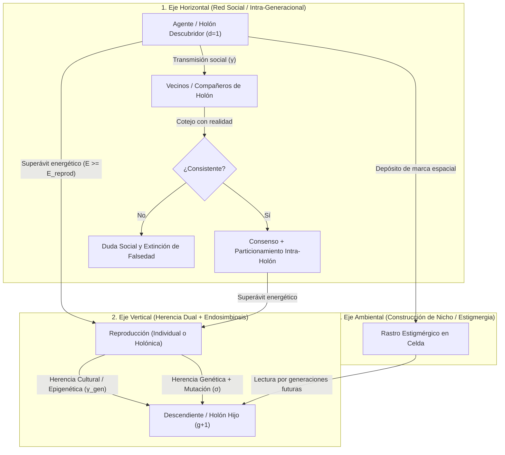
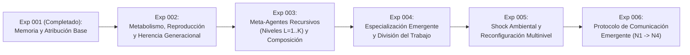

# Documento Fundacional: Inteligencia Distribuida Emergente (IDE)
**Versión:** 2.0  
**Fecha:** 2026-10-17  
**Estado:** Base Teórica y Hoja de Ruta Evolutiva Multinivel (Fase I verificada / Fase II en diseño)  

---

## 1. Premisa y Cambio de Paradigma

La mayor parte de los sistemas de inteligencia artificial contemporáneos concentra la capacidad cognitiva en arquitecturas monolíticas masivas (LLMs, redes neuronales profundas a gran escala) ejecutadas sobre infraestructuras de cómputo intensivas y centralizadas.

Este proyecto explora una hipótesis alternativa fundamental:

> **La inteligencia compleja puede emerger de una población abierta de unidades computacionales simples, autónomas y severamente limitadas, capaces de aprender localmente, intercambiar y revalidar conocimiento, reproducirse transmitiendo herencia cultural y genética, y ensamblarse recursivamente en jerarquías de agentes compuestos (meta-agentes de nivel arbitrario $L = 1, 2, \dots, K$) sin coordinación ni memoria central.**

El objetivo no es la computación distribuida clásica (repartir el cómputo de un único modelo predefinido entre múltiples nodos). El objetivo es investigar si **la inteligencia misma es una propiedad emergente y evolutiva distribuida en la dinámica relacional, transgeneracional y jerárquica de la población**.

```text
PARADIGMA ACTUAL (Monolítico):
[Entorno] ---> [Modelo Central Masivo] ---> [Acción]

PARADIGMA IDE v2.0 (Evolutivo y Fractal / Holónico):
Nivel 0 (Micro-Agentes):   (a1) <--> (a2)       (a3) <--> (a4)       (a5) <--> (a6)
                             \        /           \        /           \        /
Nivel 1 (Meta-Agentes):       [Grupo G1]  <----->  [Grupo G2]           [Grupo G3]
                                    \                  /                    /
Nivel 2 (Federaciones):              [[Organismo O1]]  <-------------------+
                                             |
Nivel K (Escala arbitraria):       [[[Super-Organismo ...]]] ---> [Adaptación y Evolución]
                                             |
Ciclo Generacional (g -> g+1):     Reproducción + Mutación + Herencia Cultural
```

---

## 2. Preguntas de Investigación

### Pregunta Central
> **¿Puede una población evolutiva de agentes computacionales con capacidades individuales insuficientes desarrollar, heredar a través de las generaciones y escalar recursivamente —mediante agrupaciones multinivel sin tope fijo— capacidades cognitivas colectivas que ningún individuo ni nivel inferior puede sostener por sí solo?**

### Preguntas Derivadas
1. **Propagación Horizontal:** ¿Puede un descubrimiento local propagarse eficientemente entre pares sin saturar los canales de comunicación?
2. **Epistemología Distribuida:** ¿Puede la red filtrar información falsa, degradada o desactualizada frente a evidencia contradictoria local?
3. **Memoria Colectiva y Transgeneracional (Vertical):** ¿Puede el conocimiento sobrevivir a la extinción del $100\%$ de sus descubridores originales mediante una combinación de transmisión social y herencia cultural de padres a hijos?
4. **Evolución de Capacidades (Genética + Epigenética):** ¿Pueden generaciones sucesivas adaptar sus parámetros cognitivos y rasgos funcionales por selección natural energética, sin entrenamiento centralizado?
5. **Simbiogénesis y Jerarquía Recursiva Ilimitada ($L \to \infty$):** ¿Pueden los agentes asociarse en meta-agentes de Nivel 1, éstos a su vez en estructuras de Nivel 2, Nivel 3 y Nivel $K$ arbitrario, operando en cada escala como una unidad más capaz?
6. **Capacidades Composicionales de Orden Superior:** ¿Puede la combinación recursiva de memorias y percepciones en un meta-agente resolver problemas compuestos de complejidad $m > C_{\max}$ inaccesibles para los niveles inferiores?
7. **Especialización y División del Trabajo:** ¿Pueden emerger espontáneamente castas o sub-unidades especializadas (exploradores, reservorios de memoria, integradores) dentro de un meta-agente multinivel?
8. **Comunicación Emergente:** ¿Puede una población inventar por sí misma un protocolo de comunicación útil si no recibe de fábrica la semántica de sus mensajes?

---

## 3. Hipótesis Central

Una población de agentes discretos exhibirá propiedades cognitivas emergentes y evolutivas de orden creciente si y sólo si dispone de mecanismos locales para:

1. **Percepción local:** Muestreo parcial del entorno inmediato.
2. **Retención acotada:** Almacenamiento local estrictamente inferior al volumen necesario para resolver el entorno ($C_{\max} \ll N$).
3. **Aprendizaje local:** Adaptación guiada por experiencia directa.
4. **Comunicación entre pares:** Intercambio horizontal de representaciones con vecinos.
5. **Evaluación epistémica de confianza:** Ponderación crítica de información externa frente al historial propio.
6. **Metabolismo, reproducción y herencia dual:** Ciclo vital gobernado por energía real ($E_i$), donde los agentes exitosos se reproducen heredando a su descendencia tanto rasgos mutables (genoma) como fragmentos de memoria (cultura).
7. **Composición holónica recursiva:** Capacidad de formar y disolver vínculos simbióticos en cualquier nivel $L$, donde un conjunto de unidades de nivel $L$ opera conjuntamente como una unidad de nivel $L+1$, y conjuntos de nivel $L+1$ vuelven a acoplarse en niveles $L+2, \dots, K$ sin límite preestablecido.

La cognición no reside en los nodos estáticos. **Reside en las transiciones de estado, los linajes evolutivos y las jerarquías dinámicas autoorganizadas de la población.**

**Cómo se pone a prueba.** La parte "si" se examina construyendo poblaciones con estos mecanismos. La parte "sólo si" se examina **quitándolos**: cada mecanismo es una regla declarada que puede apagarse (ablación), midiendo qué propiedades desaparecen con ella (§10).

---

## 4. De la Unidad Mínima al Holón Recursivo (Más allá del "Gen Egoísta")

La versión 2.0 supera el reduccionismo neodarwinista clásico (que ve al individuo aislado y a la mutación competitiva lenta como único motor) e incorpora los cuatro pilares de la **Síntesis Evolutiva Extendida y Biología de Sistemas**:

1. **Simbiogénesis y Endosimbiosis Hereditaria (Lynn Margulis):** Los grandes saltos de complejidad en la naturaleza (como el paso de procariotas a eucariotas) no ocurren por mutación gradual aislada, sino por la **fusión simbiótica permanente** de unidades distintas que pasan a operar y reproducirse como un nuevo organismo integrado. En IDE, tanto los agentes sueltos ($L=0$) como los Meta-Agentes compuestos ($L \ge 1$) pueden reproducirse transmitiendo su arquitectura simbiótica a la siguiente generación.
2. **Selección Multinivel (D. S. Wilson / E. O. Wilson):** La selección natural actúa simultáneamente sobre los individuos y sobre las coaliciones/holones. Aunque el egoísmo pueda parecer ventajoso dentro de un grupo, **los grupos cooperativos y epistémicamente diversos superan y desplazan a las poblaciones egoístas** al desbloquear recursos compuestos inaccesibles para individuos solitarios.
3. **Causalidad Descendente y Epigenética (Denis Noble):** La causalidad no fluye sólo de abajo hacia arriba ($\text{Gen} \to \text{Agente} \to \text{Grupo}$), sino también **de arriba hacia abajo ($\text{Holón } L \to \text{Sub-nodos } L-1 \dots 0$)**. Un Meta-Agente regula epigenéticamente a sus miembros para evitar que memoricen información redundante (particionamiento de memoria intra-holón) y coordina sus tasas de exploración según las necesidades del todo.
4. **Construcción de Nicho y Estigmergia Espacial:** Los agentes no sólo se adaptan pasivamente al entorno; **modifican activamente su nicho** depositando marcadores epistémicos (feromonas/señales espaciales) en las celdas del entorno, externalizando memoria colectiva más allá de sus cerebros individuales ($C_{\max}$).

| Componente | Nivel Elemental ($L = 0$: Micro-Agente) | Nivel Compuesto ($L \ge 1$: Meta-Agente Recursivo / Holón) |
| :--- | :--- | :--- |
| **Percepción** | Radio sensorial local acotado $R_{\text{perc}}$ + lectura de rastros estigmérgicos locales. | Unión sensorial de todos sus sub-nodos activos. |
| **Memoria** | Capacidad fija y pequeña ($C_{\max} \ll N$). | Memoria distribuida agregada y des-duplicada por causalidad descendente ($C_{\text{efectiva}} \to \sum C_i$). |
| **Metabolismo ($E$)** | Energía individual ganada al nutrirse y gastada por tick/acción. | Pool energético compartido (selección multinivel) con costo de coordinación por nivel. |
| **Reproducción y Herencia** | Fisión reproductiva cuando $E \ge E_{\text{reprod}}$, heredando genoma mutado y creencias top. | **Endosimbiosis reproductiva:** un Holón exitoso puede dividirse generando un Holón hijo ya ensamblado. |
| **Causalidad** | Ascendente (aporta creencias y acciones a su nodo padre). | **Descendente** (inhibe redundancia epistémica y diferencia roles entre sus hijos). |
| **Capacidad Operativa** | Resuelve recursos simples de orden $m \le C_{\max}$. | Desbloquea recursos compuestos (`CompositeRule`) de complejidad $m > C_{\max}$. |
| **Acoplamiento** | Puede unirse a otros nodos formando un grupo $L=1$. | Puede unirse a otros nodos o grupos formando niveles $L=2, 3, \dots, K$ (o disolverse en sus partes si deja de ser rentable). |

---

## 5. El Conocimiento en Tres Vías: Horizontal, Vertical y Ambiental (Estigmérgica)

En IDE v2.0, el conocimiento circula y persiste a través de **tres canales complementarios**:



### Lección Fundamental del Experimento 001 que motiva la Versión 2.0
El Experimento 001 (población inmortal sin reproducción ni construcción de nicho) demostró un teorema crítico:
- Para que la red sea inmune a cámaras de eco de rumores falsos (regla anti-eco R6), el testimonio indirecto no puede auto-revalidarse eternamente sin contacto físico.
- Como consecuencia, cuando mueren todos los descubridores originales y desaparece el recurso físico, la tradición puramente oral entre pares se extingue en $\sim 23$ ticks (resultado C4 en [RESULTADOS.md](file:///c:/Desarrollo/IDE/RESULTADOS.md)).
- **La combinación de herencia cultural vertical, endosimbiosis holónica y construcción de nicho (estigmergia) es la respuesta de la naturaleza para que el conocimiento sobreviva a los individuos sin abrir la puerta a la histeria colectiva.**

---

## 6. Organización Jerárquica Ilimitada (Arquitectura Fractal y Causalidad Bidireccional)

Se elimina cualquier restricción artificial que limite la organización a 2 o 3 niveles fijos. La jerarquía es **recursiva, abierta y bidireccional**:

$$\mathbf{Nivel\ 0\ (Agente)} \Longleftrightarrow \mathbf{Nivel\ 1\ (Grupo)} \Longleftrightarrow \mathbf{Nivel\ 2\ (Meta\text{-}Grupo)} \Longleftrightarrow \dots \Longleftrightarrow \mathbf{Nivel\ K\ (Organismo\ de\ Orden\ K)}$$

1. **Mismo contrato en todas las escalas:** Un nodo de nivel $L$ expone hacia arriba la misma interfaz cognitiva (percibir, recordar, decidir, comunicarse, asociarse, reproducirse) que un agente de nivel $0$.
2. **Causalidad Ascendente y Descendente:** Hacia arriba ($\uparrow$), los sub-nodos aportan sus percepciones y creencias para formar la mente compuesta del Holón. Hacia abajo ($\downarrow$), el Holón modula la retención de memoria de sus partes (impidiendo que dos sub-nodos desperdicien su escasa capacidad $C_{\max}$ recordando exactamente los mismos patrones) y ajusta su propensión exploratoria.
3. **Emergencia por Selección Multinivel, no por decreto:** Formar cada nivel adicional $L$ tiene un **costo metabólico de mantenimiento** ($c_{\text{coord}}(L) > 0$). Si el entorno sólo tiene problemas simples, las estructuras pesadas de alto nivel mueren de hambre o se disuelven; si el entorno contiene recursos compuestos de alta complejidad y gran recompensa energética, la selección multinivel favorece la aparición y reproducción de niveles $L=1, 2, 3, \dots, K$ capaces de resolverlos.
4. **Fusión (`BOND`), Fisión (`SPLIT`) y Endosimbiosis Reproductiva:** Una estructura de nivel $L$ puede desacoplarse en sus sub-estructuras de nivel $L-1$ cuando el entorno cambia, o bien dividirse reproductivamente como unidad simbiótica cuando alcanza un superávit energético sostenido.

---

## 7. Programa Experimental (Hoja de Ruta v2.0)



### Fase I — Experimento 001: Memoria y Propagación Colectiva (Hito Completado)
- **Estado:** Implementado y verificado empíricamente ([RESULTADOS.md](file:///c:/Desarrollo/IDE/RESULTADOS.md)).
- **Logros:** Demostró el superávit funcional de decisión ($+16\text{ a }+24\text{ pp}$, $p = 0.03125$), la extinción al $100\%$ de creencias falsas tras brotes epidémicos transitorios, la necesidad crítica de la exploración $\epsilon$ para romper tabúes falsos, y dejó establecido el marco de **Atribución de Emergencia (001-D)**.

### Fase II — Experimento 002: Ciclo Vital, Reproducción y Evolución Intergeneracional
- **Objetivo:** Introducir metabolismo real ($E_i$), muerte por agotamiento/toxicidad y reproducción con **herencia dual** (genética de capacidades $\Theta_i$ + herencia cultural de creencias $\mathcal{M}_i$).
- **Preguntas clave:**
  - ¿Logra la herencia intergeneracional sostener y acumular conocimiento colectivo a lo largo de decenas de generaciones aunque ningún individuo viva lo suficiente para explorar todo el mapa?
  - ¿Evolucionan por selección natural los hiperparámetros de los agentes ($\alpha, \gamma, \epsilon$, capacidad, visión) hacia configuraciones superiores a las iniciales sin ajuste manual?

### Fase III — Experimento 003: Simbiogénesis y Jerarquía Recursiva de Meta-Agentes ($L = 1 \dots K$)
- **Objetivo:** Permitir que agentes y grupos se asocien dinámicamente formando árboles holónicos de profundidad arbitraria ($L = 1, 2, 3, \dots, K$) frente a un entorno con **recursos composicionales graduados** (que exigen combinar simultáneamente $m = 2, 4, 8, 12\dots$ patrones).
- **Criterio de éxito:** Observar que la población ensambla espontáneamente el nivel de profundidad jerárquica $L^*$ necesario para la complejidad $m$ del entorno, logrando resolver tareas que un agente individual ($L=0$) o un grupo simple ($L=1$) tienen **probabilidad cero** de resolver.

### Fase IV — Experimentos 004 a 006: Especialización, Shock Ambiental y Lenguaje Emergente
- **Exp 004 (Especialización dentro del Meta-Agente):** Diferenciación de roles internos (nodos sensores de amplio radio vs. nodos de alta memoria vs. nodos coordinadores) dentro de un mismo organismo multinivel.
- **Exp 005 (Shock y Fisión/Fusión Adaptativa):** Inversión abrupta de las reglas del entorno (`invert_world_rules`) para medir cómo los super-organismos disuelven ramas obsoletas y se reconfiguran.
- **Exp 006 (Des-programación del Protocolo, Niveles N1 a N4):** Retiro progresivo de la semántica predefinida hasta que los agentes y meta-agentes evolucionen su propio código de señales.

---

## 8. Visión Tecnológica a Largo Plazo

```text
[Nivel 1: Simulación Evolutiva y Holónica en Software]
                         │
                         ▼
[Nivel 2: Enjambres de Agentes de Software Autoorganizados]
                         │
                         ▼
[Nivel 3: Enjambres Microrrobóticos con Acoplamiento Físico]
                         │
                         ▼
[Nivel 4: Materia Programable / Organismos Reconfigurables]
```

El concepto final no es programar un agente fijo ni una jerarquía rígida de dos capas, sino crear el sustrato evolutivo capaz de **autoorganizarse en tantos niveles de complejidad como el problema exija**.

---

## 9. Criterio Epistemológico, Falsabilidad y Atribución de Emergencia

El rigor metodológico de la Fase I se mantiene y se extiende a la evolución y la jerarquía:

> **Toda propiedad que afirmemos como emergente —sea en la red social, en la evolución generacional o en la jerarquía de meta-agentes— debe poder distinguirse de una capacidad programada explícitamente en las reglas locales.**

1. **Inventario de presupuestos de diseño (`DESIGN_RULES`).** Toda regla nueva (metabolismo, herencia cultural, mutación genética, fusión/fisión holónica) se declara con su propósito y su ablación.
2. **Pre-registro y Control Nulo.** Las afirmaciones sobre evolución y meta-agentes se contrastan contra controles sin herencia cultural, sin selección (reproducción aleatoria) y sin acoplamiento jerárquico.
3. **Prohibición de ajuste ad-hoc (*no p-hacking*).** Los resultados negativos o colapsos poblacionales (extinción por inanición o parasitismo dentro de un grupo) no se ocultan: se registran en [RESULTADOS.md](file:///c:/Desarrollo/IDE/RESULTADOS.md) como descubrimientos sobre las condiciones de frontera de la inteligencia colectiva.

---

## 10. Mapa Documental del Proyecto

1. **Visión y Programa Científico:** este [DOCUMENTO_FUNDACIONAL.md](file:///c:/Desarrollo/IDE/DOCUMENTO_FUNDACIONAL.md) (v2.0).
2. **Modelo Matemático y Ontológico:** [DEFINICIONES_FORMALES.md](file:///c:/Desarrollo/IDE/DEFINICIONES_FORMALES.md) (v2.0).
3. **Arquitectura de Software y Contratos:** [DEFINICIONES_TECNICAS.md](file:///c:/Desarrollo/IDE/DEFINICIONES_TECNICAS.md) (v2.0).
4. **Registro Empírico Auditado:** [RESULTADOS.md](file:///c:/Desarrollo/IDE/RESULTADOS.md).
5. **Especificación Ejecutable (OpenSpec):** [`openspec/changes/`](file:///c:/Desarrollo/IDE/openspec/changes/).
