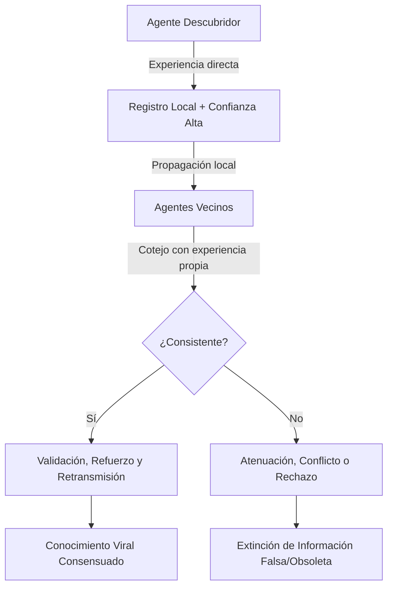
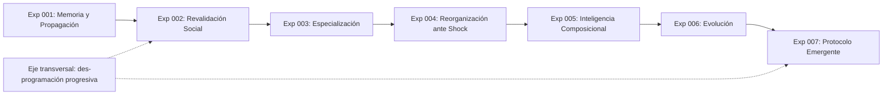

# Documento Fundacional: Inteligencia Distribuida Emergente (IDE)
**Versión:** 0.3  
**Fecha:** 2026-10-17  
**Estado:** Propuesta de Investigación / Base Teórica  

---

## 1. Premisa y Cambio de Paradigma

La mayor parte de los sistemas de inteligencia artificial contemporáneos concentra la capacidad cognitiva en arquitecturas monolíticas masivas (LLMs, redes neuronales profundas a gran escala) ejecutadas sobre infraestructuras de cómputo intensivas y centralizadas.

Este proyecto explora una hipótesis alternativa fundamental:

> **La inteligencia compleja puede emerger de una población de unidades computacionales simples, autónomas y severamente limitadas, capaces de aprender localmente, intercambiar conocimiento, revalidarlo y reorganizarse sin coordinación ni memoria central.**

El objetivo no es la computación distribuida clásica (repartir el cómputo de un único modelo predefinido entre múltiples nodos). El objetivo es investigar si **la inteligencia misma es una propiedad emergente distribuida en la dinámica relacional de la población**.

```
PARADIGMA ACTUAL:
[Entorno] ---> [Modelo Monolítico Central / Supercómputo] ---> [Acción]

PARADIGMA IDE (Inteligencia Distribuida Emergente):
[Entorno] ---> (Agente A) <---> (Agente B) <---> (Agente C) ---> [Respuesta Colectiva]
                    ^                ^                ^
                    +----------------+----------------+
                      (Intercambio, revalidación, topología dinámica)
```

---

## 2. Preguntas de Investigación

### Pregunta Central
> **¿Puede una población de agentes computacionales con capacidades individuales insuficientes desarrollar, conservar y mejorar conocimiento colectivo que ningún agente puede sostener por sí solo?**

### Preguntas Derivadas
1. **Propagación:** ¿Puede un descubrimiento local propagarse eficientemente por toda la población sin saturar los canales de comunicación?
2. **Epistemología Distribuida:** ¿Puede la red filtrar información falsa, degradada o desactualizada frente a evidencia contradictoria local?
3. **Memoria Colectiva:** ¿Puede existir memoria y reconstrucción cognitiva sin un repositorio centralizado ni representación global del mundo?
4. **Especialización Espontánea:** ¿Pueden emerger roles funcionales diferenciados a partir de agentes inicialmente homogéneos?
5. **Resiliencia y Plasticidad:** ¿Puede el sistema recuperar conocimiento o funciones tras la destrucción catastrófica de una fracción sustancial de la población?
6. **Capacidades Composicionales:** ¿Puede la agregación dinámica de agentes producir habilidades ausentes en cualquier individuo aislado?
7. **Topología Adaptativa:** ¿Puede la red de comunicación adaptar su geometría y densidad de enlaces según las presiones del entorno?
8. **Comunicación Emergente:** ¿Puede una población inventar por sí misma un protocolo de comunicación útil, si no recibe de fábrica la semántica de sus mensajes?

---

## 3. Hipótesis Central

Una población de agentes discretos exhibirá propiedades cognitivas emergentes de orden superior si y sólo si implementa mecanismos locales para:

1. **Percepción local:** Muestreo parcial y ruidoso del entorno inmediato.
2. **Retención acotada:** Almacenamiento local estrictamente inferior al volumen necesario para resolver el entorno.
3. **Aprendizaje local:** Adaptación paramétrica o de reglas guiada por experiencia directa.
4. **Comunicación de pares:** Transmisión de representaciones a agentes vecinos o enlazados.
5. **Evaluación de confianza:** Ponderación epistémica de la información externa recibida frente al historial propio.
6. **Modulación comportamental:** Ajuste de acción en función del conocimiento consolidado.
7. **Asociación dinámica:** Formación y disolución flexible de vínculos y agrupaciones operativas.

La cognición no reside en los nodos. **Reside en las transiciones de estado, los flujos informacionales y los patrones autoorganizados de la población.**

**Cómo se pone a prueba.** La parte "si" se examina construyendo poblaciones con estos mecanismos. La parte "sólo si" se examina **quitándolos**: cada mecanismo es una regla declarada que puede apagarse (ablación), y se mide qué propiedades desaparecen con ella (§10). Hoy varios de estos mecanismos, en particular la comunicación (4) y la evaluación de confianza (5), vienen **diseñados de fábrica**. Por eso sus efectos se consideran capacidades programadas, no emergentes, hasta que se demuestre lo contrario.

---

## 4. Unidad Computacional Mínima (Micro-Agente)

Cada agente es deliberadamente restringido. Ningún agente posee visión global ni capacidad de cómputo suficiente para modelar el problema completo.

| Componente | Especificación Mínima |
| :--- | :--- |
| **Percepción** | Radio sensorial local acotado (observa sólo una fracción del espacio de estados). |
| **Memoria** | Capacidad fija y pequeña ($k$ slots o memoria finita). Incapaz de contener la solución global. |
| **Estado Interno** | Variables dinámicas simples (energía, confianza interna, nivel de actividad, estrés/urgencia). *No se modela en el Exp 001.* |
| **Aprendizaje Local** | Ajuste heurístico o asociativo ante recompensas/castigos directos. |
| **Comunicación** | Protocolo broadcast/punto a punto limitado a vecinos en radio $R$ o topología de grafo. *En el Exp 001 la semántica es predefinida (consultar, responder y difundir creencias); se irá des-programando (§8).* |
| **Confiabilidad** | Metadato de confianza y grado de evidencia asociado a cada unidad de conocimiento. |
| **Afinidad/Cohesión**| Capacidad de acoplamiento temporal con otros agentes según objetivos compartidos. *No se modela en el Exp 001.* |

---

## 5. El Conocimiento como Proceso Distribuido

En IDE, el conocimiento no es un dato estático en disco. Es un **flujo dinámico, competitivo y evolutivo**:



1. **Descubrimiento:** Registro local con alta certidumbre inicial de origen experimental.
2. **Propagación:** Transmisión local a agentes contiguos.
3. **Cotejo y Concurrencia:** Los receptores cruzan el dato recibido con su memoria previa y experiencia empírica.
4. **Revisión Epistémica:** Refuerzo, mutación, degradación o descarte.
5. **Estabilidad Dinámica:** Las verdades pragmáticas sobreviven por confirmación recursiva; los sesgos o falsedades se extinguen al chocar con la realidad física del entorno.

---

## 6. Memoria Colectiva y Fragmentación

La memoria global es un fenómeno reconstructivo, análogo a esquemas holográficos o redes asociativas distribuidas:

$$\text{Solución } S = \{f_1, f_2, \dots, f_m\}$$
$$\text{Capacidad individual } C(\text{Agente}_i) \ll |S|$$

* El agente $A$ conserva $f_1$.
* El agente $B$ conserva $f_2$.
* El agente $C$ conserva $f_3$.

Ninguno conoce $S$. Cuando se presenta una demanda ambiental que exige $S$, la interacción coordinada entre $A$, $B$ y $C$ sintetiza la respuesta correcta. La pérdida de cualquier agente individual no destruye el conocimiento si existe redundancia distribuida en la población.

---

## 7. Organización Dinámica Multinivel

Se rechaza la preasignación de roles fijos (perceptores, actuadores, planificadores prefijados). La arquitectura adopta un esquema de autoensamblaje funcional:

$$\mathbf{Unidad} \longrightarrow \mathbf{Grupo} \longrightarrow \mathbf{Funci\acute{o}n} \longrightarrow \mathbf{Organismo} \longrightarrow \mathbf{Poblaci\acute{o}n}$$

* **Especialización emergente:** La interacción local y la demanda de la tarea provocan diferenciación funcional espontánea.
* **Agrupaciones transitorias:** Los agentes forman agregados funcionales temporales; una vez resuelta la perturbación o tarea, el grupo se disuelve.
* **Plasticidad morfológica:** El mismo sustrato de agentes puede configurar arquitecturas cognitivas radicalmente distintas según el contexto.

---

## 8. Programa Experimental



### Experimento 001: Memoria y Propagación Colectiva (Hito Primario)

* **Objetivo:** Establecer la **línea base funcional** de la plataforma y del método: verificar que una población con memoria individual estrictamente insuficiente adquiere, propaga, valida y retiene conocimiento del entorno sin supervisor central, **y** medir cuánto de ese desempeño se debe a cada regla diseñada.
* **Qué puede concluir:** mientras el protocolo transmita creencias con semántica predefinida, las capacidades de **acceso, superávit y persistencia** del conocimiento compartido son **programadas por construcción** (§10): no se ponen a prueba, se declaran (y si ni siquiera superan a la población aislada, se reportan como no observadas). La única afirmación con prueba empírica genuina es la **inmunidad colectiva a la falsedad**: ¿sobrevive si se apagan los filtros epistémicos diseñados (descuento, anti-eco, duda y olvido)? El resultado está abierto. El Exp 001 mide además cuánto aporta cada regla.
* **Entorno:** Grilla 2D toroidal con recursos heterogéneos. En esta primera versión, cada recurso tiene un único atributo observable (`id`) y es benéfico o dañino. Los recursos neutrales y los patrones de varios atributos quedan para experimentos posteriores.
* **Restricción Fundamental:** Cada agente sólo puede almacenar un subconjunto estricto de las reglas del mundo ($C_{\max} < N$; valor base: 3 de 12 patrones, es decir, el 25 %).
* **Métricas Formales:**
  * **Precisión Colectiva:** Tasa de decisiones correctas a nivel población.
  * **Cobertura Accesible:** Fracción del mundo que cada agente conoce o puede obtener de sus vecinos inmediatos. Es la medida del "meta-agente" que forma un grupo local; la cobertura de la población entera no basta, porque una población aislada también la alcanza.
  * **Precisión Aislada:** Rendimiento de una población idéntica sin comunicación, con las mismas condiciones iniciales (línea base).
  * **Velocidad de Propagación:** $t_{50}, t_{90}$ para difusión de nuevos descubrimientos.
  * **Persistencia Temporal:** Supervivencia del conocimiento tras la eliminación de los agentes descubridores originales.
  * **Resiliencia ante Daño:** Capacidad de retención tras eliminar el 10%, 30%, 50% y 70% de la población.
  * **Filtrado de Falsificación:** Tasa de extinción de creencias erróneas inyectadas deliberadamente (epistemología distribuida).
  * **Sobrecarga de Comunicación:** Ratio de mensajes emitidos vs. tasa de acierto cognitivo.
  * **Atribución:** Clasificación de cada capacidad observada como *programada* o *emergente*, mediante la ablación de las reglas de diseño y un control de contenido nulo.

### Eje Transversal: Des-programación Progresiva

Cuanta más inteligencia se programa en el agente, menos se puede afirmar que emerge. El programa avanza, por lo tanto, retirando semántica de diseño por niveles. En cada nivel se pregunta qué capacidades colectivas sobreviven:

| Nivel | Qué recibe el agente de fábrica | Qué debe aparecer por sí solo |
| :--- | :--- | :--- |
| **N0** (Exp 001) | Protocolo completo: consultar, responder y difundir creencias estructuradas con confianza y origen. | — (línea base) |
| **N1** | Sólo difusión; no existe la "pregunta". | Coordinación sin demanda explícita. |
| **N2** | Difusión de (patrón, signo) sin confianza ni origen. | Cuánto creer a quién (enlaza con el Exp 002). |
| **N3** | Un canal de símbolos arbitrarios de un alfabeto finito, sin significado asignado. | Una convención compartida entre símbolos y estados del mundo. |
| **N4** | Además, decidir cuándo emitir y a quién atender. | Un protocolo completo: turnos, selectividad, relevancia. |

### Experimento 007: Protocolo de Comunicación Emergente

* **Pregunta:** ¿puede una población inventar un protocolo de comunicación útil si sólo dispone de un canal de símbolos sin significado (niveles N3–N4)?
* **Restricciones:** los símbolos no tienen semántica predefinida; nadie recibe recompensa por comunicar, sólo por sus propias decisiones (comer o evitar); no hay coordinador ni diccionario compartido inicial.
* **Criterios de éxito:** (a) la población comunicada supera a la aislada; (b) la supera también frente a un control con símbolos barajados; (c) hay **señalización positiva**: los símbolos emitidos llevan información sobre el estado del mundo (información mutua mayor que 0); (d) hay **escucha positiva**: el comportamiento del receptor cambia según el símbolo recibido; (e) la convención es compartida, y no un dialecto privado de cada par.
* **Antecedentes:** juegos de señalización de Lewis, *naming games* de Steels y comunicación emergente en aprendizaje multi-agente. Se adoptan sus advertencias metodológicas: el desempeño por sí solo no prueba que haya comunicación (Lowe et al., 2019).
* **Alcance:** sería un salto conceptual. Una capacidad colectiva sostenida por un protocolo que la población inventó no puede atribuirse a una semántica programada.

---

## 9. Visión Tecnológica a Largo Plazo

```
[Nivel 1: Simulación Software]
             │
             ▼
[Nivel 2: Sistemas Distribuidos y Edge Computing]
             │
             ▼
[Nivel 3: Enjambres Microrrobóticos]
             │
             ▼
[Nivel 4: Materia Programable / Reconfigurable]
```

El fin último trasciende el software: trasladar los principios a sustratos físicos donde miles de micro-unidades aporten cómputo, energía, sensado y actuación, configurando organismos ad-hoc bajo demanda.

---

## 10. Criterio Epistemológico, Falsabilidad y Atribución de Emergencia

El proyecto se rige por rigor empírico estricto:
* **Hipótesis nula ($H_0$):** Una población de agentes limitados sin coordinador no puede superar el límite estocástico individual ni preservar conocimiento composicional coherente.
* **Criterio de éxito ($H_1$):** La población resuelve con consistencia estadística problemas que ningún agente individual puede resolver a lo largo de su ciclo vital completo, **y esa capacidad no es atribuible a una regla programada para producirla**.
* Un resultado negativo define con precisión las condiciones de frontera donde la autoorganización cognitiva colapsa.

### Regla Central de Atribución

> **Toda propiedad que afirmemos como emergente debe poder distinguirse de una capacidad que hayamos programado explícitamente en el agente.**

El riesgo que esta regla previene es concreto. Si diseñamos suficientes reglas inteligentes (confianza, descuento del rumor, refuerzo, castigo, olvido, consultas, difusión), terminamos demostrando que **nuestro algoritmo distribuido funciona**, en lugar de observar que **emerge una capacidad nueva**. La regla se aplica así:

1. **Inventario de presupuestos de diseño.** Cada regla del agente se declara con su **propósito**: qué capacidad se diseñó para producir.
2. **Pre-registro.** Antes de ejecutar un experimento se declara qué afirmaciones se harán y qué reglas tienen como propósito producir cada una. Ese registro se versiona y no se modifica a la vista de los resultados.
3. **Ablación.** Toda regla no nuclear puede apagarse. Una propiedad que desaparece al apagar las reglas diseñadas para producirla es **programada**.
4. **Control nulo.** Una propiedad que también aparece cuando los mensajes siguen las mismas reglas pero pierden su contenido informativo se atribuye a la mera **actividad**, no al intercambio de conocimiento.
5. **Principio conservador.** Ante la duda, la propiedad se atribuye al diseño. Toda afirmación sobre disponibilidad o transmisión de conocimiento se considera producida por las reglas de comunicación.
6. **Por construcción no es evidencia.** Si quitar las reglas de una afirmación deja a la población sin comunicación, la afirmación es *programada por construcción*, y eso se declara como consecuencia de la regla, no como un resultado.
7. **Mínima maquinaria.** Entre dos poblaciones que exhiben el mismo fenómeno se prefiere la que lo logra con menos reglas diseñadas. Cada regla nueva debe justificarse, declararse y poder ablacionarse.

8. **Independencia del reloj.** Una comunidad real no actúa al compás de un reloj común. Una propiedad que aparece con un esquema de actualización de la simulación y desaparece con otro es un artefacto del reloj, no de la población.

Sólo se llama **emergente** a una propiedad poblacional que supera al control aislado, persiste sin las reglas diseñadas para producirla, depende del contenido real de la comunicación y no depende del esquema de actualización. Los criterios operativos están en [DEFINICIONES_FORMALES.md](DEFINICIONES_FORMALES.md) §3.1.

---

## 11. Próximos Pasos de Implementación

> **Estado:** el simulador, las métricas y los protocolos 001-A a 001-D (este último, el de atribución) ya están implementados. El avance se sigue en [`tasks.md`](openspec/changes/ide-emergent-distributed-intelligence/tasks.md), que es la fuente del plan, y los resultados en [RESULTADOS.md](RESULTADOS.md). La lista se conserva como el plan original.

1. **Arquitectura del Simulador Experimento 001:**
   * Motor de grilla 2D discreto con soporte de eventos por pasos temporales (ticks).
   * Modelo formal del agente (memoria finita, radio de visión, buffer de comunicación, confianza Bayesiana/heurística).
   * Generador determinista de recursos y reglas ambientales.
2. **Suite de Pruebas y Métricas:**
   * Banco de benchmarks (propagación limpia, inyección de falsedad, ablación masiva).
   * Protocolo de atribución: ablación de cada regla de diseño, control nulo y clasificación programado/emergente.
   * Exportador de datos y visualización para análisis estadístico.

El detalle formal está en [DEFINICIONES_FORMALES.md](DEFINICIONES_FORMALES.md), la arquitectura en [DEFINICIONES_TECNICAS.md](DEFINICIONES_TECNICAS.md) y el plan de implementación verificable en [`openspec/changes/ide-emergent-distributed-intelligence/`](openspec/changes/ide-emergent-distributed-intelligence/).
