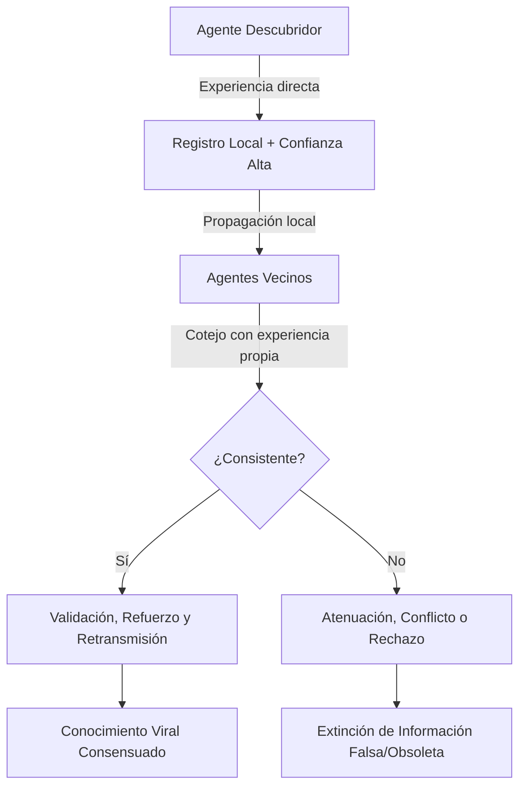
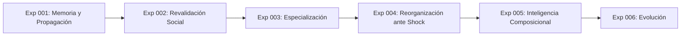

# Documento Fundacional: Inteligencia Distribuida Emergente (IDE)
**Versión:** 0.1  
**Fecha:** 2026-10-16  
**Estado:** Propuesta de Investigación / Base Teórica  

---

## 1. Premisa y Cambio de Paradigma

La mayor parte de los sistemas de inteligencia artificial contemporáneos concentra la capacidad cognitiva en arquitecturas monolíticas masivas (LLMs, redes neuronales profundas a gran escala) ejecutadas sobre infraestructuras de cómputo intensivas y centralizadas.

Este proyecto explora una hipótesis alternativa fundamental:

> **La inteligencia compleja puede emerger de una población de unidades computacionales simples, autónomas y severamente limitadas, capaces de aprender localmente, intercambiar conocimiento, revalidarlo y reorganizarse sin coordinación ni memoria central.**

El objetivo no es la computación distribuida clásica (repartir el cómputo de un único modelo predefinido entre múltiples nodos). El objetivo es investigar si **la inteligencia misma es una propiedad emergente distribuida en la dinámica relacional de la población**.

```
PARADIGMA ACTUAL:
[Entorno] ---> [Modelo Monolítico Central / Supercómputo] ---> [Acción]

PARADIGMA IDE (Inteligencia Distribuida Emergente):
[Entorno] ---> (Agente A) <---> (Agente B) <---> (Agente C) ---> [Respuesta Colectiva]
                    ^                ^                ^
                    +----------------+----------------+
                      (Intercambio, revalidación, topología dinámica)
```

---

## 2. Preguntas de Investigación

### Pregunta Central
> **¿Puede una población de agentes computacionales con capacidades individuales insuficientes desarrollar, conservar y mejorar conocimiento colectivo que ningún agente puede sostener por sí solo?**

### Preguntas Derivadas
1. **Propagación:** ¿Puede un descubrimiento local propagarse eficientemente por toda la población sin saturar los canales de comunicación?
2. **Epistemología Distribuida:** ¿Puede la red filtrar información falsa, degradada o desactualizada frente a evidencia contradictoria local?
3. **Memoria Colectiva:** ¿Puede existir memoria y reconstrucción cognitiva sin un repositorio centralizado ni representación global del mundo?
4. **Especialización Espontánea:** ¿Pueden emerger roles funcionales diferenciados a partir de agentes inicialmente homogéneos?
5. **Resiliencia y Plasticidad:** ¿Puede el sistema recuperar conocimiento o funciones tras la destrucción catastrófica de una fracción sustancial de la población?
6. **Capacidades Composicionales:** ¿Puede la agregación dinámica de agentes producir habilidades ausentes en cualquier individuo aislado?
7. **Topología Adaptativa:** ¿Puede la red de comunicación adaptar su geometría y densidad de enlaces según las presiones del entorno?

---

## 3. Hipótesis Central

Una población de agentes discretos exhibirá propiedades cognitivas emergentes de orden superior si y sólo si implementa mecanismos locales para:

1. **Percepción local:** Muestreo parcial y ruidoso del entorno inmediato.
2. **Retención acotada:** Almacenamiento local estrictamente inferior al volumen necesario para resolver el entorno.
3. **Aprendizaje local:** Adaptación paramétrica o de reglas guiada por experiencia directa.
4. **Comunicación de pares:** Transmisión de representaciones a agentes vecinos o enlazados.
5. **Evaluación de confianza:** Ponderación epistémica de la información externa recibida frente al historial propio.
6. **Modulación comportamental:** Ajuste de acción en función del conocimiento consolidado.
7. **Asociación dinámica:** Formación y disolución flexible de vínculos y agrupaciones operativas.

La cognición no reside en los nodos. **Reside en las transiciones de estado, los flujos informacionales y los patrones autoorganizados de la población.**

---

## 4. Unidad Computacional Mínima (Micro-Agente)

Cada agente es deliberadamente restringido. Ningún agente posee visión global ni capacidad de cómputo suficiente para modelar el problema completo.

| Componente | Especificación Mínima |
| :--- | :--- |
| **Percepción** | Radio sensorial local acotado (observa sólo una fracción del espacio de estados). |
| **Memoria** | Capacidad fija y pequeña ($k$ slots o memoria finita). Incapaz de contener la solución global. |
| **Estado Interno** | Variables dinámicas simples (energía, confianza interna, nivel de actividad, estrés/urgencia). |
| **Aprendizaje Local** | Ajuste heurístico o asociativo ante recompensas/castigos directos. |
| **Comunicación** | Protocolo broadcast/punto a punto limitado a vecinos en radio $R$ o topología de grafo. |
| **Confiabilidad** | Metadato de confianza y grado de evidencia asociado a cada unidad de conocimiento. |
| **Afinidad/Cohesión**| Capacidad de acoplamiento temporal con otros agentes según objetivos compartidos. |

---

## 5. El Conocimiento como Proceso Distribuido

En IDE, el conocimiento no es un dato estático en disco. Es un **flujo dinámico, competitivo y evolutivo**:



1. **Descubrimiento:** Registro local con alta certidumbre inicial de origen experimental.
2. **Propagación:** Transmisión local a agentes contiguos.
3. **Cotejo y Concurrencia:** Los receptores cruzan el dato recibido con su memoria previa y experiencia empírica.
4. **Revisión Epistémica:** Refuerzo, mutación, degradación o descarte.
5. **Estabilidad Dinámica:** Las verdades pragmáticas sobreviven por confirmación recursiva; los sesgos o falsedades se extinguen al chocar con la realidad física del entorno.

---

## 6. Memoria Colectiva y Fragmentación

La memoria global es un fenómeno reconstructivo, análogo a esquemas holográficos o redes asociativas distribuidas:

$$\text{Solución } S = \{f_1, f_2, \dots, f_m\}$$
$$\text{Capacidad individual } C(\text{Agente}_i) \ll |S|$$

* El agente $A$ conserva $f_1$.
* El agente $B$ conserva $f_2$.
* El agente $C$ conserva $f_3$.

Ninguno conoce $S$. Cuando se presenta una demanda ambiental que exige $S$, la interacción coordinada entre $A$, $B$ y $C$ sintetiza la respuesta correcta. La pérdida de cualquier agente individual no destruye el conocimiento si existe redundancia distribuida en la población.

---

## 7. Organización Dinámica Multinivel

Se rechaza la preasignación de roles fijos (perceptores, actuadores, planificadores prefijados). La arquitectura adopta un esquema de autoensamblaje funcional:

$$\mathbf{Unidad} \longrightarrow \mathbf{Grupo} \longrightarrow \mathbf{Funci\acute{o}n} \longrightarrow \mathbf{Organismo} \longrightarrow \mathbf{Poblaci\acute{o}n}$$

* **Especialización emergente:** La interacción local y la demanda de la tarea provocan diferenciación funcional espontánea.
* **Agrupaciones transitorias:** Los agentes forman agregados funcionales temporales; una vez resuelta la perturbación o tarea, el grupo se disuelve.
* **Plasticidad morfológica:** El mismo sustrato de agentes puede configurar arquitecturas cognitivas radicalmente distintas según el contexto.

---

## 8. Programa Experimental



### Experimento 001: Memoria y Propagación Colectiva (Hito Primario)

* **Objetivo:** Demostrar que una población con memoria individual estrictamente insuficiente adquiere, propaga, valida y retiene conocimiento del entorno sin supervisor central.
* **Entorno:** Grilla 2D con recursos heterogéneos (benéficos, neutrales, tóxicos/dañinos) definidos por múltiples atributos.
* **Restricción Fundamental:** Cada agente sólo puede almacenar un subconjunto estricto de reglas/asociaciones (e.g., $k=1$ atributo de $N$ requeridos).
* **Métricas Formales:**
  * **Precisión Colectiva:** Tasa de decisiones correctas a nivel población.
  * **Precisión Individual Aislada:** Rendimiento de un agente sin comunicación (línea base).
  * **Velocidad de Propagación:** $t_{50}, t_{90}$ para difusión de nuevos descubrimientos.
  * **Persistencia Temporal:** Supervivencia del conocimiento tras la eliminación de los agentes descubridores originales.
  * **Resiliencia ante Daño:** Capacidad de retención tras eliminar el 10%, 30%, 50% y 70% de la población.
  * **Filtrado de Falsificación:** Tasa de extinción de creencias erróneas inyectadas deliberadamente (epistemología distribuida).
  * **Sobrecarga de Comunicación:** Ratio de mensajes emitidos vs. tasa de acierto cognitivo.

---

## 9. Visión Tecnológica a Largo Plazo

```
[Nivel 1: Simulación Software]
             │
             ▼
[Nivel 2: Sistemas Distribuidos y Edge Computing]
             │
             ▼
[Nivel 3: Enjambres Microrrobóticos]
             │
             ▼
[Nivel 4: Materia Programable / Reconfigurable]
```

El fin último trasciende el software: trasladar los principios a sustratos físicos donde miles de micro-unidades aporten cómputo, energía, sensado y actuación, configurando organismos ad-hoc bajo demanda.

---

## 10. Criterio Epistemológico y Falsabilidad

El proyecto se rige por rigor empírico estricto:
* **Hipótesis nula ($H_0$):** Una población de agentes limitados sin coordinador no puede superar el límite estocástico individual ni preservar conocimiento composicional coherente.
* **Criterio de éxito ($H_1$):** La población resuelve con consistencia estadística problemas que ningún agente individual puede resolver a lo largo de su ciclo vital completo.
* Un resultado negativo define con precisión las condiciones de frontera donde la autoorganización cognitiva colapsa.

---

## 11. Próximos Pasos de Implementación

1. **Arquitectura del Simulador Experimento 001:**
   * Motor de grilla 2D discreto con soporte de eventos por pasos temporales (ticks).
   * Modelo formal del agente (memoria finita, radio de visión, buffer de comunicación, confianza Bayesiana/heurística).
   * Generador determinista de recursos y reglas ambientales.
2. **Suite de Pruebas y Métricas:**
   * Banco de benchmarks (propagación limpia, inyección de falsedad, ablación masiva).
   * Exportador de datos y visualización para análisis estadístico.
