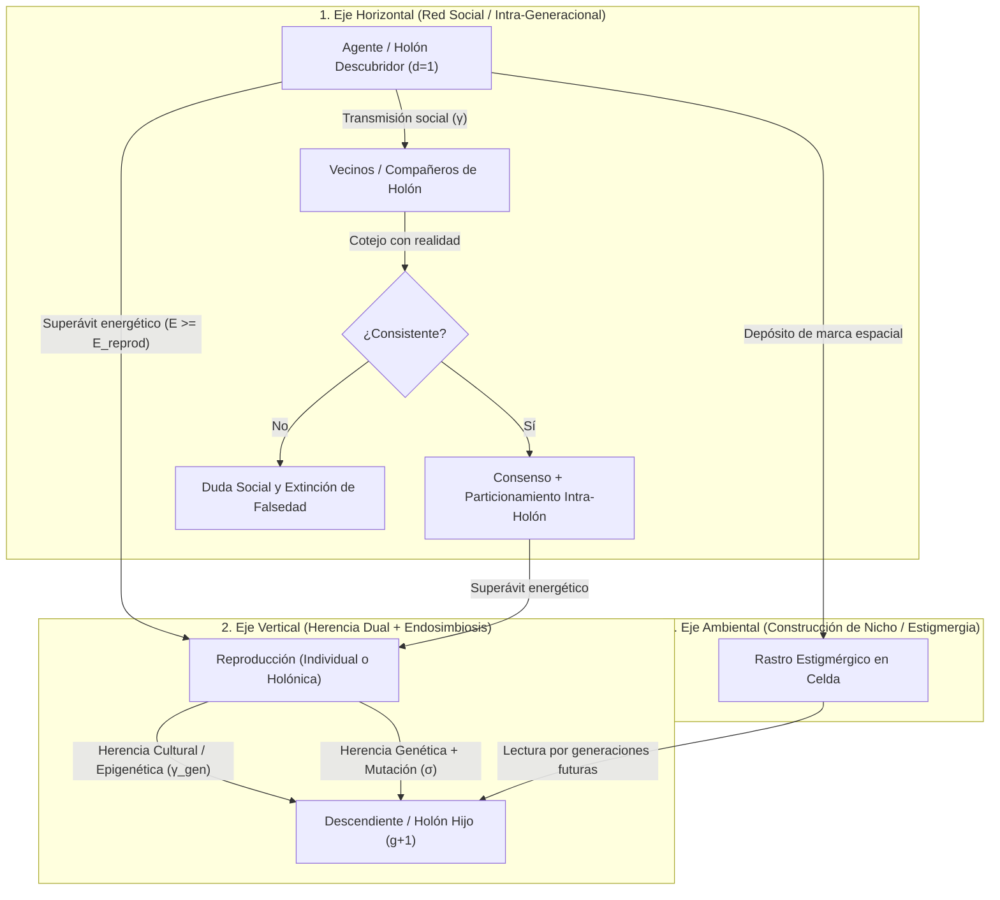
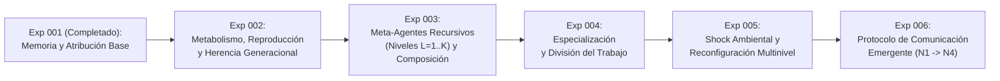

# Documento Fundacional: Inteligencia Distribuida Emergente (IDE)
**Versión:** 2.0  
**Fecha:** 2026-10-17  
**Estado:** Base Teórica y Hoja de Ruta Evolutiva Multinivel (Fase I verificada / Fase II en diseño)  

---

## 1. Premisa y Cambio de Paradigma

La mayor parte de los sistemas de inteligencia artificial contemporáneos concentra la capacidad cognitiva en arquitecturas monolíticas masivas (LLMs, redes neuronales profundas a gran escala) ejecutadas sobre infraestructuras de cómputo intensivas y centralizadas.

Este proyecto explora una hipótesis alternativa fundamental:

> **La inteligencia compleja puede emerger de una población abierta de unidades computacionales simples, autónomas y severamente limitadas, capaces de aprender localmente, intercambiar y revalidar conocimiento, reproducirse transmitiendo herencia cultural y genética, y ensamblarse recursivamente en jerarquías de agentes compuestos (meta-agentes de nivel arbitrario $L = 1, 2, \dots, K$) sin coordinación ni memoria central.**

El objetivo no es la computación distribuida clásica (repartir el cómputo de un único modelo predefinido entre múltiples nodos). El objetivo es investigar si **la inteligencia misma es una propiedad emergente y evolutiva distribuida en la dinámica relacional, transgeneracional y jerárquica de la población**.

```text
PARADIGMA ACTUAL (Monolítico):
[Entorno] ---> [Modelo Central Masivo] ---> [Acción]

PARADIGMA IDE v2.0 (Evolutivo y Fractal / Holónico):
Nivel 0 (Micro-Agentes):   (a1) <--> (a2)       (a3) <--> (a4)       (a5) <--> (a6)
                             \        /           \        /           \        /
Nivel 1 (Meta-Agentes):       [Grupo G1]  <----->  [Grupo G2]           [Grupo G3]
                                    \                  /                    /
Nivel 2 (Federaciones):              [[Organismo O1]]  <-------------------+
                                             |
Nivel K (Escala arbitraria):       [[[Super-Organismo ...]]] ---> [Adaptación y Evolución]
                                             |
Ciclo Generacional (g -> g+1):     Reproducción + Mutación + Herencia Cultural
```

---

## 2. Preguntas de Investigación

### Pregunta Central
> **¿Puede una población evolutiva de agentes computacionales con capacidades individuales insuficientes desarrollar, heredar a través de las generaciones y escalar recursivamente —mediante agrupaciones multinivel sin tope fijo— capacidades cognitivas colectivas que ningún individuo ni nivel inferior puede sostener por sí solo?**

### Preguntas Derivadas
1. **Propagación Horizontal:** ¿Puede un descubrimiento local propagarse eficientemente entre pares sin saturar los canales de comunicación?
2. **Epistemología Distribuida:** ¿Puede la red filtrar información falsa, degradada o desactualizada frente a evidencia contradictoria local?
3. **Memoria Colectiva y Transgeneracional (Vertical):** ¿Puede el conocimiento sobrevivir a la extinción del $100\%$ de sus descubridores originales mediante una combinación de transmisión social y herencia cultural de padres a hijos?
4. **Evolución de Capacidades (Genética + Epigenética):** ¿Pueden generaciones sucesivas adaptar sus parámetros cognitivos y rasgos funcionales por selección natural energética, sin entrenamiento centralizado?
5. **Simbiogénesis y Jerarquía Recursiva Ilimitada ($L \to \infty$):** ¿Pueden los agentes asociarse en meta-agentes de Nivel 1, éstos a su vez en estructuras de Nivel 2, Nivel 3 y Nivel $K$ arbitrario, operando en cada escala como una unidad más capaz?
6. **Capacidades Composicionales de Orden Superior:** ¿Puede la combinación recursiva de memorias y percepciones en un meta-agente resolver problemas compuestos de complejidad $m > C_{\max}$ inaccesibles para los niveles inferiores?
7. **Especialización y División del Trabajo:** ¿Pueden emerger espontáneamente castas o sub-unidades especializadas (exploradores, reservorios de memoria, integradores) dentro de un meta-agente multinivel?
8. **Comunicación Emergente:** ¿Puede una población inventar por sí misma un protocolo de comunicación útil si no recibe de fábrica la semántica de sus mensajes?

---

## 3. Hipótesis Central

Una población de agentes discretos exhibirá propiedades cognitivas emergentes y evolutivas de orden creciente si y sólo si dispone de mecanismos locales para:

1. **Percepción local:** Muestreo parcial del entorno inmediato.
2. **Retención acotada:** Almacenamiento local estrictamente inferior al volumen necesario para resolver el entorno ($C_{\max} \ll N$).
3. **Aprendizaje local:** Adaptación guiada por experiencia directa.
4. **Comunicación entre pares:** Intercambio horizontal de representaciones con vecinos.
5. **Evaluación epistémica de confianza:** Ponderación crítica de información externa frente al historial propio.
6. **Metabolismo, reproducción y herencia dual:** Ciclo vital gobernado por energía real ($E_i$), donde los agentes exitosos se reproducen heredando a su descendencia tanto rasgos mutables (genoma) como fragmentos de memoria (cultura).
7. **Composición holónica recursiva:** Capacidad de formar y disolver vínculos simbióticos en cualquier nivel $L$, donde un conjunto de unidades de nivel $L$ opera conjuntamente como una unidad de nivel $L+1$, y conjuntos de nivel $L+1$ vuelven a acoplarse en niveles $L+2, \dots, K$ sin límite preestablecido.

La cognición no reside en los nodos estáticos. **Reside en las transiciones de estado, los linajes evolutivos y las jerarquías dinámicas autoorganizadas de la población.**

**Cómo se pone a prueba.** La parte "si" se examina construyendo poblaciones con estos mecanismos. La parte "sólo si" se examina **quitándolos**: cada mecanismo es una regla declarada que puede apagarse (ablación), midiendo qué propiedades desaparecen con ella (§9).

---

## 4. De la Unidad Mínima al Holón Recursivo (Más allá del "Gen Egoísta")

La versión 2.0 supera el reduccionismo neodarwinista clásico (que ve al individuo aislado y a la mutación competitiva lenta como único motor) e incorpora los cuatro pilares de la **Síntesis Evolutiva Extendida y Biología de Sistemas**:

1. **Simbiogénesis y Endosimbiosis Hereditaria (Lynn Margulis):** Los grandes saltos de complejidad en la naturaleza (como el paso de procariotas a eucariotas) no ocurren por mutación gradual aislada, sino por la **fusión simbiótica permanente** de unidades distintas que pasan a operar y reproducirse como un nuevo organismo integrado. En IDE, tanto los agentes sueltos ($L=0$) como los Meta-Agentes compuestos ($L \ge 1$) pueden reproducirse transmitiendo su arquitectura simbiótica a la siguiente generación.
2. **Selección Multinivel (D. S. Wilson / E. O. Wilson):** La selección natural actúa simultáneamente sobre los individuos y sobre las coaliciones/holones. Aunque el egoísmo pueda parecer ventajoso dentro de un grupo, **los grupos cooperativos y epistémicamente diversos superan y desplazan a las poblaciones egoístas** al desbloquear recursos compuestos inaccesibles para individuos solitarios.
3. **Causalidad Descendente y Epigenética (Denis Noble):** La causalidad no fluye sólo de abajo hacia arriba ($\text{Gen} \to \text{Agente} \to \text{Grupo}$), sino también **de arriba hacia abajo ($\text{Holón } L \to \text{Sub-nodos } L-1 \dots 0$)**. Un Meta-Agente regula epigenéticamente a sus miembros para que no memoricen información redundante (particionamiento de memoria intra-holón, regla $R_{18}$). Esa regulación es una regla diseñada: lo que se pone a prueba es qué consigue la población con ella y sin ella.
4. **Construcción de Nicho y Estigmergia Espacial:** Los agentes no sólo se adaptan pasivamente al entorno; **modifican activamente su nicho** depositando marcadores epistémicos (feromonas/señales espaciales) en las celdas del entorno, externalizando memoria colectiva más allá de sus cerebros individuales ($C_{\max}$).

| Componente | Nivel Elemental ($L = 0$: Micro-Agente) | Nivel Compuesto ($L \ge 1$: Meta-Agente Recursivo / Holón) |
| :--- | :--- | :--- |
| **Percepción** | Radio sensorial local acotado $R_{\text{perc}}$ + lectura de rastros estigmérgicos locales. | Cada hoja percibe por sí misma; no hay percepción conjunta en la Fase II. |
| **Memoria** | Capacidad fija y pequeña ($C_{\max} \ll N$). | Memoria colectiva: unión de las memorias de sus hojas en alcance local, cada una con su propio límite $C_{\max}$. La capacidad agregada es $\sum C_i$; la causalidad descendente busca reducir duplicados. |
| **Metabolismo ($E$)** | Energía individual ganada al nutrirse y gastada por tick/acción. | La energía sigue siendo de cada hoja. Las hojas reparten la ganancia de un recurso compuesto resuelto en conjunto y pagan un costo de coordinación que crece con el tamaño y el nivel del holón. |
| **Reproducción y Herencia** | Fisión reproductiva cuando $E \ge E_{\text{reprod}}$, heredando genoma mutado y creencias top. | **Endosimbiosis reproductiva:** un Holón exitoso puede dividirse generando un Holón hijo ya ensamblado. |
| **Causalidad** | Ascendente (aporta creencias y acciones a su nodo padre). | **Descendente** (penaliza la retención de creencias redundantes entre sus hojas, $R_{18}$). |
| **Capacidad Operativa** | Resuelve recursos simples de orden $m \le C_{\max}$. | Desbloquea recursos compuestos (`CompositeRule`) de complejidad $m > C_{\max}$. |
| **Acoplamiento** | Puede unirse a otros nodos formando un grupo $L=1$. | Puede unirse a otros nodos o grupos formando niveles $L=2, 3, \dots, K$ (o disolverse en sus partes si deja de ser rentable). |

---

## 5. El Conocimiento en Tres Vías: Horizontal, Vertical y Ambiental (Estigmérgica)

En IDE v2.0, el conocimiento circula y persiste a través de **tres canales complementarios**:



### Lo que dejó el Experimento 001 y motiva la Versión 2.0
El Experimento 001 (población inmortal, sin reproducción ni construcción de nicho) dejó resultados mayormente negativos para la emergencia ([RESULTADOS.md](RESULTADOS.md)):
- Las capacidades colectivas observadas (acceso al conocimiento, superávit de decisión, extinción del rumor) desaparecen o dejan de superar a la población aislada cuando se apagan las reglas diseñadas para producirlas. C1, C2 y C3 resultaron `PROGRAMMED`.
- El conocimiento social no sobrevive de forma fiable a sus descubridores. C4 resultó `NOT_OBSERVED`: tras eliminar a los descubridores y retirar el estímulo, sobrevive sólo en 2 de 5 semillas (001-D, perfil `quick`). Varias reglas pesan en esa extinción en magnitudes parecidas, entre ellas la regla anti-eco $R_6$, que impide que un testimonio se revalide sólo con otros testimonios. Con 5 semillas no se puede aislar una causa.
- **Hipótesis de trabajo de la v2.0** (no un resultado): la herencia cultural vertical, la integración holónica y la construcción de nicho podrían sostener el conocimiento más allá de los individuos sin abrir la puerta a la histeria colectiva. La Fase II lo pone a prueba con el mismo marco de atribución.

---

## 6. Organización Jerárquica Ilimitada (Arquitectura Fractal y Causalidad Bidireccional)

Se elimina cualquier restricción artificial que limite la organización a 2 o 3 niveles fijos. La jerarquía es **recursiva, abierta y bidireccional**:

$$\mathbf{Nivel\ 0\ (Agente)} \Longleftrightarrow \mathbf{Nivel\ 1\ (Grupo)} \Longleftrightarrow \mathbf{Nivel\ 2\ (Meta\text{-}Grupo)} \Longleftrightarrow \dots \Longleftrightarrow \mathbf{Nivel\ K\ (Organismo\ de\ Orden\ K)}$$

1. **Contrato común en todas las escalas:** Todo nodo, de cualquier nivel $L$, expone el mismo contrato estructural (`AgentNode`: identidad, nivel, hojas, capacidad efectiva y memoria colectiva). Los nodos raíz pueden fusionarse (`BOND`) y, si son holones, reproducirse como unidad ($R_{17}$). En la Fase II, percibir, decidir y comunicarse siguen siendo operaciones de las hojas ($L = 0$); que un holón opere como agente unitario es una extensión posible, no parte de esta fase.
2. **Causalidad Ascendente y Descendente:** Hacia arriba ($\uparrow$), los sub-nodos aportan sus creencias para formar la memoria colectiva del Holón. Hacia abajo ($\downarrow$), el Holón modula la retención de memoria de sus partes, para que dos sub-nodos no desperdicien su escasa capacidad $C_{\max}$ recordando los mismos patrones ($R_{18}$). La modulación de la exploración queda fuera del alcance de la Fase II.
3. **Selección multinivel sobre una regla de asociación diseñada:** La fusión (`BOND`, $R_{15}$) es una regla programada: decide cuándo dos nodos se asocian. Lo que se pone a prueba es si la selección sostiene o no esas estructuras. Formar cada nivel adicional $L$ tiene un **costo metabólico de mantenimiento** ($c_{\text{coord}} > 0$). La hipótesis es que, si el entorno sólo tiene problemas simples, las estructuras de alto nivel se disuelven o mueren de hambre, y que, si contiene recursos compuestos de gran recompensa, la selección favorece holones de mayor nivel. Ambos desenlaces son resultados válidos.
4. **Fusión (`BOND`), Fisión (`SPLIT`) y Endosimbiosis Reproductiva:** Una estructura de nivel $L$ puede desacoplarse en sus sub-estructuras de nivel $L-1$ cuando el entorno cambia, o bien dividirse reproductivamente como unidad simbiótica cuando alcanza un superávit energético sostenido.

---

## 7. Programa Experimental (Hoja de Ruta v2.0)



### Fase I — Experimento 001: Memoria y Propagación Colectiva (Hito Completado)
- **Estado:** Implementado y verificado ([RESULTADOS.md](RESULTADOS.md)).
- **Resultados:**
  - **Superávit funcional de decisión** frente a la población aislada: +22.8 a +24.2 pp en el perfil `quick` y +14.5 a +17.7 pp en `full`, con $p = 0.03125$ en las 5 semillas. Es programado por construcción (C2).
  - **Extinción del rumor** en la población completa en las 5 semillas. Depende de los filtros epistémicos diseñados (C3 `PROGRAMMED`, E3 con $p = 0.5$).
  - **Persistencia no observada** del conocimiento tras eliminar a los descubridores (C4 `NOT_OBSERVED`).
  - **La exploración $\epsilon$ ($R_{10}$) es la regla de mayor peso:** sin ella, el rumor no se extingue nunca.
  - Dejó establecido el marco de **Atribución de Emergencia (001-D)**.
- **Qué puede concluir:** mientras el protocolo transmita creencias con semántica predefinida, las capacidades de acceso, superávit y persistencia son programadas por construcción (§9). Ninguna capacidad del Exp 001 calificó como emergente.

### Fase II — Experimento 002: Ciclo Vital, Reproducción y Evolución Intergeneracional
- **Objetivo:** Introducir metabolismo real ($E_i$), muerte por agotamiento/toxicidad y reproducción con **herencia dual** (genética de capacidades $\Theta_i$ + herencia cultural de creencias $\mathcal{M}_i$).
- **Preguntas clave:**
  - ¿Logra la herencia intergeneracional sostener y acumular conocimiento colectivo a lo largo de decenas de generaciones aunque ningún individuo viva lo suficiente para explorar todo el mapa?
  - ¿Evolucionan por selección natural los hiperparámetros de los agentes ($\alpha, \gamma, \epsilon$, capacidad, visión) hacia configuraciones superiores a las iniciales sin ajuste manual?
- **Cómo se contrasta:** la adaptación se compara contra un control de **deriva neutral** (se reproducen los mismos agentes y de la misma forma, pero el genoma de cada hijo viene de un donante al azar), y la herencia cultural contra descendientes que nacen sin creencias. Adaptarse por selección y transmitir por herencia son propósitos de reglas diseñadas, así que se declaran programados; qué rasgos evolucionan (cerebros más grandes o más cooperación) se registra como observación exploratoria.

### Fase III — Experimento 003: Simbiogénesis y Jerarquía Recursiva de Meta-Agentes ($L = 1 \dots K$)
- **Objetivo:** Permitir que agentes y grupos se asocien dinámicamente formando árboles holónicos de profundidad arbitraria ($L = 1, 2, 3, \dots, K$) frente a un entorno con **recursos composicionales** que exigen combinar simultáneamente $m$ patrones benéficos ($2 \le m \le N/2$).
- **Qué se pone a prueba:** si la población, con la regla de fusión diseñada y bajo selección, sostiene holones capaces de resolver recursos de orden $m > C_{\max}$, y con qué nivel jerárquico. Que un individuo con $C_{\max} < m$ y sin ayuda no pueda resolverlos es una propiedad del entorno diseñado. Por eso el superávit cooperativo sobre esos recursos (C7) está pre-registrado como **programado por construcción** y no se presenta como evidencia de emergencia. Los agentes no reciben la regla de esos recursos: aprenden por experiencia si les conviene consumirlos. Además, la mutación puede elevar $C_{\max}$ individual: si la selección prefiere cerebros más grandes a la cooperación, eso también es un resultado.

- **Prueba genuina de la Fase II:** de las afirmaciones pre-registradas (C5–C8), sólo una no la persigue ninguna regla diseñada: C8. Pregunta si los miembros de un holón, **sin** la regla de causalidad descendente ($R_{18}$), terminan sabiendo, entre todos, más cosas distintas que cuando se juntaron (con memoria acotada, eso exige no duplicar). Se compara contra holones formados igual pero sin la vista compartida ($R_{22}$), que se diseñó para dar acceso al conocimiento, no para repartirlo. Como se mide el cambio desde la formación, no cuenta que la regla de fusión ya junte memorias distintas. Las demás (aceleración cultural, adaptación por selección y superávit cooperativo) se declaran programadas por construcción: verifican que los mecanismos diseñados funcionan.

### Fase IV — Experimentos 004 a 006: Especialización, Shock Ambiental y Lenguaje Emergente
- **Exp 004 (Especialización dentro del Meta-Agente):** Diferenciación de roles internos (nodos sensores de amplio radio vs. nodos de alta memoria vs. nodos coordinadores) dentro de un mismo organismo multinivel.
- **Exp 005 (Shock y Fisión/Fusión Adaptativa):** Inversión abrupta de las reglas del entorno (`invert_world_rules`) para medir cómo los super-organismos disuelven ramas obsoletas y se reconfiguran.
- **Exp 006 (Protocolo de Comunicación Emergente, niveles N3–N4):** ¿puede una población inventar un protocolo útil si sólo dispone de un canal de símbolos sin significado?
  - **Restricciones:** los símbolos no tienen semántica predefinida; nadie recibe recompensa por comunicar, sólo por sus propias decisiones; no hay coordinador ni diccionario inicial compartido.
  - **Criterios de éxito:**
    - (a) la población comunicada supera a la aislada;
    - (b) la supera también frente a un control con símbolos barajados;
    - (c) hay **señalización positiva**: los símbolos llevan información sobre el mundo (información mutua mayor que 0);
    - (d) hay **escucha positiva**: el receptor cambia su comportamiento según el símbolo;
    - (e) la convención es compartida y no un dialecto privado de cada par.
  - **Antecedentes:** juegos de señalización de Lewis, *naming games* de Steels y comunicación emergente multi-agente. Se adopta su advertencia: el desempeño por sí solo no prueba que haya comunicación (Lowe et al., 2019).

### Eje Transversal: Des-programación Progresiva

Cuanta más inteligencia se programa en el agente, menos se puede afirmar que emerge. El programa avanza retirando semántica de diseño por niveles, y en cada nivel pregunta qué capacidades colectivas sobreviven:

| Nivel | Qué recibe el agente de fábrica | Qué debe aparecer por sí solo |
| :--- | :--- | :--- |
| **N0** (Exp 001 a 003) | Protocolo completo: consultar, responder y difundir creencias estructuradas con confianza y origen. | — (línea base) |
| **N1** | Sólo difusión; no existe la "pregunta". | Coordinación sin demanda explícita. |
| **N2** | Difusión de (patrón, signo) sin confianza ni origen. | Cuánto creer a quién. |
| **N3** | Un canal de símbolos arbitrarios de un alfabeto finito, sin significado asignado. | Una convención compartida entre símbolos y estados del mundo. |
| **N4** | Además, decidir cuándo emitir y a quién atender. | Un protocolo completo: turnos, selectividad, relevancia. |

---

## 8. Visión Tecnológica a Largo Plazo

```text
[Nivel 1: Simulación Evolutiva y Holónica en Software]
                         │
                         ▼
[Nivel 2: Enjambres de Agentes de Software Autoorganizados]
                         │
                         ▼
[Nivel 3: Enjambres Microrrobóticos con Acoplamiento Físico]
                         │
                         ▼
[Nivel 4: Materia Programable / Organismos Reconfigurables]
```

El concepto final no es programar un agente fijo ni una jerarquía rígida de dos capas, sino crear el sustrato evolutivo capaz de **autoorganizarse en tantos niveles de complejidad como el problema exija**.

---

## 9. Criterio Epistemológico, Falsabilidad y Atribución de Emergencia

El proyecto se rige por rigor empírico estricto:
* **Hipótesis nula ($H_0$):** Una población de agentes limitados sin coordinador no puede superar el límite estocástico individual ni preservar conocimiento composicional coherente, ni dentro de una generación ni a través de ellas.
* **Criterio de éxito ($H_1$):** La población resuelve con consistencia estadística problemas que ningún agente individual puede resolver a lo largo de su ciclo vital completo, **y esa capacidad no es atribuible a una regla programada para producirla**.
* Un resultado negativo define con precisión las condiciones de frontera donde la autoorganización cognitiva colapsa. Los colapsos poblacionales (extinción por inanición, parasitismo dentro de un holón) también son resultados.

### Regla Central de Atribución

> **Toda propiedad que afirmemos como emergente —sea en la red social, en la evolución generacional o en la jerarquía de meta-agentes— debe poder distinguirse de una capacidad programada explícitamente en las reglas locales.**

Si diseñamos suficientes reglas inteligentes (confianza, descuento del rumor, olvido, consultas, herencia, fusión holónica, penalización de redundancia), terminamos demostrando que **nuestro algoritmo distribuido funciona**, en lugar de observar que **emerge una capacidad nueva**. La regla se aplica así:

1. **Inventario de presupuestos de diseño (`DESIGN_RULES`).** Cada regla se declara con su **propósito**, es decir, la capacidad que se diseñó para producir. Esto incluye las reglas evolutivas y holónicas: metabolismo, herencia cultural, mutación, fusión y fisión, penalización de redundancia y estigmergia.
2. **Pre-registro.** Antes de ejecutar un experimento se declaran las afirmaciones, las reglas que tienen como propósito producir cada una y el perfil de corrida. Ese registro se versiona y no se modifica a la vista de los resultados.
3. **Ablación.** Toda regla no nuclear puede apagarse. Una propiedad que desaparece al apagar las reglas diseñadas para producirla es **programada**.
4. **Control nulo.** Una propiedad que también aparece cuando los mensajes (o la herencia, o los rastros) conservan su forma pero pierden su contenido informativo se atribuye a la mera **actividad**, no al intercambio de conocimiento.
5. **Principio conservador.** Ante la duda, la propiedad se atribuye al diseño. Toda afirmación sobre disponibilidad o transmisión de conocimiento se considera producida por las reglas de comunicación o de herencia.
6. **Por construcción no es evidencia.** Si sin las reglas de una afirmación la métrica se anula por diseño (la población queda sin comunicación, o el entorno impide por construcción que un individuo resuelva la tarea), la afirmación es *programada por construcción*. Se declara como consecuencia de la regla, no como un resultado.
7. **Mínima maquinaria.** Entre dos poblaciones que exhiben el mismo fenómeno se prefiere la que lo logra con menos reglas diseñadas. Cada regla nueva debe justificarse, declararse y poder ablacionarse.
8. **Independencia del reloj.** Una propiedad que aparece con un esquema de actualización de la simulación y desaparece con otro es un artefacto del reloj, no de la población.

Sólo se llama **emergente** a una propiedad poblacional que supera al control aislado, persiste sin las reglas diseñadas para producirla, depende del contenido real de la comunicación y no depende del esquema de actualización. Los criterios operativos están en [DEFINICIONES_FORMALES.md](DEFINICIONES_FORMALES.md) §3.1. Una propiedad que una regla diseñada persigue (por ejemplo, la ortogonalización de memorias que busca $R_{18}$, o la resolución cooperativa de recursos que sólo un holón puede resolver) no se llama emergente ni espontánea.

---

## 10. Mapa Documental del Proyecto

1. **Visión y Programa Científico:** este documento (v2.0).
2. **Modelo Matemático y Ontológico:** [DEFINICIONES_FORMALES.md](DEFINICIONES_FORMALES.md) (v2.0).
3. **Arquitectura de Software y Contratos:** [DEFINICIONES_TECNICAS.md](DEFINICIONES_TECNICAS.md) (v2.0).
4. **Registro Empírico Auditado:** [RESULTADOS.md](RESULTADOS.md).
5. **Especificación Ejecutable (OpenSpec):** requisitos vigentes de la Fase I en [`openspec/specs/`](openspec/specs/), con su diseño archivado en [`openspec/changes/archive/2026-10-17-ide-emergent-distributed-intelligence/`](openspec/changes/archive/2026-10-17-ide-emergent-distributed-intelligence/), y el cambio en curso de la Fase II en [`openspec/changes/ide-v2-evolutionary-holonic-intelligence/`](openspec/changes/ide-v2-evolutionary-holonic-intelligence/).
