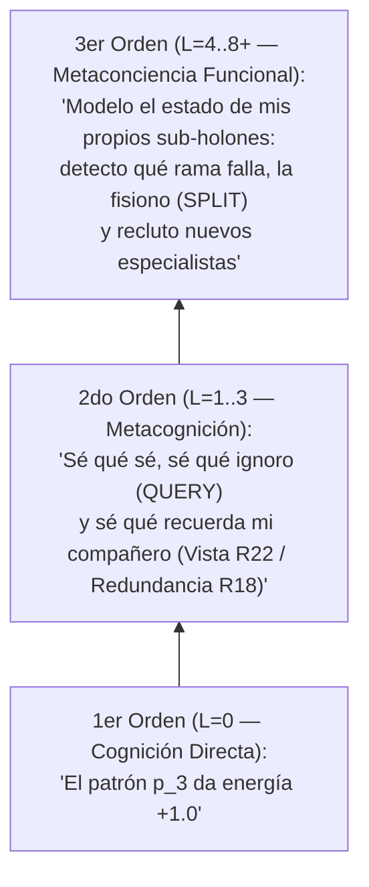

# Escala Biológica y Holónica de IDE: De la Unidad Mínima a la Noosfera ($L = 0 \dots K$)

> **Propósito de este documento:** Establecer la correspondencia formal y conceptual entre los niveles jerárquicos recursivos de `IDE` ($L = 0, 1, 2, \dots, K$, implementados mediante el protocolo `AgentNode` y la clase `CompositeAgent`) y las **Grandes Transiciones Evolutivas** de la biología (Maynard Smith & Szathmáry, Lynn Margulis, Denis Noble), incluyendo la emergencia progresiva de **metacognición** y **metaconciencia funcional**.

---

## 1. Principio de Invarianza de Escala (Leyes Fractales)

En un sistema de software tradicional, modelar células, tejidos, órganos, organismos y sociedades requeriría programar clases y reglas ad-hoc para cada escala. En `IDE v2.0+`, la jerarquía es **recursiva y libre de escala**:

$$\mathbf{L=0\ (Procariota)} \Longleftrightarrow \mathbf{L=1\ (Eucariota)} \Longleftrightarrow \mathbf{L=2\ (Tejido)} \Longleftrightarrow \mathbf{L=3\ (Órgano)} \Longleftrightarrow \mathbf{L=4\ (Sistema)} \Longleftrightarrow \mathbf{L=5\ (Organismo)} \Longleftrightarrow \mathbf{L=6\ (Tribu)} \Longleftrightarrow \mathbf{L=7\ (Sociedad)} \Longleftrightarrow \mathbf{L=8+\ (Noosfera)}$$

Las mismas leyes formales operan en todos los pisos de la escalera:
1. **Fusión Simbiótica (`BOND`, $R_{15}$):** Dos nodos de cualquier nivel $L_a, L_b$ se asocian en un nodo de nivel $L = 1 + \max(L_a, L_b)$ cuando su complementariedad epistémica de Jaccard ($\mathcal{S}_{\text{comp}}$) y su afinidad ($\omega_{\text{bond}}$) superan el umbral $\theta_{\text{sinergia}}$.
2. **Causalidad Descendente ($R_{18}$):** El nivel superior modula la utilidad de memoria ($\psi_{\text{red}}$) de sus hojas para eliminar duplicados ($\mathcal{M}_i \cap \mathcal{M}_j \to \emptyset$) y forzar la especialización interna.
3. **Costo de Coordinación y Fisión (`SPLIT`, $R_{16}, R_{23}$):** Cada nivel adicional exige pagar un costo metabólico $c_{\text{coord}}(U) = c_{\text{enlace}} \cdot |U| \cdot L(U)$. Un nivel superior sólo sobrevive si la complejidad de los problemas compuestos que resuelve ($m^{\kappa}$) paga su mantenimiento; de lo contrario, se fisiona en sus sub-estructuras.
4. **Endosimbiosis Reproductiva ($R_{17}$):** Un holón exitoso se reproduce como unidad simbiótica completa (`reproduce_holon`), heredando su topología arbórea y su cultura ($R_{14}$) a la siguiente generación.

---

## 2. Tabla Maestra de Correspondencia: Niveles $L = 0$ a $L = 9+$

### Tramo I: Escala Micro y Celular ($L = 0 \to L = 1$)
*Por qué $L=0$ es más pequeño que una célula humana:* Una célula compleja (eucariota, como una neurona) ya es el resultado de una fusión simbiótica ancestral de bacterias más simples (mitocondrias, núcleo, citoplasma).

| Nivel en `IDE` | Equivalente Biológico | Estructura en `IDE` | Capacidad Funcional y Cognitiva |
| :---: | :--- | :--- | :--- |
| **$L = 0$** | **Procariota / Bacteria / Organelo** | `MicroAgent` individual ($C_{\max} \ll N$, genoma propio $\Theta_i$, energía $E_i$). | **Supervivencia reactiva y epistemología basal:** Percibe el entorno inmediato, aprende por experiencia directa ($R_1$), olvida lo obsoleto ($R_3$) y sabe qué ignora (monitoreo metacognitivo de 1er orden vía umbral de confianza $c_{\text{umbral}}$). Resuelve únicamente recursos elementales ($m \le C_{\max}$). |
| **$L = 1$** | **Célula Compleja / Eucariota** *(1ra Simbiogénesis de Margulis)* | `CompositeAgent` formado por 2 a 4 `MicroAgent` complementarios con reproducción simbiótica ($R_{17}$). | **Unidad simbiótica mínima:** Combina memorias disjuntas para superar por primera vez la barrera individual $C_{\max}$. Una hoja actúa como portadora de un fragmento y otra del fragmento complementario, resolviendo los primeros recursos compuestos ($m > C_{\max}$). |

---

### Tramo II: Escala Histológica y Orgánica ($L = 2 \to L = 5$)
*Emergencia del individuo pluricelular complejo.*

| Nivel en `IDE` | Equivalente Biológico | Estructura en `IDE` | Capacidad Funcional y Cognitiva |
| :---: | :--- | :--- | :--- |
| **$L = 2$** | **Tejido Especializado** *(ej. epitelio sensorial, tejido neural)* | Agrupación de holones $L=1$ bajo causalidad descendente activa ($R_{18}$). | **Ortogonalización de memoria ($\mathcal{M}_i \cap \mathcal{M}_j \to \emptyset$):** Los sub-nodos dejan de repetir patrones conocidos por sus compañeros. El tejido cubre de forma uniforme un dominio de patrones sin desperdiciar capacidad cerebral individual. |
| **$L = 3$** | **Órgano Funcional** *(ej. ojo, hipocampo, hígado)* | Integración de tejidos ($L=2$) con genomas diferenciados en castas complementarias. | **División anatómica del trabajo:** Combina sub-holones *Exploradores* ($r_{\text{perc}}$ alto, $C_{\max}$ bajo), *Bibliotecarios* ($C_{\max}$ alto, sedentarios) y *Nervios de enlace* ($r_{\text{com}}$ alto). En Fase IV, un nivel $L=3$ equivale a un módulo funcional o algoritmo completo de múltiples pasos. |
| **$L = 4$** | **Sistema o Aparato** *(ej. Sistema Nervioso, Sistema Inmune)* | Red de órganos ($L=3$) acoplados que procesan flujos complejos de información y energía. | **Procesamiento distribuido e inmunidad epistémica:** Filtra rumores a gran escala, coordina percepción lejana con memoria profunda y mantiene la estabilidad frente a perturbaciones locales. |
| **$L = 5$** | **Organismo Pluricelular / Ser Vivo Completo** | Árbol holónico autónomo que integra múltiples sistemas ($L=4$) con recambio celular continuo. | **Homeostasis e identidad persistente:** Aunque las hojas individuales (`MicroAgent`, $L=0$) mueran por desgaste energético y sean reemplazadas por descendientes, el Organismo $L=5$ conserva su estructura, su memoria colectiva y su identidad a lo largo del tiempo. |

---

### Tramo III: Escala Supra-Organísmica y Planetaria ($L = 6 \to L = 9+$)
*¿Qué viene después del ser vivo individual?* Cuando varios Organismos completos ($L=5$) se asocian bajo las mismas leyes de `IDE`, la evolución cruza hacia las transiciones sociales y ecológicas:

| Nivel en `IDE` | Equivalente Biológico / Evolutivo | Estructura en `IDE` | Capacidad Funcional y Cognitiva |
| :---: | :--- | :--- | :--- |
| **$L = 6$** | **Tribu / Colonia / Superorganismo Eusocial** *(ej. colmena, hormiguero, clan)* | Asociación de varios Organismos ($L=5$) que comparten un territorio y un nido estigmérgico ($R_{19}$). | **Resiliencia trans-individual y memoria espacial compartida:** Si un organismo ($L=5$) entero colapsa ante un peligro local, la Tribu sobrevive, repara la pérdida y preserva el mapa químico grabado en el suelo del cubo 3D. |
| **$L = 7$** | **Sociedad / Ciudad Multigremial** *(Cultura acumulativa e instituciones)* | Federación de Tribus/Superorganismos ($L=6$) especializados en dominios distintos del universo. | **Especialización civilizatoria:** Una rama $L=6$ domina operaciones lógico-matemáticas, otra procesa flujos del *Telescopio a Internet* y otra gestiona el puente simbólico con el humano. Ningún organismo individual comprende la totalidad de la ciudad, pero la ciudad resuelve problemas de orden $m \gg C_{\max}$. |
| **$L = 8$** | **Biosfera / Noosfera Local** *(Hipótesis Gaia / Esfera de pensamiento global en el equipo)* | Red jerárquica que acopla las sociedades ($L=7$) a lo largo de todo el espacio toroidal 3D de la máquina. | **Autorregulación global y Metaconciencia Funcional:** El nivel superior procesa patrones no sólo sobre recursos externos, sino sobre el estado energético, epistémico y estructural de sus propias ramas inferiores, reconfigurando el ecosistema ante cambios de régimen ($R_9$). |
| **$L = 9+$** | **Federación Inter-Planetaria / Red de Mundos** | Intercambio de *Esporas Cognitivas* (`.holon.json`) entre instancias de `IDE` corriendo en distintos equipos. | **Evolución distribuida multi-hardware:** Los holones campeones migran entre computadoras distintas, cruzando linajes y culturas evolucionadas en entornos diferentes. |

---

## 3. Escala de Metacognición y Metaconciencia Funcional en `IDE`

A medida que la jerarquía asciende de $L=0$ a $L=8+$, emerge una escalera de reflexividad cognitiva:

1. **Cognición de 1er Orden (Conocer el Mundo — $L = 0$):**
   - Representar si un estímulo externo es benéfico o dañino ($\hat{v}$).
2. **Metacognición Explícita (Conocer el Propio Conocimiento — $L = 0 \dots 3$):**
   - En $L=0$: medir la propia incertidumbre ($c < c_{\text{umbral}}$) para decidir cuándo preguntar (`QUERY_PATTERN`, $R_8$) y distinguir experiencia vivida de rumor (`from_direct_experience`, $R_6$).
   - En $L=1 \dots 3$: evaluar la complementariedad con el otro (`BOND`, $R_{15}$) y podar recuerdos duplicados dentro del grupo (Causalidad Descendente, $R_{18}$).
3. **Metaconciencia Funcional (Auto-Modelo del Sistema — $L \ge 4$):**
   - En niveles superiores, la supervivencia del super-organismo depende de monitorear la salud energética y la fiabilidad de sus propios "órganos" y "sistemas" inferiores (`ticks_without_surplus`, `SPLIT` $R_{16}$ y selección de módulos en `SkillSandboxPort`), cerrando un bucle autorreferencial donde el sistema actúa sobre su propia arquitectura mental.

---

## 4. Capacidad de Carga y Nivel Máximo Alcanzable según el Hardware Detectado

Dado que cada nivel holónico $L$ se forma fusionando al menos 2 sub-nodos del nivel anterior (`BOND`, $R_{15}$), el tamaño mínimo de un holón de nivel $L$ crece exponencialmente como $2^L$ hojas (y típicamente $\sim 2.5^L$ hojas en promedio):

| Nivel Holónico ($L$) | Equivalente Biológico | Hojas mínimas por unidad ($2^L$) | Hojas típicas por unidad ($\sim 2.5^L$) | Población activa requerida para sostener un ecosistema de ese nivel |
| :---: | :--- | :---: | :---: | :---: |
| **$L = 1$** | Célula Eucariota | $2$ | $3$ | $30 - 100$ agentes |
| **$L = 2$** | Tejido Especializado | $4$ | $6 - 8$ | $100 - 300$ agentes |
| **$L = 3$** | Órgano Funcional | $8$ | $16 - 20$ | $300 - 800$ agentes |
| **$L = 4$** | Sistema / Aparato | $16$ | $40 - 50$ | $800 - 2.500$ agentes |
| **$L = 5$** | **Organismo Pluricelular Completo** | $32$ | $100 - 120$ | $2.500 - 8.000$ agentes |
| **$L = 6$** | **Tribu / Colonia Eusocial** | $64$ | $250 - 350$ | $8.000 - 25.000$ agentes |
| **$L = 7$** | **Sociedad / Ciudad Multigremial** | $128$ | $600 - 1.000$ | $25.000 - 100.000$ agentes |
| **$L = 8$** | **Biosfera / Noosfera Local (Gaia)** | $256+$ | $1.500 - 5.000$ | $100.000 - 500.000+$ agentes |

### Auto-Adaptación a la Infraestructura (`HardwareAdaptiveRuntime` en Fase III/IV)

Mediante la sonda automática de hardware (`HardwareProbe`), `IDE` ajusta su backend de ejecución, el volumen del cubo 3D y `max_population` al equipo donde corre:

| Perfil Detectado Automáticamente | Infraestructura de Referencia | Backend Seleccionado | Cubo 3D y Población Fluida | Techo Jerárquico Alcanzable |
| :--- | :--- | :--- | :---: | :--- |
| **Tier-1: CPU Base** | Laptop / PC sin GPU dedicada ($< 8\text{ GB}$ RAM) | Python / NumPy en CPU | $24^3$ celdas $\cdot$ $500 - 2.500$ agentes | **$L = 4$ a $L = 5$** (*Sistemas* y *Organismos Pluricelulares*) |
| **Tier-2: CPU Multicore** | Workstation CPU ($6\text{–}16$ núcleos, $16\text{–}32\text{ GB}$ RAM, sin CUDA) | Multiprocessing / JIT en CPU | $48^3$ celdas $\cdot$ $2.500 - 15.000$ agentes | **$L = 5$ a $L = 6$** (*Organismos Completos* y *Tribus / Colonias*) |
| **Tier-3: Híbrido CPU + GPU CUDA** | **Equipo actual de referencia:** AMD Ryzen 5 9600 (6C/12T Zen 5) + 32 GB DDR5 + **NVIDIA RTX 5060 Ti (16 GB VRAM)** | Híbrido: Árboles Holónicos en CPU + Grilla 3D, Estigmergia y Jaccard en GPU CUDA | $128^3$ celdas ($> 2\text{M}$) $\cdot$ $100.000 - 500.000$ agentes | **$L = 7$ a $L = 8$** (*Sociedades Multigremiales* y **Noosfera Local Completa**) |
| **Tier-4: Federación en Red** | Múltiples equipos intercambiando *Esporas Cognitivas* (`.holon.json`) | Multi-nodo distribuido | Múltiples cubos 3D interconectados | **$L = 9+$** (*Federación Inter-Equipos / Red de Mundos*) |

