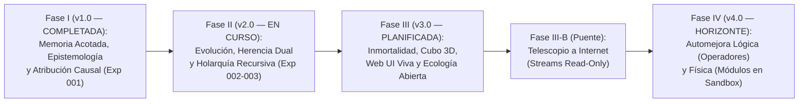

# Hoja de Ruta General (ROADMAP): Proyecto IDE (Inteligencia Distribuida Emergente)

> **Propósito de este documento:** Consolidar la evolución completa del proyecto `IDE` desde sus cimientos ya verificados (**Fase I**), su etapa actual en curso (**Fase II**), la transición a un ecosistema continuo 3D interactivo (**Fase III**) y el horizonte de automejora funcional y conexión controlada a datos reales (**Fase IV**).



---

## Tabla Resumen de Fases

| Fase | Versión | Estado | Núcleo Científico y Arquitectónico |
| :--- | :---: | :---: | :--- |
| **Fase I** | `v1.0` | **Completada y Archivada** | Micro-agentes inmortales con memoria acotada ($C_{\max} < N$), protocolo epistémico (`R1`–`R11`), entorno `ToroidalGrid2D` y marco de atribución `001-D`. |
| **Fase II** | `v2.0` | **En Curso (Diseño Cerrado / Pre-registrado)** | Metabolismo energético ($R_{20}, R_{21}$), selección y deriva ($R_{12}$), mutación genética ($R_{13}$), herencia cultural ($R_{14}$), holones recursivos $L = 0 \dots K$ (`BOND`/`SPLIT`, $R_{15}$–$R_{18}, R_{22}, R_{23}$) y estigmergia ($R_{19}$). |
| **Fase III** | `v3.0` | **Planificada** | Inmortalidad ante apagones (checkpoints atómicos + telemetría en streaming), espacio 3D (`ToroidalGrid3D`), **auto-detección y escalado de hardware (CPU/Multicore/CUDA)**, interfaz viva (Web UI + consola), ecología abierta y **Telescopio a Internet** (sub-etapa 3.6). |
| **Fase IV** | `v4.0` | **Horizonte** | Automejora de **capacidades lógicas** (síntesis holónica de operadores matemáticos y algoritmos) y **capacidades físicas** (generación evolutiva de nuevos módulos y herramientas en `SkillSandboxPort`). |

---

# Fase I (v1.0) — Memoria Acotada, Epistemología Local y Atribución Base [COMPLETADA]

- **Estado:** Implementada, verificada con 397 tests (`coverage >= 90%`) y archivada en [`openspec/changes/archive/2026-10-17-ide-emergent-distributed-intelligence/`](openspec/changes/archive/2026-10-17-ide-emergent-distributed-intelligence/).
- **Lo que se construyó:**
  - **Arquitectura Hexagonal:** Contratos inmutables en `domain/types.py`, puerto `EnvironmentPort` en `domain/ports.py` y aislamiento estricto de `src/ide/agent/` verificado por AST.
  - **Agente Mínimo (`MicroAgent`) y Memoria Acotada (`BoundedMemory`):** Capacidad individual estrictamente menor que la complejidad del mundo ($C_{\max} < N$), olvido exponencial ($\delta$, $R_3$) y desalojo por utilidad $U(k, t)$ ($R_2$).
  - **Epistemología Distribuida y Comunicación Entre Pares:** Fusión de testimonios (`merge_social_belief`) con descuento social ($\gamma$, $R_4$), refuerzo por consenso ($\eta_{\text{consenso}}$, $R_5$), protección anti-cámara de eco ($R_6$: prohibido alcanzar certeza empírica sin experiencia directa) y duda ante contradicción ($\eta_{\text{duda}}$, $R_7$).
  - **Protocolo de Tres Mensajes:** `QUERY_PATTERN` ($R_8$), `QUERY_RESPONSE` y `BROADCAST_BELIEF` ($R_9$).
  - **Marco de Atribución Causal (`001-D` en `attribution.py`):** Criterios formales `E1`–`E5`, inventario `R1`–`R11`, control nulo de contenido (`null_rng`) y ablación sistemática regla por regla.
- **Hallazgo científico clave ([RESULTADOS.md](RESULTADOS.md)):**
  - En una población estática de agentes inmortales ($g=0$), el superávit de decisión (`C2`) y la extinción del rumor (`C3`) son capacidades `PROGRAMMED` que dependen directamente de las reglas diseñadas, y el conocimiento social no sobrevive de forma fiable a la ablación del $100\%$ de sus descubridores (`C4: NOT_OBSERVED`). Este techo estructural motivó el salto evolutivo y holónico de la Fase II.

---

# Fase II (v2.0) — Evolución Abierta, Herencia Dual y Arquitectura Holónica Recursiva [EN CURSO]

- **Estado:** Diseño y pre-registro cerrados y auditados en [`openspec/changes/ide-v2-evolutionary-holonic-intelligence/`](openspec/changes/ide-v2-evolutionary-holonic-intelligence/). Lista para implementación TDD bloque por bloque (`tasks.md`).
- **Alcance en implementación:**
  1. **Metabolismo Energético y Selección Natural ($R_{12}, R_{20}, R_{21}$):**
     - Energía interna $E_i(t)$, costo cuadrático del cerebro y radios sensoriales ($c_{\text{mem}} \cdot C_{\max, i}^2 + c_{\text{sens}} \cdot (r_{\text{perc}, i}^2 + r_{\text{com}, i}^2)$), muerte por agotamiento ($E_i \le 0$) y reproducción diferencial ($E_i \ge E_{\text{reprod}}$) contrastada contra un control de **deriva neutral** (`reproduction_mode="neutral"`, `donor_rng`).
  2. **Herencia Dual Intergeneracional ($g \to g+1$):**
     - **Genética ($R_{13}$):** `AgentGenome` mutable ($\alpha, \gamma, \epsilon, \omega_{\text{bond}}, C_{\max}, r_{\text{perc}}, r_{\text{com}}$) con generador aislado `evo_rng`.
     - **Cultural Vertical ($R_{14}$):** Transferencia madre-hijo de las creencias de mayor utilidad con descuento intergeneracional $\gamma_{\text{gen}}$, ingresando por la puerta única `assimilate_testimony`.
  3. **Arquitectura Holónica Recursiva sin Tope de Niveles ($L = 0, 1, 2, \dots, K$):**
     - Protocolo `AgentNode` y clase `CompositeAgent` (patrón *Composite*).
     - Fusión simbiótica `BOND` ($R_{15}$) por complementariedad epistémica de Jaccard y fisión `SPLIT` ($R_{16}$) cuando el costo de coordinación $c_{\text{coord}}(U) = c_{\text{enlace}} \cdot |U| \cdot L(U)$ supera el superávit cooperativo ($R_{23}$).
     - Vista compartida efímera intra-holón ($R_{22}$, con separación entre `own_belief` y `get_effective_belief`).
  4. **Síntesis Evolutiva Extendida y Recursos Compuestos:**
     - **Endosimbiosis Reproductiva Holónica ($R_{17}$, Margulis):** Reproducción de un `CompositeAgent` completo preservando su topología arbórea.
     - **Causalidad Descendente Intra-Holón ($R_{18}$, Noble):** Penalización de redundancia ($\psi_{\text{red}}$) para ortogonalizar las memorias de las hojas ($\mathcal{M}_i \cap \mathcal{M}_j \to \emptyset$).
     - **Construcción de Nicho y Estigmergia ($R_{19}$):** Rastros `StigmergicTrace` depositados en las celdas de `ToroidalGrid2D` con decaimiento $\delta_{\text{suelo}}$.
     - **Recursos Compuestos (`CompositeRule`, $m > C_{\max}$):** Aprendidos por experiencia directa sin inyección del motor, medidos con las métricas `M8`–`M13` y los protocolos pre-registrados `002-A`, `002-B`, `003-A` y `003-B` (`C5`–`C8`).

---

# Fase III (v3.0) — Persistencia Continua, Espacio 3D, Interfaz Viva y Telescopio a Internet [PLANIFICADA]

> **Objetivo:** Transformar `IDE` en un ecosistema cognitivo continuo ($t \to \infty$), tridimensional, inmune a apagones, observable e interactivo en tiempo real, y alimentado opcionalmente por flujos de datos reales de Internet.

## 3.1. Inmortalidad y Persistencia Transaccional (*Crash-Proofing* y Portabilidad)

Para que `IDE` pueda ejecutarse sin límite de tiempo ($t \to \infty$) y sobrevivir a cortes de energía, reinicios o mudanzas de hardware sin perder la inteligencia acumulada:

- **3.1.1. Checkpointing Atómico del Universo (`save_checkpoint` / `load_checkpoint`):**
  - Volcado periódico cada $K$ ticks (escritura atómica `tmp -> replace` con doble buffer `checkpoint_A` / `checkpoint_B` para que un corte eléctrico a mitad de escritura jamás corrompa el estado).
  - Serializa: (1) estado exacto de los generadores `PCG64` (`rng`, `evo_rng`, `null_rng`, `donor_rng`, `_comp_rng`) y contadores (`next_tick`, `next_agent_id`, `next_holon_id`), (2) población viva (`MicroAgent` + `AgentGenome` + `BoundedMemory`), (3) bosque holónico completo (`CompositeAgent` multinivel $L = 1 \dots K$), y (4) estado del entorno y rastros estigmérgicos (`cell_stigmergy`).
- **3.1.2. Streaming de Telemetría a Disco (`Ring-Buffer` en RAM + `JSONL/SQLite` en disco):**
  - En corridas infinitas la RAM sólo retiene una ventana deslizante de los últimos $W$ ticks y vuelca el historial en segundo plano a disco para evitar agotamiento de memoria.
- **3.1.3. "Esporas Cognitivas" (Exportación / Importación de Holones y Nichos):**
  - Capacidad de extraer un `CompositeAgent` campeón (con sus hojas, genomas y memorias) en un archivo liviano (`.holon.json`) e inyectarlo ("sembrarlo") en otro entorno o en otra computadora.

## 3.2. Expansión Dimensional: Sustrato Espacial 3D (`ToroidalGrid3D`)

Superar el "cuello de botella topológico del plano 2D" (Teorema de Kuratowski: en 2D los nodos internos de un holón quedan encerrados por el perímetro y los caminos se cruzan):

- **3.2.1. Nuevo adaptador `ToroidalGrid3D(EvolutionaryEnvironmentPort)`:**
  - Grilla toroidal $(W \times H \times D)$ con vecindad de Moore 3D (**26 celdas vecinas** a radio $r = 1$ en lugar de 8, y **124** a radio $r = 2$).
  - Desacoplamiento total: gracias a `EvolutionaryEnvironmentPort`, `MicroAgent`, `CompositeAgent` y `SimulationEngine` funcionan en 3D sin cambiar su lógica interna.
- **3.2.2. Estratificación Cognitiva en el Eje $Z$:**
  - Permite que la evolución organice el espacio tridimensional por capas (análogo a las capas del córtex cerebral): estímulos crudos y recursos dinámicos en la "superficie" ($Z = 0$) y ensamblaje de holones de alto orden ($L \ge 2$) y autopistas estigmérgicas en las capas profundas ($Z > 0$) sin bloqueos geométricos.

## 3.3. Detección Automática de Hardware y Escalabilidad Adaptativa (`HardwareAdaptiveRuntime`)

Al escalar a un cubo 3D continuo ($t \to \infty$), el sistema debe inspeccionar automáticamente la infraestructura sobre la que se ejecuta y adaptar su backend de cómputo y su capacidad de carga sin configuración manual:

- **3.3.1. Sonda de Infraestructura al Arranque (`src/ide/infrastructure/hardware_probe.py`):**
  - Detecta en $< 50\text{ ms}$: (a) núcleos físicos/lógicos e IPC de CPU, (b) memoria RAM libre del sistema, y (c) presencia de GPU compatible (CUDA / VRAM disponible).
  - Selecciona automáticamente uno de los **3 Perfiles de Ejecución Determinista**:
    1. **Perfil Tier-1 (CPU Ligera / Laptop sin GPU dedicada, $< 8\text{ GB}$ RAM):** Backend Python/NumPy vectorizado en CPU, cubo 3D compacto ($24^3$), `max_population ~ 1.500` agentes (techo jerárquico $L = 4 \dots 5$).
    2. **Perfil Tier-2 (CPU Multicore de escritorio/servidor sin GPU, $16\text{–}32\text{ GB}$ RAM):** Backend paralelizado por regiones/lotes en CPU (Numba JIT / Multiprocessing), cubo 3D medio ($48^3$), `max_population ~ 15.000` agentes (techo jerárquico $L = 5 \dots 6$).
    3. **Perfil Tier-3 (Híbrido CPU + GPU CUDA, ej. Ryzen 5 9600 + 32 GB DDR5 + RTX 5060 Ti 16 GB VRAM):** Los árboles lógicos de los holones operan en CPU mientras que las operaciones masivas del cubo 3D (vecindades de 26/124 celdas, difusión/decaimiento de estigmergia en millones de celdas y matriz de complementariedad de Jaccard para `BOND`) se descargan en los núcleos CUDA de la GPU, habilitando cubos de $128^3$ ($> 2.000.000$ de celdas) y `max_population ~ 250.000+` agentes (techo jerárquico $L = 7 \dots 8$, Noosfera Local).
- **3.3.2. Regulación Dinámica en Caliente (*Dynamic Carrying Capacity*):**
  - Monitorea los *ticks por segundo (TPS)* y la presión de memoria en vivo: si el usuario ejecuta otras tareas pesadas en el equipo, el motor ajusta suavemente el flujo energético ambiental para sostener la fluidez sin saturar el sistema operativo; y si un checkpoint (`.state`) se migra a un equipo más potente, expande automáticamente `max_population` y activa el backend superior al reanudar.

## 3.4. Interfaz de Observación e Interacción en Tiempo Real (El "Microscopio y Consola")

- **3.4.1. Motor con Control en Caliente (Pausa / Paso a Paso / Velocidad Variable):**
  - Ejecución del `SimulationEngine` en un hilo/proceso desacoplado con cola de comandos en vivo (`PAUSE`, `RESUME`, `STEP`, `SET_TPS`, `SAVE_NOW`).
- **3.4.2. Visor 3D y Radiografía Holónica en Tiempo Real (Web UI / Panel Local):**
  - **Vista Espacial 3D:** Nube de agentes coloreados por linaje/casta, enlaces de los holones ($L = 1 \dots K$) y mapa de calor de estigmergia.
  - **Inspector de Mentes:** Clic en cualquier agente u holón para inspeccionar su árbol jerárquico, su energía, su genoma mutado y qué patrones recuerda cada hoja.
- **3.4.3. "Mano del Experimentador" (Intervenciones en Vivo desde la UI):**
  - Inyectar recursos simples o compuestos en una coordenada $(X, Y, Z)$, disparar shocks ambientales (`invert_world_rules`) o premiar/castigar energéticamente ($\pm \Delta E$) a un holón específico (**Refuerzo Humano en Vivo**).

## 3.5. Ecología Abierta y Puente Simbólico Humano-IDE

- **3.5.1. Ecología Abierta (*Open-Ended Environment*):**
  - Generador procedimental de complejidad progresiva: a medida que la población domina los recursos compuestos de orden $m = 2, 3$, el entorno introduce gradualmente combinaciones nuevas de orden $m = 4, 5, 6 \dots$ para que la presión selectiva nunca se detenga.
- **3.5.2. Puerto de Entrada/Salida Simbólica (`InteractiveBridgePort`) y Comunicación Emergente (Exp 004–006):**
  - Traductor bidireccional Humano $\leftrightarrow$ Universo IDE que deposita estímulos del usuario en la capa $Z = 0$ del cubo 3D y lee las respuestas de los holones superiores, acompañado de la des-programación progresiva del lenguaje (`N1` $\to$ `N4`).

## 3.6. El "Telescopio a Internet" (`InternetStreamEnvironment` — Sub-etapa Puente III-B)

> **¿Por qué el Telescopio a Internet entra al cierre de la Fase III (justo antes de la Fase IV)?**
> 1. **Requiere Inmortalidad (3.1) y Espacio 3D (3.2) ya operativos:** Internet es un flujo continuo y ruidoso; sin checkpoints y sin espacio 3D para separar "continentes temáticos", el ecosistema se saturaría.
> 2. **Es el combustible necesario para la Fase IV:** Para que en la Fase IV los holones inventen nuevas operaciones matemáticas y módulos de código útiles, necesitan enfrentarse a series de datos reales que no puedan resolverse con un diccionario finito estático.

- **Arquitectura de Seguridad ("Telescopio Unidireccional Read-Only"):**
  - Nuevo adaptador `InternetStreamEnvironment(EvolutionaryEnvironmentPort)` estrictamente de **sólo lectura** (consume APIs públicas, RSS, series temporales financieras/meteorológicas o flujos de texto y los proyecta como constelaciones de `Pattern` y `CompositeRule` en la superficie $Z = 0$ del cubo 3D).
  - **Aislamiento físico garantizado:** Los agentes siguen emitiendo únicamente acciones internas del motor (`MOVE`, `INTERACT`, `WAIT`); jamás tienen acceso a sockets de red salientes ni al sistema operativo anfitrión, impidiendo por diseño cualquier propagación fuera del equipo.

## 3.7. Dinámica de Crecimiento en Ejecución Continua ($t \to \infty$)

El sistema crece en **4 dimensiones simultáneas** sin violar el límite cerebral individual ($C_{\max}$):

```text
1. CRECIMIENTO DEMOGRÁFICO (Horizontal)
   40 agentes fundadores ──(comen y se reproducen R12)──► 160, 500, 2.000 agentes...

2. CRECIMIENTO JERÁRQUICO / HOLÓNICO (En Profundidad: L = 0 -> 1 -> 2 -> ... -> K)
   (a1)+(a2) ──BOND──► [Holón L=1]
   [Holón L=1] + [Holón L=1] ──BOND──► [[Meta-Holón L=2]]
   [[L=2]] + [[L=2]] ──BOND──► [[[Super-Organismo L=3 ... L=K]]]

3. CRECIMIENTO CULTURAL E INTERGENERACIONAL (En el Tiempo: g = 0 -> 1 -> ... -> ∞)
   Generación 0 descubre A ──(Herencia R14)──► Gen 1 nace sabiendo A y descubre B ──► Gen 100...

4. CRECIMIENTO AMBIENTAL / ESTIGMÉRGICO (Memoria Externa en el Cubo 3D)
   El cubo 3D vacío se llena de "autopistas y bibliotecas químicas" (R19) grabadas en las celdas.
```

---

# Fase IV (v4.0) — Automejora Funcional: Evolución de Capacidades Lógicas y Físicas [HORIZONTE]

> **Objetivo:** Dar el salto de **acumular conocimiento** (aprender datos dentro de reglas fijas) a **inventar nuevas capacidades funcionales**, permitiendo que la población evolucione tanto nuevas operaciones lógicas/matemáticas como nuevos módulos ejecutables en una caja de arena segura (*Sandbox*).

## 4.1. Automejora en Capacidades Lógicas (Síntesis Holónica de Operaciones Matemáticas y Algoritmos)

En las Fases I a III, cada hoja (`MicroAgent`) almacena creencias declarativas (`Pattern` $\to$ valor predicho $\hat{v}$) y los holones unen conjuntos de datos. En la Fase IV, los nodos adquieren **memoria procedimental (operadores lógicos y matemáticos)**:

- **4.1.1. Operadores Primitivos en las Hojas ($L = 0$):**
  - Cada `MicroAgent` puede portar en su repertorio operadores formales elementales: aritméticos (`ADD`, `SUB`, `MUL`, `DIV`, `MOD`), comparadores (`GT`, `EQ`), lógicos (`AND`, `OR`, `NOT`, `XOR`), estadísticos (`MEAN`, `DIFF`, `EMA`) y simbólicos (`SLICE`, `CONCAT`, `MATCH`).
- **4.1.2. El Árbol del Holón como Árbol de Sintaxis Abstracta (AST) Vivo ($L = 1 \dots K$):**
  - Cuando dos o más nodos se fusionan mediante `BOND` ($R_{15}$), no sólo unen sus memorias declarativas: **encadenan sus operadores formando un grafo de flujo de datos o AST ejecutable** (*Symbiotic Genetic Programming* / *Tangled Program Graphs*).
  - Un Holón de Nivel 1 compone una función de 2 pasos; un Holón de Nivel 3 compone un algoritmo o fórmula matemática completa capaz de transformar un vector de entrada $X(t)$ (por ejemplo, una serie numérica del Telescopio de Internet) en una predicción exacta $\hat{Y}(t+1)$.
- **4.1.3. Selección Natural de Fórmulas y Algoritmos:**
  - Los holones cuya fórmula compuesta predice o resuelve problemas matemáticos complejos del entorno reciben superávit energético ($+\Delta E$) y se reproducen simbióticamente ($R_{17}$); los que producen errores lógicos pierden energía y se disuelven mediante `SPLIT` ($R_{16}$), descubriendo nuevas leyes matemáticas sin programación humana.

## 4.2. Automejora en Capacidades Físicas / Estructurales (Generación de Nuevos Módulos en `SkillSandboxPort`)

Para que `IDE` pueda extender su propia anatomía funcional (nuevos sensores, nuevos heurísticos de navegación, nuevos compresores de memoria o nuevos filtros epistémicos) sin poner en riesgo la estabilidad del motor ni el equipo del usuario:

- **4.2.1. Arquitectura de Caja de Arena Estricta (`SkillSandboxPort`):**
  - El núcleo del motor (`SimulationEngine`) expone un puerto de extensión aislado donde los holones de orden superior pueden sintetizar, mutar y registrar nuevos módulos funcionales (`ExecutableSkill` / *plugins* autocontenidos en un subconjunto puro y determinista de Python/AST).
  - **Límites duros de ejecución (*Safety Cage*):**
    1. Tiempo máximo de CPU por invocación (por ejemplo, `timeout <= 5 ms` y límite de instrucciones de bytecode).
    2. Memoria RAM acotada por módulo (sujeta al costo metabólico cuadrático $R_{21}$).
    3. **Cero acceso a I/O de sistema:** Prohibición por AST y *capabilities* de importar `os`, `sys`, `subprocess`, `socket`, `pathlib` o abrir archivos/red fuera del sandbox.
- **4.2.2. Evolución de Nuevos "Órganos" para los Agentes:**
  - Los módulos creados dentro del `SkillSandboxPort` pueden convertirse en nuevos componentes físicos equipables por los descendientes:
    - **Nuevos Órganos Sensoriales:** Filtros que pre-procesan la observación del cubo 3D o del Telescopio a Internet para detectar gradientes o frecuencias ocultas.
    - **Nuevos Órganos de Memoria y Compresión:** Estrategias de utilidad o resúmenes internos que permiten empaquetar más información dentro del mismo límite $C_{\max}$.
    - **Nuevos Órganos de Comunicación y Coordinación:** Protocolos emergentes (`N3`–`N4`) y políticas de decisión que reemplazan la heurística fija de Fase I.
- **4.2.3. Inmunidad del Ecosistema ante Módulos Defectuosos:**
  - Si un agente u holón sintetiza un módulo con un bug, una excepción o un cálculo demasiado lento, **el motor captura el fallo localmente, aplica el costo metabólico al portador y sólo muere ese linaje defectuoso**, mientras el resto de la población sigue operando y heredando únicamente los módulos probados y rentables.