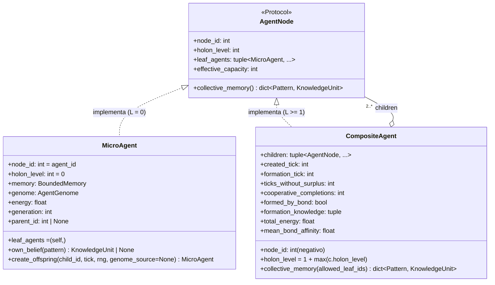

# Especificación de Definiciones Técnicas — Proyecto IDE (v2.0)

Este documento traduce las [Definiciones Formales](DEFINICIONES_FORMALES.md) en una **arquitectura de software concreta**: stack, estructura, contratos de datos, ciclo de ejecución y parámetros.

> **Fuente normativa.** Este documento es un **resumen orientativo**; ante una discrepancia rigen los specs y el design:
> - **Fase I (Experimento 001, implementada y verificada):** criterios verificables en [`openspec/specs/*/spec.md`](../openspec/specs/) y firmas, fórmulas y desempates en el design archivado [`openspec/changes/archive/2026-10-17-ide-emergent-distributed-intelligence/design.md`](../openspec/changes/archive/2026-10-17-ide-emergent-distributed-intelligence/design.md) (Decisiones D1–D18).
> - **Fase II (Experimentos 002 y 003, implementada, corrida y archivada):** el design archivado [`openspec/changes/archive/2026-10-20-ide-v2-evolutionary-holonic-intelligence/design.md`](../openspec/changes/archive/2026-10-20-ide-v2-evolutionary-holonic-intelligence/design.md) (Decisiones D19–D29) es la **fuente única** de firmas, nombres, parámetros, valores por defecto y desempates; los criterios verificables están sincronizados en [`openspec/specs/*/spec.md`](../openspec/specs/). Los resultados, negativos para C5–C8, están en [RESULTADOS.md](RESULTADOS.md).
> - **Fase II-B (v2.5, ADN compacto, conducta evolucionable y ecología; en implementación):** el `design.md` del cambio activo [`openspec/changes/ide-v25-compact-dna-and-epigenetics/`](../openspec/changes/ide-v25-compact-dna-and-epigenetics/) (Decisiones D30–D63 y sus "Precisiones") es la **fuente única** de firmas, nombres, parámetros, valores por defecto y desempates; sus criterios verificables están en los specs delta de ese cambio. La etapa A (bloques 1 a 5: $R_{24}$, D30–D35) está implementada. El 2026-10-20 la fase se **reformuló** (D43–D56, que prevalecen sobre D30–D42 donde los contradicen) y el 2026-10-21 se **amplió** (D57–D63: estado interno, plasticidad, señales, rangos del codón, entorno cambiante, ADN de 64 codones, detección de núcleos y telemetría). Su pre-registro vigente es **D56**, aprobado el 2026-10-21 en la tarea 0.5; el D42 quedó sustituido y sus afirmaciones C9–C12 se retiraron sin medir. Este documento la refleja en tipos (§3.8), agente y política (§4.4), entorno (§5), ciclo del tick (§6), parámetros (§7.3) y protocolos y atribución (§8.6 y §8.7). Lo que no es de la etapa A se marca "especificado, sin implementar".

> **Novedades en la Versión 2.0.** Conserva la especificación implementada de la **Fase I** y resume la arquitectura técnica implementada en la **Fase II**:
> 1. **Patrón *Composite* recursivo (`AgentNode`, en `agent/holon.py`):** `MicroAgent` ($L=0$) y `CompositeAgent` ($L \ge 1$) implementan el protocolo común `AgentNode`, de modo que un `CompositeAgent` agrupa nodos de cualquier nivel sin un tope de profundidad codificado.
> 2. **Metabolismo, linaje y herencia dual (`agent/evolution.py`):** genoma inmutable `AgentGenome`, mutación acotada (`mutate_genome`, en `domain/extensions.py`) y herencia cultural vertical que el motor entrega por `assimilate_testimony`.
> 3. **Recursos compuestos graduados (`CompositeRule`, que ya existe en `domain/extensions.py`):** recursos de orden $m \ge 2$ que exigen conocer $m$ patrones a la vez. Ponen a prueba si la población forma niveles jerárquicos superiores para resolverlos.
> 4. **Compatibilidad regresiva estricta:** todas las banderas de activación de la Fase II valen `False` por defecto y `num_composite_patterns = 0`, de modo que las corridas y los hashes SHA-256 del Experimento 001 permanecen idénticos bit a bit.
>
> **Decisiones tomadas** (2026-10-18, ver "Decisiones tomadas" en `proposal.md` del cambio): **P1 → (a)**, la vista compartida del holón es un canal efímero declarado, con regla y ablación propias ($R_{22}$, §6); **P2 → (b)**, el agente aprende los recursos compuestos por experiencia y el motor no le inyecta nada (§6); **P3**, el pre-registro de la Fase II (reglas $R_{12}$–$R_{23}$, afirmaciones C5–C8, variantes y perfil `phase2`) está versionado en design D29 (§8.4).

---

## 1. Stack Tecnológico y Principios de Ingeniería

- **Lenguaje:** Python $\ge 3.11$.
- **Tipado:** Estricto (`typing`, `dataclasses`, `Protocol`, `Enum`).
- **Dependencias del núcleo:** biblioteca estándar + `numpy` (generador reproducible `np.random.Generator(np.random.PCG64(seed))` y agregaciones).
- **Testing y análisis:** `pytest` con `pytest-cov` (cobertura) e `hypothesis` (pruebas por propiedades con generación reproducible); exportación JSON y CSV desacoplada del motor.
- **Calidad estática:** `ruff` (lint y formato) y `pyright` en modo estricto sobre `src/`. Un bloque de trabajo sólo se cierra con las cuatro verificaciones en verde.
- **Rendimiento:** paralelismo entre corridas independientes (`--jobs N`, con salida idéntica para cualquier `N`; desde la ampliación de la Fase II-B, todos los runners y CLI de calibración usan por defecto los núcleos detectados, D62.3 y precisión 55), una línea base medida (`ide.experiments.benchmark`) y perfiladores instalados (`py-spy`, `line_profiler`). No se vectoriza el bucle de agentes sin una medición que lo justifique: cambiaría la arquitectura que permite ablacionar reglas. Sin cambiar la semántica, la grilla precalcula una tabla de desplazamientos por vecindad, de percepción y de comunicación (cada una válida desde cualquier celda del toro, así que no crece con el tablero) y el motor reutiliza los vecinos de la observación para rutear los mensajes; una prueba exige historiales idénticos a los de la implementación previa.
- **Arquitectura hexagonal:** el paquete `agent` **tiene prohibido** importar `environments`, `simulation` o `experiments`. Toda interacción pasa por estructuras agnósticas (`Observation`, `AgentAction`, `Message`). En la Fase II, `agent/evolution.py` y `agent/holon.py` quedan sujetos a las mismas auditorías AST (design D20).
- **Determinismo entre procesos:** Python aleatoriza el hash de `str` por proceso, así que está prohibido iterar un `set` sin `sorted(...)` y toda selección aleatoria opera sobre listas ordenadas.
- **Generadores derivados (excepción declarada, design D19):** además del generador principal `engine.rng`, toda operación estocástica nueva usa un generador derivado con `np.random.SeedSequence(seed, spawn_key=(k,))`: `(1,)` `null_rng` del control nulo (ya existe en Fase I), `(2,)` `evo_rng` del motor (mutación y ubicación de descendientes), `(3,)` `_comp_rng` de `ToroidalGrid2D` (ubicación y reposición de recursos compuestos) y `(4,)` `donor_rng` del motor (sólo el sorteo del donante de genoma en la reproducción neutral, aparte para no desplazar `evo_rng`). La Fase II-B agrega `(5,)` `hgt_rng` del motor (sólo la conjugación de plásmidos, $R_{26}$, design D30 y D37; especificado, sin implementar). La reformulación de la Fase II-B no agrega generadores: sus extracciones nuevas usan el generador principal (la conducta en la Fase 3 y la ubicación de recursos en el entorno) o `evo_rng` (la recombinación al nacer). La ampliación tampoco (D57.4): el control nulo de las señales usa `null_rng` y los cambios del entorno, el generador principal. Cada uno se consume sólo si su mecanismo está activo.
- **Atribución verificable:** cada regla de diseño ($R_1 \dots R_{11}$ en Fase I; $R_{12} \dots R_{23}$ en Fase II; $R_{24} \dots R_{41}$ en la Fase II-B, con $R_{24}$ implementada) se puede desactivar desde `SimulationConfig`, salvo las nucleares (`R1`, `R2` y `R20`, con ablación vacía), y la plataforma clasifica cada afirmación como programada o emergente (ver §8, protocolo 001-D, y [Definiciones Formales](DEFINICIONES_FORMALES.md) §3.1).
- **Protocolo reemplazable:** toda la semántica de los mensajes vive en `agent/protocol.py`; ningún otro módulo del agente construye ni interpreta mensajes.
- **Jerarquía sin clases por nivel (Fase II):** la jerarquía holónica se representa con el protocolo `AgentNode`; no existen clases por nivel. El ciclo del tick sigue ejecutándose sobre los `MicroAgent` (las hojas), y el motor mantiene aparte el bosque de nodos raíz `root_nodes` que usan la vista compartida del holón, la resolución compuesta y los operadores `BOND`/`SPLIT`.

---

## 2. Estructura de Directorios del Proyecto

Los archivos marcados `[Fase II]` se agregaron en la Fase II. Los marcados `[Fase II-B, previsto]` están especificados en el cambio activo y todavía no existen; `[Fase II-B]` marca lo que ese cambio agrega a un archivo, ya hecho en la etapa A o previsto. Los documentos normativos y `RESULTADOS.md` están en `docs/`; la visión sin rango normativo, en `docs/vision/`.

```text
IDE/
├── docs/
│   ├── DOCUMENTO_FUNDACIONAL.md     # Visión v2.0 (Horizontal + Vertical + Holónica)
│   ├── DEFINICIONES_FORMALES.md     # Modelo matemático v2.0 (Fase I + Fase II; Fase II-B reformulada)
│   ├── DEFINICIONES_TECNICAS.md     # Arquitectura técnica v2.0 (este documento)
│   ├── RESULTADOS.md                # Reporte empírico verificable (Exp 001, 002 y 003)
│   └── vision/                      # Hoja de ruta y visión (sin rango normativo)
├── openspec/                        # Specs vigentes, cambios y archivo (OpenSpec)
├── pyproject.toml
├── src/
│   └── ide/
│       ├── __init__.py
│       ├── config.py                # SimulationConfig (Fase I; [Fase II] campos de D20; [Fase II-B] campos de D31, D52 y D63)
│       ├── domain/                  # Contratos puros
│       │   ├── __init__.py
│       │   ├── types.py             # Pattern, KnowledgeUnit, Resource, VisibleResource, Observation, Message, AgentAction, ActionResult; [Fase II] AgentGenome, StigmergicTrace, HolonSnapshot; [Fase II-B] EpigeneticRole, CompactDNA, EpigeneticContext, ExpressedPhenotype; Behavior, VisibleAgent, SocialPerception, SensorySignals, EventSignals, BehaviorEvaluation y ActionType ampliado (previstos)
│       │   ├── ports.py             # EnvironmentPort (10 métodos); [Fase II] EvolutionaryEnvironmentPort; [Fase II-B] EcologicalEnvironmentPort
│       │   └── extensions.py        # TrustStrategyPort, AgentCapabilities, CompositeRule, AgentHyperParams, EvolutionaryPort; [Fase II] mutate_genome, compute_epistemic_synergy
│       ├── agent/                   # Cognición local (agnóstica del espacio)
│       │   ├── __init__.py
│       │   ├── memory.py            # BoundedMemory ([Fase II] set_redundant_patterns, R18; [Fase II-B] resize)
│       │   ├── epistemology.py      # Aprendizaje directo y revalidación social (A, B, C)
│       │   ├── protocol.py          # BeliefExchangeProtocol: única semántica de mensajes ([Fase II-B] puerta de comunicación)
│       │   ├── micro_agent.py       # MicroAgent (hoja L = 0 de AgentNode en Fase II; [Fase II-B] ADN, fenotipo, rol, edad, endospora, política, estado interno, pesos plásticos y eventos)
│       │   ├── evolution.py         # [Fase II] genome_from_config, compute_metabolic_cost, transfer_cultural_heritage; [Fase II-B] compute_dna_cost, compute_senescence_cost
│       │   ├── holon.py             # [Fase II] AgentNode, CompositeAgent, BOND, SPLIT, R17, R18, poda; [Fase II-B] assign_epigenetic_roles, is_locked, sello por compromiso
│       │   ├── dna.py               # [Fase II-B] codón, ADN fundador, transcripción y mutate_dna (etapa A); plásmidos, evaluate_behavior, evaluate_drives, founder_dna_length, recombine_dna y expressible_codons (previstos)
│       │   └── policy.py            # [Fase II-B, previsto] PolicyPort, HandwrittenPolicy, GeneticPolicy
│       ├── environments/
│       │   ├── __init__.py
│       │   └── grid2d.py            # ToroidalGrid2D ([Fase II] spawn_agent_near, recursos compuestos, estigmergia; [Fase II-B] R33, R34, R35 y agentes visibles)
│       ├── simulation/
│       │   ├── __init__.py
│       │   ├── pipeline.py          # [Fase II-B, previsto] EngineSystem, TickObserver, TickFrame, build_systems
│       │   ├── engine.py            # SimulationEngine (5 fases; [Fase II] trabajo dentro de las fases 1, 2, 4 y 5; [Fase II-B] Fase 0 (etapa A); pipeline, hgt_rng, percepción social e interacciones)
│       │   └── controls.py          # nullify_belief (control nulo de contenido, E4)
│       └── experiments/
│           ├── __init__.py
│           ├── metrics.py           # TickMetrics, MetricsCollector, M1–M7; [Fase II] EvolutionaryTickMetrics, EvolutionaryMetricsCollector, M8–M13; [Fase II-B] GeneticTickMetrics, EcologyTickMetrics y observadores
│           ├── benchmark.py         # Línea base de rendimiento (ticks por segundo)
│           ├── attribution.py       # R1–R11, C1–C4, ablación, clasificación y 001-D; [Fase II] R12–R23, C5–C8, perfil phase2; [Fase II-B] R24–R41, C13–C20, Holm y δ_min
│           ├── exp001_runner.py     # Protocolos 001-A, 001-B, 001-C y CLI
│           ├── exp002_runner.py     # [Fase II] Protocolos 002-A y 002-B y CLI
│           ├── exp003_runner.py     # [Fase II] Protocolos 003-A (transición holónica) y 003-B (cobertura colectiva) y CLI
│           ├── phase25_viability.py # [Fase II-B, previsto] Compuerta de viabilidad (D55)
│           └── exp25_runner.py      # [Fase II-B, previsto] Protocolos 25a, 25b, 25c y 25d y CLI
└── tests/
    ├── test_domain_contracts.py
    ├── test_roadmap_extensions.py
    ├── test_memory.py
    ├── test_epistemology.py
    ├── test_micro_agent.py
    ├── test_grid2d.py
    ├── test_simulation_engine.py
    ├── test_metrics.py
    ├── test_exp001_suite.py
    ├── test_attribution.py
    ├── test_controls.py
    ├── test_benchmark.py
    ├── test_performance_equivalence.py  # Huellas SHA-256 del oráculo (Decisión 18; intactas en v2.0)
    ├── test_suite_markers.py            # La corrida por defecto excluye `empirical` y `slow`
    ├── test_empirical.py                # @pytest.mark.empirical (excluido por defecto)
    ├── test_evolutionary_dynamics.py    # [Fase II]
    ├── test_holonic_hierarchy.py        # [Fase II]
    ├── test_exp002_exp003.py            # [Fase II]
    ├── test_compact_dna.py              # [Fase II-B]
    ├── test_exp25.py                    # [Fase II-B, previsto]
    └── conftest.py                      # Perfil `ci` de Hypothesis (derandomize=True)
```

---

## 3. Estructuras de Datos (`domain/types.py` y `domain/extensions.py`)

Todas son `@dataclass(frozen=True)` para evitar mutaciones accidentales de estado compartido. Los tipos de Fase I **no cambian** en la Fase II: un test verifica los campos exactos de `VisibleResource`, y los hashes dorados dependen de los demás.

### 3.1. `Pattern`
Firma observable $\rho$ de un recurso. Tiene orden total (`order=True`) para iterar de forma determinista.
```python
@dataclass(frozen=True, order=True)
class Pattern:
    attributes: tuple[tuple[str, str], ...]  # Ej: (("id", "p_0"),)
```

### 3.2. `KnowledgeUnit` (creencia $k$)
```python
@dataclass(frozen=True)
class KnowledgeUnit:
    pattern: Pattern
    predicted_value: float       # \hat{v} en [-1.0, +1.0]
    confidence: float            # c en [0.0, 1.0]
    evidence_count: int          # n >= 1
    last_updated_tick: int       # \tau
    from_direct_experience: bool # d: True si este agente lo experimentó (False en testimonios, herencia cultural y estigmergia)
```

### 3.3. `Resource` (interno del entorno)
```python
@dataclass(frozen=True)
class Resource:
    resource_id: int
    pattern: Pattern
    true_value: float            # v(r): oculto al agente
```
En la Fase II, un recurso compuesto es un `Resource` ordinario cuyo `pattern` es un patrón compuesto (`c_k`) registrado en las reglas compuestas del entorno (§3.7); no hay un tipo de recurso aparte.

### 3.4. `VisibleResource` y `Observation` (lo que percibe el agente)
El entorno nunca entrega `Resource`. En su lugar proyecta `VisibleResource`, que no tiene `true_value` y trae una guía de movimiento agnóstica de la geometría:
```python
@dataclass(frozen=True)
class VisibleResource:
    resource_id: int
    pattern: Pattern
    recommended_move: Any        # Primer paso (∈ available_moves) hacia el recurso; None si distance == 0
    distance: int                # Distancia en pasos (Chebyshev en la grilla)
    is_reachable_now: bool       # True sii distance == 0

@dataclass(frozen=True)
class Observation:
    agent_id: int
    tick: int
    visible_resources: tuple[VisibleResource, ...]   # Ordenados por (distance, resource_id)
    available_moves: tuple[Any, ...]
    neighbor_ids: tuple[int, ...]                     # Ascendentes, sin el propio agente
```

### 3.5. `Message`
Este es el protocolo de nivel N0: su semántica viene **predefinida de fábrica**, y es un presupuesto de diseño que se irá retirando (Experimento 006; [Documento Fundacional](DOCUMENTO_FUNDACIONAL.md) §7, eje transversal). La Fase II no agrega tipos de mensaje.
```python
class MessageType(Enum):
    QUERY_PATTERN = "QUERY_PATTERN"       # "¿Alguien conoce ρ?"
    QUERY_RESPONSE = "QUERY_RESPONSE"     # "Yo creo esto sobre ρ"
    BROADCAST_BELIEF = "BROADCAST_BELIEF" # Difusión espontánea

@dataclass(frozen=True)
class Message:
    msg_type: MessageType
    sender_id: int
    recipient_id: int | None              # None = todos los vecinos de comunicación
    pattern: Pattern
    belief: KnowledgeUnit | None = None   # Obligatorio en QUERY_RESPONSE y BROADCAST_BELIEF
```

### 3.6. `AgentAction` y `ActionResult`
```python
class ActionType(Enum):
    MOVE = "MOVE"
    INTERACT = "INTERACT"
    IDLE = "IDLE"

@dataclass(frozen=True)
class AgentAction:
    action_type: ActionType
    target: Any = None                    # Movimiento si MOVE, resource_id si INTERACT

@dataclass(frozen=True)
class ActionResult:
    action_type: ActionType
    interacted_pattern: Pattern | None = None
    experienced_value: float | None = None # Sólo si INTERACT tuvo éxito
```
La Fase II-B agrega `SHARE`, `ATTACK` y `SPORULATE` a `ActionType` (§3.8); las aplica el motor en la Fase 4, porque el entorno no conoce la energía (design D49).

Al interactuar con un recurso compuesto, `execute_action` devuelve `ActionResult(ActionType.INTERACT, comp_pat, rule.composite_value)`, y el motor intercepta el resultado (§6).

### 3.7. Tipos de la Fase II (design D20)
En `domain/types.py` se agregan tres tipos inmutables, sin tocar `VisibleResource`. Los valores por defecto de `AgentGenome` coinciden con los de `SimulationConfig`; el genoma fundador real se construye siempre con `genome_from_config`.
```python
@dataclass(frozen=True)
class AgentGenome:
    alpha_learning: float = 0.40
    gamma_social_discount: float = 0.75
    epsilon_explore: float = 0.15
    bond_affinity: float = 0.60          # \omega_{bond}
    memory_capacity: int = 3             # C_{max, i} (costo metabólico cuadrático)
    perception_radius: int = 2           # r_{perc, i}
    comm_radius: int = 2                 # r_{com, i}

@dataclass(frozen=True)
class StigmergicTrace:
    pattern: Pattern
    sign_value: float                    # sign(v) del valor experimentado
    intensity: float                     # decae con stigmergy_decay
    last_updated_tick: int

@dataclass(frozen=True)
class HolonSnapshot:
    node_id: int
    holon_level: int
    child_node_ids: tuple[int, ...]
    leaf_agent_ids: tuple[int, ...]
    effective_capacity: int
    collective_known_patterns: int
```

`CompositeRule` **ya existe** en `domain/extensions.py` y se reutiliza sin cambios:
```python
@dataclass(frozen=True)
class CompositeRule:
    required_patterns: tuple[Pattern, ...]   # >= 2 patrones, sin repetir
    composite_value: float

    def evaluate(self, known_patterns: set[Pattern] | dict[Pattern, KnowledgeUnit]) -> float | None: ...
```

En `domain/extensions.py` se agregan además dos funciones (que pasan a importar `ide.config`, sin ciclo):
```python
def mutate_genome(genome: AgentGenome, config: SimulationConfig, rng: np.random.Generator) -> AgentGenome: ...
def compute_epistemic_synergy(
    patterns_a: frozenset[Pattern], patterns_b: frozenset[Pattern], mean_bond_affinity: float
) -> float: ...  # |K_a △ K_b| / |K_a ∪ K_b| · mean_bond_affinity; 0.0 si ambos vacíos
```
`mutate_genome` no consume `rng` si `mutation_rate == 0.0` y `discrete_mutation_prob == 0.0`. Con `mutation_rate > 0` extrae 4 normales para $(\alpha, \gamma, \epsilon, \omega_{\text{bond}})$ y recorta $\alpha \in [0.01, 1]$ y el resto a $[0, 1]$. Con `discrete_mutation_prob > 0`, para $C_{\max}$, $r_{\text{perc}}$ y $r_{\text{com}}$, en ese orden, extrae siempre un `random()` y, si salta, un `integers(0, 2)` para el signo, y recorta a las cotas del rasgo ($C_{\max} \in [1, \texttt{max\_genome\_memory\_capacity}]$, y $< N$ si `enforce_memory_constraint`; radios en $[1, (\min(\text{ancho}, \text{alto}) - 1) // 2]$, o el valor parental si ese intervalo es vacío). Los detalles están en design D22.

No hay tipos `LineageRecord` ni `MetabolicState`: la energía, la generación, el progenitor y el genoma son estado del `MicroAgent` (§4.1).

### 3.8. Tipos de la Fase II-B (design D31, D46, D47 y D58–D60)
**Etapa A (implementados, design D31).** En `domain/types.py` se agregan cuatro tipos, sin tocar los existentes:
```python
class EpigeneticRole(Enum):
    NONE = "NONE"
    EXPLORER = "EXPLORER"    # menor grado interno en el holón
    LIBRARIAN = "LIBRARIAN"  # más conocimiento propio único
    NERVE = "NERVE"          # mayor grado interno

@dataclass(frozen=True)
class CompactDNA:
    chromosome: tuple[int, ...]          # codones de 32 bits, herencia vertical
    plasmids: tuple[int, ...] = ()       # a lo sumo max_plasmids, herencia vertical y horizontal (R26)
    crispr_memory: tuple[int, ...] = ()  # firmas rechazadas, FIFO de crispr_memory_size (R27)

@dataclass(frozen=True)
class EpigeneticContext:
    holon_level: int = 0                   # nivel del nodo raíz que contiene a la hoja; 0 si está sola
    role: EpigeneticRole = EpigeneticRole.NONE
    energy_ratio: float = 1.0              # E_i / reproduction_threshold

@dataclass(frozen=True)
class ExpressedPhenotype:
    genome: AgentGenome                    # los 7 rasgos expresados
    lifespan: int                          # T_max expresada (R29)
    spore_threshold: float                 # E_espora expresada (R28)
    expressed_codons: int                  # codones activos con destino de rasgo (telemetría)
    # Previstos (D46.7), con valor por defecto igual a la base por defecto de la configuración:
    symbiotic_commitment: float = 0.0      # destino 0x0A (R31)
    recombination_propensity: float = 0.0  # destino 0x0B (R38)
    comm_propensity: float = 1.0           # destino 0x0C (R32)
    plasticity_rate: float = 0.0           # destino 0x0F (R40; ampliación, D59.3)
```
- `CompactDNA.__post_init__` lanza `ValueError` si algún codón está fuera de $[0, 2^{32} - 1]$, si `chromosome` está vacío o si `plasmids` o `crispr_memory` tienen codones repetidos.
- La longitud de `chromosome` no se valida en el tipo: `dna_min_length` y `dna_max_length` son de la configuración y las aplica la mutación.
- Los codones son `int` de Python, no `numpy.uint32`, para que la igualdad, el `repr` y el hash no dependan del dtype.
- El contexto no lleva `z_layer` (Fase III) ni el estado de endospora (lo maneja el motor).
- Con la reformulación, `expressed_codons` cuenta los destinos `0x00`–`0x08` y `0x0A`–`0x0C` (D46.7) y, con la ampliación, `0x0F` (precisión 54).

**Reformulación (especificados, sin implementar; design D46 y D47).** Todos inmutables:
```python
class Behavior(Enum):   # un destino de codón por conducta, 0x40..0x47; el orden es el de desempate
    CONSUME, EXPLORE, NAVIGATE, WANDER, SHARE, ATTACK, FLEE, SPORULATE

@dataclass(frozen=True)
class VisibleAgent:
    agent_id: int
    distance: int               # Chebyshev toroidal
    recommended_move: Any       # hacia el agente; None si distance == 0
    flee_move: Any              # el movimiento de Moore que maximiza la distancia; desempate por orden de MOORE_MOVES

@dataclass(frozen=True)
class SocialPerception:
    adjacent: tuple[int, ...] = ()            # agentes activos a distancia <= 1, ascendentes
    weakest_adjacent: int | None = None       # de `adjacent`, el de menor (energía, agent_id)
    weaker_adjacent: bool = False             # su energía es menor que la propia
    flee_move: Any = None                     # huida del más cercano con más energía que la propia
    crowded: bool = False                     # agentes activos visibles >= crowding_threshold
    carcass_visible: bool = False             # algún recurso visible es un cadáver (R35)

@dataclass(frozen=True)
class SensorySignals:   # lo que leen los promotores sensoriales 0x20..0x27, en ese orden
    known_good: bool; unknown: bool; no_resource: bool; neighbor_adjacent: bool
    weaker_adjacent: bool; stronger_near: bool; crowded: bool; carcass: bool
```
- **Valores de los enumerados.** Los miembros de `Behavior` y los nuevos de `ActionType` usan como valor su nombre en texto, como `MessageType`. La correspondencia con los destinos de codón vive en `dna.py` (`BEHAVIOR_TARGETS`, en el orden de la tabla).
- **`ActionType`** agrega `SHARE`, `ATTACK` y `SPORULATE`. `AgentAction.target` es el `agent_id` en `SHARE` y `ATTACK`, y `None` en `SPORULATE`.
- "Activo" excluye a las endosporas. `SocialPerception` la construye el motor en la Fase 1 sobre la instantánea de energías al empezar el tick; `SensorySignals`, la política genética (§4.4).
- Los agentes siguen sin conocer coordenadas: `VisibleAgent` sólo trae distancias y movimientos.

**Ampliación (especificados, sin implementar; design D58–D60).** Todos inmutables:
```python
@dataclass(frozen=True)
class EventSignals:   # eventos del tick anterior, que leen los promotores 0x28..0x2B, en ese orden (D58.5)
    attacked: bool = False         # fue objetivo de un ATTACK con éxito y stolen > 0
    ate: bool = False              # consumió un recurso con valor experimentado positivo
    lost_energy: bool = False      # terminó el tick con menos energía que al empezarlo
    received_energy: bool = False  # fue objetivo de un SHARE que lo alcanzó

@dataclass(frozen=True)
class BehaviorEvaluation:   # resultado de evaluate_behavior (D60.1)
    drives: tuple[float, ...]               # un impulso por Behavior, en su orden (SIGNAL no es conducta)
    set_mask: int                           # bits de internal_state a encender (D58.3)
    clear_mask: int                         # bits a apagar; prevalece sobre set_mask
    emitted: int                            # máscara de símbolos emitidos (D60.3)
    plastic: tuple[tuple[int, ...], ...]    # índices de codones plásticos activos, por conducta (D59.4)
```
- `EventSignals` vive en `domain/types.py`. El motor lo calcula al final del tick y lo guarda en `agent.last_events`; un recién nacido arranca con `EventSignals()`.
- `SensorySignals` agrega al final los cuatro campos de `EventSignals` (`attacked`, `ate`, `lost_energy` y `received_energy`, que leen los promotores `0x28`–`0x2B`; D60.1), tomados de `agent.last_events`: la evaluación de conducta ve en un solo vector la percepción del tick y los eventos del anterior.

---

## 4. Agentes y Arquitectura Holónica

### 4.1. `MicroAgent` (Fase I; hoja $L = 0$ en la Fase II)
Firmas públicas canónicas de la Fase I, verificadas por `test_firmas_publicas_canonicas` y que la Fase II no modifica (8 métodos y 4 propiedades de sólo lectura):
```python
class MicroAgent:
    def __init__(self, agent_id: int, config: SimulationConfig,
                 trust_strategy: TrustStrategyPort | None = None,
                 protocol: BeliefExchangeProtocol | None = None) -> None: ...
    # Propiedades: agent_id, config, memory, capabilities
    def get_effective_belief(self, pattern: Pattern) -> KnowledgeUnit | None: ...
    def assimilate_testimony(self, belief: KnowledgeUnit, sender_id: int, tick: int) -> KnowledgeUnit: ...
    def perceive_and_emit_messages(self, obs: Observation, tick: int) -> list[Message]: ...
    def process_incoming_messages(self, messages: list[Message], tick: int) -> list[Message]: ...
    def decide_action(self, obs: Observation, tick: int, rng: np.random.Generator) -> AgentAction: ...
    def learn_from_experience(self, pattern: Pattern, real_value: float, tick: int) -> None: ...
    def decay_memory(self, tick: int) -> None: ...
```
**Fase II-B (precisión 22 de la reformulación, prevista para el bloque 7).** `__init__` agrega `policy: PolicyPort | None = None` al final, después de `protocol`, y `decide_action` agrega `social: SocialPerception | None = None` al final. `test_firmas_publicas_canonicas` se amplía con esos dos parámetros opcionales: es la **única** excepción a que ningún test de las Fases I y II cambie, y es un cambio aditivo de firma, sin cambio de conducta.

`assimilate_testimony` es la **única puerta** del conocimiento social persistente. En la Fase II hay una sola excepción declarada: la vista compartida del holón ($R_{22}$, §4.3), que es efímera y no se fusiona con la memoria. `perceive_and_emit_messages` vacía al empezar el caché efímero del tick (no la vista del holón, que tiene su propio diccionario).

**Agregados de la Fase II** (design D22, D23 y D25; spec delta `micro-agent`): `energy`, `generation`, `parent_id`, `genome`, `node_id` (`== agent_id`), `holon_level` (`0`), `leaf_agents` (`(self,)`), `effective_capacity`, `collective_memory()`, `own_belief(pattern)`, `apply_energy_delta(delta)`, `clear_holon_beliefs()`, `inject_ephemeral_belief(unit)`, `MicroAgent.from_lineage(agent_id, config, genome, energy, generation, parent_id, trust_strategy=None, protocol=None)` y `create_offspring(child_id, tick, rng, genome_source=None)`.
- `__init__` toma `genome_from_config(config)`, `energy = config.initial_energy`, `generation = 0` y `parent_id = None`, sin reemplazar `config` (así `agent.config == config` en Fase I). `from_lineage` deriva la configuración del agente desde el genoma con `dataclasses.replace`.
- `create_offspring` parte la energía (`offspring_energy_share`), muta con `mutate_genome` el genoma de `genome_source` o, si es `None`, el propio (`genome_source` sólo lo pasa la reproducción neutral, Caso 3 de §6) y construye el hijo con `from_lineage`. **No** transfiere creencias: la herencia cultural la entrega el motor (§6).
- **Creencia propia frente a vista del holón:** `own_belief(p)` es la `get_effective_belief` de Fase I (memoria → caché efímero propio). `get_effective_belief(p)` agrega al final la vista del holón del tick (`_holon_tick_beliefs`), y sólo la usan `decide_action` y la decisión de consultar del protocolo. `learn_from_experience` y `assimilate_testimony` parten de `own_belief`, para que la experiencia directa y los testimonios nunca se fusionen con la creencia de un compañero. Las respuestas a consultas y los broadcasts salen sólo de la memoria propia: nadie retransmite la vista del holón. Con la vista vacía, ambas coinciden bit a bit con Fase I (requisito `MODIFIED` del spec delta `micro-agent`).

### 4.2. Protocolo `AgentNode` y `CompositeAgent` (`agent/holon.py`, design D23)
Para que los agentes formen holones ($L=1$) y éstos vuelvan a unirse en niveles $L = 2, 3, \dots, K$ **sin límite codificado de niveles**, se aplica el patrón estructural *Composite*:



```python
@runtime_checkable
class AgentNode(Protocol):
    @property
    def node_id(self) -> int: ...
    @property
    def holon_level(self) -> int: ...
    @property
    def leaf_agents(self) -> tuple[MicroAgent, ...]: ...
    @property
    def effective_capacity(self) -> int: ...
    def collective_memory(self) -> dict[Pattern, KnowledgeUnit]: ...
```

`CompositeAgent`:
- `node_id` sale de un contador decreciente del motor (`next_holon_id`, empieza en `-2`; `-1` es el emisor sintético de la estigmergia): los holones tienen IDs negativos y nunca colisionan con los `agent_id >= 0`.
- `children` tiene al menos 2 nodos de cualquier nivel; `__init__` lanza `ValueError` con menos de 2 hijos o con hojas repetidas entre subárboles.
- `created_tick: int` y `formation_tick: int`: al crearlo, `formation_tick == created_tick`; el motor lo reinicia al tick actual cuando el holón pierde un miembro y sigue siendo holón (M13, §8.5).
- `formed_by_bond: bool` y `formation_knowledge: tuple[tuple[int, frozenset[Pattern]], ...]`: si lo creó `BOND` (no $R_{17}$) y lo que sabía cada hoja al formarse, en pares `(agent_id, K)` ordenados; los fija el motor al crearlo, y `formation_knowledge` se reinicia junto con `formation_tick` (M13, §8.5).
- **Constructor:** `CompositeAgent(node_id, children, created_tick, formed_by_bond)`, con `formation_tick = created_tick` y `formation_knowledge = ()`. `holon.py` nunca calcula $K$ (exige la verdad del mundo): el motor completa `formation_knowledge` al crear el holón (por `BOND` o $R_{17}$) y lo reinicia cuando el holón pierde un miembro. Como `prune_dead_leaves` modifica los árboles en el lugar, `_remove` guarda antes las hojas de cada nodo compuesto y después reinicia los que quedaron con menos; el `tick` es el del paso en curso, o `next_tick` si la poda la piden las perturbaciones entre pasos.
- Propiedades derivadas: `holon_level` $= 1 + \max_c c.\text{holon\_level}$; `leaf_agents` ordenadas por `agent_id`; `effective_capacity` $= \sum_\ell \ell.\text{memory.capacity}$; `total_energy`; `mean_bond_affinity` (media de `leaf.genome.bond_affinity`).
- `collective_memory(allowed_leaf_ids=None)` recorre las hojas (filtradas si se da `allowed_leaf_ids`) y conserva, para cada patrón, la `KnowledgeUnit` que maximiza `(confidence, last_updated_tick, -agent_id)`.

**Cómo escala a cualquier nivel:**
1. **Sin clases por nivel:** dos `MicroAgent` forman un nivel 1; dos holones de nivel 1 forman un nivel 2; un nivel 2 con un nivel 1 o 2 forma un nivel 3, y así inductivamente.
2. **Capacidad colectiva sin violar $C_{\max}$:** cada hoja conserva su `BoundedMemory` con su $C_{\max, \ell}$. La memoria colectiva se calcula en tiempo de ejecución, así que un holón reúne hasta `effective_capacity` creencias y puede cubrir recursos compuestos de orden $m > C_{\max}$. Para resolverlos sólo cuentan las hojas en alcance local (§4.3).
3. **Causalidad descendente ($R_{18}$, `apply_downward_causation`):** recibe del motor `local_reach`, con exactamente una clave por hoja y listas que sólo contienen hojas del holón, en cualquier orden y con o sin la propia hoja (si no, `ValueError`, también con la regla apagada; design D25.1). Con `enable_downward_causation=True`, cada hoja marca como redundantes, con `memory.set_redundant_patterns(redundant, redundancy_penalty)`, los patrones que otra hoja en su alcance local retiene con más confianza (empate: conserva el patrón la hoja de menor `agent_id`). La penalización multiplica $U(k, t)$ y afecta el desalojo, el orden de difusión y el de la herencia cultural. Esta regla **está diseñada para ortogonalizar** las memorias: la ortogonalización que produzca es programada, no espontánea.
4. **Reproducción de holón completo ($R_{17}$, `reproduce_holon`):** cada hoja engendra una hija con `create_offspring`, y el árbol se replica en un nuevo `CompositeAgent` raíz (§6, Fase 5). Los `node_id` nuevos se piden en preorden en profundidad (cada nodo antes que sus descendientes, los hermanos en el orden de `children`), después de validar que cada hoja tiene una hija distinta y ajena al holón (design D26).
5. **Fisión (`SPLIT`, $R_{16}$):** el holón disuelto se reemplaza por sus `children` inmediatos, preservando los sub-holones intermedios.
6. **Poda (`prune_dead_leaves`):** tras una muerte o ablación, un sub-holón con una sola hoja sobreviviente colapsa a ella y uno sin hojas desaparece.

**Firmas públicas** (ninguna recibe el entorno: las distancias llegan calculadas por el motor):
```python
# agent/evolution.py (no importa micro_agent.py)
def genome_from_config(config: SimulationConfig) -> AgentGenome: ...
def compute_metabolic_cost(genome: AgentGenome, config: SimulationConfig) -> float: ...  # c_base
def transfer_cultural_heritage(
    parent_memory: BoundedMemory, child_capacity: int, tick: int, config: SimulationConfig
) -> tuple[KnowledgeUnit, ...]: ...

# agent/holon.py
def prune_dead_leaves(node: AgentNode, alive_ids: set[int]) -> AgentNode | None: ...
def evaluate_bond_candidates(
    roots: Sequence[AgentNode], adjacent_pairs: Sequence[tuple[int, int]], config: SimulationConfig
) -> list[tuple[int, int]]: ...
def should_split_holon(holon: CompositeAgent, config: SimulationConfig) -> bool: ...
def apply_downward_causation(
    holon: CompositeAgent, local_reach: Mapping[int, Sequence[int]], config: SimulationConfig
) -> None: ...
def reproduce_holon(
    holon: CompositeAgent, offspring: Mapping[int, MicroAgent], node_id_source: Callable[[], int], tick: int
) -> CompositeAgent: ...
```

### 4.3. Localidad, `BOND` y `SPLIT` (design D24)
El motor mantiene `root_nodes: dict[int, AgentNode]` (al inicio, cada `MicroAgent` es su propio nodo raíz) y el índice inverso `agent_to_root: dict[int, int]`.
- **Alcance local intra-holón:** dos hojas de un mismo holón están en alcance local si `env.get_agent_distance(a, b) <= max(comm_radius_a, comm_radius_b) + 1`. Sólo esas hojas participan en la vista compartida, la resolución compuesta y la causalidad descendente. Así se evita la "telepatía holónica" a través del toro.
- **Costo de coordinación ($R_{23}$, junto con el reparto de la ganancia compuesta de §6):** por holón raíz, en orden ascendente de `node_id`, $c_{\text{coord}}(U) = \texttt{holon\_coord\_cost} \cdot |U| \cdot L(U)$, repartido en partes iguales entre sus hojas si `enable_evolution=True`. Los sub-holones no pagan aparte, porque $L(U)$ ya pondera la profundidad.
- **Superávit del tick:** hubo una resolución compuesta exitosa en la Fase 4, o la unión de los patrones conocidos (`confidence >= decision_conf_threshold`) de la mayor componente conexa del grafo de alcance local supera la mejor memoria individual. Sin superávit, `ticks_without_surplus += 1`. Un sub-holón que un `SPLIT` deja como raíz empieza con el contador en 0 (design D24.2).
- **`SPLIT` ($R_{16}$):** con `enable_holon_splitting=True`, el holón se disuelve si `ticks_without_surplus >= holon_split_patience` o `total_energy < |U| · holon_min_energy_per_leaf`.
- **`BOND` ($R_{15}$):** dos nodos raíz son candidatos si su masa combinada no supera `max_holon_leaves` y alguna hoja de cada uno está a distancia $\le 1$. Su puntaje es $\mathcal{S}_{\text{comp}}(\mathcal{K}_a, \mathcal{K}_b) \cdot (\bar{\omega}_a + \bar{\omega}_b)/2$, con $\mathcal{S}_{\text{comp}}$ la distancia de Jaccard entre los patrones conocidos de sus memorias colectivas. Los pares con puntaje `>= holon_bond_threshold` se ordenan por `(-score, a, b)` y se fusionan en un emparejamiento codicioso sin solapamiento.

- **Vista compartida del holón ($R_{22}$, decisión P1 resuelta por la variante (a), design D25):** es un canal de conocimiento social **efímero y declarado**: cada hoja ve en el tick lo que saben las hojas de su holón raíz en alcance local, sin copiarlo a su memoria. Es la única excepción a la regla de que el conocimiento social entra sólo por `assimilate_testimony`, y se justifica porque no persiste, no pasa por la fusión epistémica y se puede apagar. Se controla con `enable_holon_view` (por defecto `True`; sólo actúa con `enable_holonic_hierarchy=True`). Con `enable_holon_view=False`, los holones siguen existiendo (`BOND`, `SPLIT`, energía y resolución compuesta), pero sus miembros no ven el conocimiento ajeno. El motor la sincroniza en dos tiempos con `_sync_holon_view` (§6).

### 4.4. ADN Compacto, Política y Conducta en el Agente (Fase II-B; design D32–D40, D45–D51 y D58–D61)

La etapa A implementó el codón, el ADN fundador, la transcripción, `mutate_dna`, `BoundedMemory.resize`, `compute_dna_cost` y el estado nuevo de `MicroAgent` con `express`. Lo demás está especificado y sin implementar.

**Módulo nuevo `agent/dna.py`.** Importa sólo `ide.domain`, `ide.config`, `numpy` y la biblioteca estándar; no importa `micro_agent.py` ni `holon.py`. Es puro: no ve coordenadas ni `true_value`.
```python
class Codon(NamedTuple):
    promoter: int    # (c >> 24) & 0xFF
    target: int      # (c >> 16) & 0xFF
    mode: int        # (c >> 14) & 0x3: 0 ADDITIVE, 1 REPRESSOR, 2 MULTIPLICATIVE, 3 PLASTIC (inerte en el fenotipo; D59.1)
    channel: int     # (c >> 8) & 0x3F
    delta: float     # p = c & 0xFF; (p - 256 if p >= 128 else p) / 128.0

FOUNDER_DNA_LENGTH = 9

def decode_codon(codon: int) -> Codon: ...
def encode_codon(promoter: int, target: int, mode: int = 0, channel: int = 0, payload: int = 0) -> int: ...  # payload en [-128, 127]; ValueError fuera de rango
def founder_dna(config: SimulationConfig) -> CompactDNA: ...  # un codón (0x00, t) por cada t en 0x00..0x08; con enable_genetic_policy, + 4 de conducta (D46.5)
def founder_dna_length(config: SimulationConfig) -> int: ...  # 13 con la política genética, 9 sin ella (previsto)
def transcribe_phenotype(dna: CompactDNA, context: EpigeneticContext, config: SimulationConfig) -> ExpressedPhenotype: ...
def phenotype_from_genome(genome: AgentGenome, config: SimulationConfig) -> ExpressedPhenotype: ...  # sin ADN
def mutate_dna(dna: CompactDNA, config: SimulationConfig, rng: np.random.Generator, scale: float = 1.0) -> CompactDNA: ...
def receive_plasmid(dna: CompactDNA, codon: int, config: SimulationConfig) -> CompactDNA | None: ...  # None: bloqueado por CRISPR (previsto)
def purge_plasmid(dna: CompactDNA, codon: int, config: SimulationConfig) -> CompactDNA: ...  # previsto
# Previstos por la reformulación (D46 y D51) y la ampliación (D60.1):
def evaluate_behavior(dna: CompactDNA, context: EpigeneticContext, signals: SensorySignals,
                      config: SimulationConfig, state: int = 0, perceived: int = 0,
                      plastic_weights: dict[int, float] | None = None) -> BehaviorEvaluation: ...
def evaluate_drives(dna: CompactDNA, context: EpigeneticContext, signals: SensorySignals,
                    config: SimulationConfig) -> tuple[float, ...]: ...  # evaluate_behavior(...).drives
def recombine_dna(parent: CompactDNA, partner: CompactDNA, a: int, b: int, config: SimulationConfig) -> CompactDNA: ...
# Previsto por la precisión 42 (métricas de C13 y C17):
def expressible_codons(dna: CompactDNA, holonic: bool, roles: bool) -> tuple[tuple[int, bool], ...]: ...  # (valor canónico, promotor condicional)
```
- **Transcripción** (dos pasadas, un solo nivel de regulación, $x_T = b_T \mu + k_T \rho S$, cotas y redondeo `floor(x + 0.5)`): ver [Definiciones Formales](DEFINICIONES_FORMALES.md) §9.3 y §9.4. Las bases salen siempre de la configuración base de la población.
- **`founder_dna`** expresa exactamente la base en todo contexto: `transcribe_phenotype(founder_dna(c), ctx, c).genome == genome_from_config(c)`. Con `enable_genetic_policy=True` agrega, en este orden, `encode_codon(0x00, 0x40, 0, 0, 127)`, `encode_codon(0x00, 0x41, 0, 0, 96)`, `encode_codon(0x00, 0x42, 0, 0, 64)` y `encode_codon(0x00, 0x43, 0, 0, 32)`: impulsos 0.9921875, 0.75, 0.5 y 0.25 para `CONSUME`, `EXPLORE`, `NAVIGATE` y `WANDER`. `FOUNDER_DNA_LENGTH = 9` se conserva para la validación de D31.
- **Rangos del codón tras la ampliación (D61).** Promotores: contexto `0x00`–`0x0A`, `0x10`–`0x12`, `0x18`, `0x19`; sensoriales `0x20`–`0x27`; eventos `0x28`–`0x2B`; estado `0x30`–`0x37`; señales percibidas `0x38`–`0x3F`; regulados `0x80`–`0xBF`; el resto, reservados. Destinos: rasgos `0x00`–`0x08`, `0x0A`–`0x0C` y `0x0F` (`plasticity_rate`, base `plasticity_rate_base`, escala 0.60, cotas $[0, 1]$); `EMIT_TF` `0x09`; estado `0x0D` (`SET_STATE`) y `0x0E` (`CLEAR_STATE`); conductas `0x40`–`0x47`; `SIGNAL` `0x48`; reservados `0x10`–`0x3E`, `0x3F` (`AST_PIPE` de la Fase IV, mudado desde el modo 3) y `0x49`–`0xFF`. Los promotores de eventos, de estado y de señales sólo actúan en la evaluación de conducta.
- **Destinos nuevos de la reformulación.** `0x0A`–`0x0C` son rasgos reales (compromiso simbiótico, propensión a recombinar y propensión a comunicar; bases `symbiotic_commitment_base`, `recombination_base` y `comm_propensity_base`, escala 0.60, cotas $[0, 1]$; con 0.60, un solo codón aditivo con $\delta \ge 0.84$ lleva un rasgo de base 0 al umbral de 0.5, D46.7). `0x40`–`0x47` son destinos de conducta: inertes en la transcripción del fenotipo y fuera de `expressed_codons`. Los promotores sensoriales `0x20`–`0x27` están inactivos en la transcripción del fenotipo.
- **`evaluate_behavior`** (pura, D60.1) sustituye a `evaluate_drives` como función principal; `evaluate_drives` se conserva y devuelve `evaluate_behavior(...).drives`. Repite las dos pasadas con la pasada 1 extendida a los promotores sensoriales (`0x20`–`0x27`), de eventos (`0x28`–`0x2B`, sobre los eventos de `signals`), de estado (`0x30`–`0x37`, sobre `state`) y de señales percibidas (`0x38`–`0x3F`, sobre `perceived`), y devuelve, para cada conducta, $d_B = \mu_B \cdot \rho_B \cdot S_B$, sin cotas y 0 sin codones activos; con `enable_plasticity`, cada codón activo de modo 3 sobre una conducta suma $\delta + w_i$ a $S_B$, con $w_i$ = `plastic_weights.get(i, 0.0)`. También devuelve `set_mask` y `clear_mask` (mayoría por bit de `SET_STATE` y `CLEAR_STATE`, con `clear` prevaleciente), `emitted` (mayoría por símbolo de `SIGNAL`) y `plastic`. Sin la bandera de cada regla, su parte es inerte: máscaras en 0 y sin términos plásticos ([Definiciones Formales](DEFINICIONES_FORMALES.md) §9.10 y §9.15–§9.17).
- **`recombine_dna`** (pura) devuelve `parent[:a] + partner[b:]` truncado a `dna_max_length`, o el cromosoma del progenitor si queda más corto que `dna_min_length`, con los plásmidos y la memoria CRISPR del progenitor. El sorteo de la pareja y de `a` y `b` lo hace el motor con `evo_rng` (§6).
- **`expressible_codons`** (pura, precisión 42) devuelve los **valores canónicos** distintos, ascendentes, de los codones de `chromosome + plasmids` con destino de rasgo o de conducta y, desde la ampliación, de estado (`0x0D`, `0x0E`) o de señal (`0x48`), modo distinto de 3 y promotor **expresable en el protocolo**, cada uno con si su promotor es **condicional**. El valor canónico es `codon & ~0x3F00` en los destinos de rasgo y de conducta, donde el campo `channel` no actúa (dos codones que difieren sólo en `channel` son sinónimos y cuentan una vez); en `SET_STATE`, `CLEAR_STATE` y `SIGNAL` el canal elige el bit o el símbolo y no se enmascara (D61). Los promotores de eventos, de estado y de señales percibidas son expresables sólo sobre destinos de conducta, de estado y de señal, y siempre condicionales. Depende sólo del genotipo, de `holonic = enable_holonic_hierarchy` y de `roles = enable_epigenetic_roles`, no del estado del tick: `0x02`–`0x0A` exigen `holonic`, y `0x10`–`0x12` exigen `holonic` y `roles`. Los emisores de canal (`EMIT_TF`) se buscan en `chromosome + plasmids`, nunca en `crispr_memory`, y los de promotor sensorial (`0x20`–`0x27`) encienden canales sólo para codones con destino de conducta, de estado o de señal. Las reglas de expresabilidad y de condicionalidad, con la aproximación declarada de los canales regulados (no considera represores), están en [Definiciones Formales](DEFINICIONES_FORMALES.md) §9.14.
- **`phenotype_from_genome(genome, config)`** devuelve `ExpressedPhenotype(genome, config.telomere_base_lifespan, config.spore_energy_threshold, 0)`, para que $R_{28}$ y $R_{29}$ funcionen también sobre el genoma plano.
- **`mutate_dna`** no consume `rng` si `mutation_rate == 0.0` y `discrete_mutation_prob == 0.0` (puerta de $R_{13}$). Si no, aplica en orden: mutación puntual del cromosoma (`rng.random(len)` y, por cada acierto, `rng.integers(0, 32)` para el bit), lo mismo sobre los plásmidos (luego descarta repetidos y los que estén en `crispr_memory`), duplicación, deleción y, con `enable_plasmid_hgt=True`, escisión a plásmido. Los tres últimos extraen siempre su `u = float(rng.random())`, y el índice sólo si el operador se aplica. `crispr_memory` se hereda sin mutar.
- **`receive_plasmid`**: con $R_{27}$ activa y el codón en `crispr_memory`, `None`; si el codón ya está en `plasmids`, el mismo ADN; si no, lo agrega al final, con FIFO a `max_plasmids`. **`purge_plasmid`** lo quita de `plasmids` y lo agrega a `crispr_memory`, con FIFO a `crispr_memory_size`.

**Cambios en `MicroAgent`** (design D34, D35 y "Precisiones" 1–4):
- Estado nuevo: `dna: CompactDNA | None` (`None` sin ADN), `phenotype: ExpressedPhenotype`, `base_config: SimulationConfig` (la de la población: el fundador recibe la del motor y el hijo la de su progenitor), `epigenetic_role` (`NONE` al nacer), `birth_tick` (0 en los fundadores), `is_endospore` (`False`) y `last_stress_tick` (`None`).
- Estado de la ampliación (previsto, D58 y D59): `internal_state: int` (8 bits, 0 al nacer, no heredado, conservado en la endospora), `plastic_weights: dict[int, float]` (por posición del codón en `chromosome + plasmids`; vacío al nacer, no heredado y vaciado por `set_dna`, porque las posiciones cambian) y `last_events: EventSignals` (`EventSignals()` al nacer).
- `genome` sigue existiendo y devuelve el genoma **expresado** (`phenotype.genome` con ADN).
- `__init__` fija `base_config = config`. Con `enable_compact_dna=True` asigna `founder_dna(config)` y lo transcribe con `EpigeneticContext(0, NONE, initial_energy / reproduction_threshold)`; si no, `dna = None` y `phenotype_from_genome(genome_from_config(config), config)`. `from_lineage` recibe además `dna` y `base_config`.
- Métodos nuevos:
```python
def express(self, context: EpigeneticContext, tick: int) -> bool: ...  # True si cambió algún radio
def set_epigenetic_role(self, role: EpigeneticRole) -> None: ...
def set_dna(self, dna: CompactDNA) -> None: ...
def set_endospore(self, flag: bool) -> None: ...
def open_plasmid_trial(self, codon: int, tick: int) -> None: ...   # no reabre un ensayo abierto
def close_plasmid_trial(self, codon: int) -> None: ...
# propiedad plasmid_trials -> dict[int, tuple[int, float, float]]: copia ordenada por codón (tick de apertura, energía de ingreso, energía cedida)
def create_offspring(self, child_id: int, tick: int, rng: np.random.Generator,
                     genome_source: AgentGenome | None = None, dna_source: CompactDNA | None = None,
                     mutation_scale: float = 1.0) -> MicroAgent: ...
```
- **`express`:** sin ADN no hace nada y devuelve `False`. Con ADN, reemplaza **siempre** `phenotype`; si cambió `genome`, reemplaza también `_genome`, la configuración fenotípica (el mismo `replace` de los 6 campos que `from_lineage`) y llama a `memory.resize(genome.memory_capacity, tick)`. Puede memoizar por `(min(holon_level, 9), role, banda)`, con banda de energía estrés, normal o superávit; el caché se invalida al cambiar el ADN y un test exige que coincida con la transcripción directa.
- **`create_offspring`:** con ADN muta `dna_source` o el propio con `mutate_dna(..., self.base_config, rng, mutation_scale)` y expresa al hijo en el acto con `EpigeneticContext(0, NONE, energía_del_hijo / reproduction_threshold)`. Sin ADN, conserva la Fase II; con `mutation_scale != 1.0` pasa a `mutate_genome` una configuración escalada (`mutation_rate` por la escala y `discrete_mutation_prob` por la escala, recortada a 1). Suma la energía del hijo a la cedida de todos los ensayos CRISPR abiertos. El hijo nace con `birth_tick = tick`, `is_endospore = False`, `last_stress_tick = None` y sin ensayos.

**`BoundedMemory.resize(capacity, tick)`:** `ValueError` con `capacity < 1`. Fija la capacidad y, mientras sobren creencias, elimina la de menor utilidad con el criterio y el desempate del desalojo ($R_2$, con la penalización de $R_{18}$). Agrandar no borra nada.

**`agent/evolution.py`:**
```python
def compute_dna_cost(dna: CompactDNA | None, config: SimulationConfig) -> float: ...
    # dna_codon_cost * (len(chromosome) + len(plasmids) + len(crispr_memory)); 0.0 sin ADN
def compute_senescence_cost(age: int, lifespan: int, config: SimulationConfig) -> float: ...  # previsto
    # senescence_cost_rate * (age - lifespan) ** 2 si age > lifespan
```

**`agent/holon.py`:**
- `CompositeAgent` incorpora `is_locked: bool = False` ($R_{31}$). `should_split_holon` devuelve `False` para un holón soldado, por paciencia y por energía. Con la reformulación (D50.3), el motor suelda una raíz cuando la media del `symbiotic_commitment` expresado de sus hojas es $\ge 0.5$ (§6).
- Función nueva, pura y sin coordenadas:
```python
def assign_epigenetic_roles(
    holon: CompositeAgent, local_reach: Mapping[int, Sequence[int]], config: SimulationConfig
) -> dict[int, EpigeneticRole]: ...
```
  Valida `local_reach` como en D25.1 (también con la regla apagada). Con `enable_epigenetic_roles=False` o `enable_compact_dna=False`, devuelve `NONE` para todas las hojas. Si no, asigna `LIBRARIAN`, `EXPLORER` y `NERVE` con los desempates de [Definiciones Formales](DEFINICIONES_FORMALES.md) §9.5. Desde la reformulación (D50.1) el rol es sólo una señal posicional: ningún codón del ADN fundador tiene promotores de rol.

**Puerto de política (`agent/policy.py`, previsto; design D45 y D46).** Vive en `src/ide/agent/` y cumple sus invariantes: no importa `environments`, `simulation` ni `experiments`, y no construye `Message`. Importa `dna.py`, `epistemology.py` e `ide.domain`, y `micro_agent` sólo bajo `TYPE_CHECKING`, como `protocol.py`.
```python
class PolicyPort(Protocol):
    def decide(self, agent: "MicroAgent", obs: Observation, social: SocialPerception | None,
               tick: int, rng: np.random.Generator) -> AgentAction: ...

class HandwrittenPolicy: ...   # la lógica actual de decide_action, movida sin cambios; ignora `social`
class GeneticPolicy: ...       # impulsos del ADN sobre las conductas de Behavior
```
- **`MicroAgent`** recibe `policy: PolicyPort | None = None` al final del constructor (`None` es `HandwrittenPolicy()`) y la propaga a sus descendientes en `create_offspring`. `decide_action(obs, tick, rng, social=None)` delega en ella; la firma vieja sigue siendo válida (§4.1). Guarda el `EpigeneticContext` de su última expresión (`last_context`: el de la Fase 0 del tick o, en un recién nacido, el de su nacimiento). El motor construye los fundadores con `GeneticPolicy()` si `enable_compact_dna` y `enable_genetic_policy` están activas.
- **"Con la política genética"** quiere decir que $R_{32}$ está efectivamente activa (`enable_compact_dna` y `enable_genetic_policy`). Con `enable_genetic_policy=True` y sin ADN, no hay percepción social, la puerta de comunicación no actúa y la política es la escrita a mano.
- **`GeneticPolicy.decide`** arma `SensorySignals` con la observación, las creencias efectivas y `social`; calcula los impulsos; recorre las conductas con $d_B > 0$ en orden de $(-d_B, \text{posición})$ y devuelve la acción de la primera factible, o `IDLE`. Evalúa los impulsos con `agent.last_context`. La factibilidad se evalúa de a una, en el orden de prueba, y se detiene en la primera factible, así que `rng` sólo se consume en `EXPLORE` y `WANDER` cuando el recorrido llega a ellas. Con `social=None` usa `SocialPerception()`: las señales sociales son falsas y `SHARE`, `ATTACK` y `FLEE` no son factibles. `SHARE` exige además energía estrictamente positiva, y `SPORULATE`, `enable_evolution` y `enable_sporulation`. La tabla de conductas y de factibilidad está en [Definiciones Formales](DEFINICIONES_FORMALES.md) §9.10. Con el ADN fundador reproduce exactamente `HandwrittenPolicy`, incluidas las extracciones de `rng`. Puede memoizar los impulsos por (clave de contexto de `express`, `signals`), invalidando al cambiar el ADN; un test exige que coincida con la evaluación directa. **Con la ampliación** evalúa con `evaluate_behavior`, sobre el `internal_state` del tick anterior, los eventos de `last_events` (dentro de `SensorySignals`), la máscara de símbolos percibidos y los `plastic_weights` del agente; la escritura del estado (D58.3), la emisión (D60.3) y la actualización plástica de la conducta elegida (D59.4) las aplica el motor (§6). El caché guarda los impulsos sin los pesos y la lista de codones plásticos por conducta, y los pesos se suman después (D59.5).
- **Puerta de comunicación.** `agent.communicates` vale `comm_propensity >= 0.5` con la política genética y siempre `True` con la escrita a mano. `protocol.py` la consulta sin consumir generadores: con `False`, el agente no emite ni responde consultas, pero sigue recibiendo y asimilando testimonios.

---

## 5. Contrato del Entorno (`domain/ports.py`)

`EnvironmentPort` conserva **exactamente** sus 10 métodos de Fase I (lo verifica un test):
```python
@runtime_checkable
class EnvironmentPort(Protocol):
    def get_active_agent_ids(self) -> list[int]: ...
    def get_observation(self, agent_id: int, tick: int) -> Observation: ...
    def get_communication_neighbors(self, agent_id: int) -> list[int]: ...
    def execute_action(self, agent_id: int, action: AgentAction, tick: int) -> ActionResult: ...
    def remove_agents(self, agent_ids: list[int]) -> None: ...
    def retire_pattern_resources(self, pattern: Pattern) -> None: ...          # Prueba de persistencia (M4)
    def invert_world_rules(self, fraction: float, rng: np.random.Generator) -> list[Pattern]: ...  # Exp 005
    def step_dynamics(self, tick: int) -> None: ...
    def get_world_patterns(self) -> dict[Pattern, float]: ...
    def get_reachable_true_values(self, agent_id: int) -> dict[int, float]: ...  # Sólo telemetría (M2)
```

`get_reachable_true_values` es un oráculo exclusivo del motor para juzgar decisiones; nunca se entrega a un agente. Sólo `simulation/engine.py` lo referencia (auditoría AST).

**Fase II (design D20).** Los métodos nuevos van en un sub-protocolo, que `ToroidalGrid2D` implementará además de `EnvironmentPort`:
```python
@runtime_checkable
class EvolutionaryEnvironmentPort(EnvironmentPort, Protocol):
    def spawn_agent_near(
        self, agent_id: int, anchor_agent_id: int, rng: np.random.Generator,
        perception_radius: int | None = None, comm_radius: int | None = None,
    ) -> tuple[int, int]: ...
    def set_agent_radii(self, agent_id: int, perception_radius: int, comm_radius: int) -> None: ...
    def get_agent_distance(self, agent_a: int, agent_b: int) -> int: ...      # Chebyshev toroidal
    def get_composite_rules(self) -> dict[Pattern, CompositeRule]: ...
    def deposit_stigmergy(
        self, agent_id: int, pattern: Pattern, value: float, confidence: float, tick: int
    ) -> None: ...
    def get_cell_stigmergy(self, agent_id: int) -> tuple[StigmergicTrace, ...]: ...
    def get_active_stigmergy_cells(self) -> int: ...
```

**Fase II-B (especificado, sin implementar; design D47.2 y D48).** Un sub-protocolo más, que `ToroidalGrid2D` implementará además de los anteriores:
```python
@runtime_checkable
class EcologicalEnvironmentPort(EvolutionaryEnvironmentPort, Protocol):
    def get_visible_agents(self, agent_id: int) -> tuple[VisibleAgent, ...]: ...  # radio de percepción del observador; orden (distance, agent_id); sin él mismo
    def deposit_carcass(self, agent_id: int, value: float, tick: int) -> None: ...   # R35; antes de quitar al agente
    def get_resource_count(self) -> int: ...                                          # telemetría; todos los recursos del tablero, incluidos compuestos y cadáveres
```
Los agentes siguen sin conocer coordenadas: `get_visible_agents` sólo devuelve distancias y movimientos.

**Agregados de la Fase II-B en `ToroidalGrid2D` (previstos, design D48):**
- **Recursos agotables ($R_{33}$):** un recurso elemental consumido se agenda con `due = tick + resource_regen_delay`, y `step_dynamics(tick)` repone, en orden de `(due, orden de consumo)`, los agendados con `due <= tick`, cada uno en una celda sorteada con el generador del entorno. Con la regla apagada, la reposición es la de la Fase II. Los compuestos no cambian.
- **Heterogeneidad ($R_{34}$):** `num_regions` franjas verticales de ancho `grid_width // num_regions` (la última absorbe el resto); los recursos del patrón elemental $i$ (el $i$ de su nombre `p_i`) se ubican en la región $i \bmod$ `num_regions`, con `x = x0 + int(rng.integers(ancho))` y `y = int(rng.integers(grid_height))`. Con `season_length > 0`, en la estación `(tick // season_length) % 2 == 1` el retardo de $R_{33}$ se multiplica por `winter_regen_factor` y se redondea con `floor(x + 0.5)`; la estación es la del tick de consumo, cuando se agenda `due`.
- **Cadáveres ($R_{35}$):** `deposit_carcass` coloca en la celda del agente un recurso de patrón `CARCASS_PATTERN = Pattern((("id", "carcass"),))` y valor `carcass_value`, que no se repone y se retira en `step_dynamics` `carcass_lifetime` ticks después. Recibe `resource_id` del contador monótono del entorno; varios cadáveres del mismo tick se depositan en orden de `agent_id`. No forma parte de `get_world_patterns()`, pero es un recurso elemental alcanzable: entra en el oráculo de M2, y comerlo suma a `direct_discoverers` y, con $R_{19}$, deposita estigmergia.

### Índice espacial en `ToroidalGrid2D`
- `cell_agents: dict[tuple[int, int], set[int]]`
- `cell_resources: dict[tuple[int, int], dict[int, Resource]]`

Consultar vecinos en un radio $R$ inspecciona sólo las $(2R+1)^2$ celdas del radio, con aritmética modular y tabla de desplazamientos precalculada. El costo no depende del tamaño del mapa.

**Agregados de la Fase II en `ToroidalGrid2D` (design D22 y D27):**
- **Radios individuales:** `_agent_radii: dict[int, tuple[int, int]]` y un caché de desplazamientos por radio. Un agente ausente de `_agent_radii` (todos en Fase I) usa las tablas globales sin sobrecosto.
- **`spawn_agent_near`:** toma las 9 celdas `((0, 0), *MOORE_MOVES)` alrededor del ancla, se queda con las de menor ocupación y elige una con una única extracción `best[int(rng.integers(len(best)))]`.
- **Recursos compuestos** (si `num_composite_patterns > 0`, con `_comp_rng`): para $k = 0, \dots$, el patrón `c_k` de orden $m$ = `composite_order` exige `m` patrones benéficos elegidos cíclicamente (`p_k, p_{k+1}, …`) y vale $m^{\texttt{composite\_reward\_exponent}}$. Se generan `composite_resources_per_pattern` instancias, que se reponen en `step_dynamics`.
- **Estigmergia ($R_{19}$):** `cell_stigmergy: dict[Cell, dict[Pattern, StigmergicTrace]]`. Un depósito crea `StigmergicTrace(pattern, sign(value), min(1, stigmergy_deposit_rate · confidence), tick)` y, si ya hay un rastro de ese patrón de un tick anterior, lo reemplaza; si es del mismo tick, conserva el de mayor `(intensity, sign_value)`, de modo que el resultado no depende del orden de la Fase 4. Un depósito con intensidad menor que `min_confidence` reemplaza y se purga en el acto: borra el rastro de ese patrón de un tick anterior y no deja ninguno. Frente a un rastro del mismo tick no cambia nada: la comparación del mismo tick se hace antes que el umbral, y así el resultado no depende del orden. En `step_dynamics(tick)`, cada rastro con `last_updated_tick < tick` pierde `stigmergy_decay` de intensidad y se purga bajo `min_confidence`.

---

## 6. Ciclo de Ejecución por Tick (`simulation/engine.py`)

Cada tick $t$ se ejecuta en **5 fases**; la quinta incluye el olvido. La percepción, la comunicación y la decisión son **simultáneas**: todos ven la misma instantánea y nadie ve lo que otro hace en el mismo tick. El orden de los agentes se baraja una vez por tick con `rng.permutation`; su único efecto sustantivo es resolver por sorteo los conflictos físicos (dos agentes que intentan consumir el mismo recurso). Un esquema alternativo asíncrono (`update_scheme="asynchronous"`, **no implementado**) servirá para verificar que ninguna propiedad dependa del reloj de la simulación (criterio E5).

La Fase II **no agrega fases**: agrega trabajo dentro de las fases 1, 2, 4 y 5, sólo cuando sus banderas están activas (design D21 y D24–D27). La Fase II-B agrega una **Fase 0** de expresión, con `enable_compact_dna=True` (implementada en la etapa A), reorganiza el tick como un pipeline de sistemas y observadores y extiende las fases 1, 3, 4 y 5 (design D44 y D53; ver "Trabajo de la Fase II-B dentro del tick").

```mermaid
sequenceDiagram
    participant E as EnvironmentPort
    participant S as SimulationEngine
    participant A as MicroAgents

    opt Fase II-B (etapa A), R24: Fase 0 _express_phenotypes
        S->>A: express(EpigeneticContext, tick); set_agent_radii si cambió un radio
    end
    Note over S,A: order = rng.permutation(sorted(activos))
    opt Fase II, R22: Tiempo 1 de _sync_holon_view (lee memorias)
        S->>A: clear_holon_beliefs() + inject_ephemeral_belief() con la vista del holón local
    end
    S->>E: Fase 1. get_observation() de cada agente
    S->>A: perceive_and_emit_messages(obs, tick)
    A-->>S: QUERY_PATTERN y BROADCAST_BELIEF
    opt Fase II, R19: estigmergia
        S->>A: assimilate_testimony(rastro de la celda, sender_id=-1)
    end
    S->>A: Fase 2. Entrega a vecinos, process_incoming_messages(messages, tick) → QUERY_RESPONSE
    S->>A: 2ª pasada: entrega de QUERY_RESPONSE (sólo si comm_enabled)
    opt Fase II, R22: Tiempo 2 de _sync_holon_view (lee own_belief)
        S->>A: clear_holon_beliefs() + inject_ephemeral_belief() con la vista del holón local
    end
    S->>E: Fase 3. get_reachable_true_values() (sólo para M2, sin recursos compuestos)
    S->>A: decide_action(obs, tick, rng)
    A-->>S: AgentAction
    S->>E: Fase 4. execute_action()
    E-->>A: ActionResult → learn_from_experience(pattern, real_value, tick)
    opt Fase II
        S->>A: compuesto: learn_from_experience(c_k, +1.0 si se resuelve o −composite_failure_penalty)
        S->>S: energía (R23 reparte la ganancia compuesta) y depósito estigmérgico
    end
    S->>A: Fase 5. decay_memory(tick)
    opt Fase II
        S->>S: (a) coordinación R23, SPLIT (R16) y BOND (R15)
        S->>S: (b) metabolismo, muerte y reproducción (R17, luego R12) con herencia R14
        S->>S: (c) R18 sobre el bosque resultante
    end
    S->>E: step_dynamics() (reposición de compuestos y decaimiento estigmérgico)
    S->>S: registro de TickMetrics (M1–M7) y, en Fase II, de EvolutionaryTickMetrics (M8–M13)
```

### Recepción de mensajes (Fase 2)
Cada agente responde primero todas las consultas de su bandeja con la memoria que tenía al empezar la fase, y recién después asimila los testimonios recibidos, en el orden de llegada. Como ese orden sigue la permutación del tick, responder antes de asimilar evita que el sorteo altere el contenido de una respuesta.

### Toma de decisión del agente (Fase 3)
Una creencia es **conocida** si su confianza es $\ge c_{\text{umbral}}$. Se consulta `get_effective_belief`: primero la memoria y luego las creencias recibidas en el tick (y, en la Fase II, la vista del holón).
1. **Recursos en la celda actual:**
   - Si hay alguno conocido como benéfico ($\hat{v} > 0$): `INTERACT` sobre el de mayor $\hat{v} \cdot c$.
   - Si no, y hay alguno no conocido: con probabilidad $\epsilon$, `INTERACT` sobre él (exploración).
   - Nunca interactúa con un recurso conocido como dañino. (La re-verificación escéptica `epsilon_recheck`, prevista para el Exp 005, no está implementada.)
2. **Recursos a distancia:** si ve uno conocido como benéfico, `MOVE` hacia su `recommended_move` (el de menor `distance`).
3. **Por defecto:** caminata aleatoria uniforme sobre `available_moves` (`IDLE` si no hay movimientos).

Desde la Fase II-B (design D45, previsto), esta lógica es `HandwrittenPolicy`, la política por defecto detrás del puerto `PolicyPort`; con $R_{32}$, la decisión la toma `GeneticPolicy` a partir del ADN (§4.4).

`decide_action` no trata de forma especial a los recursos compuestos (decisión P2 resuelta por la variante (b), design D25 punto 3). Para el agente, un recurso compuesto es un recurso más, con su propio patrón `c_k`: lo ve como `VisibleResource`, lo explora con $\epsilon$ como a cualquier desconocido, lo consulta y lo difunde con el protocolo, y aprende su valor con `learn_from_experience`. El motor **no** le inyecta patrones compuestos ni le informa la estructura de las reglas: sólo él conoce `CompositeRule`, y sólo para resolver la interacción en la Fase 4, igual que conoce `true_value`.

### Trabajo de la Fase II dentro del tick (design D21–D27)
- **Vista del holón en dos tiempos (`_sync_holon_view`, $R_{22}$)**, sólo con `enable_holonic_hierarchy=True` y `enable_holon_view=True`. En cada tiempo, el motor primero calcula la vista de **todos** los agentes y recién después llama, en orden de `agent_id`, a `clear_holon_beliefs()` y a `inject_ephemeral_belief` de cada uno: ningún cálculo lee una inyección del mismo tiempo, así que no hay efectos de orden. La vista de `aid` contiene, para cada patrón, la creencia de mayor `(confidence, last_updated_tick, -agent_id)` entre las hojas de su holón raíz en alcance local, sin contar a `aid`.
  - **Tiempo 1** (Fase 1, antes de `perceive_and_emit_messages`): lee las **memorias** de las hojas, no su caché efímero, que todavía es del tick anterior. Así el protocolo no gasta `QUERY_PATTERN` en lo que el holón ya sabe.
  - **Tiempo 2** (al final de la Fase 2, antes de decidir): lee `own_belief` de las hojas (memoria más caché del tick en curso), para que la decisión de la Fase 3 aproveche lo que cada hoja obtuvo de sus vecinos. Las recorre con `own_beliefs()`, que devuelve `own_belief` de cada patrón de la memoria o del caché propio, sin la vista del holón.
  - Sólo sincroniza la vista del holón: no inyecta patrones compuestos.
- **Estigmergia en la Fase 1** ($R_{19}$, con `enable_stigmergy=True`): cada rastro de la celda del agente se convierte en `KnowledgeUnit(trace.pattern, trace.sign_value, trace.intensity, 1, trace.last_updated_tick, False)` y entra por `assimilate_testimony(unit, sender_id=-1, tick=tick)`. Ocurre **después** de que todos los agentes ejecutaron `perceive_and_emit_messages`, que vacía el caché efímero, y en orden de `agent_id` (design D27).
- **Control nulo aplicado por el motor:** `nullify_belief` vive en `ide.simulation.controls`, que el agente no puede importar. Con `comm_content_null=True`, el motor lo aplica con `null_rng` a todos los canales de la Fase II (vista del holón, estigmergia y herencia cultural) antes de entregar la creencia.
- **M2 sólo sobre recursos elementales:** para que M2 siga siendo objetiva, los recursos compuestos no entran en el `truth` de `judge_decision`. El motor quita de `get_reachable_true_values(aid)` los `resource_id` de las entradas de `observations[aid].visible_resources` cuyo `pattern` está en `env.get_composite_rules()`. Si el resultado queda vacío, o si la acción de `aid` es `INTERACT` sobre un compuesto, el agente no suma oportunidad de decisión en ese tick. El desempeño sobre compuestos se mide con M12.
- **Fase 4, recurso compuesto:** `execute_action` consume el recurso (que se repone en `step_dynamics`) y el motor intercepta el resultado. Arma $\mathcal{K}_{\text{eff}}$ con los patrones que alguna hoja en alcance local de `aid` dentro de su nodo raíz (o sólo `aid`, si no está en un holón) conoce según `own_belief` con `predicted_value > 0` y `confidence >= decision_conf_threshold`, y evalúa `rule.evaluate(K_eff)`. $\mathcal{K}_{\text{eff}}$ y las hojas del reparto se calculan con el estado al empezar la Fase 4 (posiciones y creencias tras la Fase 3), así que la permutación sólo decide quién se lleva un recurso disputado (design D27). La resolución usa el conocimiento de las hojas aunque $R_{22}$ esté apagada: es física declarada del entorno ("el recurso se libera si el grupo local conoce los fragmentos"), no un canal de conocimiento hacia el agente.
  - **Éxito:** el agente aprende `learn_from_experience(comp_pat, +1.0, tick)`, se incrementa `composite_completions` y, si el nodo raíz es un `CompositeAgent`, también su `cooperative_completions`, y se reinicia su `ticks_without_surplus`. Con `enable_evolution=True`, la ganancia `energy_gain_scale · composite_value` se reparte en partes iguales entre las hojas en alcance local del holón ($R_{23}$); con `holon_energy_sharing=False`, o fuera de un holón, va entera a `aid`. No se agrega a `direct_discoverers` (que rastrea sólo patrones elementales) ni se deposita rastro estigmérgico.
  - **Fracaso:** el agente aprende `learn_from_experience(comp_pat, -composite_failure_penalty, tick)`; con `enable_evolution=True`, eso le cuesta `energy_gain_scale · composite_failure_penalty` de energía. No hay éxito compuesto.
  - El valor que aprende el agente **no es estacionario**: el mismo recurso paga o castiga según lo que sepa su grupo local en ese tick. Es una propiedad declarada del entorno: un individuo solo tenderá a aprender que `c_k` es dañino, y si los holones superan esa trampa es parte de lo que se mide.
- **Fase 4, recurso elemental:** las ganancias de energía ($\eta_E \cdot v$) se acreditan en esta fase. Con `enable_stigmergy=True` y `stigmergy_deposit_rate > 0`, el motor deposita un rastro con la confianza resultante de `learn_from_experience`.
- **Fase 5, en este orden** (design D21 y spec delta `simulation-engine`): (i) `decay_memory` de todos los agentes, igual que en Fase I; (ii) el trabajo de Fase II: (a) costo de coordinación ($R_{23}$), `SPLIT` ($R_{16}$) y `BOND` ($R_{15}$); (b) cobro metabólico, muerte por $E_i \le 0$ (con poda `prune_dead_leaves`) y reproducción ($R_{17}$, luego $R_{12}$) con su herencia cultural ($R_{14}$); (c) causalidad descendente ($R_{18}$) sobre el bosque holónico resultante, de modo que las hojas liberadas por `SPLIT` o por poda pierden la penalización de redundancia antes del tick siguiente; (iii) `env.step_dynamics(tick)`, con la reposición de compuestos y el decaimiento estigmérgico; (iv) registro de `TickMetrics` y de `EvolutionaryTickMetrics` en `engine.evolutionary_history`, **después** de `step_dynamics`, para que `stigmergy_active_cells` refleje el decaimiento del tick y los nacimientos y bajas del tick figuren en sus métricas. Con el paso (ii) inactivo, la secuencia de Fase I no cambia.
- **Metabolismo ($R_{20}$, física metabólica nuclear, con el costo cuadrático $R_{21}$; design D21):** $E_i(t+1) = E_i(t) + \eta_E r_i(t) - c_{\text{base}}(i) - c_{\text{move}} \mathbb{I}(\text{mov}) - c_{\text{msg}} m_i(t) - c_{\text{coord\_share}}(i, t)$, con $c_{\text{base}}(i) = c_{\text{fijo}} + c_{\text{mem}} C_{\max, i}^2 + c_{\text{sens}}(r_{\text{perc}, i}^2 + r_{\text{com}, i}^2)$. $r_i(t)$ es el valor real experimentado: `true_value` de un recurso elemental, `-composite_failure_penalty` en un intento compuesto fallido, o la fracción recibida de un compuesto resuelto. Las ganancias y penalizaciones por recursos se acreditan en la Fase 4; el costo de coordinación, en el paso (a) de la Fase 5; el basal, el de movimiento y el de mensajes, en el paso (b). No hay tope superior de energía. `_remove` (por muerte o por `ablate_population` / `ablate_discoverers`) poda `root_nodes` y reconstruye `agent_to_root`.
- **Reproducción (design D26):** a lo sumo un evento reproductivo por agente y por tick (`reproduced_this_tick`). `next_agent_id` empieza en `max(ids activos) + 1`.
  - **Caso 1, holón completo ($R_{17}$, con `enable_holon_reproduction=True`):** cada holón raíz en orden de `node_id`, sin hojas ya reproducidas, con `total_energy >= |U| · reproduction_threshold` y cupo para `|U|` hijos, se reproduce entero: cada hoja, en orden de `agent_id`, engendra una hija con `create_offspring` y recibe su herencia cultural antes de pasar a la siguiente; después `reproduce_holon` replica el árbol en un nuevo `CompositeAgent` raíz.
  - **Caso 2, individual ($R_{12}$, `reproduction_mode="energy"`):** cada agente en orden de `agent_id`, no reproducido, con `energy >= reproduction_threshold` y `len(agents) < max_population`, engendra un hijo con `create_offspring(next_agent_id, tick, evo_rng)`, ubicado con `spawn_agent_near` y registrado como nodo raíz de nivel 0.
  - **Caso 3, neutral (`reproduction_mode="neutral"`, ablación de $R_{12}$ y control de deriva de C6):** quita el vínculo entre éxito y herencia sin cambiar **la regla** demográfica. Se reproducen los mismos agentes que en el Caso 2 (no reproducidos, con `energy >= reproduction_threshold`, en orden de `agent_id`, respetando el cupo) y exactamente igual: misma partición de energía, misma ubicación junto al progenitor, mismo `parent_id`, misma `generation` y misma herencia cultural. Sólo cambia el **genoma** del hijo: antes de cada nacimiento se sortea un donante con `donors[int(donor_rng.integers(len(donors)))]`, donde `donors` es la lista ordenada por `agent_id` de los agentes vivos al empezar la fase de reproducción del tick, y el hijo nace con `create_offspring(next_agent_id, tick, evo_rng, genome_source=donante.genome)`, es decir, con `mutate_genome(donante.genome, ...)`. En un tick dado, con el mismo estado de partida, quién se reproduce, la partición de energía y las posiciones son las mismas que en el modo `"energy"`; sólo se rompe la herencia de los rasgos de los exitosos. A partir de ahí las dos corridas divergen, porque los hijos tienen genomas distintos, y ésa es la diferencia que mide `selection_gain`: no es un control de demografía idéntica a lo largo de la corrida. La reproducción holónica ($R_{17}$) no cambia.
- **Herencia cultural ($R_{14}$, design D22):** `transfer_cultural_heritage` es pura y no escribe en el hijo. El motor entrega cada testimonio, en el orden devuelto, con `child.assimilate_testimony(belief, sender_id=parent.agent_id, tick=tick)`, en el mismo tick y antes de procesar al siguiente progenitor. Como el hijo nace vacío, la creencia heredada queda con confianza $\gamma \cdot \gamma_{\text{gen}} \cdot c$, `evidence_count = 1` y `from_direct_experience = False`.

### Trabajo de la Fase II-B dentro del tick (design D34–D40, D44, D46–D53 y D58–D62)
Con todas las banderas de la Fase II-B en `False`, el tick se reduce exactamente al de la Fase II: ninguna rama nueva consume un generador ni cambia un valor o un orden de iteración. La Fase 0 está implementada (etapa A); lo demás está especificado y sin implementar.

**Motor por sistemas y observadores (`simulation/pipeline.py`, design D44).** El refactor no cambia ningún comportamiento:
```python
class EngineSystem(Protocol):
    name: str
    def run(self, engine: "SimulationEngine", frame: "TickFrame") -> None: ...

class TickObserver(Protocol):
    def on_decisions(self, engine: "SimulationEngine", frame: "TickFrame") -> None: ...
    def on_tick_end(self, engine: "SimulationEngine", frame: "TickFrame") -> None: ...

@dataclass
class TickFrame:  # estado mutable de un tick; no es una entidad de dominio
    tick: int
    order: list[int]
    reach: dict[int, list[int]]
    observations: dict[int, Observation]
    social: dict[int, SocialPerception]
    emitted: list[Message]
    responses: list[Message]
    actions: dict[int, AgentAction]
    composite_intents: dict[int, Pattern]
    composite_contexts: dict[int, tuple[bool, list[int], CompositeAgent | None]]
    moved: set[int]
    attacks: dict[int, int]       # intentos de ataque por agente, para el costo
    surplus: set[int]
    births: int
    deaths: int
    messages_sent: int
    events: Counter[str]          # eventos ecológicos y genéticos del tick
```
- `build_systems(config)` arma la lista ordenada de sistemas; un mecanismo que vive en su propio sistema no aparece en la lista con su bandera apagada. `step()` crea el `TickFrame`, ejecuta los sistemas en orden, llama a `on_decisions` de cada observador después del sistema de decisión y a `on_tick_end` al final, e incrementa `next_tick`.
- **Observadores:** `TickMetricsObserver` (M1–M7; juzga M2 en `on_decisions`, con el oráculo consultado **antes** de ejecutar las acciones), `EvolutionaryMetricsObserver`, `GeneticMetricsObserver` y `EcologyMetricsObserver`. La API pública del motor no cambia.
- **Acceso a la memoria del agente.** Los sistemas no llaman a `agent.memory` salvo en los puntos que hoy lo hacen ($R_{18}$, $R_{19}$, el superávit de conocimiento y las perturbaciones); un test AST sobre `pipeline.py` y `engine.py` fija la lista.
- **Aceptación:** hashes dorados idénticos, huellas de la Fase II e historiales del bloque 5 idénticos, misma secuencia de consumo de cada generador y un benchmark que no empeora más de un 10 %.

**Orden de los sistemas (design D53.1, con la ampliación D58–D62):**
- **Cambio del entorno (D62.1, previsto):** con `world_shift_period > 0`, al empezar el tick, antes de la Fase 0, en cada tick $t > 0$ con $t \bmod$ `world_shift_period` $= 0$ (precisión 56), el motor llama a `env.invert_world_rules(world_shift_fraction, self.rng)`, con el generador principal. Es una manipulación experimental del entorno, no una regla del agente.
- **Fase 0, expresión (`_express_phenotypes`, implementada):** sólo con `enable_compact_dna=True`, al empezar `step()` y antes de la permutación y del alcance local. Para cada `aid` en `sorted(self.agents)` arma `EpigeneticContext(holon_level, role, energy_ratio)`: `holon_level` es el de `self.root_nodes[self.agent_to_root[aid]]` (0 si la hoja es su propia raíz), `role` es `agent.epigenetic_role` y `energy_ratio = agent.energy / reproduction_threshold`. Llama a `agent.express(context, tick)` y, si devuelve `True`, a `env.set_agent_radii(aid, r_perc, r_com)`. No consume generadores, y cada agente se expresa sobre el estado de fin del tick anterior. Las endosporas también se expresan.
- **Fase 1:** percepción; germinación (una endospora germina, inmediatamente después de `get_observation`, si ve un recurso o, con $R_{19}$, si su celda tiene un rastro con `sign_value > 0`; germina antes de emitir y actúa normalmente en ese tick); percepción social (con la política genética: `SocialPerception` de cada agente sobre la instantánea de energías al empezar el tick, con `get_visible_agents`; sin ella, `None`); emisión con la puerta de comunicación; estigmergia y vista del holón (tiempo 1).
  - **Percepción de señales ($R_{41}$, D60.4):** cada agente activo recibe la máscara percibida, el OR de los símbolos emitidos en la Fase 3 del tick anterior por los emisores de los que era vecino de comunicación en ese tick (los de la observación del emisor) y que siguen vivos y activos. Con `comm_content_null`, cada máscara no vacía se reemplaza, en orden de `agent_id`, por `int(null_rng.integers(1, 256))` (D60.5). Las señales no pasan por `protocol.py` ni por la memoria (D60.6).
- **Fase 2:** intercambio social en dos pasadas y vista del holón (tiempo 2).
- **Fase 3:** decisión con la política de cada agente (`decide_action(obs, tick, rng, social)`) y contexto de los compuestos; después, `on_decisions` de los observadores. Una endospora no llama a `perceive_and_emit_messages`, no asimila estigmergia, se excluye del ruteo como emisora y como destinataria, y su acción de la Fase 3 es `IDLE` sin llamar a `decide_action` (no consume `self.rng` ni suma oportunidad en M2).
  - **Ampliación:** la decisión usa el estado interno, los eventos y la máscara percibida **anteriores**. De la misma evaluación salen los símbolos emitidos ($R_{41}$; `SIGNAL` no ocupa la acción y las endosporas no emiten), que se rutean en el tick siguiente, y las máscaras `set_mask` y `clear_mask` ($R_{39}$). Al terminar la Fase 3, `internal_state = (internal_state | set_mask) & ~clear_mask`, de modo que la decisión del tick nunca ve el estado que escribe (D58.3).
- **Fase 4:** ejecución en el orden de la permutación: movimientos, interacciones con recursos (incluidos los cadáveres), `SHARE`, `ATTACK` y `SPORULATE`; aprendizaje directo, energía y estigmergia.
  - "Sigue vivo" quiere decir "sigue en `engine.agents`": nadie muere en la Fase 4.
  - **`SHARE` ($R_{36}$):** si el objetivo sigue vivo y no es endospora y la energía del donante es estrictamente positiva, el donante pierde `amount = share_fraction * energía_del_donante` y el receptor gana `share_efficiency * amount`; si no, nada.
  - **`ATTACK` ($R_{37}$):** el intento se cuenta en `frame.attacks`. Tiene éxito si el objetivo sigue vivo, no es endospora y el atacante tiene estrictamente más energía **al ejecutarse**; entonces `stolen = min(attack_power, max(0, energía_del_objetivo))`, el objetivo pierde `stolen` y el atacante gana `predation_efficiency * stolen`. Un objetivo con energía $\le 0$ puede ser atacado y rinde `stolen = 0`.
  - **Adyacencia (precisión 86):** `SHARE` y `ATTACK` exigen que el objetivo sea otro agente y siga a distancia $\le 1$ del actor al ejecutarse (el motor lo consulta al entorno). Si se alejó antes en la permutación, no hay efecto; el `ATTACK` igual cuenta como intento y paga `attack_cost`.
  - **Condición efectiva y eventos (precisiones 83 a 85):** $R_{36}$ y $R_{37}$ actúan sólo con `enable_evolution` y la política genética efectivamente activa; si no, la grilla ejecuta `SHARE` y `ATTACK` como `IDLE`. Hasta el bloque 17, un actor en endospora tampoco cede ni ataca (precisión 82). En `frame.events`, `shares` cuenta los `SHARE` con `amount > 0`, `attacks` cuenta los intentos y `successful_attacks` los éxitos. El objetivo de un ataque con éxito y `stolen > 0` entra en `frame.predated` (precisión 37). En el paso de muerte, las muertes de agentes de `frame.predated` cuentan en `predation_deaths` y las demás en `starvation_deaths`, siempre que haya muertes.
  - **`SPORULATE` ($R_{28}$):** `set_endospore(True)` al ejecutarse. Es la única entrada en endospora: la entrada por umbral de D38 se eliminó (D50.2).
  - **Plasticidad ($R_{40}$, D59.4):** inmediatamente después de ejecutar la acción de cada agente, $r$ es el cambio de su energía causado por esa acción (recurso, cadáver, `SHARE` cedido o `ATTACK` con éxito; 0 en `MOVE`, `IDLE` y `SPORULATE`, sin lo que le hagan otros ni los costos de la Fase 5), y cada codón plástico activo de la conducta elegida actualiza `w = min(1, max(-1, w + plasticity_rate * r))`. Las actualizaciones con $r \ne 0$ cuentan en `plastic_updates`.
  - **M2 (precisión 21):** juzga **decisiones**, no acciones. Si un agente tiene recursos elementales alcanzables (incluidos los cadáveres) y elige `FLEE`, `SHARE`, `ATTACK` o `SPORULATE`, la decisión cuenta como oportunidad y `judge_decision` la juzga como hoy.
  - Las claves de `frame.events` son los nombres de los campos contadores de `EcologyTickMetrics`; los nombres de los sistemas no son contrato.
- **Fase 5, en este orden:**
  - (i) `decay_memory`;
  - (ii) coordinación: una raíz no soldada se suelda si la media del `symbiotic_commitment` expresado de sus hojas es $\ge 0.5$ (D50.3; antes de cobrar la coordinación y de evaluar `SPLIT`); su costo se multiplica por `lock_coord_discount` si la **raíz** está soldada; después `SPLIT` y `BOND`;
  - (iii) metabolismo: costo basal sobre el genoma expresado, más `compute_dna_cost`, la senescencia, `attack_cost` por cada intento de ataque del tick y `signal_cost` por cada símbolo emitido ($R_{41}$, D60.3); una endospora paga `spore_cost_fraction * metabolic_base_cost` más la senescencia en lugar del basal, el del ADN, el de movimiento y el de mensajes, pero sigue pagando su alícuota de coordinación del paso (ii);
  - (iv) muerte; con $R_{35}$, `env.deposit_carcass(agent_id, carcass_value, tick)` **antes** de quitar al muerto del entorno, sólo por hambre o depredación (las perturbaciones no dejan cadáver); registro del estrés (`last_stress_tick = tick` si `energy < stress_energy_ratio * reproduction_threshold`, aunque $R_{30}$ esté apagada);
  - (v) reproducción: la escala SOS se decide con el estado del progenitor antes de partir la energía; con $R_{38}$, la recombinación (abajo); el hijo hereda el ADN mutado y `spawn_agent_near` recibe los radios de su fenotipo de nacimiento; en $R_{17}$ cada hoja hija recibe el rol de su progenitora (`offspring[progenitora.agent_id]`) y la réplica se registra como ya asignada. Un holón con alguna hoja en endospora no se reproduce por $R_{17}$, y en la reproducción neutral los donantes son los vivos que no están en endospora, que aportan su **ADN** (la secuencia de `donor_rng` de la reproducción individual no cambia). Con ADN, la reproducción holónica neutral sortea con `donor_rng`, antes de la individual, un donante por hoja progenitora en el orden de `leaf_agents`, y la hoja hija recibe su ADN, que después se muta; sin ADN, $R_{17}$ no sortea y se comporta como en la Fase II (precisión 41);
  - (vi) conjugación (`_conjugate`, con `hgt_rng`) y ensayo CRISPR (`_evaluate_crispr`), en orden de `agent_id` y, dentro de cada agente, de codón;
  - (vii) $R_{18}$ y asignación de roles ($R_{25}$) a cada raíz compuesta, en orden de `node_id`, cuyo conjunto de hojas cambió desde la última asignación (`self._role_leaf_sets: dict[int, frozenset[int]]`; una raíz sin entrada cuenta como cambiada); las hojas que son su propia raíz vuelven a `NONE`, y los roles se escriben con `set_epigenetic_role` después de calcularlos todos;
  - (viii) `env.step_dynamics(tick)`, con la reposición de $R_{33}$ y $R_{34}$ y el retiro de cadáveres;
  - al final del tick, con la política genética, el motor calcula `EventSignals` de cada agente (D58.5: `attacked`, `ate`, `lost_energy` y `received_energy`) y lo guarda en `agent.last_events` para la evaluación del tick siguiente. Lo hace un sistema propio después de (viii); `lost_energy` compara con la instantánea de energías de la percepción social (D47.3), así que incluye la energía cedida al hijo; `ate` vale si el valor que aprende el agente de su `INTERACT` es positivo (un compuesto con éxito cuenta, uno fallido no); `received_energy`, si ganó energía como objetivo de un `SHARE` (`share_efficiency * amount > 0`); un nacido en el tick recibe `EventSignals()` (precisión 87);
  - después, `on_tick_end` de los observadores: `TickMetrics`, `EvolutionaryTickMetrics`, `GeneticTickMetrics` en `engine.genetic_history` y `EcologyTickMetrics` en `engine.ecology_history` (§8.6).
- **Recombinación ($R_{38}$, design D51):** con `enable_compact_dna`, `enable_evolution` y `enable_recombination`, sólo en la reproducción individual. Si la `recombination_propensity` expresada del progenitor es $\ge 0.5$, las candidatas son, ordenadas por `agent_id`, las demás hojas vivas al empezar el paso de reproducción (sin los nacidos en ese paso), no endosporas, con ADN, a distancia $\le 1$ y con `recombination_propensity >= 0.5`. Con candidatas, y en este orden con `evo_rng`: `pareja = candidatas[int(evo_rng.integers(len(candidatas)))]`, `a = int(evo_rng.integers(1, len(cromosoma_progenitor) + 1))` y `b = int(evo_rng.integers(0, len(cromosoma_pareja)))`; el ADN es `recombine_dna(...)` (el truncado conserva el prefijo `[:dna_max_length]`) y después se muta con `mutate_dna`. La pareja no cede energía. Sin candidatas, la reproducción es asexual. **En la reproducción neutral**, el primer cromosoma del cruce es el ADN del donante sorteado con `donor_rng`, y la pareja y la propensión son las del agente que se reproduce; el orden de extracciones es donante (`donor_rng`), cruce (`evo_rng`) y mutación (`evo_rng`), así que `drift` sólo quita la selección y conserva la recombinación.
- **Conjugación (`_conjugate`):** los donantes, fijados al empezar el paso en orden de `agent_id`, son las hojas que no están en endospora, tienen plásmidos y `energy >= hgt_energy_ratio * reproduction_threshold`. Para cada donante: `u = float(hgt_rng.random())`; si `u < hgt_rate`, los candidatos son `sorted(b for b in vivos if b != donante and not endospora and env.get_agent_distance(donante, b) <= 1)` y, si hay, se extraen `receptor = candidatos[int(hgt_rng.integers(len(candidatos)))]` y `codón = plasmids[int(hgt_rng.integers(len(plasmids)))]`. Las transferencias registradas se aplican después, en el orden de `hgt_rng.permutation(len(transferencias))` si hay dos o más, con `receive_plasmid`; si el ADN cambió, el motor llama a `set_dna` y, con $R_{27}$, a `open_plasmid_trial`.
- **Ensayo CRISPR (`_evaluate_crispr`):** un ensayo vencido (`tick - t0 >= crispr_eval_ticks`) purga el plásmido con `purge_plasmid` si sigue en `plasmids` y `energy - e0 + cedida < -crispr_toxicity_threshold`; en cualquier caso se cierra. Si el plásmido se perdió antes, se cierra al vencer, sin purga.
- **Conteo de eventos:** `hgt_transfers` cuenta las transferencias que cambiaron el ADN del receptor; `crispr_rejections`, las bloqueadas por `crispr_memory`; un codón ya presente no cuenta en ninguno. `crispr_purges` cuenta las purgas.
- **Control nulo:** el ADN y los plásmidos no transportan creencias; `comm_content_null` no los altera. Sobre las señales de $R_{41}$ sólo reemplaza el contenido de la máscara percibida, con `null_rng` (arriba).
- **Dependencias de la ampliación (D57.3):** $R_{39}$, $R_{40}$ y $R_{41}$ sólo actúan con la política genética efectivamente activa. Sin `enable_internal_state`, `internal_state` queda en 0 (los eventos siguen disponibles, porque son percepción); sin `enable_plasticity`, el modo 3 es inerte y los pesos no cambian; sin `enable_signals`, no hay emisión, percepción ni costo.

---

## 7. Parámetros de Configuración (`config.py`)

Centralizados en `SimulationConfig` (inmutable, validado en `__post_init__`, serializable con `to_dict()`).

### 7.1. Parámetros de la Fase I (Experimento 001)

| Parámetro | Nombre en código | Valor base (Exp 001) | Descripción |
| :--- | :--- | :---: | :--- |
| Semilla | `seed` | `42` | Reproducibilidad exacta. Entero `>= 0`. |
| Dimensiones | `grid_width`, `grid_height` | `40, 40` | 1.600 celdas toroidales. |
| Población ($M$) | `num_agents` | `80` | Densidad de 5 %. |
| Patrones ($N$) | `num_world_patterns` | `12` | 6 benéficos ($+1.0$) y 6 dañinos ($-1.0$). |
| Recursos por patrón | `resources_per_pattern` | `8` | 96 recursos en el tablero. |
| Capacidad ($C_{\max}$) | `memory_capacity` | `3` | **Restricción crítica:** 3/12 = 25 % del mundo. |
| Radio de percepción | `perception_radius` | `2` | Vecindad de Moore de 5×5. |
| Radio de comunicación | `comm_radius` | `2` | Vecindad de Moore de 5×5. |
| Comunicación activa | `comm_enabled` | `True` | `False` en el modo aislado. |
| Confianza directa inicial | `initial_direct_confidence` | `0.85` | Tras la primera experiencia directa. |
| Aprendizaje de valor ($\alpha$) | `alpha_learning` | `0.40` | Peso de la nueva experiencia en $\hat{v}$. |
| Refuerzo empírico ($\beta_{\text{ref}}$) | `beta_reinforce` | `0.30` | Aumento al confirmar. |
| Castigo por refutación ($\beta_{\text{cast}}$) | `beta_punish` | `0.60` | Caída al ser contradicho por la realidad. |
| Descuento por rumor ($\gamma$) | `gamma_social_discount` | `0.75` | Por cada salto social. |
| Consenso ($\eta_{\text{consenso}}$) | `eta_consensus` | `0.15` | Refuerzo por coincidencia. |
| Duda ($\eta_{\text{duda}}$) | `eta_doubt` | `0.20` | Atenuación por contradicción. |
| Decaimiento de utilidad ($\lambda$) | `lambda_decay` | `0.005` | En $U(k,t)$. |
| Decaimiento pasivo ($\delta$) | `passive_conf_decay` | `0.002` | Pérdida de confianza por tick sin validación. |
| Confianza mínima ($c_{\min}$) | `min_confidence` | `0.05` | Por debajo se purga la creencia. |
| Umbral de decisión ($c_{\text{umbral}}$) | `decision_conf_threshold` | `0.35` | Confianza mínima para actuar. |
| Exploración ($\epsilon$) | `epsilon_explore` | `0.15` | Probabilidad de probar lo desconocido. |
| Broadcasts por tick | `max_broadcast_per_tick` | `1` | Difusión espontánea. |
| Consultas por tick | `max_queries_per_tick` | `2` | Patrones desconocidos consultados. |
| Especialización | `enable_specialization` | `False` | Exp 004 (no implementado). |
| Re-verificación escéptica | `epsilon_recheck` | `0.0` | Exp 005 (no implementado): probar lo que se cree dañino con probabilidad $\epsilon_{\text{recheck}}(1-c)$. |
| Política de τ | `tau_policy` | `"validation"` | Exp 005 (no implementado): `"evidence_age"` hace que τ sea la edad de la evidencia empírica más reciente. |
| Forzar $C_{\max} < N$ | `enforce_memory_constraint` | `True` | Validación de la restricción crítica. |
| Anti-cámara de eco | `anti_echo_enabled` | `True` | `False` ablaciona la regla R6. |
| Navegación | `enable_navigation` | `True` | `False` ablaciona la regla R11. |
| Esquema de actualización | `update_scheme` | `"synchronous"` | `"asynchronous"` (no implementado): secuencial aleatorio, para el criterio E5. |
| Control nulo de contenido | `comm_content_null` | `False` | `True` entrega cada creencia con $\hat{v} = \pm 1$ al azar, desde un generador propio (criterio E4). |

Los mecanismos marcados "(no implementado)" tienen contrato en `SimulationConfig`, pero `SimulationEngine.__init__` lanza `NotImplementedError` si se activan (`enable_specialization=True`, `epsilon_recheck > 0`, `tau_policy != "validation"` o `update_scheme != "synchronous"`). La Fase II conserva esas cuatro comprobaciones.

Las demás reglas se ablacionan con valores existentes: R3 `passive_conf_decay=0`, R4 `gamma_social_discount=1`, R5 `eta_consensus=0`, R7 `eta_doubt=0`, R8 `max_queries_per_tick=0`, R9 `max_broadcast_per_tick=0`, R10 `epsilon_explore=0`.

### 7.2. Parámetros de la Fase II (design D20)

Se agregan al final de `SimulationConfig`, con los nombres y valores por defecto exactos del design. Con `SimulationConfig()`, todas las banderas de activación valen `False` y `num_composite_patterns = 0`. Las únicas banderas en `True` son `enable_holon_splitting`, `enable_holon_view` y `holon_energy_sharing`, que sólo modulan a `enable_holonic_hierarchy` y no tienen efecto mientras ésta valga `False`. Las configuraciones de los experimentos 002 y 003 no cambian estos valores por defecto: se construyen sobre ellos en `PHASE2_PROTOCOL_CONFIGS`, congeladas en el pre-registro (§8.4).

| Grupo | Nombre en código | Por defecto | Descripción |
| :--- | :--- | :---: | :--- |
| Evolución ($R_{12}$, $R_{20}$, $R_{21}$) | `enable_evolution` | `False` | Activa metabolismo, muerte y reproducción. |
| | `initial_energy` | `1.50` | Energía inicial $E_0$. |
| | `reproduction_threshold` | `2.20` | $E_{\text{reprod}}$. |
| | `reproduction_mode` | `"energy"` | `"energy"`: reproducción diferencial por energía ($R_{12}$). `"neutral"`: mismos nacimientos que `"energy"`, pero el genoma del hijo sale de un donante sorteado entre los vivos (ablación de $R_{12}$ y control de deriva de C6, §6). |
| | `offspring_energy_share` | `0.50` | Fracción $\kappa_{\text{part}}$ de energía que recibe el hijo. |
| | `max_population` | `160` | Capacidad de carga $N_{\max}$. |
| | `metabolic_base_cost` | `0.01` | $c_{\text{fijo}}$. |
| | `memory_capacity_cost` | `0.002` | $c_{\text{mem}}$ (multiplica $C_{\max, i}^2$; $R_{21}$). |
| | `sensory_radius_cost` | `0.0005` | $c_{\text{sens}}$ (multiplica $r_{\text{perc}}^2 + r_{\text{com}}^2$; $R_{21}$). |
| | `move_cost` | `0.005` | $c_{\text{move}}$ por `MOVE` válido. |
| | `message_cost` | `0.001` | $c_{\text{msg}}$ por mensaje emitido (ninguno con `comm_enabled=False`). |
| | `energy_gain_scale` | `0.45` | $\eta_E$, escala del valor experimentado sobre la energía. |
| Mutación ($R_{13}$) | `mutation_rate` | `0.05` | Desvío de la mutación gaussiana de rasgos continuos. |
| | `discrete_mutation_prob` | `0.10` | Probabilidad de salto $\pm 1$ en $C_{\max}$, $r_{\text{perc}}$, $r_{\text{com}}$. |
| | `max_genome_memory_capacity` | `6` | Cota superior de $C_{\max}$ en el genoma. |
| | `initial_bond_affinity` | `0.60` | $\omega_{\text{bond}}$ del genoma fundador. |
| Herencia cultural ($R_{14}$) | `enable_cultural_inheritance` | `False` | Testimonios parentales al nacer. |
| | `inheritance_discount` | `0.65` | $\gamma_{\text{gen}}$. |
| Holones ($R_{15}$–$R_{18}$, $R_{22}$, $R_{23}$) | `enable_holonic_hierarchy` | `False` | Activa `CompositeAgent` y `BOND`. |
| | `holon_bond_threshold` | `0.35` | Puntaje mínimo de sinergia para `BOND`. |
| | `max_holon_leaves` | `8` | Masa máxima de un holón. |
| | `holon_coord_cost` | `0.002` | Costo de coordinación por hoja y nivel ($R_{23}$). |
| | `enable_holon_splitting` | `True` | Activa `SPLIT` (sólo con la jerarquía activa). |
| | `enable_holon_view` | `True` | Vista compartida del holón ($R_{22}$; sólo con la jerarquía activa). |
| | `holon_energy_sharing` | `True` | Reparto de la ganancia compuesta entre las hojas en alcance local (parte de $R_{23}$; sólo con la jerarquía activa). |
| | `holon_split_patience` | `25` | Ticks sin superávit antes de `SPLIT`. |
| | `holon_min_energy_per_leaf` | `0.30` | Energía mínima por hoja para no disolverse. |
| | `enable_holon_reproduction` | `False` | Reproducción del holón completo ($R_{17}$). |
| | `enable_downward_causation` | `False` | Causalidad descendente ($R_{18}$). |
| | `redundancy_penalty` | `0.25` | $\psi_{\text{red}}$ sobre $U(k,t)$ de patrones redundantes. |
| Compuestos y estigmergia ($R_{19}$) | `num_composite_patterns` | `0` | Cantidad de patrones compuestos. |
| | `composite_order` | `2` | Orden $m$ de cada patrón compuesto. |
| | `composite_resources_per_pattern` | `4` | Instancias por patrón compuesto. |
| | `composite_reward_exponent` | `1.50` | $\kappa_{\text{comp}}$: el compuesto vale $m^{\kappa_{\text{comp}}}$. |
| | `composite_failure_penalty` | `0.20` | Valor experimentado ($-$) de un intento compuesto fallido; lo aprende el agente y, con evolución, le cuesta energía. |
| | `enable_stigmergy` | `False` | Depósito y lectura de rastros. |
| | `stigmergy_deposit_rate` | `0.50` | Intensidad depositada por unidad de confianza. |
| | `stigmergy_decay` | `0.02` | $\delta_{\text{suelo}}$ por tick. |

**Validación en `__post_init__`:**
- En `[0, 1]`: `discrete_mutation_prob`, `initial_bond_affinity`, `holon_bond_threshold`, `inheritance_discount`, `stigmergy_deposit_rate`, `stigmergy_decay`.
- `offspring_energy_share` en `(0, 1)`; `redundancy_penalty` en `(0, 1]`.
- Estrictamente positivos: `initial_energy`, `reproduction_threshold`, `energy_gain_scale`, `composite_reward_exponent`.
- No negativos: `metabolic_base_cost`, `memory_capacity_cost`, `sensory_radius_cost`, `move_cost`, `message_cost`, `mutation_rate`, `holon_coord_cost`, `holon_min_energy_per_leaf`, `composite_failure_penalty` (además `<= 1`) y `num_composite_patterns`.
- Enteros: `max_population >= 1`, `max_genome_memory_capacity >= memory_capacity`, `max_holon_leaves >= 2`, `holon_split_patience >= 1`, `composite_order >= 2`, `composite_resources_per_pattern >= 1`.
- `reproduction_mode` en `{"energy", "neutral"}`; si no, `ValueError` que nombra `reproduction_mode`.
- Si `num_composite_patterns > 0`, `composite_order <= num_world_patterns // 2` (con los valores base, $m \le 6$); si no, `ValueError` que nombra `composite_order`.
- Si `enable_stigmergy=True` y `stigmergy_deposit_rate > 0`, `stigmergy_deposit_rate * initial_direct_confidence >= min_confidence`; si no, `ValueError` que nombra `stigmergy_deposit_rate`, porque ni una creencia directa nueva dejaría un rastro sobre el umbral y la estigmergia casi sólo borraría rastros (design D20 y D27). Es una cota de cordura: un depósito con confianza menor (por ejemplo, tras reforzar un rumor o tras una refutación) puede igual quedar bajo el umbral y borrar el rastro anterior.

**Generadores derivados (design D19):** la Fase II agrega `evo_rng` (`spawn_key=(2,)`: mutación y ubicación de descendientes), que se consume únicamente con `enable_evolution=True`; `_comp_rng` (`(3,)`: recursos compuestos), únicamente con `num_composite_patterns > 0`; y `donor_rng` (`(4,)`: donante de genoma), únicamente con `reproduction_mode="neutral"`; junto con `null_rng` (`(1,)`, Fase I) son los únicos generadores derivados. Las métricas (M8–M13) no consumen ningún generador.

**Ablaciones de $R_{12}$–$R_{23}$:** forman parte del pre-registro de design D29 y se listan en el inventario de §8.4.

### 7.3. Parámetros de la Fase II-B (design D31, D52 y D63)

Se agregan al final de `SimulationConfig`, después de los de la Fase II. Los de D31 están implementados (etapa A); los de D52, de la reformulación, y los de D63, de la ampliación, están especificados y sin implementar, y sus valores por defecto se aprueban con el pre-registro en la tarea 0.5. Todas las banderas nuevas valen `False` por defecto, y con ellas apagadas nada cambia respecto de la Fase II. `config.to_dict()` incluye los campos nuevos, así que los JSON que regeneren los runners de la Fase II dejan de ser idénticos byte a byte a los de `registros/`: se comparan sin los campos de D31, D52 y D63 (los historiales y los valores medidos sí son idénticos).

| Grupo | Nombre en código | Por defecto | Descripción |
| :--- | :--- | :---: | :--- |
| ADN compacto ($R_{24}$) | `enable_compact_dna` | `False` | Genotipo como `CompactDNA` con expresión condicional. |
| | `dna_codon_cost` | `0.0002` | $c_{\text{dna}}$ por codón (cromosoma, plásmidos y CRISPR) y por tick. |
| | `dna_point_mutation_rate` | `0.05` | Probabilidad por codón de invertir un bit al reproducirse. |
| | `dna_duplication_rate` | `0.02` | Probabilidad de duplicar un codón. |
| | `dna_deletion_rate` | `0.02` | Probabilidad de eliminar un codón. |
| | `dna_min_length` | `1` | Longitud mínima del cromosoma. |
| | `dna_max_length` | `32` | Longitud máxima del cromosoma. Los protocolos de D56 fijan 64 (D62.2); el valor por defecto no cambia, así que ningún historial existente cambia. |
| | `stress_energy_ratio` | `0.35` | Umbral de $E/E_{\text{reprod}}$ del promotor `0x18` y del estrés de $R_{30}$. |
| | `surplus_energy_ratio` | `0.85` | Umbral de $E/E_{\text{reprod}}$ del promotor `0x19`. |
| Roles ($R_{25}$) | `enable_epigenetic_roles` | `False` | Señal posicional intra-holón (D50.1). |
| Plásmidos ($R_{26}$) | `enable_plasmid_hgt` | `False` | Conjugación de plásmidos. |
| | `dna_excision_rate` | `0.02` | Copia de un codón del cromosoma a un plásmido al reproducirse. |
| | `max_plasmids` | `4` | Plásmidos por agente (FIFO). |
| | `hgt_rate` | `0.05` | Probabilidad por tick de que un donante elegible conjugue. |
| | `hgt_energy_ratio` | `0.85` | El donante necesita $E \ge$ `hgt_energy_ratio` $\cdot E_{\text{reprod}}$. |
| CRISPR ($R_{27}$) | `enable_crispr_immunity` | `False` | Ensayo, purga y bloqueo de plásmidos. |
| | `crispr_eval_ticks` | `20` | Ventana del ensayo. |
| | `crispr_toxicity_threshold` | `0.20` | Purga si el balance del ensayo es menor que su opuesto. |
| | `crispr_memory_size` | `4` | Firmas en la memoria CRISPR (FIFO). |
| Esporulación ($R_{28}$) | `enable_sporulation` | `False` | Endospora disponible como conducta `SPORULATE` (D50.2). |
| | `spore_energy_threshold` | `0.30` | Base de $E_{\text{espora}}$ (destino `0x08`). |
| | `spore_cost_fraction` | `0.05` | Costo de la endospora como fracción de `metabolic_base_cost`. |
| Senescencia ($R_{29}$) | `enable_telomere_senescence` | `False` | Costo extra por edad. |
| | `telomere_base_lifespan` | `600` | Base de $T_{\max}$ (destino `0x07`). |
| | `telomere_min_lifespan` | `150` | Cota inferior de $T_{\max}$. |
| | `telomere_max_lifespan` | `1200` | Cota superior de $T_{\max}$. |
| | `senescence_cost_rate` | `1e-5` | Costo extra `rate * (edad - T_max) ** 2`. |
| SOS ($R_{30}$) | `enable_sos_mutation` | `False` | Escala de mutación según el estrés. |
| | `sos_window` | `50` | Ticks desde el último estrés que activan la hipermutación. |
| | `sos_hypermutation_factor` | `4.0` | Escala bajo estrés. |
| | `sos_high_fidelity_factor` | `0.25` | Escala en abundancia. |
| | `sos_high_fidelity_energy_ratio` | `1.5` | Umbral de $E/E_{\text{reprod}}$ de la alta fidelidad. |
| Compromiso ($R_{31}$) | `enable_symbiotic_ratchet` | `False` | Holones soldados por compromiso expresado (D50.3). |
| | `lock_coord_discount` | `0.5` | Factor sobre el costo de coordinación de una raíz soldada. |
| | `symbiotic_commitment_base` | `0.0` | Base del compromiso simbiótico (destino `0x0A`); con 0, ningún holón fundador se suelda. |
| Conducta ($R_{32}$) | `enable_genetic_policy` | `False` | Política de acción y decisión de comunicar desde el ADN. |
| | `comm_propensity_base` | `1.0` | Base de la propensión a comunicar (destino `0x0C`); comunica si la expresada es $\ge 0.5$. |
| | `crowding_threshold` | `3` | Agentes activos visibles que encienden `SENSE_CROWDED`. |
| Escasez ($R_{33}$) | `enable_resource_depletion` | `False` | Recursos elementales que tardan en reponerse. |
| | `resource_regen_delay` | `20` | Ticks hasta la reposición. |
| Heterogeneidad ($R_{34}$) | `enable_heterogeneity` | `False` | Regiones por patrón y estaciones. |
| | `num_regions` | `3` | Franjas verticales de la grilla. |
| | `season_length` | `0` | Ticks por estación; 0 = sin estaciones. |
| | `winter_regen_factor` | `3.0` | Factor del retardo de $R_{33}$ en invierno. |
| Cadáveres ($R_{35}$) | `enable_carcasses` | `False` | Los muertos dejan un recurso. |
| | `carcass_value` | `0.6` | Valor del cadáver. |
| | `carcass_lifetime` | `50` | Ticks hasta que se retira. |
| Transferencia ($R_{36}$) | `enable_energy_transfer` | `False` | Conducta `SHARE`. |
| | `share_fraction` | `0.25` | Fracción de la energía del donante que se cede. |
| | `share_efficiency` | `0.9` | Fracción de lo cedido que recibe el receptor. |
| Depredación ($R_{37}$) | `enable_predation` | `False` | Conducta `ATTACK`. |
| | `attack_power` | `0.5` | Energía máxima robada por ataque exitoso. |
| | `predation_efficiency` | `0.6` | Fracción de lo robado que gana el atacante. |
| | `attack_cost` | `0.01` | Costo de cada intento. |
| Recombinación ($R_{38}$) | `enable_recombination` | `False` | Cruce de cromosomas al reproducirse. |
| | `recombination_base` | `0.0` | Base de la propensión a recombinar (destino `0x0B`). |
| Telemetría (D53) | `activity_threshold` | `10` | Umbral de actividad de Bedau–Packard, en nacimientos portadores (precisión 43). |
| Estado interno ($R_{39}$, D63) | `enable_internal_state` | `False` | Destinos `SET_STATE`/`CLEAR_STATE` y promotores de estado. |
| Plasticidad ($R_{40}$) | `enable_plasticity` | `False` | Modo 3 plástico sobre las conductas. |
| | `plasticity_rate_base` | `0.0` | Base de la tasa de plasticidad (destino `0x0F`); con 0 nadie aprende al empezar. |
| Señales ($R_{41}$) | `enable_signals` | `False` | Destino `SIGNAL` y promotores de señales percibidas. |
| | `signal_cost` | `0.002` | Costo por símbolo emitido, en el metabolismo. |
| Entorno cambiante (D62.1) | `world_shift_period` | `0` | Ticks entre cambios del entorno; 0 = sin cambios. No es una regla del agente. |
| | `world_shift_fraction` | `0.5` | Fracción de las reglas del mundo que invierte cada cambio. |

`lock_composite_threshold` (D31, implementado en la etapa A) **se elimina** con la reformulación (D50.3 y D52.4); sus tests de validación se retiran en el bloque que implementa D50.

**Validación en `__post_init__`, siempre** (aunque la bandera esté apagada):
- En `[0, 1]`: `dna_point_mutation_rate`, `dna_duplication_rate`, `dna_deletion_rate`, `dna_excision_rate`, `hgt_rate`, `spore_cost_fraction`, `sos_high_fidelity_factor`, `lock_coord_discount`.
- No negativos: `dna_codon_cost`, `crispr_toxicity_threshold`, `senescence_cost_rate`, `spore_energy_threshold`.
- Estrictamente positivos: `stress_energy_ratio`, `surplus_energy_ratio`, `hgt_energy_ratio`, `sos_hypermutation_factor`, `sos_high_fidelity_energy_ratio`.
- Enteros: `dna_min_length >= 1`, `dna_min_length <= FOUNDER_DNA_LENGTH` (9), `dna_max_length >= FOUNDER_DNA_LENGTH`, `max_plasmids >= 1`, `crispr_eval_ticks >= 1`, `crispr_memory_size >= 1`, `sos_window >= 1`, `telomere_min_lifespan >= 1` y `telomere_min_lifespan <= telomere_base_lifespan <= telomere_max_lifespan` (`lock_composite_threshold >= 1` sale con el campo).
- Orden: `stress_energy_ratio < surplus_energy_ratio`.
- Con `enable_compact_dna` y `enable_genetic_policy` activas: `dna_min_length <= founder_dna_length(config) <= dna_max_length` (13; precisión 27).
- De D63: en `[0, 1]`, `plasticity_rate_base` y `world_shift_fraction`; no negativo, `signal_cost`; $\ge 0$, `world_shift_period`. Van al final de `SimulationConfig`, en el orden de la tabla.
- De D52: en `[0, 1]`, `comm_propensity_base`, `symbiotic_commitment_base`, `recombination_base`, `share_fraction`, `share_efficiency` y `predation_efficiency`; en `(0, 1]`, `carcass_value`; no negativos, `attack_power` y `attack_cost`; $\ge 1$, `crowding_threshold`, `resource_regen_delay`, `num_regions`, `carcass_lifetime`, `activity_threshold` y `winter_regen_factor`; $\ge 0$, `season_length`; y `num_regions <= grid_width`.

**Validación con `enable_compact_dna=True`:** exige `enable_evolution=True`, `perception_radius >= 1` y `comm_radius >= 1`, y que cada base esté dentro de sus cotas de expresión, para que el ADN fundador exprese exactamente la base: `alpha_learning` en $[0.01, 1]$, `memory_capacity` no mayor que la cota de $C_{\max}$, radios no mayores que la cota de radio y `spore_energy_threshold <= reproduction_threshold`. El `ValueError` nombra el campo.

**Dependencias inertes, no inválidas (design D30.3 y D52.3):** $R_{25}$, $R_{26}$, $R_{27}$, $R_{31}$, $R_{32}$ y $R_{38}$ sólo actúan con `enable_compact_dna=True` (sin ADN, el sello de $R_{31}$ no se evalúa aunque `symbiotic_commitment_base >= 0.5`); $R_{25}$ y $R_{31}$, sólo con `enable_holonic_hierarchy=True`; $R_{27}$, sólo con $R_{26}$; $R_{28}$, $R_{36}$ y $R_{37}$, sólo con $R_{32}$ (actúan como conductas), y $R_{39}$–$R_{41}$, también sólo con $R_{32}$ (D57.3); $R_{28}$, $R_{29}$, $R_{30}$, $R_{35}$ y $R_{38}$, sólo con `enable_evolution=True`; las estaciones de $R_{34}$, sólo con $R_{33}$. Con su requisito apagado, la bandera es inerte y no lanza `ValueError`. La compuerta de viabilidad (D55) sólo puede cambiar `resources_per_pattern` y `resource_regen_delay`.

**Generador derivado nuevo (design D30.4, previsto):** `hgt_rng = np.random.Generator(np.random.PCG64(np.random.SeedSequence(config.seed, spawn_key=(5,))))`. Su único uso es el sorteo de la conjugación, y sólo se consume con `enable_compact_dna=True` y `enable_plasmid_hgt=True`; va aparte para no desplazar `evo_rng`. La mutación del ADN usa `evo_rng`, así que con `enable_compact_dna=True` la secuencia de `evo_rng` difiere de la de la Fase II, como es esperable. La reformulación no agrega generadores (D43.6): la conducta en la Fase 3 y la ubicación de recursos de $R_{33}$ y $R_{34}$ usan el generador principal, compartido con el entorno, y la recombinación usa `evo_rng`, siempre detrás de su bandera. La ampliación tampoco agrega generadores (D57.4): el control nulo de las señales usa `null_rng` y `world_shift_period` usa el generador principal.

---

## 8. Protocolos Experimentales

Numeración v2: **001** memoria (completado), **002** evolución y herencia, **003** holones y composición, **004** especialización, **005** shock ambiental (`invert_world_rules`), **006** protocolo emergente. La tarea 1.2 del `tasks.md` de la Fase II (archivado) actualizó los docstrings a esta numeración, y los últimos restos de la v1 (comentarios de `config.py`, mensajes de `engine.py` y docstrings de `extensions.py`) se corrigieron al abrir la Fase II-B.

### 8.1. Experimento 001 (Fase I — Completado)
`exp001_runner.py` ejecuta los protocolos 001-A a 001-C, y desde su CLI invoca 001-D, que vive en `attribution.py`. Cada uno tiene dos perfiles: **quick**, para tests y valores por defecto de las funciones, y **full**, el valor por defecto de la CLI.

| Protocolo | quick | full |
| :--- | :---: | :---: |
| 001-A: ticks totales | 300 | 1000 |
| 001-B: ticks totales / tick de inyección | 300 / 80 | 1000 / 200 |
| 001-C: warmup / ticks post-ablación | 150 / 100 | 500 / 200 |

1. **001-A (Superávit: colectivo vs. aislado):** misma semilla con `comm_enabled=True` y `False`. Compara precisión de decisión (M2) y cobertura accesible a un salto (M1). La cobertura colectiva también se reporta, pero no sirve como criterio: la población aislada también cubre casi todos los patrones. El superávit verifica que los mecanismos de comunicación cumplen su propósito; **no es, por sí solo, evidencia de emergencia**.
2. **001-B (Falsificación):** inyecta en el 25 % de la población un rumor plantado ($c = 0.95$, `from_direct_experience=False`) que afirma que el patrón benéfico `p_0` es dañino, y mide su prevalencia inicial, pico y final y el tiempo hasta su extinción.
3. **001-C (Daño y persistencia):** ablación del 10, 30, 50 y 70 % en corridas independientes (retención y tiempo de recuperación $T_{\text{rec}}$), y una corrida que elimina al 100 % de los descubridores de `p_0` y retira el estímulo físico, para medir la persistencia puramente social.
4. **001-D (Atribución de emergencia):** para cada afirmación pre-registrada (C1 acceso a conocimiento ajeno, C2 superávit de decisión, C3 inmunidad a la falsedad, C4 persistencia extra-individual) mide la métrica en cuatro variantes (completa, aislada, sin las reglas diseñadas para producirla y control nulo) y la clasifica como `PROGRAMMED`, `ACTIVITY_ARTIFACT`, `NOT_OBSERVED`, `INSUFFICIENT_EVIDENCE` o, si cumple E1–E4, `EMERGENT_PENDING_ROBUSTNESS` (sin la prueba de robustez E5 al esquema asíncrono), `SCHEDULING_ARTIFACT` (falla E5) o `EMERGENT` (la cumple). **E5 no es evaluable todavía**, porque el esquema asíncrono no está implementado (`e5_evaluated = False`). También mide el aporte de cada regla apagándolas de a una. Se ejecuta con `--attribution`, que corre **sólo** 001-D (no los protocolos 001-A/B/C), siempre con el perfil pre-registrado `quick`. Con menos de 5 semillas avisa en consola y todos los estados son `INSUFFICIENT_EVIDENCE`. C1, C2 y C4 son programadas **por construcción** (sus reglas de propósito incluyen toda la comunicación), así que E3 no se prueba; si además falla E2 su estado es `NOT_OBSERVED` (le ocurrió a C4). C3 es la única con prueba empírica genuina. El criterio está en [Documento Fundacional](DOCUMENTO_FUNDACIONAL.md) §9 y [Definiciones Formales](DEFINICIONES_FORMALES.md) §3.1; los resultados, en [RESULTADOS.md](RESULTADOS.md).

La CLI acepta varias semillas y reporta media y desvío de cada métrica. Las expectativas funcionales (`python -m pytest -m empirical`) usan las semillas 42 a 46 y una prueba de signo unilateral: con 5 de 5 a favor, p = 1/32.

### 8.2. Experimento 002 (Fase II — Evolución y Herencia; design D28)
`exp002_runner.py` define dos protocolos con reportes inmutables, serializables a JSON y CLI reproducible. Cada función corre sus condiciones con la misma semilla y devuelve su reporte. Las precisiones (`*_accuracy`) son la `cumulative_decision_accuracy` del último tick (M2, sólo recursos elementales). La duración, las semillas y la configuración de cada protocolo salen del perfil pre-registrado `phase2` (§8.4).
1. **002-A (Adaptación), `run_protocol_002a_adaptation(config, total_ticks) -> AdaptationReport`:** tres condiciones: `evolved` = `config`; `frozen_genome` = `ablate(config, ["R13"])` (sin mutación); `drift` = `ablate(config, ["R12"])` (reproducción neutral con mutación: el control de deriva). Campos: `seed`, `total_ticks`, `evolved_accuracy`, `frozen_genome_accuracy`, `drift_accuracy`, `adaptation_gain` (`evolved - frozen_genome`), `selection_gain` (`evolved - drift`), `final_mean_memory_capacity` y `final_mean_bond_affinity` (rasgos finales, **exploratorios**: qué rasgos evolucionan), `evolved_max_generation`, `evolved_mean_energy`, `total_births`, `total_deaths` y `condition_demography` (población final y generación máxima de cada condición, Enmienda 1).
2. **002-B (Herencia cultural), `run_protocol_002b_cultural_inheritance(config, total_ticks) -> CulturalInheritanceReport`:** `cultural` = `config` frente a `tabula_rasa` = `ablate(config, ["R14"])`. Campos: `seed`, `total_ticks`, `cultural_accuracy`, `tabula_rasa_accuracy`, `cultural_accuracy_surplus` (`cultural - tabula_rasa`), `final_offspring_social_ratio`, `final_offspring_social_ratio_tabula_rasa`, `social_ratio_gain` (diferencia de las dos anteriores: la contribución de la herencia a M9), `cultural_convergence_tick`, `tabula_rasa_convergence_tick` y `condition_demography`. Un tick de convergencia es el menor `m.tick` de `engine.history` con `decision_opportunities > 0` y `cumulative_decision_accuracy >= 0.70`, o `None`.

### 8.3. Experimento 003 (Fase II — Holones y Composición; design D28)
`exp003_runner.py` define dos protocolos sobre recursos compuestos de orden $m > C_{\max}$ (la validación exige $m \le N // 2$), con las mismas convenciones de 002.
1. **003-A (Transición holónica), `run_protocol_003a_holonic_transition(config, total_ticks) -> HolonicTransitionReport`:** `holonic` = `config` frente a `individual` = `ablate(config, ["R15"])` (sin holones, con comunicación). Campos: `seed`, `total_ticks`, `holonic_composite_completions`, `individual_composite_completions`, `composite_completion_surplus` (`float(holonic - individual)`), `holonic_accuracy`, `individual_accuracy`, `holonic_surplus` (diferencia de precisiones), `max_holon_level` (profundidad máxima alcanzada), `peak_holonic_coverage_gain` y `condition_demography`.
2. **003-B (Cobertura colectiva), `run_protocol_003b_orthogonalization(config, total_ticks) -> OrthogonalizationReport`:** dos condiciones, ambas con $R_{18}$ **apagada** (`enable_downward_causation=False`): `with_view` = `config` y `without_view` = `ablate(config, ["R22"])` (holones formados por la misma regla `BOND`, sin la vista compartida; no son los mismos holones, porque la vista cambia la energía). Mide si los holones ganan cobertura colectiva después de formarse sin la regla diseñada para repartir memoria; C8 se declara programada por construcción por R22 (§8.4), y la cobertura, la reducción de redundancia y la exposición de ambas condiciones son observaciones exploratorias. Campos: `seed`, `total_ticks`, `mean_acquired_coverage` (media de M13 por par tick-holón elegible en `with_view`, o `None`), `mean_acquired_coverage_without_view` (lo mismo en `without_view`), las reducciones de redundancia medias de ambas condiciones (descriptivas), `coverage_advantage` (con vista − sin vista, o `None`), `holon_ticks` y `holon_ticks_without_view` (exposición de cada condición), `max_holon_level`, `level_counts_peak` (pares `(L, conteo)` ordenados por $L$) y `condition_demography`.

### 8.4. Atribución de la Fase II (pre-registro, design D29)
El pre-registro de la Fase II (decisión P3) está versionado en design D29 antes de implementar los runners y de mirar resultados; cambiarlo después exige un commit que lo justifique.

**Inventario de reglas.** `DESIGN_RULES` conserva exactamente R1–R11. Se agrega `PHASE2_DESIGN_RULES` con R12–R23, cada una con `rule_id`, `name`, `purpose` no vacío y `ablation` (`()` marca una regla nuclear, como R1 y R2 en Fase I). `ALL_DESIGN_RULES = DESIGN_RULES + PHASE2_DESIGN_RULES`, y `ablate()` busca en `_ALL_RULES_BY_ID`.

| Regla | Nombre | Propósito | Ablación |
| :--- | :--- | :--- | :--- |
| R12 | Reproducción diferencial por energía | Que los agentes con más energía dejen más descendencia (selección). | `reproduction_mode="neutral"` (misma demografía, genoma del hijo tomado de un donante al azar; es también el control de deriva de C6). |
| R13 | Mutación genética acotada | Variación heredable sobre la que actúa la selección. | `mutation_rate=0.0`, `discrete_mutation_prob=0.0` |
| R14 | Herencia cultural vertical | Transmitir conocimiento de padres a hijos. | `enable_cultural_inheritance=False`, `inheritance_discount=0.0` |
| R15 | Fusión holónica (`BOND`) | Asociar nodos complementarios en unidades de nivel superior. | `enable_holonic_hierarchy=False` (deja inertes R16, R17, R18, R22 y R23). |
| R16 | Fisión holónica (`SPLIT`) | Disolver holones sin superávit. | `enable_holon_splitting=False` |
| R17 | Reproducción de holón completo | Transmitir la estructura simbiótica a la descendencia. | `enable_holon_reproduction=False` |
| R18 | Causalidad descendente intra-holón | Reducir la redundancia de memoria entre hojas de un holón (ortogonalización). | `enable_downward_causation=False`, `redundancy_penalty=1.0` |
| R19 | Estigmergia | Externalizar conocimiento en el entorno. | `enable_stigmergy=False`, `stigmergy_deposit_rate=0.0` |
| R20 | Física metabólica | Vida y muerte por energía: costo basal fijo, de movimiento y de emisión, muerte con $E \le 0$ y capacidad de carga. Sin ella no hay selección. | `()` (nuclear) |
| R21 | Costo cuadrático de cerebro y sentidos | Encarecer la hipertrofia individual ($C_{\max}^2$, radios²). Sesga a favor de cooperar; se declara como sesgo. | `memory_capacity_cost=0.0`, `sensory_radius_cost=0.0` |
| R22 | Vista compartida del holón | Dar a cada hoja acceso efímero al conocimiento de las hojas cercanas de su holón. | `enable_holon_view=False` |
| R23 | Coordinación y reparto energético del holón | Que pertenecer a un holón tenga un costo y un beneficio energético compartido. | `holon_coord_cost=0.0`, `holon_energy_sharing=False` |

Cómo paga un recurso compuesto (éxito si el grupo local conoce los fragmentos, fracaso si no) es **física del entorno sin regla**, como `true_value`: el agente no la recibe, la aprende.

**Afirmaciones C5–C8.** `EmergenceClaim` no cambia. Se definen `EXP002_CLAIMS` (C5, C6) y `EXP003_CLAIMS` (C7, C8). Cada afirmación declara además su **canal**, las reglas sin las cuales el mecanismo que se pone a prueba no existe, en `PHASE2_CLAIM_CHANNELS: dict[str, tuple[str, ...]]`:

| Afirmación | Protocolo y métrica | $R_C$ | Canal | Variante `isolated` | Clasificación esperable |
| :--- | :--- | :--- | :--- | :--- | :--- |
| **C5** Aceleración cultural intergeneracional | `002b`, `cultural_accuracy` (mayor es mejor) | R14 | R14 | `ablate(config, ["R14"])`: sin herencia, con comunicación horizontal | Programada por construcción. |
| **C6** Adaptación evolutiva por selección | `002a`, `evolved_accuracy` (mayor es mejor) | R12, R13 | R12 | `ablate(config, ["R12"])`: el control de deriva | Programada por construcción. Qué rasgos evolucionan (`final_mean_memory_capacity`, `final_mean_bond_affinity`) es una **observación exploratoria**, no una afirmación. |
| **C7** Superávit cooperativo sobre recursos compuestos | `003a`, `holonic_composite_completions` (mayor es mejor) | R15, R17 | R15 | `ablate(config, ["R15"])`: sin holones, con comunicación | Programada por construcción: el entorno impide por diseño que un individuo con $C_{\max} < m$ y sin ayuda resuelva el recurso. |
| **C8** Cobertura colectiva adquirida sin causalidad descendente | `003b`, `mean_acquired_coverage` (mayor es mejor) | R22 | R22 | `ablate(config, ["R22"])`: holones formados por la misma regla `BOND`, sin la vista compartida | Programada por construcción. Saber más patrones correctos es una afirmación sobre **disponibilidad** de conocimiento, y por el principio conservador (Documento Fundacional §9, punto 5) se atribuye a la regla que da acceso a ese conocimiento, R22. R18 está apagada en la condición base y el sesgo de `BOND` se cancela porque M13 mide el cambio desde la formación, pero eso no basta para llamarla emergente. Semillas sin medición en alguna variante: empate descartado y listado; con menos de `MIN_SEEDS` medidas en E2, `INSUFFICIENT_EVIDENCE`; efectos de regla sin medición, `None`. |

- **Criterio "por construcción" ampliado.** Para C1–C4, `is_by_construction` no cambia (quitar $R_C$ deja a la población sin comunicación). Para las de Fase II, una afirmación es por construcción si su canal no es vacío y está contenido en $R_C$: quitar $R_C$ elimina el mecanismo que se pone a prueba, y E3 sería una tautología. Con este criterio, C5, C6, C7 y C8 salen por construcción: **la Fase II no tiene ninguna prueba genuina pre-registrada**, y se declara así, como resultado del diseño (sus cuatro afirmaciones verifican que mecanismos diseñados funcionan).
- **Observaciones exploratorias de 003-B** (no son afirmaciones y no se clasifican). En las dos condiciones de 003-B se registran la cobertura colectiva adquirida (M13), la reducción de redundancia y la exposición a holones. **Mecanismo hipotético, declarado de antemano:** con la vista, una hoja deja de consultar lo que ya saben sus compañeros (§6), no lo duplica y conserva capacidad para patrones propios. No se pre-registra ningún veredicto esperado. E4 compara contra el control nulo, que anula el contenido de **todos** los canales (horizontal, herencia, estigmergia y vista), así que pone a prueba si importa el contenido de toda la comunicación, no sólo el de la vista.
- **Variantes de Fase II** (`_variants`; para C1–C4 no cambian):
  - `isolated`: la de la tabla.
  - `purpose_ablated`: `ablate(config, R_C)`, sólo si $R_C$ no es vacío y la afirmación no es por construcción.
  - `null_content`: `replace(config, comm_content_null=True)`; el motor aplica `nullify_belief` al ruteo horizontal, a la herencia cultural ($R_{14}$), a la estigmergia ($R_{19}$) y a la vista del holón ($R_{22}$).
  - `rule_effects`: una variante sin cada regla ablacionable de `ALL_DESIGN_RULES`, **salvo las inactivas** en el protocolo de la afirmación (quitarlas no cambia nada, y un efecto 0 se leería como "no influye"). Se declaran en `PHASE2_INACTIVE_RULES: dict[str, tuple[str, ...]]` y no reciben variante ni efecto: `"002a"`: R14–R19, R22, R23 (sin herencia cultural, sin holones, sin estigmergia); `"002b"`: R15–R19, R22, R23; `"003a"` y `"003b"`: R14, R18, R19.
- **Compatibilidad con Fase I:** `run_protocol_001d_attribution(config, seeds, claims=EXP001_CLAIMS, jobs=1)` no cambia: usa `DESIGN_RULES`, el perfil `ATTRIBUTION_PROFILE` y sólo afirmaciones de Fase I, así que siguen valiendo `report.rules == DESIGN_RULES` y los efectos de regla R3–R11 de sus tests.
- **Ejecución de la Fase II:** `run_phase2_attribution(seeds=PHASE2_SEEDS, claims=EXP002_CLAIMS + EXP003_CLAIMS, jobs=1, configs=None)` usa `configs[claim.protocol]` como `full` (por defecto `PHASE2_PROTOCOL_CONFIGS`; la referencia de la Enmienda 1 pasa `PHASE2_PROTOCOL_CONFIGS_ORIGINAL`), el perfil `phase2` y `ALL_DESIGN_RULES`. Cada variante corre **sólo** la condición base del protocolo (las comparaciones ya son las variantes).
- **Perfil pre-registrado `phase2`:**
  - `PHASE2_ATTRIBUTION_PROFILE = "phase2"`, con `PROFILES["phase2"] = Profile(total_ticks=2000, injection_tick=80, warmup_ticks=150, post_ablation_ticks=100)`; los protocolos 002 y 003 sólo usan `total_ticks`.
  - `PHASE2_SEEDS = tuple(range(42, 52))`: 10 semillas (42–51). La prueba de signo unilateral puede llegar a $p = 1/1024$.
  - `PHASE2_PROTOCOL_CONFIGS: dict[str, SimulationConfig]`, con `resources_per_pattern = 20` desde la Enmienda 1b (las mismas configuraciones con los valores por defecto, `resources_per_pattern = 8`, quedan en `PHASE2_PROTOCOL_CONFIGS_ORIGINAL`) y, sobre los valores por defecto de `SimulationConfig`: `"002a"` con `enable_evolution=True`; `"002b"` con `enable_evolution=True` y `enable_cultural_inheritance=True`; `"003a"` y `"003b"` con `enable_evolution=True`, `enable_holonic_hierarchy=True`, `enable_holon_reproduction=True`, `num_composite_patterns=3` y `composite_order=4` (> `memory_capacity = 3`). En `"003b"`, `enable_downward_causation=False` es parte de la condición base de C8.
  - Ningún parámetro del perfil se cambia a la vista de los resultados de las afirmaciones. Si la población se extingue o no llega a varias generaciones, eso se reporta como resultado.
  - **Enmienda 1 (design D29, 2026-10-19).** La prueba de humo mostró que la población no pasa de la generación 1. Con la decisión del responsable del proyecto se calibra sólo `resources_per_pattern` (`src/ide/experiments/phase2_calibration.py`), ciego a las afirmaciones: grilla 10, 20, 40, 80 en orden ascendente, semillas 0–9, y se elige el menor valor con al menos 8 de 10 semillas vivas a los 2000 ticks y con generación $\ge 5$ en cada condición de comparación (`calibration_conditions`: las condiciones de cada runner, que ablacionan $R_{13}$, $R_{12}$, $R_{14}$, $R_{15}$ o $R_{22}$, y el control nulo de cada protocolo). Las configuraciones previas quedan en `PHASE2_PROTOCOL_CONFIGS_ORIGINAL`, y los reportes y la atribución registran la demografía de cada condición (`condition_demography`, `ClaimEvaluation.demography`). Más recursos elementales cambian la escasez relativa de los compuestos, que fijan `composite_resources_per_pattern`, y eso puede influir en C7.
  - **Enmienda 1b (2026-10-19, decisión del responsable del proyecto, antes de correrla).** Con la grilla original ningún valor fue viable (`RESULTADOS.md`): con 20 se extingue el control nulo y con 40 y 80 casi no hay recambio generacional. Se evalúa, con el mismo criterio, las mismas semillas y el mismo procedimiento, la grilla refinada 25, 30, 35 (`CALIBRATION_REFINED_GRID`, `python -m ide.experiments.phase2_calibration --refined`, que escribe `phase2_calibration_refinada.json`), en orden ascendente y con parada en el primer valor viable. **Salida fijada de antemano:** si tampoco hay un valor viable, se usa `resources_per_pattern = 20` (todas las condiciones de los runners son viables) y la comparación E4 de C5 a C8 se declara **no interpretable**, porque con 20 se extingue el control nulo. No cambia ninguna clasificación: las cuatro afirmaciones son programadas por construcción, y en la clasificación de la Decisión 13 su estado se decide antes de E4; el p de E4 se informa con esa advertencia. Las variantes de `rule_effects` no entran en el criterio y con 20 también podrían extinguirse: su `ClaimEvaluation.demography` se revisa antes de interpretar cada efecto, y un efecto con la variante extinguida se informa como no interpretable.
  - **Resultado de la grilla refinada y salida de respaldo (2026-10-19).** La grilla refinada de la Enmienda 1b se corrió en el equipo del responsable del proyecto, sobre el código de `d60ffa6` (`--refined`, salida en `registros/phase2_calibration_refinada_consola.txt`), y **ningún valor es viable**: con 25 todas las condiciones de los runners son viables en al menos 8 de 10 semillas, pero el control nulo de 003 sólo en 5 de 10; con 30 y 35 las condiciones de 002 y 003-A `individual` casi no llegan a la generación 5. Por la regla fijada de antemano en la Enmienda 1b, `PHASE2_PROTOCOL_CONFIGS` toma `resources_per_pattern = 20` (`PHASE2_RESOURCES_PER_PATTERN`) sobre `PHASE2_PROTOCOL_CONFIGS_ORIGINAL`. Con 20 todas las condiciones de los runners son viables en al menos 9 de 10 semillas de calibración, pero el valor **no cumple el criterio**: el control nulo se extingue en 8 o 9 de 10. Por eso la comparación E4 de C5 a C8 se declara **no interpretable** (`ClaimEvaluation.e4_interpretable = False` cuando la configuración base usa la abundancia del perfil; no cambia ninguna clasificación, porque las cuatro son programadas por construcción y su estado se decide antes de E4), y cada efecto de `rule_effects` se interpreta sólo después de revisar su `ClaimEvaluation.demography`. La extinción del control nulo es una observación demográfica de la calibración, no una medición de las afirmaciones.
  - **Prueba de humo:** antes de implementar los runners se corre una prueba que sólo comprueba que la corrida termina y registra la generación máxima, **sin calcular ni mirar las métricas de las afirmaciones** (tarea 6.2 de `tasks.md`).

### 8.5. Métricas M8–M13 (`EvolutionaryTickMetrics`, design D28)
`TickMetrics` conserva sus 14 campos de Fase I. La telemetría de Fase II va en `EvolutionaryTickMetrics` (registrada por `EvolutionaryMetricsCollector` en `engine.evolutionary_history`), con estos campos y fórmulas de casos borde. En M9 y M11, una creencia **válida** es una de la memoria con `confidence >= decision_conf_threshold`, sin importar si su signo es correcto (describen qué se retiene, no si es verdad); M13 es la excepción y sólo cuenta creencias de signo correcto:

| Métrica | Campos | Definición y casos borde |
| :--- | :--- | :--- |
| — | `tick`, `active_agents`, `stigmergy_active_cells` | Tick, agentes activos y celdas con rastros. |
| **M8** Generaciones y energía | `mean_generation`, `max_generation`, `births_this_tick`, `deaths_this_tick`, `mean_energy` | Sin agentes activos: `0.0`, `0` y `0.0`. |
| **M9** Proporción social de los descendientes | `offspring_social_ratio` | Sobre agentes con `generation >= 1`: creencias válidas con `from_direct_experience == False` sobre creencias válidas; `0.0` si no hay ninguna. Es **descriptiva**: cuenta también los testimonios horizontales, así que no mide sola la herencia; su contribución se mide contra la ablación de R14 en 002-B (`social_ratio_gain`). |
| **M10** Estructura holónica | `holon_count_by_level`, `max_holon_level`, `mean_holon_size` | Pares `(L, conteo)` para $L \ge 1$ ordenados por $L$; nivel máximo (`0` sin holones); tamaño medio en hojas de los holones raíz (`0.0` sin holones). |
| **M11** Ganancia holónica | `holonic_coverage_gain` | Media, sobre holones raíz, de patrones válidos en `collective_memory()` dividido por el promedio de patrones válidos de sus hojas (`1.0` si ese promedio es 0); `1.0` sin holones. |
| **M12** Resolución compuesta | `composite_completions` | Acumulado de recursos compuestos resueltos. |
| **M13** Cobertura colectiva adquirida (métrica de C8) y reducción de redundancia (descriptiva) | `acquired_coverage`, `redundancy_reduction`, `eligible_holons` | Para una hoja $\ell$, $K(\ell)$ son los patrones **elementales** de su memoria con `confidence >= decision_conf_threshold` **y signo correcto** (el colector conoce la verdad del mundo, como para M1 y M2; el agente no). $\text{cov}(U) = |\bigcup_\ell K(\ell)|$ y $\text{red}(U) = (\sum_\ell |K(\ell)| - \text{cov}(U)) / \sum_\ell |K(\ell)|$ (0 si la suma es 0). $\text{cov}_0$ y $\text{red}_0$ se calculan con `formation_knowledge` (lo que sabía cada hoja al formarse). Cuando el holón pierde un miembro (muerte o poda) y sigue siendo holón, el motor **reinicia** su estado de formación: `formation_knowledge` = $K$ actual de las hojas que quedan y `formation_tick = tick`, así que una muerte nunca cuenta como ganancia ni como pérdida (p. ej., con $A = \{\rho_0\}$, $B = \{\rho_1\}$, $C = \{\rho_2\}$, si $A$ aprende $\rho_1$ y muere $B$ en $t$, el holón se reinicia al estado de $A$ y $C$, no es elegible en $t$ y en $t+1$, sin cambios, aporta 0); un sub-holón que pasa a raíz por `SPLIT` conserva su propio estado de formación. Holones elegibles: raíz, `formed_by_bond` y `tick - formation_tick >= 1` (los de $R_{17}$ y sus sub-holones replicados no entran). `acquired_coverage` es la media de $(\text{cov} - \text{cov}_0)/|U|$ sobre los elegibles y `redundancy_reduction` la de $\text{red}_0 - \text{red}$; las dos valen `None` sin elegibles. La media de una corrida es por par (tick, holón elegible). La cobertura no premia olvidar: olvidar un duplicado no suma y olvidar algo único resta. |

### 8.6. Fase II-B: protocolos 25a, 25b, 25c y 25d, telemetría y compuerta de viabilidad (especificados, sin implementar; design D53–D56 y D62–D63)
Los protocolos `002c`, `002d`, `002e` y `003c` de la versión anterior (D41) se retiraron con la reformulación, sin haberse corrido. `exp25_runner.py` (previsto) define los cuatro protocolos del pre-registro D56, sobre la infraestructura de `phase2_cli.py` (`ProtocolSpec`). Cada uno corre sus condiciones con la misma semilla:

| Protocolo | Configuración | Condiciones |
| :--- | :--- | :--- |
| `25a` (ecología individual) | `PHASE2_PROTOCOL_CONFIGS["002a"]` con `enable_compact_dna`, `enable_genetic_policy`, `enable_plasmid_hgt`, `enable_crispr_immunity`, `enable_sporulation`, `enable_telomere_senescence`, `enable_sos_mutation`, `enable_resource_depletion`, `enable_heterogeneity` (`season_length = 500`), `enable_carcasses`, `enable_energy_transfer`, `enable_predation`, `enable_recombination`, `enable_internal_state`, `enable_plasticity` y `enable_signals` | `full`, `drift` (sin $R_{12}$), `no_predation` (sin $R_{37}$), `no_predation_drift` (sin $R_{37}$ ni $R_{12}$) y `null_content` |
| `25b` (ecología holónica) | `PHASE2_PROTOCOL_CONFIGS["003a"]` con las banderas de `25a` más `enable_epigenetic_roles` y `enable_symbiotic_ratchet` | `full`, `drift` y `null_content` |
| `25c` (comunicación desde cero) | `25a` con `comm_propensity_base = 0.0` | `full`, `drift` y `null_content` |
| `25d` (entorno cambiante) | `25a` con `world_shift_period = 1000` y `world_shift_fraction = 0.5` | `full`, `drift` (sin $R_{12}$), `stable` (`dataclasses.replace(config, world_shift_period=0)`, sin `ablate`), `stable_drift` (`stable` sin $R_{12}$), `no_learning` (sin $R_{39}$ ni $R_{40}$) y `null_content` |

Todos fijan `dna_max_length = 64` (D62.2), y `(resources_per_pattern, resource_regen_delay)` los fija la compuerta de viabilidad. Como `world_shift_fraction = 0.5` es su valor por defecto y con `world_shift_period = 0` no actúa, `stable` de `25d` es idéntica a `full` de `25a`, y `stable_drift` a `drift` de `25a`: sus corridas pueden reutilizarse, aunque la definición es por configuración. El resumen de cada condición incluye `final_accuracy`, `final_agents`, `final_active_agents`, `max_generation` y el último registro de `genetic_history` y de `ecology_history`; la CLI usa por defecto `PHASE25_SEEDS` y `--jobs = len(os.sched_getaffinity(0))` si existe, `os.cpu_count()` si no (mínimo 1), igual que todos los runners y CLI de calibración del proyecto, también los de las Fases I y II (D62.3 y precisión 55); la salida es idéntica para cualquier `--jobs`, así que ningún resultado registrado cambia. `null_content` aleatoriza el contenido de las creencias en todos los canales epistémicos, como en la Fase II, y no altera el ADN, los plásmidos, la política ni la puerta de comunicación.

**`GeneticTickMetrics`** (en `metrics.py`, `@dataclass(frozen=True)`; sustituye a la de D41): se registra en **cada** tick, con cualquier combinación de banderas, en `engine.genetic_history: list[GeneticTickMetrics]`. No se agregan campos a `TickMetrics` ni a `EvolutionaryTickMetrics`, y no consume generadores. Los promedios son sobre las hojas vivas al final del tick; con la población vacía, los promedios valen `0.0` y los máximos `0`.

| Campos | Definición y casos borde |
| :--- | :--- |
| `tick` | Tick. |
| `mean_chromosome_length`, `mean_expressed_codons`, `mean_plasmids` | Medias; `0.0` sin ADN. |
| `endospores`, `senescent_agents` | Hojas en endospora y hojas con `age > lifespan`. |
| `mean_age` (`float`), `max_age` (`int`) | Edad `tick - birth_tick`, definida siempre. |
| `explorers`, `librarians`, `nerves` | Hojas con cada rol. |
| `locked_holons` | Holones soldados ($R_{31}$). |
| `hgt_transfers`, `crispr_rejections`, `crispr_purges` | Eventos del tick (§6, "Trabajo de la Fase II-B dentro del tick"). |
| `distinct_genotypes` | Cromosomas distintos entre las hojas vivas. |
| `mean_functional_codons` | Media de codones con destino de rasgo (`0x00`–`0x08`, `0x0A`–`0x0C` y `0x0F`, precisión 54) o de conducta (`0x40`–`0x47`) y modo distinto de 3, cualquiera sea su promotor (descriptiva). |
| `regulated_expression_fraction` | Media, sobre las hojas con ADN, de la fracción de los valores de `expressible_codons(dna, enable_holonic_hierarchy, enable_epigenetic_roles)` cuyo promotor es condicional; una hoja sin codones expresables aporta 0.0. Depende sólo del genotipo y del protocolo. Descriptiva desde la ronda 3: puede subir sólo porque la selección borra los codones fundadores constitutivos (precisión 42). |
| `policy_divergence` | Entre las decisiones del tick con la política genética, fracción en que la primera conducta factible según el ADN del agente difiere de la del ADN fundador, con las mismas señales y factibilidades, `EXPLORE` tomada como factible si hay recursos desconocidos alcanzables y sin extraer de `rng`; 0.0 sin decisiones (C14). |
| `communicating_fraction` | Fracción de hojas vivas no endosporas con `comm_propensity >= 0.5` (C15). |
| `new_activity`, `cumulative_new_activity` | Actividad evolutiva de Bedau–Packard por nacimientos (precisión 43): para cada valor canónico **ausente del cromosoma de `founder_dna(config)`**, su actividad cuenta, desde el tick 0, los individuos que **nacieron** portándolo en `chromosome + plasmids` más las recepciones por conjugación ($R_{26}$) que lo agregaron; no depende de cuánto vive cada portador, y un individuo aporta 1 por valor canónico aunque lo porte varias veces. Un valor cruza el umbral en $t$ si $a_c(t-1) <$ `activity_threshold` $\le a_c(t)$, con `activity_threshold = 10`. `new_activity` cuenta los que lo cruzaron en el tick; `cumulative_new_activity` es su suma acumulada. |
| `mean_expressible_codons` | Media, sobre las hojas con ADN, de `len(expressible_codons(dna, enable_holonic_hierarchy, enable_epigenetic_roles))`: valores canónicos distintos de codones funcionales expresables. Duplicados, sinónimos e inertes no suman, y no depende del estado del tick (descriptiva, precisión 42). |
| `cumulative_births`, `new_activity_per_birth` | Suma, desde el tick 0, de `births` de `evolutionary_history` (individuales y holónicos), y `cumulative_new_activity / cumulative_births` (0.0 sin nacimientos), que normaliza la actividad por el aporte de variación (C16, precisiones 43 y 49). |
| `mean_age_at_death` | Media acumulada de `tick - birth_tick` de las muertes desde el tick 0 (0.0 sin muertes): covariable de la longevidad (precisión 49). |
| `mean_conditional_codons` | Media, sobre las hojas con ADN, de la cantidad de valores de `expressible_codons(...)` con promotor condicional: el numerador de la fracción, que no sube si se borran codones constitutivos (métrica de C13, precisión 42). |
| `mean_expressible_nonattack_codons` | Como `mean_expressible_codons`, sin los valores de destino `0x45` (`ATTACK`), inertes en `no_predation` (métrica de C17, precisión 42). |
| `mean_internal_state_bits` | Ampliación (D63.2; al final, en el orden de esta tabla): media de bits encendidos de `internal_state` en las hojas vivas. |
| `mean_plasticity_rate` | Media de `plasticity_rate` expresada. |
| `mean_abs_plastic_weight` | Media de `abs(w)` sobre todos los pesos de las hojas vivas; 0.0 sin pesos. |
| `mean_learning_codons` | Media, sobre las hojas con ADN, de la cantidad de valores canónicos distintos (D61) de `chromosome + plasmids` con promotor expresable en el protocolo que cumplen alguna de estas condiciones: destino `0x0D` o `0x0E` con modo distinto de 3; promotor `0x30`–`0x37` sobre un destino de conducta, de estado o de señal; o modo 3 sobre un destino de conducta, en una hoja con `plasticity_rate > 0` expresada según su `last_context` (precisión 23). No se limita a los funcionales de la precisión 42, que excluyen el modo 3 (métrica de C19, precisión 52). |
| `signaling_rate` | Fracción de las decisiones del tick cuyo agente emitió al menos un símbolo. |
| `symbol_diversity` | Cantidad de símbolos distintos emitidos en el tick. |
| `max_signal_information` | Máximo, sobre los pares (símbolo $k$, campo $j$ de `SensorySignals` del emisor), de la información mutua en bits entre "emitió $k$" y "$j$ es verdadero" en las decisiones del tick; 0.0 sin decisiones (descriptiva). |
| `birth_source_ids` | Último campo (precisión 68): tupla ascendente con la fuente genética de cada nacimiento del tick: el `agent_id` cuyo ADN hereda el hijo antes de mutar (el progenitor con selección; el donante en la reproducción neutral, también en $R_{17}$, precisión 41; con $R_{38}$, el que inicia el cruce, sin contar la pareja, limitación declarada); `()` sin nacimientos. Dentro de un tick nadie se reproduce dos veces (D26); en neutral un donante puede repetirse. `demography` calcula con él `effective_parents`. |

**`EcologyTickMetrics`** (nueva, en `engine.ecology_history`, registrada en cada tick): `tick`, `resources_available`, `shares`, `attacks`, `successful_attacks`, `predation_deaths` (muertes del tick de agentes atacados con éxito, con energía robada mayor que 0, en ese tick; precisión 37), `starvation_deaths`, `carcasses_deposited`, `carcasses_eaten`, `sporulations`, `recombinations`, `share_rate` (`shares` dividido por las decisiones del tick, con todo `SHARE`, sea o no entre hojas del mismo holón; `0.0` sin decisiones; métrica de C18). Las "decisiones del tick" son las de las hojas vivas que no estaban en endospora en la Fase 3, incluidas las que terminan en `IDLE` y `behavior_counts` (tupla con la cantidad de decisiones de cada `Behavior` en el tick, en el orden de la tabla). La ampliación agrega `signals_emitted` (símbolos emitidos en el tick), `plastic_updates` (actualizaciones de pesos con $r \ne 0$) y `decision_opportunities` y `correct_decisions` (oportunidades y aciertos de M2 del tick, sin cambiar `TickMetrics`; los usa C20) (D63.3 y D63.4).

**Rendimiento (design D54).** El benchmark (`python -m ide.experiments.benchmark` y `--compact-dna`) se registra antes del refactor (bloque 6) y no puede empeorar más de un 10 % después de los bloques 6 y 7, en las dos variantes (con y sin `--compact-dna`). Antes de la compuerta se mide un tick con todas las reglas de D56; si una corrida de `phase25` supera los 5 minutos, se puede optimizar el bucle con la regla de `CLAUDE.md` (medición previa e historiales idénticos).

**Compuerta de viabilidad (`phase25_viability.py`, design D55).** Sólo demografía: si la corrida termina con población viva y la generación máxima; no calcula ninguna métrica de afirmación.
- Semillas `PHASE25_VIABILITY_SEEDS = tuple(range(0, 10))`, disjuntas de `PHASE25_SEEDS`.
- Cada corrida dura el perfil `phase25` (5000 ticks). Una corrida es viable si termina con al menos una hoja viva **que no esté en endospora** y `max_generation >= 20`. Una configuración es viable si, para **cada** protocolo y **cada** una de sus condiciones `full`, `drift`, `no_predation`, `no_predation_drift`, `stable`, `stable_drift` y `no_learning`, al menos 9 de las 10 semillas son viables (con 9 de 10 por condición, la estimación puntual es de unos 24 pares válidos de 30, por encima de los 20 que exige la evaluación; no es una garantía: 9 de 10 es compatible con una supervivencia real menor, y alguna afirmación podría quedar no evaluable). `null_content` se corre y se registra, pero no decide la viabilidad: sólo si E4 es interpretable (§8.7).
- Grilla declarada de `(resources_per_pattern, resource_regen_delay)`, en orden de preferencia (menos abundancia primero: menos recursos por patrón y, a igual cantidad, mayor retardo): `(20, 20)`, `(20, 10)`, `(30, 20)`, `(30, 10)`, `(40, 40)` y `(40, 20)`. Se elige la primera viable y se detiene. Si ninguna lo es, se reporta como resultado y decide el responsable del proyecto; no se prueba nada fuera de la grilla sin una enmienda.
- La salida completa va a `registros/` y a `docs/RESULTADOS.md` antes de la prueba de humo.

**Prueba de humo.** Después de la compuerta y antes de los runners: registra por protocolo, condición y semilla sólo la terminación, la generación máxima y la población final, sin calcular ni mirar las métricas de las afirmaciones.

### 8.7. Atribución de la Fase II-B (pre-registro D56, aprobado el 2026-10-21 en la tarea 0.5)
El pre-registro D42 (inventario R24–R31, afirmaciones C9–C12, protocolos `002c`–`003c` y perfil `phase2`), aprobado el 2026-10-20, quedó **sustituido** el mismo día por la reformulación, antes de medir ninguna afirmación: C9–C12 se retiran sin medir. El vigente es D56, aprobado el 2026-10-21 (tarea 0.5) antes de implementar los bloques nuevos y de mirar cualquier resultado; cambiarlo después exige un commit que lo justifique, y las constantes de `attribution.py` deben coincidir exactamente con él. El detalle conceptual (principio, propósitos, sesgos y criterios) está en [Definiciones Formales](DEFINICIONES_FORMALES.md) §3.1.
- **Inventario.** `PHASE25_DESIGN_RULES` con R24–R41 (R39–R41 desde la ampliación); `PHASE25_ALL_RULES = ALL_DESIGN_RULES + PHASE25_DESIGN_RULES`. `ALL_DESIGN_RULES` no cambia, y `ablate()` busca en las dos tuplas.

| Regla | Nombre | Ablación |
| :--- | :--- | :--- |
| R24 | ADN compacto y expresión condicional (sesgo declarado: abarata la complejidad latente) | `enable_compact_dna=False` (deja inertes R25–R27, R31, R32 y R38, y con R32 también R28, R36, R37 y R39–R41) |
| R25 | Señal posicional epigenética | `enable_epigenetic_roles=False` |
| R26 | Conjugación de plásmidos | `enable_plasmid_hgt=False` (deja inerte R27) |
| R27 | Inmunidad CRISPR | `enable_crispr_immunity=False` |
| R28 | Endospora disponible | `enable_sporulation=False` |
| R29 | Senescencia telomérica (sesgo declarado: fuerza recambio) | `enable_telomere_senescence=False` |
| R30 | Mutación SOS | `enable_sos_mutation=False` |
| R31 | Compromiso simbiótico | `enable_symbiotic_ratchet=False` |
| R32 | Conducta codificada en el ADN | `enable_genetic_policy=False` (deja inertes R28, R36, R37 y R39–R41) |
| R33 | Recursos agotables | `enable_resource_depletion=False` |
| R34 | Heterogeneidad espacial y estacional | `enable_heterogeneity=False` |
| R35 | Cadáveres | `enable_carcasses=False` |
| R36 | Transferencia de energía | `enable_energy_transfer=False` |
| R37 | Depredación | `enable_predation=False` |
| R38 | Recombinación | `enable_recombination=False` |
| R39 | Estado interno persistente | `enable_internal_state=False` |
| R40 | Plasticidad en vida | `enable_plasticity=False` |
| R41 | Señales evolucionables | `enable_signals=False` |

- **Afirmaciones (`PHASE25_CLAIMS`).** C13–C19 son pruebas genuinas, con canal vacío: ninguna es programada por construcción (la justificación frente a C6 está en [Definiciones Formales](DEFINICIONES_FORMALES.md) §3.1). Cada métrica es la media de la ventana final, los últimos `min(total_ticks, PHASE25_FINAL_WINDOW)` ticks con `PHASE25_FINAL_WINDOW = 1000` (un ciclo estacional completo: verano e invierno con `season_length = 500`; precisión 4; en `25d` la ventana 4000–4999 empieza en un cambio del entorno, en `full` y `drift`), de su campo, salvo C16 (último tick) y C20 (`post_shift_accuracy`).

| Afirmación | Protocolo y métrica | Comparación | $R_C$ | $\delta_{\min}$ (propuesto) |
| :--- | :--- | :--- | :--- | ---: |
| **C13** La regulación génica evoluciona | `25a`, `mean_conditional_codons` (precisión 42) | `full` frente a `drift` | R12 | 1.0 |
| **C14** La conducta evoluciona | `25a`, `policy_divergence` | `full` frente a `drift` | R12 | 0.05 |
| **C15** La comunicación evoluciona desde cero | `25c`, `communicating_fraction` | `full` frente a `drift` | R12 | 0.10 |
| **C16** Actividad evolutiva por encima de la reproducción neutral | `25a`, `new_activity_per_birth` (último tick, precisión 43) | `full` frente a `drift` | R12 | relativo: $\max(0.001,\ 0.25 \cdot \text{mediana de drift})$ |
| **C17** La depredación aumenta la complejidad genética | `25a`, `mean_expressible_nonattack_codons` (precisión 42) | diferencia de diferencias: (`full` − `drift`) frente a (`no_predation` − `no_predation_drift`) | R37 | 1.0 |
| **C18** La cooperación material evoluciona en la ecología holónica | `25b`, `share_rate` (todo `SHARE`) | `full` frente a `drift` | R12 | 0.01 |
| **C19** La memoria y el aprendizaje evolucionan cuando el entorno cambia | `25d`, `mean_learning_codons` (D63.2) | diferencia de diferencias: (`full` − `drift`) frente a (`stable` − `stable_drift`) | — | 1.0 |

- **Diferencia de diferencias (C17 y C19).** Por semilla, $d(s) = [\text{full}(s) - \text{drift}(s)] - [\text{comp}(s) - \text{comp\_drift}(s)]$: descuenta el mayor recambio generacional que causan la depredación y los cambios del entorno, que hace crecer los conteos de codones aun sin selección. `Phase25Claim` lo declara con `baseline_drift` y `comparison_drift` (los dos distintos de `None`); en la evaluación, `values` guarda $\text{full} - \text{drift}$ y `comparison_values` $\text{comp} - \text{comp\_drift}$ (precisión 69).

- **C20, funcional (D56 reabierto).** *La memoria y la plasticidad aceleran la recuperación tras un cambio del entorno*: `25d`, métrica `post_shift_accuracy` (suma de `correct_decisions` sobre suma de `decision_opportunities` en los 200 ticks que siguen a cada cambio del entorno, sobre todos los cambios de la corrida; 0.0 sin oportunidades), `full` frente a `no_learning`, $R_C$ y canal `("R39", "R40")`, $\delta_{\min} = 0.02$. Como su canal coincide con su $R_C$, es **programada por construcción**, como C1 y C2 de la Fase I, y no entra en la corrección de Holm. Su estado (precisión 53) es `OBSERVED` si el p-valor **crudo** de la prueba de signo sobre los pares válidos es menor que 0.05 y la mediana de las diferencias es al menos $\delta_{\min}$; no recorre la escalera E1–E5.

- **Reglas inactivas (`PHASE25_INACTIVE_RULES`):** `"25a"` y `"25c"`: R14–R19, R22, R23, R25 y R31; `"25b"`: R14, R18 y R19; `"25d"`: las de `"25a"` (precisión 51). Un test las contrasta con las configuraciones.
- **Condición `drift`: reproducción neutral, no deriva pura (precisiones 41 y 44).** Con ADN también la reproducción holónica es neutral. Siguen actuando la supervivencia (los donantes son los vivos no endosporas), la conjugación de $R_{26}$ (sólo la hacen los donantes con energía suficiente), la purga de $R_{27}$, la escala de $R_{30}$, en `25b` la reproducción de holones por $R_{17}$ (depende de su energía total y la réplica hereda topología y roles) y la decisión de recombinar de $R_{38}$ (la toma el fenotipo del que se reproduce). Que sean conservadores en C13, C14, C15 y C18 es una **expectativa declarada**, no verificable de antemano; las pruebas unilaterales sólo detectan selección positiva neta. En C16 el sesgo es **anticonservador** (precisión 44): la reproducción neutral con donante uniforme no es una sombra neutral de Bedau–Packard, porque en `full` la descendencia se concentra en los progenitores con más energía y los codones neutros que viajan con linajes exitosos cruzan el umbral más a menudo. Por eso se informa siempre con C16, sin decidir su estado, `effective_parents` $= 1 / \sum_i p_i^2$ sobre las fuentes genéticas de los nacimientos de la ventana final (el progenitor con selección, el donante en neutral; 0.0 sin nacimientos; precisión 68).
- **Pares válidos (precisión 45).** Un par (semilla) es válido si todas las condiciones de su diferencia (dos, o cuatro en C17 y C19) terminan con al menos una hoja activa; los demás se excluyen; sus semillas se informan en `excluded_seeds` y su cantidad en `excluded_pairs` (precisión 47). Con menos de 20 pares válidos, la afirmación es `NOT_OBSERVED` con `evaluable = False`, y sigue contando en la corrección de Holm con el p-valor de la prueba de signo sobre sus pares válidos. El p-valor es 1.0 siempre que no quede ninguna diferencia distinta de cero, sea la afirmación evaluable o no (precisión 48).
- **Prueba y estado.** No recorren la escalera E1–E5. Prueba de signo unilateral sobre las diferencias de los pares válidos (empates descartados) y corrección de Holm–Bonferroni sobre las genuinas C13–C19 ($m = 7$) con $\alpha = 0.05$; C20 queda fuera. `OBSERVED` (miembro nuevo de `ClaimStatus`, sólo para estas afirmaciones) si el p-valor ajustado es menor que $\alpha$ y la mediana de las diferencias es al menos el **umbral de efecto** $\max(\delta_{\min},\ \text{delta\_relative} \cdot \text{mediana de la comparación})$ sobre los pares válidos (sólo C16 usa `delta_relative = 0.25`, con $\delta_{\min} = 0.001$); `NOT_OBSERVED` en otro caso. La mediana se toma sobre **todas** las diferencias de los pares válidos, incluidas las nulas, aunque la prueba de signo descarte los empates. Se informan siempre el p-valor crudo, el ajustado, la mediana y la demografía (`demography: dict[str, dict[int, dict[str, float]]]`, condición → semilla → campo, con las dos o cuatro condiciones de la afirmación: `final_agents`, `final_active_agents`, `max_generation`, `cumulative_births`, `cumulative_deaths`, `mean_age_at_death` y `effective_parents`, como covariables; precisiones 44, 45, 49 y 68).
- **E4.** Contra `null_content` en la métrica simple (`full` frente a `null_content`, también en C17 y C19; precisión 38), con `PHASE25_SEEDS` y la misma regla de pares válidos que las afirmaciones (precisiones 38 y 45): un control nulo extinguido no cuenta como un 0.0 a favor de `full`. Es interpretable en un protocolo sólo si, con la configuración elegida por la compuerta, su `null_content` fue viable en al menos 9 de las 10 semillas de viabilidad; si no, se declara no interpretable sin mirar la métrica.
- **Efectos de regla (precisión 66).** `rule_effects: dict[str, dict[str, float | None]]` (afirmación → regla → efecto; una variante por regla de `PHASE25_ALL_RULES`, salvo las inactivas del protocolo) son **exploratorios**: se miden sólo con las semillas 42–51 y no entran en la corrección de Holm. El efecto es la mediana de `full` menos `ablate(full, [regla])` en la métrica simple de la afirmación (también en C17 y C19, sin diferencia de diferencias), sobre las semillas en que las dos terminan con hojas activas; `None` sin ninguna.
- **Caché (precisión 67).** Cada corrida se ejecuta una vez por (protocolo, variante, semilla) y sirve a todas las afirmaciones del protocolo, a E4 y a los efectos de regla.
- **Perfil.** `phase25`, con 5000 ticks (`PROFILES["phase25"]`); `PHASE25_SEEDS = tuple(range(42, 72))` (30 semillas) y `PHASE25_RULE_EFFECT_SEEDS = tuple(range(42, 52))`. `PHASE2_SEEDS` no cambia, y el camino de atribución de la Fase II tampoco: los reportes de C5–C8 deben quedar idénticos.
- **Tipos y ejecución** (todos `frozen`):
  - `Phase25Claim`: `claim_id`, `statement`, `protocol`, `metric`, `comparison` (`"drift"`, `"no_predation"`, `"stable"` o `"no_learning"`; precisión 50), `rule_ids`, `channel`, `delta_min`, `delta_relative: float = 0.0`, `baseline_drift: str | None = None` y `comparison_drift: str | None = None` (C17: `"drift"` y `"no_predation_drift"`; C19: `"drift"` y `"stable_drift"`).
  - `Phase25ClaimEvaluation`: `claim_id`, `status`, `p_value`, `p_adjusted`, `median_difference`, `values`, `comparison_values`, `demography`, `e4_p_value`, `e4_interpretable`, `excluded_seeds: tuple[int, ...]`, `excluded_pairs: int` y `evaluable: bool`.
  - `Phase25Report`: `profile = "phase25"`, `rules = PHASE25_ALL_RULES`, `evaluations` y `rule_effects` (exploratorios).
  - `run_phase25_attribution(seeds=PHASE25_SEEDS, claims=PHASE25_CLAIMS, jobs=1, configs=None, rule_effect_seeds=PHASE25_RULE_EFFECT_SEEDS) -> Phase25Report`.

### 8.8. Experimentos 004 a 006 y extensiones
- **004 Especialización:** contrato `enable_specialization` y `AgentCapabilities` (no implementados). Se medirá con $R_{25}$ ablacionada (decisión P7 de la Fase II-B): con $R_{25}$ reformulada como señal, la especialización que muestre la Fase II-B con $R_{25}$ activa es evolucionada sobre una señal diseñada y no cuenta como evidencia.
- **005 Shock ambiental:** `invert_world_rules` invierte una fracción de las reglas del mundo; `epsilon_recheck` y `tau_policy="evidence_age"` (no implementados) son los mecanismos previstos contra la trampa de evitación.
- **006 Protocolo emergente:** retiro progresivo de la semántica predefinida de `Message` (niveles N1 a N4; [Documento Fundacional](DOCUMENTO_FUNDACIONAL.md) §7, eje transversal).
- **Confianza por emisor (`TrustStrategyPort`):** extensión ya disponible (por defecto `UniformTrustStrategy`), sin experimento asignado en la numeración v2.

---

## 9. Criterios de Calidad (Definition of Done)

1. **Memoria:** `BoundedMemory` jamás supera $C_{\max}$ y reemplaza siempre la creencia de menor utilidad, con desempate determinista. Sin patrones redundantes marcados ($\psi_{\text{red}} = 1$, que es el estado de toda hoja fuera de un holón o con $R_{18}$ apagada) la utilidad es la de Fase I.
2. **Epistemología:** la refutación directa derrumba una creencia falsa, un rumor sufre el descuento $\gamma$ y, con factor de confianza en el emisor $\le 1$, dos rumores no se inflan mutuamente (ver el riesgo declarado en [DEFINICIONES_FORMALES.md](DEFINICIONES_FORMALES.md) §2.3).
3. **Aislamiento:** `src/ide/agent/` (incluidos `evolution.py` y `holon.py`) no importa `environments`, `simulation`, `experiments` ni `grid2d`; `merge_social_belief` sólo se referencia en `epistemology.py` y en `MicroAgent.assimilate_testimony`; no hay alias `import ... as ...` sobre nombres vigilados, y `evolution.py` no importa `micro_agent.py` (verificado sobre el AST).
4. **Protocolo aislado:** dentro de `src/ide/agent/`, sólo `protocol.py` construye `Message` o usa `MessageType` (verificado sobre el AST).
5. **Reproducibilidad y no regresión de Fase I:** dos ejecuciones con `seed=42` producen métricas idénticas, también en procesos con distinto `PYTHONHASHSEED` (en la Fase II, también con todas sus banderas activas). Con los valores por defecto de la Fase II, los hashes SHA-256 de `test_performance_equivalence.py` no cambian y ningún test de Fase I se modifica.
6. **Hipótesis:** `python -m pytest -m empirical` se ejecuta y su resultado se reporta tal cual, sin ajustar parámetros para que pase.
7. **Recursividad holónica (Fase II):** `CompositeAgent` acepta como `children` instancias de `MicroAgent` o de `CompositeAgent` indistintamente, verificado con tests para $L = 1, 2, 3, 4$ sin lógica condicional por número de nivel.
8. **Atribución:** las reglas ($R_1 \dots R_{41}$) y las afirmaciones se versionan antes de la corrida de atribución correspondiente (en la Fase II, antes del primer commit de los runners 002 y 003; en la Fase II-B, el pre-registro D56 aprobado antes del primer commit de `exp25_runner.py`, y la compuerta de viabilidad registrada antes de la prueba de humo), y su tabla de estados se registra tal cual.
9. **Propiedades:** los invariantes de memoria, epistemología, grilla, evolución, jerarquía holónica y determinismo se verifican con Hypothesis (perfil `ci`, `derandomize=True`).
10. **Paralelismo inocuo:** la CLI produce archivos idénticos con `--jobs 1` y `--jobs N`.
11. **Verificaciones de cierre** (las de [CLAUDE.md](../CLAUDE.md) y la CI):
    ```bash
    ruff check
    ruff format --check
    pyright
    python -m pytest --cov=ide
    PYTHONHASHSEED=12345 python -m pytest -q          # otro PYTHONHASHSEED, como en CI
    OPENSPEC_TELEMETRY=0 npx -y @fission-ai/openspec@latest validate --all --strict
    ```
    Después, `/code-review` sobre el cambio, según el ciclo de revisión de CLAUDE.md.
