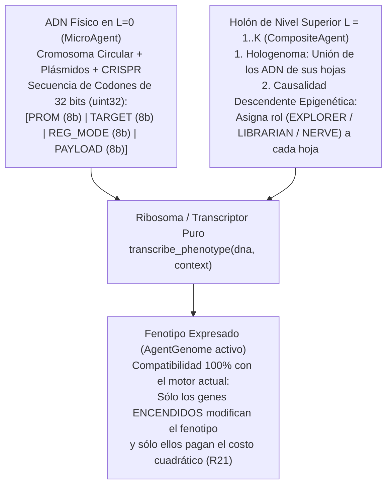

# Arquitectura de ADN Bacteriano Comprimido, Redes Regulatorias (GRN), Epigenética Multinivel y Plásmidos (`CompactDNA` — Fase II-B / v2.5)

> **Propósito de este documento:** Definir la arquitectura formal y técnica del sistema genético comprimido (`CompactDNA`) propuesto para la Fase II-B, evolucionando el vector fenotípico plano actual (`AgentGenome` de 7 parámetros) hacia un código genético bacteriano real basado en **codones de 32 bits (`uint32`), operones condicionales, redes de regulación génica (GRN), diferenciación epigenética en holones ($L = 0 \dots K$), transferencia horizontal de plásmidos (HGT), inmunidad CRISPR-Cas y senescencia telomérica**.

> **Estado y rango (2026-10-20).** Este documento es **visión**, sin rango normativo. La especificación que rige es el cambio OpenSpec [`ide-v25-compact-dna-and-epigenetics`](../../openspec/changes/ide-v25-compact-dna-and-epigenetics/) (design D30–D42), cuyo pre-registro se aprobó el 2026-10-20. Al especificarlo se corrigió esta propuesta en estos puntos:
> - **Canales de factores de transcripción.** Son **64** (promotores `0x80`–`0xBF`), no 128: el canal se codifica en los 6 bits bajos de `REG_MODE`, y 6 bits sólo direccionan 64 canales. `0xC0`–`0xFF` quedan reservados.
> - **Destino `EMIT_TF`.** Es sólo `0x09`. `0x0A`–`0xFF` (incluidos los operadores y órganos de la Fase IV) quedan reservados e **inertes** en v2.5, igual que el modo `AST_PIPE`.
> - **Profundidad de la red regulatoria.** Con dos pasadas hay **un solo nivel** de regulación: los factores emitidos en la segunda pasada no encienden otros genes. No hay cascadas de múltiples etapas.
> - **Contexto epigenético.** `EpigeneticContext` no incluye `is_endospore`, que maneja el motor, ni `z_layer`, que es de la Fase III.
> - **Inventario.** Telómeros y SOS son reglas separadas ($R_{29}$ y $R_{30}$), y el trinquete simbiótico pasa a ser $R_{31}$: una regla, un propósito y una ablación.
> - **"Tapón de Matusalén".** La propuesta lo daba por demostrado sin haberlo medido. El diagnóstico previo (tarea 0.1, 2026-10-20) lo **confirmó**: con abundancia, en el protocolo sin holones el 99 % de los vivos al final nació en la primera mitad de la corrida (punto 4 de §1).
> - **Sesgos.** Se declaran como sesgos de diseño el abaratamiento de la complejidad latente ($R_{24}$), el rescate de poblaciones ($R_{28}$) y la estabilidad por decreto ($R_{31}$). Lo que persigan es programado, no emergente.

---

## 1. Motivación Científica y Empírica (Lecciones de la Fase II)

En la Fase II (`v2.0`), la herencia genética ($R_{13}$) se modela mediante `AgentGenome`: una tupla inmutable de 7 hiperparámetros escalares ($\alpha, \gamma, \epsilon, \omega_{\text{bond}}, C_{\max}, r_{\text{perc}}, r_{\text{com}}$). Si bien este modelo permite cerrar los protocolos pre-registrados `002` y `003`, presenta **cuatro límites biológicos estructurales** que `CompactDNA` resuelve de raíz al cierre de la Fase II:

1. **Ausencia de Compresión y Regulación Génica (Genotipo $=$ Fenotipo en `v2.0`):**
   - En `v2.0`, un agente con $C_{\max} = 6$ paga el costo metabólico cuadrático ($R_{21}$) todo el tiempo, esté suelto ($L=0$) o dentro de un holón ($L \ge 1$).
   - En las bacterias reales, el ADN almacena información altamente comprimida mediante **operones**: secuencias de genes con un *promotor* que permanecen **dormidos (costo metabólico $\approx 0$)** y sólo se transcriben cuando el entorno o el nivel holónico lo requiere.
2. **Diferenciación Celular Lenta en Holones ($L \ge 1$):**
   - En `v2.0`, cuando un holón se reproduce simbióticamente (`reproduce_holon`, $R_{17}$), sus hojas nacen con genomas casi idénticos y dependen de mutaciones aleatorias lentas para especializarse.
   - Con **Operones Epigenéticos**, todas las células de un organismo pluricelular ($L = 2 \dots 5$) pueden portar **exactamente el mismo ADN en $L=0$**, pero expresar instantáneamente castas distintas (*Explorador*, *Bibliotecario*, *Nervio*) según la señal descendente del holón ($R_{18}$ ampliada).
3. **Falta de Evolución Horizontal en Vida (Plásmidos / Conjugación Bacteriana):**
   - Las bacterias reales no esperan a reproducirse ($g \to g+1$) para compartir adaptaciones: intercambian **plásmidos** (anillos cortos de ADN funcional) de par a par en vida.
4. **El "Tapón de Matusalén" en Abundancia de Recursos (Ausencia de Telómeros / Senescencia):**
   - En la calibración de la Fase II, con abundancia (`resources_per_pattern` ≥ 30) la población llega al tope `max_population = 160`, pero casi no llega a la generación 5. **Hipótesis no verificada** ([RESULTADOS.md](../RESULTADOS.md)): con abundancia casi nadie muere y el cupo no se libera. Llegar al tope no lo explica por sí solo, porque también ocurre con 20, donde sí hay recambio, y la mortalidad no se midió. Si el diagnóstico la confirma, los **telómeros** introducirían senescencia programada para forzar la rotación generacional.

---

## 2. Principio de Escala: ¿Tienen ADN los Niveles Superiores ($L \ge 1$)?

Siguiendo el principio libre de escala de [`ESCALA_BIOLOGICA_HOLONICA.md`](ESCALA_BIOLOGICA_HOLONICA.md):

> **El ADN físico (`CompactDNA`) reside única y exclusivamente en las unidades mínimas ($L = 0$, `MicroAgent`). Los niveles superiores ($L = 1 \dots K$, `CompositeAgent`) NO poseen una estructura de ADN separada; su genética emerge del Hologenoma (la unión del ADN de sus hojas) y del Epigenoma (qué operones del ADN de $L=0$ enciende cada nivel superior).**



---

## 3. Especificación Formal del Codón de 32 bits (`uint32` — `4 bytes`)

### ¿Por qué 32 bits por codón en lugar de 16 bits?
1. **Cero sobrecosto en hardware moderno (CPU de 64 bits / GPU CUDA):** En arquitecturas modernas (Ryzen Zen 5 / NVIDIA CUDA), operar con enteros de 32 bits (`uint32`) consume exactamente **1 ciclo de instrucción**, igual que `uint16`, y un cromosoma completo de 32 codones ocupa apenas `128 bytes` en caché L1.
2. **Eliminación del techo evolutivo hacia las Fases III y IV ($2^{32} \approx 4.29 \times 10^9$ combinaciones):** Un codón de 16 bits (`4b | 4b | 8b`) limitaría el universo a sólo 16 promotores y 16 destinos, agotándose apenas se incorporen el eje $Z$ tridimensional (Fase III) y los operadores matemáticos/lógicos y módulos del `SkillSandboxPort` (Fase IV).
3. **Soporte para Redes de Regulación Génica (GRN) y Registros de AST:** Los 32 bits permiten codificar **factores de transcripción internos** (genes que encienden o reprimen a otros genes en cascada) y el direccionamiento de registros (`REG_MODE`) necesario para encadenar algoritmos en la Fase IV sin migrar el formato de checkpoints (`.state` / `.holon.json`).

$$\text{Codon} \in \{0, \dots, 2^{32}-1\} \Longleftrightarrow \underbrace{\text{PROM}}_{8\text{ bits (31..24)}} \;\Big|\; \underbrace{\text{TARGET}}_{8\text{ bits (23..16)}} \;\Big|\; \underbrace{\text{REG\_MODE}}_{8\text{ bits (15..8)}} \;\Big|\; \underbrace{\text{PAYLOAD}}_{8\text{ bits con signo (7..0)}}$$

```text
 31          24 23          16 15           8 7            0
+--------------+--------------+--------------+--------------+
|   PROMOTER   |    TARGET    |   REG_MODE   |   PAYLOAD    |
|   (8 bits)   |   (8 bits)   |   (8 bits)   | (8b signed)  |
+--------------+--------------+--------------+--------------+
```

### 3.1. Campo `PROM` — Promotor Epigenético y Regulatorio (`bits 31..24`, 256 condiciones)

Determina bajo qué condición ambiental, jerárquica o regulatoria interna se transcribe el codón:

| Rango (`8 bits`) | Nombre Simbólico | Condición de Activación ($\mathbb{I}_{\text{prom}}(\text{context}) = 1$) |
| :---: | :--- | :--- |
| `0x00` | `ALWAYS_BASAL` | Activo siempre, en cualquier nivel $L \ge 0$ (metabolismo y aprendizaje basal). |
| `0x01` | `SOLITARY_L0` | Activo **sólo** cuando el agente vive libre ($L = 0$). Se silencia al unirse a un holón. |
| `0x02..0x0A` | `IN_HOLON_L1..L9` | Se enciende cuando la hoja pertenece a un holón de nivel $L \ge k$ ($k \in \{1, \dots, 9\}$, desde Eucariota hasta Noosfera). |
| `0x10` | `ROLE_EXPLORER` | Se enciende cuando el holón asigna a la hoja la casta epigenética **Exploradora** ($r_{\text{perc}} \uparrow$). |
| `0x11` | `ROLE_LIBRARIAN` | Se enciende cuando el holón asigna a la hoja la casta **Bibliotecaria** ($C_{\max} \uparrow$). |
| `0x12` | `ROLE_NERVE` | Se enciende cuando el holón asigna a la hoja la casta **Nervio / Enlace** ($r_{\text{com}} \uparrow$). |
| `0x18` | `STRESS_LOW_ENERGY` | Operón de supervivencia: se enciende en ayuno crítico ($E_i(t) < 0.35 \cdot E_{\text{reprod}}$). |
| `0x19` | `SURPLUS_HIGH_ENERGY` | Operón de abundancia: se enciende cuando $E_i(t) \ge 0.85 \cdot E_{\text{reprod}}$. |
| `0x20..0x3F` | `SPATIAL_3D_STIGMERGY` | Señales estigmérgicas ($R_{19}$) y estratos de profundidad del eje $Z$ en `ToroidalGrid3D` (Fase III). |
| `0x40..0x7F` | `RESERVED_ECOLOGY` | Reservados para señales del Telescopio a Internet y puente simbólico (Fase III-B). |
| `0x80..0xBF` | `TRANSCRIPTION_FACTORS` | **Red regulatoria (64 canales internos `TF_0..TF_63`):** se activan en la segunda pasada sólo si en la primera hubo más activadores que represores de `TF_k` en la misma célula. Un solo nivel de regulación. `0xC0..0xFF` quedan reservados. |

### 3.2. Campo `TARGET` — Rasgo Fenotípico, Factor GRN u Operador Funcional (`bits 23..16`, 256 destinos)

Determina qué parámetro del fenotipo, qué factor de transcripción o qué operador procedimental modula el codón cuando su promotor está activo:

| Rango (`8 bits`) | Destino | Efecto al Expresarse ($\delta = \text{payload} / 128.0 \in [-1.0, +0.992]$) |
| :---: | :--- | :--- |
| `0x00` | `ALPHA_LEARNING` | Modula la tasa de aprendizaje individual: $\alpha = \text{clip}(\alpha_0 + 0.40 \cdot \sum \delta, 0.01, 1.0)$. |
| `0x01` | `GAMMA_DISCOUNT` | Modula el descuento epistémico social: $\gamma = \text{clip}(\gamma_0 + 0.40 \cdot \sum \delta, 0.0, 1.0)$. |
| `0x02` | `EPSILON_EXPLORE` | Modula la curiosidad / exploración: $\epsilon = \text{clip}(\epsilon_0 + 0.35 \cdot \sum \delta, 0.0, 1.0)$. |
| `0x03` | `BOND_AFFINITY` | Modula la propensión simbiótica: $\omega_{\text{bond}} = \text{clip}(\omega_0 + 0.50 \cdot \sum \delta, 0.0, 1.0)$. |
| `0x04` | `MEMORY_CAPACITY` | Modula el tamaño cerebral activo: $C_{\max} = \text{clip}(C_{\max, 0} + \text{round}(3.0 \cdot \sum \delta), 1, C_{\max}^{\text{tope}})$. |
| `0x05` | `PERCEPTION_RADIUS` | Modula el radio sensorial: $r_{\text{perc}} = \text{clip}(r_{\text{perc}, 0} + \text{round}(2.0 \cdot \sum \delta), 1, 4)$. |
| `0x06` | `COMM_RADIUS` | Modula el radio comunicativo: $r_{\text{com}} = \text{clip}(r_{\text{com}, 0} + \text{round}(2.0 \cdot \sum \delta), 1, 4)$. |
| `0x07` | `TELOMERE_LONGEVITY` | Modula la vida máxima antes de senescencia: $T_{\max} = \text{clip}(T_0 + \text{round}(250 \cdot \sum \delta), 150, 1200)$. |
| `0x08` | `SPORULATION_THRESH` | Ajusta el umbral energético $E_{\text{espora}}$ para entrar en criptobiosis (`ENDOSPORE`). |
| `0x09` | `EMIT_TF_SIGNAL` | Emite el factor de transcripción `TF_k` (canal `k` en los 6 bits bajos de `REG_MODE`); el modo represor lo reprime. `0x0A..0x1F` quedan reservados. |
| `0x20..0x7F` | `LOGIC_MATH_OPS` | **Fase IV (96 operadores):** Operadores formales (`ADD`, `SUB`, `MUL`, `DIV`, `EMA`, `DIFF`, `GT`, `EQ`, `AND`, `OR`, `XOR`, `MATCH`) para el AST del holón. |
| `0x80..0xFF` | `SANDBOX_ORGANS` | **Fase IV (128 slots):** Invocación de módulos y órganos funcionales evolucionados en `SkillSandboxPort`. |

### 3.3. Campo `REG_MODE` — Modo Epigenético y Direccionamiento de Registros (`bits 15..8`)

- **`bits 15..14` (`MODE`, 2 bits):**
  - `00` (`ADDITIVE`): Suma $\delta$ al acumulador del `TARGET` (comportamiento estándar poligénico).
  - `01` (`REPRESSOR`): Actúa como **represor génico**: si este codón se enciende, silencia o amortigua en un factor $(1 - |\delta|)$ la expresión de otros codones posteriores que apunten al mismo `TARGET`.
  - `10` (`MULTIPLICATIVE`): Escala el rasgo basal multiplicativamente por $(1 + \delta)$.
  - `11` (`AST_PIPE`): En Fase IV, conecta el operador `TARGET` dentro del grafo de flujo de datos del holón.
- **`bits 13..10` (`SRC_REG`, 4 bits `R0..R15`) y `bits 9..8` (`DST_REG`, 2 bits `R0..R3`):**
  - Direccionan qué registros de entrada lee un operador de Fase IV (`0x20..0xFF`) y en qué registro deposita su salida, o qué canal de factor de transcripción (`TF`) emite cuando `TARGET` es `EMIT_TF_SIGNAL`.

---

## 4. Contratos de Dominio (`CompactDNA` y `EpigeneticContext`)

El diseño se integra como un **adaptador generativo puro** por encima de `AgentGenome`, preservando intactas todas las firmas de Fase I y Fase II:

```python
class EpigeneticRole(Enum):
    NONE = "NONE"
    EXPLORER = "EXPLORER"      # Casta sensorial / periférica
    LIBRARIAN = "LIBRARIAN"    # Casta de almacenamiento profundo (C_max alto)
    NERVE = "NERVE"            # Casta de ruteo comunicativo (r_com alto)


@dataclass(frozen=True)
class EpigeneticContext:
    """Contexto celular e intra-holón que gobierna qué promotores se encienden."""
    holon_level: int = 0
    role: EpigeneticRole = EpigeneticRole.NONE
    energy_ratio: float = 1.0       # E_i(t) / E_reprod
    is_endospore: bool = False      # Criptobiosis / dormancia ante escasez extrema
    z_layer: int = 0                # Capa espacial en 3D (0 en grilla 2D de Fase II)


@dataclass(frozen=True)
class CompactDNA:
    """Genotipo bacteriano comprimido en L=0 con codones de 32 bits (Fase II-B / v2.5)."""
    chromosome: tuple[int, ...]         # Tupla de codones uint32 (Herencia Vertical Madre -> Hija)
    plasmids: tuple[int, ...] = ()      # Anillos cortos (0..4 codones uint32) para HGT horizontal
    crispr_memory: tuple[int, ...] = () # Firmas uint32 de plásmidos tóxicos rechazados (Inmunidad)
```

---

## 5. Dinámica Genética, Inmunológica y Epigenética en el Motor

### 5.1. Transcripción en 2 Pasadas (GRN) y Costo Metabólico Diferencial ($R_{21}$ Expresada)
- **Transcripción en 2 pasadas (`transcribe_phenotype`):**
  1. *Pasada 1 (Sensado y Factores de Transcripción):* Evalúa los promotores ambientales y de nivel/rol (`0x00..0x7F`), recolectando los factores de transcripción internos `TF` emitidos por codones con `TARGET = EMIT_TF_SIGNAL`.
  2. *Pasada 2 (Expresión Fenotípica y Represión):* Activa los codones cuyos promotores `0x80..0xFF` coincidan con los `TF` encendidos, aplica los represores (`MODE = 01`) y sintetiza el `AgentGenome` resultante.
- **Costo Metabólico Diferencial:** El agente paga un costo basal minúsculo por replicar/mantener la hebra física de ADN más el costo cuadrático **únicamente del fenotipo expresado en ese tick**:
  $$c_{\text{total}}(i, t) = c_{\text{dna}} \cdot \left(|\text{chromosome}_i| + |\text{plasmids}_i| + |\text{crispr}_i|\right) + c_{\text{base}}\!\left(\text{transcribe}(\text{DNA}_i, \text{context}_i)\right)$$
  donde $c_{\text{dna}} \ll c_{\text{mem}}$. Así, portar genes para niveles superiores ($L \ge 2$) o para operadores de Fase IV es casi gratis en $L=0$, eliminando la presión selectiva contra la complejidad latente.

### 5.2. Diferenciación Epigenética Intra-Holón (`assign_epigenetic_roles`) y Herencia Mitótica
- **Asignación Descendente:** Cuando un `CompositeAgent` ($L \ge 1$) agrupa hojas, ejecuta una regla determinista de asignación de roles basada en la topología y el estado de memoria de sus hojas:
  1. La hoja con mayor número de patrones únicos de alta confianza recibe `EpigeneticRole.LIBRARIAN` (enciende sus codones `0x11`, expandiendo $C_{\max}$).
  2. La hoja con mayor conectividad espacial hacia el exterior recibe `EpigeneticRole.EXPLORER` (enciende sus codones `0x10`, expandiendo $r_{\text{perc}}$ y reduciendo su gasto en $C_{\max}$).
  3. Las hojas puente reciben `EpigeneticRole.NERVE` (encienden sus codones `0x12`, expandiendo $r_{\text{com}}$).
- **Memoria Epigenética Mitótica (Impronta Madre $\to$ Hija):** Cuando una hoja especializada se divide dentro de un holón, la hija nace heredando por defecto la marca epigenética (`role`) de su madre, evitando perder ticks de especialización hasta que el nivel superior ($R_{18}$) requiera reprogramarla.

### 5.3. Los 4 Operadores Evolutivos sobre `CompactDNA` (usando `evo_rng`)
1. **Mutación de Punto (SNP sobre 32 bits):** Con probabilidad $\mu_{\text{snp}}$, invierte o desplaza bits en un codón `uint32` del cromosoma (puede mutar `PAYLOAD`, `REG_MODE`, `TARGET` o `PROM`).
2. **Duplicación Génica (*Gene Duplication*):** Con probabilidad $\mu_{\text{dup}}$ (si $|\text{chromosome}| < L_{\max}$), duplica un codón existente. Una copia mantiene la función original mientras la otra queda libre para mutar su promotor o destino (**neofuncionalización**).
3. **Deleción (Compactación Genómica):** Con probabilidad $\mu_{\text{del}}$ (si $|\text{chromosome}| > L_{\min}$), elimina un codón, premiando genomas compactos y eficientes.
4. **Conjugación Bacteriana de Plásmidos (HGT Horizontal en Vida):**
   - Cuando dos agentes co-localizados (o miembros del mismo holón) interactúan y el donante supera un umbral de éxito energético, copia su plásmido `uint32` más activo al receptor sin necesidad de esperar a la reproducción vertical.

### 5.4. Inmunidad Genética tipo CRISPR-Cas (Defensa contra Plásmidos Parásitos)
- Al recibir un plásmido nuevo por HGT, el agente registra su nivel de energía inicial $E_{\text{ingreso}}$ y abre una ventana de prueba de $K_{\text{eval}}$ ticks:
  - Si el codón ya figura en `crispr_memory`, el agente **bloquea su ingreso** de inmediato.
  - Si tras $K_{\text{eval}}$ ticks el balance energético $\Delta E = E_i(t) - E_{\text{ingreso}} < -\theta_{\text{tox}}$, la enzima Cas digital **escinde y destruye el plásmido** de `plasmids` e inserta su firma `uint32` en `crispr_memory` (hasta un tope FIFO de 4 espaciadores), transmitiendo además esa inmunidad a su descendencia vertical.

### 5.5. Esporulación Bacteriana / Criptobiosis (`ENDOSPORE` ante Escasez Extrema)
- Solución biológica al cuello de botella de extinción en desiertos ecológicos (`resources_per_pattern <= 10`):
  - Cuando $E_i(t) \le E_{\text{espora}}$ y el agente no percibe ningún recurso benéfico ni rastro estigmérgico positivo en su vecindad, el operón `STRESS_LOW_ENERGY` (`0x18`) activa el estado **Endospora** (`is_endospore = True`).
  - **Física de la Endospora:** El agente permanece inmóvil (`IDLE`), silencia la expresión de sus radios y memoria activa, y reduce su gasto metabólico total al mínimo de supervivencia ($c_{\text{espora}} = 0.05 \cdot c_{\text{fijo}}$).
  - **Germinación:** Apenas reaparece un recurso en su celda o se deposita un rastro estigmérgico positivo ($R_{19}$), la endospora germina (`is_endospore = False`) y restaura su transcripción normal.

### 5.6. Respuesta SOS: Tasa de Mutación Adaptativa regulada por Estrés
- En lugar de una tasa de mutación ciega y constante, la fidelidad de copia de `CompactDNA` depende del estado metabólico del progenitor:
  $$\mu_{\text{efectiva}}(i) = \begin{cases} 0.25 \cdot \mu_{\text{base}} & \text{si } E_i(t) \ge E_{\text{reprod}} \text{ y superávit reciente (Reparación de Alta Fidelidad)} \\ 4.00 \cdot \mu_{\text{base}} & \text{si estrés energético o shock ambiental (Hipermutación SOS)} \\ \mu_{\text{base}} & \text{en régimen normal} \end{cases}$$
- Preserva los genomas campeones en estabilidad y acelera $16\times$ la exploración evolutiva frente a crisis o inversiones de reglas del mundo (`Exp 005`).

### 5.7. Telómeros y Senescencia Celular (Solución al "Tapón de Matusalén")
- Cada `MicroAgent` lleva un contador `age_ticks: int`.
- Al superar la longevidad expresada por sus codones teloméricos ($T_{\max}$), el agente entra en **senescencia**: su costo metabólico basal se incrementa progresivamente ($\Delta c_{\text{senescencia}} \propto (\text{age\_ticks} - T_{\max})^2$) hasta agotar su energía y morir.
- **Efecto ecológico:** Incluso en entornos de altísima abundancia (`resources_per_pattern = 40` u `80`), ninguna generación puede monopolizar eternamente el cupo `max_population`, garantizando evolución continua ($g \to \infty$).

### 5.8. Trinquete Simbiótico Evolutivo (*Symbiotic Ratchet*): De Alianza Reversible a Organismo Indisoluble
- En la naturaleza existen dos regímenes de asociación jerárquica (Maynard Smith & Szathmáry):
  1. **Alianza Facultativa (Holón Joven / Reversible):** Un `CompositeAgent` recién formado por `BOND` (`formed_by_bond = True`, generación simbiótica $0$) es una alianza de prueba: si no genera superávit en `holon_split_patience` ticks, se disuelve un escalón ($L \to L-1$) mediante `SPLIT` ($R_{16}$).
  2. **Organismo Consolidado (Trinquete Simbiótico / Irreversible, `is_locked = True`):** Cuando un holón supera un umbral de consolidación evolutiva —por haberse reproducido como unidad simbiótica (`reproduce_holon`, $R_{17}$) o haber completado $K_{\text{lock}}$ tareas compuestas con diferenciación epigenética activa ($R_{25}$)— sus enlaces internos quedan **soldados (`is_locked = True`)**.
- **Efecto arquitectónico:** Un nodo con `is_locked = True` ya **no se desarma por `SPLIT`** (sus hojas cedieron autonomía para especializarse como órganos del conjunto) y recibe un descuento de madurez en su costo de coordinación ($\eta_{\text{lock}} \cdot c_{\text{coord}}$), convirtiéndose en un ladrillo estable e indivisible sobre el cual el motor puede ensamblar el nivel jerárquico siguiente ($L+1$).

---

## 6. Inventario de Reglas de Diseño (`R24`–`R31`) y Ablaciones (Cumplimiento de `CLAUDE.md`)

Siguiendo la regla metodológica central del proyecto (*toda capacidad diseñada debe declararse en el inventario con su propósito y su ablación explícita*):

| Regla | `name` | `purpose` (capacidad que se diseñó para producir) | `ablation` |
| :--- | :--- | :--- | :--- |
| `R24` | Codificación genética en codones de 32 bits, operones y GRN (`CompactDNA`) | Comprimir rasgos y circuitos regulatorios en secuencias `uint32` con promotores condicionales y pagar costo $R_{21}$ sólo por los genes expresados. | `(("enable_compact_dna", False),)`: revierte al `AgentGenome` plano de Fase II. |
| `R25` | Diferenciación epigenética intra-holón e impronta mitótica | Especializar hojas con el mismo ADN en castas (`EXPLORER`, `LIBRARIAN`, `NERVE`) según su rol en el holón. | `(("enable_epigenetic_roles", False),)`: todas las hojas mantienen `EpigeneticRole.NONE`. |
| `R26` | Transferencia horizontal de plásmidos (HGT) | Compartir codones `uint32` ventajosos en vida entre pares sin esperar a la reproducción vertical. | `(("enable_plasmid_hgt", False),)` |
| `R27` | Inmunidad genética CRISPR-Cas | Purgar plásmidos con balance energético negativo y bloquear su reinfección. | `(("enable_crispr_immunity", False),)` |
| `R28` | Esporulación bacteriana (`ENDOSPORE`) | Reducir el gasto metabólico en hambruna extrema hasta que reaparezcan estímulos locales. | `(("enable_sporulation", False),)` |
| `R29` | Senescencia telomérica | Garantizar recambio generacional limitando la vida. | `(("enable_telomere_senescence", False),)` |
| `R30` | Mutación SOS adaptativa | Modular la tasa de mutación según el estrés. | `(("enable_sos_mutation", False),)` |
| `R31` | Trinquete simbiótico evolutivo (*Symbiotic Ratchet*) | Soldar (`is_locked = True`) los holones consolidados por reproducción simbiótica o especialización para que actúen como individuos indivisibles del nivel siguiente. | `(("enable_symbiotic_ratchet", False),)` |

---

## 7. Plan de Ejecución

1. **Fase II cerrada y archivada** (2026-10-20): `openspec/changes/archive/2026-10-20-ide-v2-evolutionary-holonic-intelligence/`, con resultados en [RESULTADOS.md](../RESULTADOS.md).
2. **Fase II-B especificada** en el cambio OpenSpec `ide-v25-compact-dna-and-epigenetics`:
   - **Ubicación.** `CompactDNA`, la transcripción, la mutación, los plásmidos y CRISPR viven en `src/ide/agent/dna.py`; los roles y el trinquete, en `holon.py`; la expresión en vida, la esporulación, la senescencia y SOS, en el motor.
   - **Retrocompatibilidad.** Con `enable_compact_dna=False` y las demás banderas en `False` (por defecto), el motor se comporta exactamente como en la Fase II.
   - **Protocolos.** `002c` (genoma regulado frente a plano), `002d` (senescencia con abundancia), `002e` (esporulación con escasez) y `003c` (roles en holones), con las afirmaciones C9–C12 propuestas como programadas por construcción.
   - **Orden de implementación.** Primero se aprueba el pre-registro (bloque 0 del `tasks.md`); después se implementa por etapas, empezando por $R_{24}$ sola.
